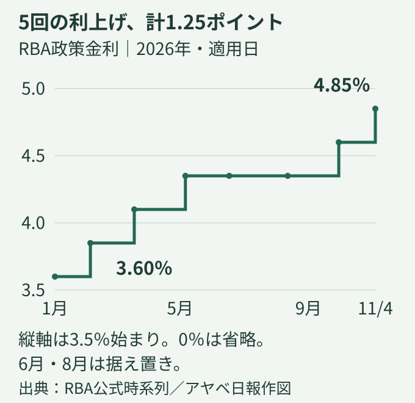
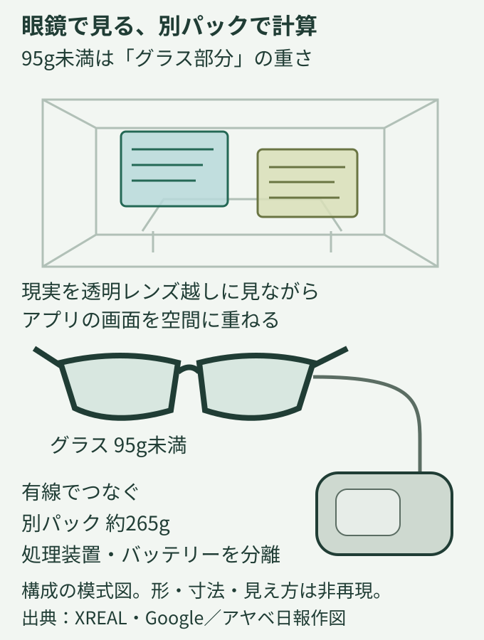

# アヤベ日報　2026年11月4日（水）

本紙 · 22記事 · 図解2点　情報確認 2026-11-04 07:48 JST

## 今朝の読みどころ

- 大阪市の行政手続きにも波及 メール委託先で情報流出の恐れ
- ホルムズ、攻撃と仲介並行 原油は約4週ぶり安値
- 豪州、政策金利4.85％へ 物価と雇用の板挟み

## 01　大阪市の行政手続きにも波及 メール委託先で情報流出の恐れ

国内・大阪／社会 · 深掘り

大阪市は3日、行政オンラインシステムの利用者のメールアドレスや氏名などが漏えいした可能性があると公表した。システムを提供するTKCが使っているアララのメール配信サービスへの不正アクセスが原因で、TKCから市への報告は2日。市のシステム本体やTKCのデータセンターへの不正アクセスは確認されておらず、市民の情報が実際に流出したか、対象が何件かは調査中だ。

すでに利用面への影響が出ている。外部サービスの緊急メンテナンスにより、10月31日午後5時40分ごろからメールを送れず、新規利用者登録、メールアドレス変更、パスワード再設定ができない。メール送信以外の機能は利用できるが、復旧時期は未定。ABCの報道によると、この仕組みは住民票の写しの請求や水道の使用開始・中止などに使われている。

事案全体では、アララが2日の第2報で調査範囲の拡大を説明した。契約企業向け97台のサーバー、最大約380社に関わり、持ち出された、またはその恐れがあるメールアドレスは約7700万件。これは大阪市の人数でも、7700万人の被害を意味する数字でもない。別に示された共用環境の件数とは重複する可能性があり、単純には足せない。3日にはスーパーのベルクも、自社関係のメールアドレス78万6739件と氏名2352件の流出を確認したと発表した。

アララは配信サービスからカード会社を装う不審メールが最大約713万通送られたとも説明している。これも流出件数とは別の数字で、送信先は攻撃者が外部から持ち込んだアドレスという。市は不審なメールのリンクや添付ファイルを開かず、ID、暗証番号、カード情報などを入力しないよう呼びかける。

今回確認できるのは、自治体の本体システムへの侵入が見つからなくても、外部の配信基盤の障害が住民の手続きを妨げるという構図だ。今後は市ごとの流出有無、対象範囲、復旧案内を分けて確認する必要がある。市が利用者に特定の対応を求める場合は、公式ホームページとシステム内のお知らせで案内するとしている。

**出典**

- [出典：大阪市・情報漏えいの可能性について（第1報）](<https://www.city.osaka.lg.jp/hodoshiryo/ictsenryakushitsu/0000690714.html>)
- [出典：アララ・情報流出およびサービス停止について（第2報）](<https://www.arara.com/dcms_media/other/arara_20261102__.pdf>)
- [出典：ABCニュース・大阪市の行政オンラインシステムで個人情報漏えいか](<https://www.asahi.co.jp/webnews/pages/abc_63395.html>)
- [出典：ベルク・11月3日追記 調査結果](<https://www.belc.jp/news/20261029>)

## 02　ホルムズ、攻撃と仲介並行 原油は約4週ぶり安値

国際・経済 · 深掘り

米国とイランの対立を巡り、軍事行動と停戦に向けた仲介が並行している。AP通信によると、米当局者は米中間選挙直前にホルムズ海峡周辺のイラン側を攻撃したことを認めた。イラン国営メディアはゲシュム島などで爆発を報じた。一方、仲介役のカタールは3日、双方が提案の検討を続けていると説明した。交渉継続と合意成立は別であり、海峡の安全が回復したと判断できる段階にはない。

カタール国営通信が伝えた外務省の定例会見によると、代表団は2日にテヘランで約3時間協議し、同日夜に帰国した。アンサリ報道官は、米国とイランが仲介案を検討し、当事者間の連絡が続いていると説明。その一方で、具体的な突破口が開けたとは現時点で言えないとの認識を示した。カタールは自国のガス運搬船への攻撃も非難し、海峡と湾岸の航行の自由を脅かす行為は交渉にも影響すると警告した。

市場では外交への期待が原油価格を押し下げた。ロイターによると、3日の北海ブレント先物清算値は前日比1.17ドル安の1バレル103.60ドルで、10月7日以来の安値。米WTIは0.37ドル安の96.09ドルとなり、10月14日以来の低水準だった。イランだけでなくウクライナを巡る和平協議の動きも材料となったが、攻撃による供給混乱への懸念は残る。

供給側は長期化にも備える。サウジアラムコは3日の決算発表で、東西パイプラインが輸出の柔軟性を支えているとし、海外の貯蔵能力や代替輸出経路を引き続き検討すると説明した。原油先物が下がる局面でも、物流の安全や実際の積み出し能力が直ちに元に戻るわけではない。今後は停戦案の文言に加え、船舶の通航、港湾封鎖、保険や輸送の実務が正常化するかを見極める必要がある。

**出典**

- [AP：海峡周辺の攻撃](<https://apnews.com/article/iran-us-strikes-strait-hormuz-183b3d32d9bf5241f744abb917e6713e>)
- [カタール国営通信：外務省定例会見](<https://qna.org.qa/en/news/news-details?id=advisor-to-prime-minister-official-spokesperson-for-ministry-of-foreign-affairs-qatar-continues-its-efforts-to-bridge-gap-between-washington-tehran&date=3/11/2026>)
- [ロイター：原油清算値](<https://www.gaitameonline.com/reuters/outdir/20261103nRTROPT20261103212713KCN3WE2N2.html>)
- [アラムコ：7〜9月期決算](<https://www.aramco.com/en/news-media/news/2026/aramco-announces-third-quarter-2026-results>)

## 03　豪州、政策金利4.85％へ 物価と雇用の板挟み

国際・経済 · 深掘り

オーストラリア準備銀行（RBA）は3日、政策金利を0.25ポイント引き上げ、4.85％とすることを決めた。ロイターによると今年5回目の利上げで、金利水準は18年ぶりの高さに達する。ただし、9人の政策委員のうち賛成は6人、3人は据え置きを支持した。物価の抑制がなお必要とする判断の一方で、住宅市場や雇用への負担を懸念する声も強まっている。

声明が問題視したのは、原油高だけでは説明できない物価上昇の広がりだ。中東紛争による燃料・商品価格の上昇に加え、国内の供給余力が従来の想定より乏しく、企業がコスト増を販売価格へ転嫁する動きが続く。AI関連投資に伴う技術関連商品の値上がりも指摘した。物価上昇率が目標の2〜3％の上限に戻る時期は2027年後半とし、従来見通しから約3四半期遅れる。

一方、金融引き締めの効果は景気に表れ始めている。RBAは消費の減速、住宅価格の下落、失業率の上昇を認めた。11月の金融政策報告では、利上げが今後の支出をさらに抑え、物価を下げるとする一方、雇用者数は増えても失業率が上がるとの見通しを示した。物価目標の中心に戻るのは2028年半ばと予測しており、正常化にはなお時間を見込む。

利上げにもかかわらず、為替市場では豪ドルが下落した。ロイターが3日14時21分（日本時間）に更新した報道では対米ドルで0.3％安の0.6977米ドル。利上げ自体より、投票が割れたことや、声明から必要に応じてさらに金利を上げるとの従来の表現が外れたことが意識された。ブロック総裁も次の金利変更の方向は明確でないと述べている。

今回の判断は、物価だけを見れば引き締めが必要でも、景気だけを見れば慎重さが求められる状況を映す。追加利上げの終了を決めたわけではない。これまでの利上げが家計・企業に波及する速度と、燃料高がその他の価格へ広がる程度が、次の政策判断を左右する。

RBA政策金利は2026年初の3.60％から、11月4日適用の4.85％へ。0.25ポイントの利上げが5回で計1.25ポイント。6月と8月は据え置き。日付は適用日、縦軸は3.5％始まり。RBA公式時系列に基づくアヤベ日報の自作図。

**出典**

- [RBA：政策決定声明](<https://www.rba.gov.au/media-releases/2026/mr-26-30.html>)
- [RBA：金融政策報告概要](<https://www.rba.gov.au/publications/smp/2026/nov/>)
- [ロイター配信：決定と市場反応](<https://www.aol.com/articles/australias-central-bank-lifts-rates-033706000.html>)
- [RBA：政策金利の公式時系列（図のデータ）](<https://www.rba.gov.au/statistics/cash-rate/>)

## 04　憲法公布80年 改正への議席と、合意形成の距離

国内／政治 · 深掘り

日本国憲法は3日、1946年の公布から80年を迎えた。施行日は翌1947年5月3日で、両日は同じではない。国民主権、基本的人権の尊重、平和主義を柱とする憲法の条文は、これまで改正されていない。3日は各地で憲法を考える催しが開かれ、国会前の護憲派集会には約1万4000人が参加したと主催者が発表した。共同通信によると、玉城デニー前沖縄県知事らが平和主義の維持を訴えた。

一方、政治の側では改正への条件が変わっている。3日の時事通信の分析によれば、自民党と日本維新の会は2月の衆院選で3分の2を大きく超える議席を獲得した。昨年、公明党が連立を離れ、維新が政権に加わったことで、与党は条文起草協議会を設け、改憲原案づくりを進めている。高市首相は4月の党大会で、次の党大会までに国会発議への見通しを立てる意向を示した。

ただし、議席が多いことと、一つの改正案がまとまることは別だ。時事は、何を優先するかや条文の内容をめぐって自民・維新の隔たりがあり、自民の衆院側と参院側も足並みがそろっていないと報じる。自民内には2028年参院選後の発議を現実的とみる声もあるという。これは決定済みの日程ではなく、党内の見方として読む必要がある。

制度上も、衆院の議席だけで改正はできない。憲法96条は、衆参それぞれの総議員の3分の2以上の賛成による国会の発議に加え、国民の承認を必要としている。つまり、与党間で条文を固める段階、両院で発議の賛成を集める段階、国民投票で判断を求める段階には、それぞれ異なる課題がある。改憲を掲げることへの支持と、個々の条文への賛否も同一とは限らない。

80年の節目を読むうえでは、改憲派か護憲派かという大きな区分だけでなく、具体的にどの権限や権利をどう変える案なのか、現在の制度で対処できない問題は何かを見極めたい。集会の人数も選挙の議席も政治を知る材料だが、それだけで全国民の条文ごとの意思が確定するわけではない。次の焦点は、発議の目標時期よりも、比較検討できる具体的な案と説明が示されるかにある。

**出典**

- [出典：時事通信・公布80年、分水嶺の憲法](<https://www.nippon.com/ja/articles/-/56809>)
- [出典：共同通信・進む改正議論、護憲派が抗議の声](<https://news.livedoor.com/article/detail/32722687/>)
- [出典：衆議院・日本国憲法](<https://www.shugiin.go.jp/internet/itdb_annai.nsf/html/statics/shiryo/dl-constitution.htm>)
- [出典：国立公文書館・日本国憲法の公布](<https://www.archives.go.jp/exhibition/digital/saiken/shousai/1_15_16.html?num=15>)

## 05　AI開発競争、社内の守りも試される

テクノロジー・検証 · 深掘り

ロイター通信は3日、OpenAIの社員らがChatGPT公開前から社内の情報管理に懸念を伝えていたと報じた。事情を知る5人への取材では、業務に直接関係しないプロジェクトの技術情報にも広くアクセスできることなどが問題視されていたという。AIの能力だけでなく、その開発情報を誰にどこまで見せるのかが、企業の競争力と安全保障にかかわる課題になっている。

同社は、機密性の高い研究は厳しいアクセス管理を設けた別の保管場所に置いており、共通のコード保管庫にモデルの重み（学習で決まる内部の数値）など全ての重要情報が含まれるわけではないと説明。社内ツールのセキュリティー審査も現在は定期的に行っているとしている。報道された社員側の評価と会社の反論は、分けて読む必要がある。

前日の2日、OpenAIは外部のCathedral Systemsと次の社内セキュリティー点検を準備すると発表した。自社のAIも使って弱点を探し、修正を検証する。前回は製品開発エンジニアの25％を投入し、Codexが問題の調査、隔離環境での再現、レビュー用の修正案づくりを支援したという。新しい取り組みの開始日や対象システム、改善効果の数値は示していない。

脆弱性の報告報奨金も拡充する。ChatGPT、Codex、API基盤などの重大な欠陥は通常の上限が3万ドル。例外的に重要な報告は10万ドル、追加報奨を含め最大17万2000ドルになり得る。最高額が全ての報告に支払われる制度ではない。

開発の速度を上げるAIは、攻撃側の情報探索にも使われ得る。これは防御を考える際のリスクであり、今回の報道でAIによる侵入の原因が立証されたわけではない。外部の目を入れる方針は確認できるが、防御が十分になったことまで証明されたわけではない。今後は点検を実施した事実だけでなく、発見と修正の実績、機密情報へのアクセスをどこまで絞れるかが焦点となる。

**出典**

- [Reuters／WSAU転載：OpenAI employees warned about operational security lapses for years, sources say](<https://wsau.com/2026/11/03/openai-employees-warned-about-operational-security-lapses-for-years-sources-say/>)
- [OpenAI：Preparing our next security sprint to harden OpenAI](<https://openai.com/index/preparing-our-next-security-sprint-to-harden-openai/>)
- [OpenAI：Rewarding defenders with bigger bug bounties](<https://openai.com/index/rewarding-defenders-with-bigger-bug-bounties/>)

## 06　100億回に1度の崩壊、兆候つかむ

科学 · 深掘り

欧州合同原子核研究機関（CERN）のLHCb実験チームは3日、極めてまれな粒子の崩壊を示す証拠を得たと発表した。対象は、ボトム（ビューティー）クォークを含む中性のB中間子（Bd）が、電子に似て重い粒子ミューオンとその反粒子の対になる過程。現在の理論では、このB中間子の崩壊のおよそ100億回に1回しか起きないと見積もられている。

ただし、今回の「証拠」は発見の確定とは異なる。2024〜25年のデータだけでは統計的な有意性は3.0シグマ（偶然の揺らぎでは説明しにくい度合いを示す尺度）。2011〜18年の記録を合わせると3.2シグマとなり、証拠の目安とされる3シグマを上回った。素粒子物理で発見を主張する際の基準は5シグマで、そこには届いていない。ケンブリッジ大学によると、結果はまだ査読前である。

なぜ、既存の理論が予測する現象を探すのか。粒子が崩壊する確率には、直接作り出して観測するのが難しい未知の粒子も、量子的な効果を通じて影響し得る。まれな過程の頻度を精密に測れば、加速器の直接観測範囲を超えて新しい物理を探る手がかりになる。今回の結果は標準模型の予測と整合しており、暗黒物質や未知の粒子を見つけたという意味ではない。

前進を支えたのは装置と解析の改良だ。改修後のLHCbは、以前の最大5倍の速さでデータを集められるようになった。粒子の種類を見分ける能力を高め、機械学習も使って大量の別の反応からわずかな信号を選り分けた。英オックスフォード大学は、粒子の飛跡を追う検出器などへの貢献を説明している。

この崩壊は2015年にも複数実験の合同解析で兆候が報告されたが、その後のデータでは裏付けられなかった。今回は単一実験で証拠の水準に達した点が新しい。研究チームはさらにデータを積み増し、まず崩壊自体の確認を目指す。その先にあるのが、発生頻度の小さなずれから、標準模型では説明できない世界を探る作業だ。

今回の科学的説明は参加研究機関の発表に基づくもので、独立した研究者の詳細な評価はまだ確認できていない。

**出典**

- [CERN：LHCb finds evidence of one-in-ten-billion particle decay](<https://home.cern/lhcb-finds-evidence-of-one-in-ten-billion-particle-decay/>)
- [University of Cambridge：Physicists knock at the door of the zeptoverse](<https://www.cam.ac.uk/research/news/physicists-knock-at-the-door-of-the-zeptoverse>)
- [University of Oxford：Evidence of rarest particle decay after 42-year search](<https://www.physics.ox.ac.uk/news/evidence-rarest-particle-decay-after-42-year-search>)
- [Phys.org（University of Manchester提供）：Physicists step closer to the Zeptoverse after 42-year particle search](<https://phys.org/news/2026-11-physicists-closer-zeptoverse-year-particle.html>)

## 07　米中間選挙、投票続く 物価高とイラン戦争が争点

国際

米国で3日、中間選挙の投票が始まった。下院全435議席と上院100議席中35議席が改選対象で、今後2年間の議会の多数派を争う。トランプ大統領の2期目への審判となり、物価高や対イラン戦争、それに伴う燃料費の負担が争点となっている。

日本時間4日午前7時45分現在、投票が続いており、両院の多数派は未確定。AP通信によると、インディアナ、ケンタッキー両州の大部分では同8時に投票が終わる予定だ。接戦や郵便投票の集計によって、大勢判明が翌日以降になる可能性もある。2022年は、APが上院の多数派を判定するまで投票日から4日、下院は8日を要した。

**出典**

- [Reuters／外為オンライン公開配信：米中間選挙投票始まる、トランプ政権に審判 下院は民主優勢も上院なお不透明](<https://www.gaitameonline.com/reuters/outdir/20261103nRTROPT20261103163618KCN3WE26Q.html>)
- [USPS Postal Bulletin：Key Elections](<https://about.usps.com/postal-bulletin/2026/pb22694/html/cover_004.htm>)
- [USAGov：Congressional elections and midterm elections](<https://www.usa.gov/midterm-elections>)
- [AP：Midterm elections are coming to a close as voters pass judgment on Trump’s second term](<https://apnews.com/article/midterm-election-house-senate-democrats-republicans-trump-f126e12e05b579a327b98481c0ae2226>)
- [AP：Election night agenda: When polls close and when to expect results](<https://apnews.com/article/election-rundown-polls-close-results-timing-0e2078f16af285b22675445d78360e6d>)
- [AP：When will we know who controls Congress? It could be a while](<https://apnews.com/article/when-ap-calls-congress-control-9dae62cdd7d776a20a26eab6fbd9b12c>)

## 08　米求人752万件 増加も採用の勢い見極め

国際・経済

米労働統計局（BLS）が3日発表した9月の求人・離職動向調査（JOLTS）によると、月末の求人数は季節調整済みで752万3000件となり、改定後の8月から33万3000件増えた。求人率は4.3％から4.5％へ上昇した。採用は約540万件、自己都合の離職は約340万件、解雇などは約160万件だった。

数値上は求人が増えたが、BLSは統計上の変動評価として全体の求人と採用を「大きな変化なし」と整理している。求人は月末時点の未充足の職であり、その月に実際に雇われた人数とは異なる。需要の底堅さを示す材料である一方、これだけで雇用全体の急回復と判断するのは早い。9月分は速報値で、翌月以降に改定される。

**出典**

- [BLS：JOLTS本文](<https://www.bls.gov/news.release/jolts.nr0.htm>)
- [BLS：求人統計表1](<https://www.bls.gov/news.release/jolts.t01.htm>)

## 09　和平協議前に電力網攻撃 ウクライナで広域停電

国際・経済

ロシアは3日、ウクライナの発電所や変電所に大規模な波状攻撃を加え、各地で停電が発生した。ロイターによると、ゼレンスキー大統領はドローン289機、弾道ミサイル17発、巡航ミサイル59発が使われたと説明した。南部オデーサから西部リウネまで電力設備が攻撃されたという。兵器の数はウクライナ側の発表に基づく。

攻撃は米国仲介の和平協議再開を控えた時期に起きた。冬を前に電力供給への打撃が続く中、交渉日程の合意が直ちに攻撃の停止につながっていない。協議が開かれることと停戦条件がまとまることを分けて見る必要がある。

**出典**

- [ロイター：電力網攻撃](<https://www.gaitameonline.com/reuters/outdir/20261103nRTROPT20261103145635KCN3WE1YA.html>)

## 10　中国、外貨準備率6％へ 市場は元高抑制と解釈

国際・経済

中国人民銀行は3日、金融機関が外貨預金に対して積む準備の比率を、15日から4％から6％へ引き上げると発表した。引き上げ幅は2ポイント。公式発表は、金融機関の外貨流動性管理を強めるためと説明している。

ロイター時事によると、人民元は10月に対ドルで0.74％上昇し、年初来の上昇率は約5％に達した。上海保銀投資管理の張智威氏は、人民銀行が急速な元高への懸念を示したと分析している。ただし、為替相場を誘導する狙いは報道や市場関係者の解釈であり、人民銀行の短い声明が明示した理由ではない。

今回の対象は外貨預金の準備率で、人民元建て預金に対する通常の預金準備率や政策金利の変更ではない。発表当日から適用される措置でもなく、実施日は15日となる。

**出典**

- [中国人民銀行：正式発表](<https://www.pbc.gov.cn/goutongjiaoliu/113456/113469/2026110308254969050/index.html>)
- [ロイター時事：上海外為、元下落](<https://sonybank.t2.jiji.com/linkbox?pageID=LB1656_NEWS_LIST&userID=sonybank>)

## 11　アラムコ、利益312億ドル AI分野への投資も並行

国際・経済

サウジアラムコが3日発表した2026年7〜9月期決算は、調整後純利益が312億ドルとなり、前年同期の286億ドルを上回った。営業キャッシュフローは387億ドル、フリーキャッシュフローは282億ドルだった。基本配当219億ドルを10〜12月期に支払う。

事業拡張ではAI企業HUMAINの49％取得を挙げた。取引には資産の移転と約26億ドルの現金拠出が含まれる。エネルギー供給網の強化と、AI分野への投資を並行して進める構図だ。利益は会社定義の調整後指標であり、通常の会計上の純利益と区別する必要がある。

**出典**

- [アラムコ：第3四半期決算](<https://www.aramco.com/en/news-media/news/2026/aramco-announces-third-quarter-2026-results>)

## 12　OpenAIとマツダ、AIを車体設計へ

テクノロジー

OpenAIは3日、マツダとの新たな研究協力を発表した。空力と衝突安全の技術者が、AIで車体形状を考え、空気の流れや構造の挙動をシミュレーションする。狙いは単なる作業時間の短縮ではない。空気抵抗を減らす形とマツダらしい意匠、コストの条件を同時に検討し、設計者が比較できる案を増やすことにある。

同社はレーシングチームのチップ・ガナッシ・レーシングとの協力拡大も公表。元の設計図がない部品の3Dスキャンから、編集可能なCADモデルや製造図面を作る工程を試す。別の社内実験では、2人がGPT-6 Astraを使い1週間未満で小型端末を設計したが、製造には繰り返しの見直しが必要だった。公差や組み立て条件をAIが十分に織り込めない例もあったという。

今回の発表は研究・試行段階の報告で、車両の性能改善値や量産車への採用時期は示していない。実機を安全に作れるかどうかは、引き続き技術者が検証する。

**出典**

- [OpenAI：Accelerating engineering for the physical world](<https://openai.com/index/accelerating-engineering-for-the-physical-world/>)
- [FourWeekMBA：OpenAI’s Hardware Teams Use 23x More Tokens; Mazda Signs On](<https://fourweekmba.com/ai-openais-hardware-teams-use-23x-more-tokens-mazda-signs-on/>)

## 13　XREAL AURA、日本発売は11月27日 条件付き予約19万9900円

ガジェット

XREALのAndroid XRグラス「AURA」は、日本では27日午後2時に発売予定で、発送は11月下旬から。12GB／256GBモデルの通常価格は22万9800円だが、本体のみを全額前払いする一般予約には19万9900円の特別価格を設定した。上位版は通常26万9800円、同条件で23万9900円。いずれも税込み。海外発表時の「11月中旬出荷」より、日本の新しい案内を優先して確認したい。

XREALは、Google、Qualcommと開発した「XREAL AURA」の日本向け一般予約を2日に始めた。透明なレンズ越しに現実を見ながら、アプリの画面を空間に重ねるAndroid XR端末だ。処理装置と電池を別のパックへ移し、ケーブルでつなぐことでグラス部分を95グラム未満に抑えた。

Googleは、Geminiと表示内容について話し、複数のアプリを空間に配置できるとしている。国内発表会の実機記事も3日に公開された。ただし、軽いのはグラス部分であり、単体で全てが動く眼鏡ではない。

XREAL AURAは95g未満のグラスを約265gの別体コンピュートパックへケーブルで接続し、処理装置と電池を分離する。透明レンズ越しの現実にアプリ画面を重ねる。XREAL・Googleの公表仕様を基にした構成の模式図で、形・寸法・実際の見え方を再現していない。アヤベ日報作図。

**出典**

- [XREAL（PR TIMES）：Android XRとGoogle Geminiを搭載 次世代空間コンピューティングデバイス「XREAL AURA」国内一般予約受付を11月2日より開始！](<https://prtimes.jp/main/html/rd/p/000000312.000070978.html>)
- [Google：XREAL AURA: Wired XR glasses to watch, work, and play](<https://blog.google/products-and-platforms/platforms/android/xreal-aura/>)
- [週刊アスキー：発表会実機速報\!\!＝XREALがGoogleと共同開発した次世代ARグラス「XREAL AURA」を日本でも発売開始](<https://weekly.ascii.jp/elem/000/004/447/4447994/>)
- [HelenTech：XREAL、Android XR搭載「XREAL AURA」の予約受付を日本で開始。229,800円から](<https://helentech.jp/news-xreal-aura-opens-japan-preorders-93158/>)

## 14　QPS「ワダツミⅡ」、初交信に成功

宇宙・日本

福岡のQPS研究所は3日、小型レーダー衛星QPS-SAR20号機「ワダツミⅡ」の打ち上げと初交信に成功したと発表した。米ロケット・ラボのElectronが日本時間午前1時41分、ニュージーランドのマヒア半島から打ち上げた。約50分後に衛星が分離し、その約30分後に地上との初交信が成立。機器の作動と良好な状態を確認した。

ロケット・ラボによると、投入先は高度575キロの地球低軌道。SARは電波で地表を観測するため、雲があっても、夜間でも画像を得られる。衛星を複数配置し、同じ地域を短い間隔で観測する計画の一歩となる。

ただし、初交信の成功は商用観測開始を意味しない。同社は今後、アンテナを展開して初画像を取得する。次の19号機「ヤマツミⅡ」は14日以降の打ち上げを予定しており、機体番号順とは異なる打ち上げ計画となる。

**出典**

- [QPS研究所（PR TIMES）：2026年11月3日（日本時間）にQPS-SAR20号機「ワダツミ-Ⅱ」が打ち上げられ、初交信に成功しました](<https://prtimes.jp/main/html/rd/p/000000133.000049970.html>)
- [QPS研究所：QPS-SAR-20 WADATSUMI-II was launched and made the first communication successfully](<https://i-qps.net/en/news/4146/>)
- [Rocket Lab：MISSION SUCCESS: Rocket Lab Launches 99th Electron Mission](<https://rocketlabcorp.gcs-web.com/news-releases/news-release-details/mission-success-rocket-lab-launches-99th-electron-mission>)
- [Space.com：Rocket Lab launches Japanese Earth-observing satellite on 99th mission to date](<https://www.space.com/space-exploration/launches-spacecraft/rocket-lab-electron-launch-sea-god-surveys-iqps-radar-satellite>)

## 15　アジア杯、約１年延期 新日程はＦＩＦＡ承認待ち

スポーツ

アジア・サッカー連盟（ＡＦＣ）は３日、サウジアラビアで来年１月７日から２月５日に予定していたアジアカップを、２０２７年１２月２３日から２８年１月２１日に延期すると発表した。新日程は国際サッカー連盟（ＦＩＦＡ）に提出し、承認を受ける。大会組織委員会とサウジ連盟との協議を踏まえ、地域情勢に伴う物流上の問題や渡航の混乱から、当初日程での開催は困難と判断した。日本サッカー協会の宮本恒靖会長も同日、選手や観客らの安全を優先した判断を尊重し、日本代表が最良の準備をできるよう関係先と連携する意向を示した。大会は約１１カ月後ろへ動く。森保一監督の指揮終了時期や日本代表の年末活動への影響は、今回の日程変更発表だけでは確定していない。

**出典**

- [AFC：Important update on AFC Asian Cup Saudi Arabia 2027](<https://www.the-afc.com/en/more/content/asian_cup_-_landing_page.html>)
- [JFA：AFCがAFCアジアカップサウジアラビア2027の開催日程を変更](<https://www.jfa.jp/news/00036971/>)
- [サッカーダイジェストWeb：アジア杯が異例の開催延期。中東情勢の悪化を受け、当初の予定から約１年後ろ倒しに](<https://www.soccerdigestweb.com/news/detail/id%3D199246?mobileapp=1>)
- [AP：Asian Cup soccer tournament in Saudi Arabia postponed because of conflict in the Middle East](<https://apnews.com/article/13dcf82453e7d9e591c8f520d6682cfc>)

## 16　井口ジャパン始動 正木１番、山口４番の方針

スポーツ

野球日本代表「侍ジャパン」は３日、アジアプロ野球チャンピオンシップ（１２～１５日、東京ドーム）に向け、ひなたサンマリンスタジアム宮崎で秋季キャンプを始めた。井口資仁監督は初ミーティングで、２０２８年ロサンゼルス五輪の金メダルを目標に掲げ、出場権がかかる来年のプレミア１２へ一人でも多く進んでほしいと選手を鼓舞。練習では正木智也（ソフトバンク）と山口航輝（ロッテ）がフリー打撃で力を示し、監督は正木を１番、山口を４番で起用する方針を明らかにした。選手らは今大会で使うサイン伝達用の電子機器「ピッチコム」の説明も受けた。合宿は９日までで、４日は投内連係などで確認事項をそろえる予定。日本は１２日午後７時、チャイニーズ・タイペイとの初戦を迎える。

**出典**

- [野球日本代表 侍ジャパン：井口資仁新監督のもと初ミーティングや初練習 正木智也や山口航輝らへの期待を明かす](<https://www.japan-baseball.jp/jp/news/press/20261103_1.html>)
- [宮崎放送/TBS NEWS DIG：野球日本代表「侍ジャパン」 宮崎秋季合宿スタート 宮崎県内外から多くのファンの姿](<https://newsdig.tbs.co.jp/articles/-/3058564?display=1>)
- [日刊スポーツ：ロッテ西川史礁は２、３番起用「得点圏のケース増える」大学先輩の指揮官に応える](<https://www.nikkansports.com/baseball/news/202611030001056.html>)

## 17　全日本インカレ組み合わせ発表 早大は日本経済大と初戦

スポーツ・男子バレー

全日本大学バレーボール連盟は３日、全日本大学選手権（全日本インカレ）男子の組み合わせを公表した。１２月１日の１回戦で早稲田大は日本経済大、中央大は立命館大、筑波大は鎮西学院大、順天堂大は大同大と対戦する。大会は全国６４校によるトーナメントで、全試合５セット制。２日に２回戦、３日に３回戦、４日に準々決勝、５日に準決勝を行い、６日に決勝と３位決定戦を迎える。公開された対戦表の会場は、大田区総合体育館、国立代々木競技場第一体育館、駒沢屋内競技場。龍谷大の初戦相手となる東海学連の１枠は未定で、連盟は１１月８日の入れ替え戦後に掲載するとしている。対戦カードの大半が決まり、各校は大学日本一を争う年末の大舞台へ準備を進める。

**出典**

- [全日本大学バレーボール連盟：【2026年度：全日本インカレ】組み合わせ](<https://volleyball-u.jp/2026/11/03/18863/>)
- [全日本大学バレーボール連盟：2026 全日本インカレ 男子トーナメント](<https://volleyball-u.jp/wp-content/uploads/2026/11/2026-全日本インカレ-男子トーナメント.pdf>)
- [全日本大学バレーボール連盟：2026 全日本インカレ 参加校一覧男子](<https://volleyball-u.jp/wp-content/uploads/2026/11/2026-全日本インカレ-参加校一覧男子.pdf>)
- [日本バレーボール協会：第79回全日本バレーボール大学選手権大会 男子](<https://www.jva.or.jp/domestic/2026/intercollege_men/>)

## 18　自宅敷地の仮設住宅、対象を広く 防災相が熊本で方針

国内／社会

細野豪志防災相は3日、熊本地震の被災地を視察し、自宅敷地内への仮設住宅の設置について、農業など仕事の都合で家を離れられない人以外にも幅広く認める考えを示した。テレビ熊本によると、県庁で木村敬知事の要望を受けた後の会見で述べた。被災者が元の生活圏にとどまれるかに関わる方針だが、対象条件や申請方法の詳細は今回の報道では示されていない。

2日の防災庁発足後、初の視察先となった熊本では、八代市の南九州自動車道・妙見第一橋の復旧現場や、氷川町のペット同行避難施設、入浴支援などを確認した。熊本日日新聞は、細野氏が省庁の縦割りをなくし、復旧・復興事業の完遂を働きかけると述べたと報じる。庁の新設という看板から、住まいの確保や避難生活の改善をどこまで早められるかへ、課題が具体化した。

**出典**

- [出典：テレビ熊本・初代防災大臣が熊本地震の被災地へ](<https://www.fnn.jp/articles/-/1145374>)
- [出典：熊本日日新聞・省庁縦割りなくす司令塔に](<https://www.kumanichi.com/articles/2053781>)

## 19　三の丸尚蔵館が全面開館 正倉院から近代工芸まで

文化／美術

皇居三の丸尚蔵館が3日、全面開館した。2023年の一部開館後、展示室や収蔵庫の整備を進めてきた新施設で、記念特別展「皇室の至宝―美いづるところ」が始まった。会期は来年1月24日まで。館の収蔵品に正倉院宝物や法隆寺献納宝物を合わせ、3期を通して約190件を紹介する。

前期には、皇居内で初めて公開される正倉院宝物として螺鈿紫檀琵琶が登場。伊藤若冲の《旭日鳳凰図》や、明治の技術を集めた《菊蒔絵螺鈿書棚》などとともに、絵画と工芸を横断して見ることができる。重要なのは、前期・中期・後期で全作品を入れ替える点だ。前期は23日までで、目当ての作品は出品リストの期間確認が必要となる。

一般2500円の日時指定制で、会場の当日券販売はない。通常は午前9時半から午後5時、金・土曜は午後8時まで。入館締め切りは閉館30分前。無料対象者も原則として事前予約が必要だ。

**出典**

- [出典：皇居三の丸尚蔵館・特別展開催概要](<https://shozokan.nich.go.jp/exhibitions/grand-opening-1>)
- [出典：インターネットミュージアム・全面開館した皇居三の丸尚蔵館](<https://www.museum.or.jp/report/127615>)

## 20　御堂筋、冬の光の季節へ 4キロを五つの時代で彩る

大阪／街・文化

御堂筋イルミネーション2026が3日から点灯期間に入った。阪神前交差点から難波西口交差点まで約4キロを、12月31日まで毎日午後5時ごろから翌午前1時まで彩る。来年の御堂筋完成90周年を前に、1940年代から現在へと移る街の歴史を、五つのエリアの色で表す構成だ。

北側のキャンドル色から船場のシャンパンゴールドやミックス、南側の水都ブルーミックス、白と五色の組み合わせへ。北御堂では来場者の動きに反応する光と映像の演出も予定され、こちらは午後11時まで、11月17～24日と12月11日は実施しない。

点灯初日とセレモニーの日は別で、御堂筋の一部を歩行者に開放する催しは11月23日午後5～7時の予定。大阪市中央公会堂のプロジェクションマッピングも12月11日からで、今すべてが始まったわけではない。夜の散策は、目的の場所と催しの実施日を分けて計画したい。

**出典**

- [出典：大阪・光の饗宴2026・御堂筋イルミネーション](<https://hikari-kyoen.com/core/midosuji/>)
- [出典：大阪市・コアプログラム詳細](<https://www.city.osaka.lg.jp/hodoshiryo/keizaisenryaku/0000687506.html>)
- [出典：大阪イベントナビ・御堂筋イルミネーションは11/3から](<https://osaka.8agarage.co.jp/midosuji-illumination-2026/>)

## 21　『ゴジラ-0.0』公開 前作の2年後、再び迫る脅威

文化／映画

山崎貴監督の『ゴジラ-0.0』が3日、全国公開された。米アカデミー賞視覚効果賞を受賞した『ゴジラ-1.0』の続編で、日本製作の実写ゴジラとして31作目。前作から2年後を舞台に、取り戻しかけた日常が新たな脅威にさらされる。神木隆之介、浜辺美波らが続投し、長澤まさみ、田中泯らが加わった。

都内の初日舞台あいさつには神木、浜辺、山崎監督らが登壇。WEBザテレビジョンの取材によると、神木は家族を得た主人公について、守るものができた強さと、失いたくないための弱さの両方を意識したと語った。怪獣の規模だけでなく、人間側の立場がどう変わったかも続編の見どころになる。

同記事によると、全国448館で封切られた。監督・脚本・VFXは前作に続いて山崎が担い、視覚効果を白組が手掛ける。前作で国際的に注目された制作陣が、続編で物語と映像の両面をどう広げたか。公開直後の反応だけでなく、今後の観客の広がりにも注目が集まる。

**出典**

- [出典：映画『ゴジラ-0.0』公式サイト](<https://godzilla-minuszero.toho-movie.jp/>)
- [出典：WEBザテレビジョン・初日舞台あいさつ取材](<https://thetv.jp/news/detail/1454103/>)
- [出典：nippon.com・『ゴジラ-0.0』映画評](<https://www.nippon.com/ja/articles/-/56430>)

## 22　サンド伊達、9日の『帰れマンデー』へ 復帰ロケを予告

お笑い／テレビ

サンドウィッチマンの伊達みきおが、9日午後7時放送のテレビ朝日系『帰れマンデー見っけ隊\!\!』で同番組に復帰する。番組公式Xが公開した予告は、東京・調布市の深大寺でそばの名店を探す旅。相方の富澤たけしやタカアンドトシ、松たか子、ずん飯尾らとともに、約2カ月ぶりにロケへ加わる内容だ。

3日付のモデルプレスによると、予告では伊達が笑顔で現れ、富澤が相方の復帰を知らせる様子や、周囲から迎えられる場面が紹介された。番組側はサプライズでの登場と説明しており、共演者が迎える場面も9日の放送の注目点になる。

伊達は療養のため活動を休止し、10月31日にニッポン放送の生番組で活動を再開していた。同局が3日に公開した番組記録では、今後のロケで言葉が出にくい時には相方に指摘してほしいと本人が話している。出演再開は確認できるが、予告映像だけから回復の程度や今後の出演量まで決めつけることはできない。

**出典**

- [出典：モデルプレス・サンド伊達『帰れマンデー』約2カ月ぶり復帰へ（ライブドア転載）](<https://news.livedoor.com/article/detail/32721578/>)
- [出典：スポニチ・9日放送回で復帰（ライブドア転載）](<https://news.livedoor.com/article/detail/32722151/>)
- [出典：ニッポン放送・サンド伊達 約2カ月ぶりの冠番組出演](<https://news.1242.com/article/555525>)
- [出典：番組公式X投稿を含むYahooリアルタイム検索](<https://search.yahoo.co.jp/realtime/search?btid=MTk1NDg2NTg0Nzg4MjYyMTE3MQ%3D%3D&ifr=tp_bz&p=%E3%81%9A%E3%82%93%E9%A3%AF%E5%B0%BE&rkf=1>)
