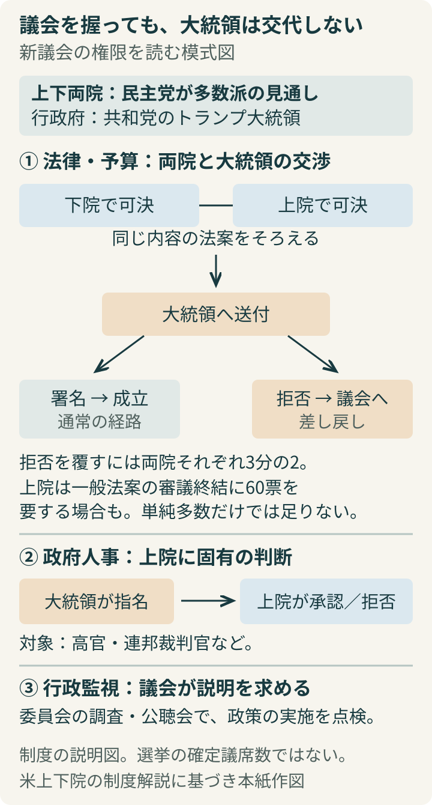
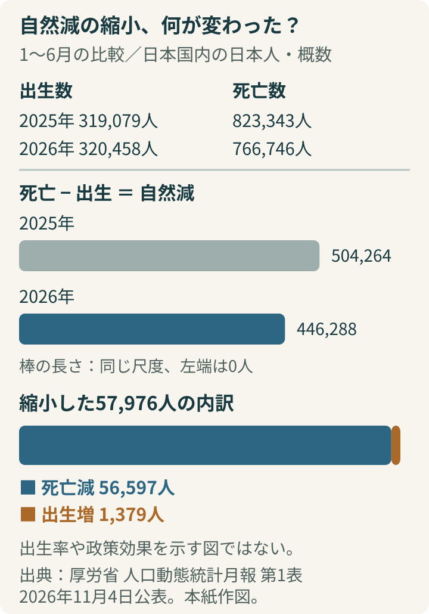
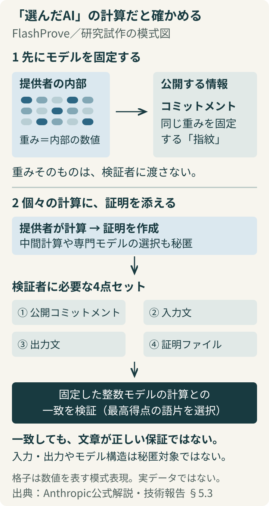

# アヤベ日報　2026年11月5日（木）

本紙 · 22記事 · 図解3点　情報確認 2026-11-05T07:35:00+09:00

## 今朝の読みどころ

- 民主党、上下両院の奪還を確実に 生活費への不満が浮き彫りに
- 食料品減税、6日に首相質疑へ 給付の「誰に、いくら」がなお争点
- 大阪副首都案、災害時の代役を「平時から動かす」 都構想との結び付きを明示

## 01　民主党、上下両院の奪還を確実に 生活費への不満が浮き彫りに

米国で現地3日に投票された中間選挙は、民主党が上院と下院の両方で多数派を確保することが確実となった。4日のAP通信、ロイターなどの当落判定によるもので、全選挙区の公式な結果認証が終わったという意味ではない。投票が続いていた前号から情勢は一変し、トランプ大統領の残り任期は、野党が主導する議会と向き合う局面に入る。まだ開票中の選挙区があり、議席の最終確定と多数派の判定は分けて読む必要がある。

特徴は、従来の接戦州だけでなく共和党の強い州へ変化が広がったことだ。ロイターによると、テキサスでは民主党が1988年以来の上院議席を獲得し、知事選でも共和党の現職を破った。カンザスでも長く続いた共和党の上院議席に変化が起きた。どちらの党が僅差で過半数に届くかという選挙前の問いを越え、共和党の安全圏とされていた場所が争点になった。

何が支持を動かしたのか。APの有権者調査では、国の方向に怒りや不満を感じる回答が約4分の3に達し、通常より高い物価の原因をトランプ政権の政策により多く求める回答が約6割だった。約7割は議会が大統領への抑制と監視を強めることを望んだ。これは調査対象者の回答であり、全有権者が同じ理由で投票したという意味ではないが、生活費と政権運営への評価が結び付いたことを示す。

民主党側の選択にも注目したい。下院の選挙を担う党組織DCCCは4日の声明で、生活費と医療費の引き下げ、中東の戦争終結を優先課題に掲げた。科学委員会の民主党筆頭委員ゾーイ・ロフグレン氏は同日、委員長への立候補を表明し、科学政策への監視・調査と、革新を促しながらAIに責任ある規則を設ける方針を示した。いずれも当事者の政策意思であり、すでに法律や予算になったわけではない。

議会を握ることは、大統領の交代とは異なる。米上下院の制度説明によれば、議会は法律や予算を審議し、行政を調査・監視する。上院は大統領が指名した高官や裁判官を承認または拒否できる。一方、大統領は成立法案に拒否権を使える。一般の法案では上院の審議を終えるため60票が必要になることもあり、過半数だけですべてが動くわけではない。編集上の焦点は、今回の勝利が生活費対策や戦争政策をどこまで具体的な妥協へ変えられるかだ。反対票を集める段階から、約束を実行するための多数をつくる段階へ、民主党自身も移る。

図1｜議会を握っても、大統領は交代しない。法律・予算の成立、人事承認、行政監視を分けた自作模式図。上院・下院の公式制度解説に基づく。新議会の役割を示し、確定議席数は表していない。

**出典**

- [Reuters：民主党が上下両院を奪還](<https://www.reuters.com/legal/government/democrats-seize-congress-sweeping-midterm-repudiation-trump-2026-11-04/>)
- [AP：中間選挙の結果と有権者調査](<https://www.boston.com/news/politics/2026/11/04/5-takeaways-from-the-midterms/>)
- [DCCC：下院多数派獲得についての声明](<https://dccc.org/dccc-chair-suzan-delbene-statement-on-democrats-winning-the-house-majority/>)
- [ロフグレン議員：科学委員長への立候補と政策方針](<https://lofgren.house.gov/media/press-releases/ranking-member-lofgren-announces-she-will-seek-chair-house-science-committee>)
- [米上院：議会の調査・人事承認・審議終結の権限](<https://www.senate.gov/about/powers-procedures.htm>)
- [米下院：立法過程と大統領の拒否権](<https://www.house.gov/the-house-explained/the-legislative-process>)

## 02　食料品減税、6日に首相質疑へ 給付の「誰に、いくら」がなお争点

消費税減税関連法案を巡り、与野党は4日、高市早苗首相が6日の衆院財務金融委員会に1時間出席し、野党議員の質問に答えることで合意した。与党は委員会で採決し、その日の本会議で衆院を通過させたい構え。野党は首相の答弁を聞いてから判断するとしており、日程の合意は採決への合意ではない。

焦点は、店頭で払う税金を減らす話だけではない。法案は飲食料品の税率引き下げと、所得に応じて支援金を配る仕組みを組み合わせている。自民・維新が9月15日に決めた大綱では、2027年4月から2年間の臨時措置とし、その先の2029年度の本格的な所得連動給付につなぐ設計だ。11月2日号で取り上げた「2年間」の位置づけに加え、いま国会では、その期間中に支援金を受け取れる人の線引きが問われている。

4日の審議で問題になったのは、給付対象となる所得上限の数字が示されていないことだった。テレビ朝日の報道によると、政府は消費税1％相当の約6000億円を財源とする支援を想定するが、片山さつき財務相は計算が続いており、最終的には予算編成過程になると説明した。公明党の赤羽一嘉氏は、肝心の数字がないまま採決することに強く異議を唱えた。共同通信は同日夜、公明党が衆院採決で反対する方向で調整に入ったと報じた。

なぜ税率が決まっても、家計の受益が決まらないのか。減税は対象の商品を買う人に広く及ぶのに対し、支援金は所得などの条件で対象を選ぶからだ。所得上限と支給額が定まらなければ、同じ支出の世帯でも支援がどれほど違うのかを比べられない。制度の目的を評価するために、野党が首相本人の説明を求めているという構図になる。

もう一つは、持ち帰りの食品と外食の差だ。法案が想定する持ち帰りの税率は8％から1％へ下がる一方、店内での飲食は10％のまま。4日の質疑では外食事業者への具体的な支援策も問われたが、農林水産省側は今後検討すると答えた。値下げの効果と、業態ごとの売れ行きへの影響をどう両立させるかも残る。

審議の舞台は参院にも広がる。4日には40人の特別委員会が設置され、委員長を除く与党は19人、野党は20人となった。6日の首相答弁で何が具体化するかに加え、衆院通過後も参院でどの会派の賛同を得られるかが成立までの焦点となる。

**出典**

- [テレビ朝日：6日の首相出席・野党のみの1時間質疑で合意（4日18:06）](<https://news.tv-asahi.co.jp/news_politics/articles/000545194.html>)
- [自民党：飲食料品消費税率と支援金の大綱（9月15日）](<https://www.jimin.jp/news/policy/214205.html>)
- [報道ステーション：所得上限と外食支援を巡る4日の審議（4日23:44）](<https://news.tv-asahi.co.jp/news_politics/articles/900203476.html>)
- [共同通信：公明、衆院採決で反対へ（4日19:09）](<https://www.kumanichi.com/articles/2054147>)
- [共同通信：首相質疑と参院特別委の構成（4日11:15）](<https://www.kumanichi.com/articles/2053922>)

## 03　大阪副首都案、災害時の代役を「平時から動かす」 都構想との結び付きを明示

大阪府と大阪市は4日夜、副首都推進本部会議で「副首都・大阪成長ビジョン」の中間報告を公表した。首都圏の大災害が起きてから拠点を立ち上げるのではなく、国の中枢を支える人員や機能を大阪に平時から置き、動かしておく構想だ。国に提案する考え方の整理であり、国の機関の移転や施設整備が決定したという発表ではない。

問いは、非常時のための場所を用意するだけで、東京の代わりが務まるのかということだ。府市の資料は、政府の緊急災害対策本部の代替候補が官邸、内閣府、防衛省、立川の広域防災基地と東京圏内に集中している点を挙げる。広い範囲が被災すれば、近くへの移動では仕事を続けられないおそれがある。そこで、東京と同時に大きな被害を受けにくい地域に、指揮を続ける体制を持つことを提案している。

具体像には、大阪での国会の定期開催、緊急災害対策本部を開ける組織・人員の配置、司法業務の代替、企業や金融機関の第二の業務拠点などが並ぶ。ここで重要なのは、建物だけでなく権限、担当者、通信の経路まで要ることだ。普段から業務を担う拠点なら、災害時にも人と情報の流れを切り替えやすい、というのが提案の狙いである。

府市は、この国家的な役割と大阪の統治機構改革を結び付けた。中間報告は、府と市が分担する広域行政を一元化し、住民に近いサービスを特別区が担う形を掲げる。関西テレビによると、来春を目指す都構想の住民投票で可決された場合、現在の大阪市の消防や水道を広域側へ移し、警察とともに一元管理する方針だ。吉村洋文知事は、防災と首都機能の代替のためにこの体制が重要だと説明した。

ただし、「副首都になるには全国どこでも特別区が必須」と読むのは違う。府市資料自身が、制度上の地方行政体制について、特別区の設置のほか、連携協約の締結と推進体制の構築という選択肢を記している。大阪で都区制度を採るというのは、府市が機能を最大限発揮するために選ぶ方針である。その効果や負担は、首都のバックアップが必要だという議論と分けても検証できる。

報告は成長政策も組み込み、労働・医療など複数分野の規制をまとめて見直す仕組みや、成長重点分野の企業への税負担軽減を国に求める。府市は来年3月ごろに素案、来年度中に成案を目指す。非常時の司令塔と平時の経済拠点を同じ都市につくる構想を、具体的な権限配分、費用、人員配置へどう落とすかが次の段階になる。

**出典**

- [大阪府市：副首都・大阪成長ビジョン中間報告（4日、資料2）](<https://www.pref.osaka.lg.jp/documents/142828/27kaishiryou2.pdf>)
- [関西テレビ：都構想実現を前提に副首都指定を目指す（4日21:14）](<https://www.fnn.jp/articles/-/1146214>)
- [共同通信：平時の中枢機能配置と経済政策提言（4日20:56）](<https://www.kumanichi.com/articles/2054185>)

## 04　上半期の出生数、11年ぶり増加 32万458人に

厚生労働省が4日に公表した人口動態統計の概数で、2026年1〜6月に国内で生まれた日本人の出生数は32万458人となった。前年同期の31万9079人から1379人、0.4％増えた。上半期に前年を上回るのは2015年以来、11年ぶり。11月の出生動向ではなく、今年前半の集計が今回公表された。

テレビ朝日は、2024年から2年続けて年間の婚姻数が増えたことが背景にあると伝えている。ただし、今回の集計だけで政策効果や増加の原因を切り分けることはできない。出生数は人数の実績であり、女性1人が生涯に産む子どもの数の目安である合計特殊出生率の上昇を、そのまま示すものでもない。

人口全体では、出生数から死亡数を引いた自然減が44万6288人だった。前年の50万4264人から減少幅は5万7976人縮まったが、その大部分は死亡数が5万6597人減ったことで説明できる。出生の小幅な持ち直しと、依然として大きい人口減少が併存している。今回は概数のため今後修正され得る。

図2｜出生増と死亡減を分けて読む。自然減の縮小57,976人のうち、死亡減が56,597人、出生増が1,379人。単位は人、対象は日本国内の日本人の1〜6月の概数。厚労省第1表に基づく自作の統計補助図。

**出典**

- [厚労省：2026年6月人口動態統計月報・第1表（11月4日公表）](<https://www.mhlw.go.jp/toukei/saikin/hw/jinkou/geppo/m2026/dl/toukeihyo_06.pdf>)
- [テレビ朝日：上半期出生数、2015年以来の増加（4日17:25）](<https://news.tv-asahi.co.jp/news_society/articles/000545185.html>)

## 05　三井化学、JSR取得を検討 1.3兆円超の売却報道に「未決定」

三井化学は4日、半導体材料大手JSRの取得を含む検討を行っていると認めた。一方で、決定した事実はないと説明した。ロイターは関係者の話として、官民ファンドの産業革新投資機構（JIC）が三井化学への売却を計画し、金額が1兆3000億円を超える可能性があると報じている。正式な買収契約の発表とは区別が必要だ。

JSRは、半導体の回路を形成するときに使う感光材料「フォトレジスト」の大手。AI向け半導体を支える材料の供給体制が、国内の大手化学企業の下で組み替わる可能性が浮上した。ただし、報道された金額や時期は会社側が確定させた条件ではない。

市場では期待より先に大型案件への警戒が出た。株探は4日午前、買収報道を受けて三井化学株が急落したと伝えた。事業の成長性に加え、必要な資金をどう調達するかが問われる局面だ。会社開示は検討の存在を認めた短い説明にとどまり、資金調達方法や取得後の運営体制は示していない。

**出典**

- [三井化学：当社に関する一部報道について（4日）](<https://jp.mitsuichemicals.com/content/dam/mitsuichemicals/sites/mci/documents/release/2026/261104_2.pdf>)
- [Reuters：JIC plans to sell JSR to Mitsui Chemicals（4日）](<https://www.reuters.com/world/asia-pacific/japan-fund-jic-plans-sell-jsr-mitsui-chemicals-sources-say-2026-11-04/>)
- [株探：JSR買収報道で三井化学株急落（4日10:19）](<https://s.kabutan.jp/news/n202611040525/>)

## 06　三菱商事、最大1兆円の自社株買い 利益予想も1.2兆円へ

三菱商事は4日、最大1兆円、株数では4億2000万株を上限とする自社株買いを決めた。取得期間は5日から2027年7月31日までで、東京証券取引所の市場で買い付ける。買った株式は全て同年8月31日に消却する予定だ。発表時点で1兆円を使い終えたわけではなく、今後実施するための上限枠である。

自社株買いは企業が自分の株を市場から買い戻すこと。消却すれば株式の総数が減る。同社は資本効率の向上を理由に挙げ、財務の健全性を保ちながら成長への投資も検討する方針を示した。株主への還元と、新たな事業に回す資金をどう配分するかという判断になる。

同日の決算発表では、2027年3月期の純利益予想を1兆1000億円から1兆2000億円へ引き上げた。株探によると、豪州の原料炭と銅の市況上昇などを反映したもの。4〜9月の純利益は前年同期比74.2％増の6196億9600万円だった。株価は4日の終値で前営業日比7.9％高の5148円となった。

**出典**

- [三菱商事：自己株式取得・消却決議（4日）](<https://www.mitsubishicorp.com/jp/ja/news/release/2026/files/mcpr261104z.pdf>)
- [株探：三菱商事の決算・自社株買いと4日終値](<https://s.kabutan.jp/news/n202611041068/>)

## 07　停車中のバスに工事資材が直撃 大阪・茨木、けが人なし

4日午後4時すぎ、大阪府茨木市の阪急茨木市駅近くで、工事現場の資材が路線バスを直撃し、窓ガラスが割れた。関西テレビが消防などへの取材として報じた。バスは停車中で、十数人の乗客がいたとみられるが、けが人はいないという。

資材は鉄パイプを束にしたようなもので、窓ガラスに刺さっていた。通行人から、バスに資材が貫通したという通報があった。駅に近い路上で、工事現場の外にいた乗客が巻き込まれた事故だ。確認できた報道では資材が道路側へ出た詳しい原因や、業者の管理責任は確定していない。被害の状況と原因究明は分けて追う必要がある。

**出典**

- [関西テレビ：鉄パイプの束が路線バスを直撃（4日19:23）](<https://www.fnn.jp/articles/-/1146039>)

## 08　米雇用は増えても、注文は減速 サービス業に残る仕入れ高

米国の民間雇用は増えているが、サービス業の勢いは少し弱まった。4日公表のADP雇用報告によると、10月の民間雇用者数は前月比8万6000人増。9月は当初の9万人増から8万6000人増へ下方修正され、同じ増加幅が2か月続いた。一方、米供給管理協会（ISM）の10月サービス業景況指数は54.5で、9月の54.9から低下した。50が拡大と縮小の目安で、減速しても縮小に転じたわけではない。

ADPの内訳では、サービス部門が8万2000人増え、全体の増加の大半を占めた。貿易・運輸・公益が3万9000人増、教育・医療が2万8000人増だった一方、専門・企業向けサービスは2万7000人減で、3か月続けて減少した。企業規模別には幅広く採用が続いたが、すべての業種で雇用が増えている状況ではない。総数だけでは、働く業種による差を取り落とす。

企業の注文と納入にもねじれがある。ISMでは新規受注指数が59.8から55.9へ下がったのに対し、納入の遅さを表す指数は53.2から56.7へ上昇した。受注の伸びが弱まっても、必要な物資が素早く届くようになったわけではない。仕入れ価格指数も74.0から73.0へわずかに下がったものの、高い水準にある。これは物価が73％上がったという数字ではなく、調査企業の価格上昇・下落の回答からつくる指数だ。

ロイターは、イラン戦争と輸入関税を背景に供給網への負担が続き、家計の購買力も物価高に削られていると報じた。物価と税金を考慮した家計の可処分所得は9月に減り、貯蓄率は3.8％と4年ぶりの低水準だった。編集上は、採用が維持されていても、消費者が値上げを吸収できる余地は同じとは限らない点が重要になる。雇用増と物価圧力は、矛盾せず同時に起こり得る。

今回の二つの発表は、景気が一方向に良くなった、悪くなったと決める材料ではない。給与支払いデータを基にするADPと、企業の仕入れ担当者を対象とするISMは、違う場所から経済を見ている。政府の10月雇用統計は6日に公表予定で、民間調査の数字をそのまま政府統計の予測値にはできない。まず確認したいのは、採用の持続と供給の詰まりのどちらが強く表れるか。その違いが、賃金、消費、企業の値付けをつなぐ。

**出典**

- [ADP：10月民間雇用報告](<https://mediacenter.adp.com/2026-11-04-ADP-National-Employment-Report-Private-Sector-Employment-Increased-by-86,000-Jobs-in-October>)
- [ISM：2026年10月サービス業景況報告](<https://www.ismworld.org/supply-management-news-and-reports/reports/ism-pmi-reports/services/october/>)
- [Reuters：サービス業の減速と物価圧力](<https://new.streetinsider.com/Reuters/US%2Bservices%2Bsector%2Bactivity%2Bcools%2Bslightly%2Bin%2BOctober;%2Binflation%2Bremains%2Belevated/27287702.html>)

## 09　APEC閣僚会議、供給網とAIで連携 茂木氏は自由な貿易ルール訴え

中国が主催するアジア太平洋経済協力会議（APEC）の閣僚会議が3日夜、オンラインで約4時間開かれた。外務省が4日に概要を公表した。茂木敏充外相は、世界経済の不確実性が高まる中、部品や原料の調達でつながる域内経済に悪影響が生じないよう、参加国・地域が一致して対応する必要があると訴えた。赤沢亮正経済産業相も出席した。

日本側は、信頼性を確保しながら国境を越えてデータを流通させる仕組みや、安全で信頼できるAIの事業環境・貿易ルールを具体策に挙げた。中東情勢の早期沈静化もエネルギー確保に重要だとした。共同通信によると、中国の王毅外相はWTOを中心とする貿易体制の維持を、王文濤商務相はAIなどの技術を開いて共有する取り組みを訴えた。

共通するのは経済の分断を避けたいという言葉だが、それぞれの主張が新しい貿易協定や規制緩和として合意されたわけではない。日本の発表で確認できるのは、供給網、データ、AIを経済協力の具体的な議題として提示したことだ。

**出典**

- [外務省：APEC閣僚会議の概要](<https://www.mofa.go.jp/mofaj/press/release/pressit_000001_04410.html>)
- [共同通信：日中の閣僚発言](<https://kumanichi.com/articles/2053938>)

## 10　北朝鮮、巡航ミサイル訓練と新型防空システム試験を発表

北朝鮮は4日、新型の防空ミサイルシステムの試射と巡航ミサイルの攻撃訓練を実施したと、朝鮮中央通信が5日に報じた。ロイターが日本時間5日午前6時18分に伝えた。韓国側が4日に日本海へ向けた複数のミサイル発射を発表した後、北朝鮮側から兵器の種類と訓練内容について説明が出た形だ。

ロイターによると、北朝鮮は防空システムについて、標的の識別・追尾や誘導の性能を確かめたと主張。東部の長距離戦略巡航ミサイル部隊は、仮想の空港を標的とする訓練を行ったとしている。これらは北朝鮮国営通信の説明であり、性能や命中精度を独立に確認できたという意味ではない。

韓国軍の4日の発表では、発射地点は東部の宣徳付近とされた。当初の時事通信報道では、弾道ミサイルか巡航ミサイルかは公表されていなかった。4日の外部観測に、5日朝の北朝鮮側の説明が加わった。

**出典**

- [Reuters：5日朝の北朝鮮国営通信報道](<https://www.reuters.com/world/asia-pacific/north-korea-test-fires-new-air-defence-missile-system-kcna-reports-2026-11-04/>)
- [時事通信：4日の韓国軍発表](<https://www.nippon.com/en/articles/-/56848>)

## 11　日本政府、米議会交代後も同盟を基軸に 外交の出方を注視

米中間選挙で民主党が上下両院の過半数を確保する見通しになったことを受け、木原官房長官は4日、選挙結果にかかわらず日米同盟は日本の外交・安全保障政策の基軸だと表明した。日テレNEWS NNNが同日の記者会見を報じた。首脳間を含むあらゆるレベルで、引き続き緊密に連携していく考えも示した。

一方、政権内には、米大統領が内政で成果を上げにくくなれば外交に力を注ぐとの見方がある。同報道では、首相周辺が、米中・米朝関係で同盟国の意向を十分に考慮せず動く可能性に言及し、日本の考えを繰り返し伝える必要を指摘した。これは匿名の関係者の見方であり、新たな米国の政策が決まったという情報ではない。

FNNも、政府内の冷静な受け止めと、トランプ氏の行動を読み切れないという懸念を併せて伝えた。日本側の公式な同盟継続の立場と、個々の関係者の警戒感は両立する。議会の交代をそのまま日米関係の断絶と読まず、今後の首脳間の調整や具体的な要求を見極める局面だ。

**出典**

- [日テレNEWS NNN：木原官房長官の会見と政府内の受け止め](<https://news.livedoor.com/article/detail/32732498/>)
- [FNN：日本政府の受け止め](<https://www.fnn.jp/articles/-/1145772>)

## 12　市場は米議会の「歯止め」に期待 AI投資銘柄には選別も

4日の金融市場では、米中間選挙後の政策運営に歯止めがかかるとの期待から株式が買われる一方、AI関連では反応が分かれた。ロイターは、民主党の大勝で結果を巡る長い紛争への懸念が和らぎ、共和党の大統領と民主党の議会が互いを抑えることが予測可能性を高める、との投資家の見方を伝えた。

ただし、AI関連を一括りにはできない。同通信が4日午後に伝えた相場では、アマゾン、メタ、アルファベットなどが上昇した一方、データセンター運営企業のIREN、アプライド・デジタル、コア・サイエンティフィックは下落した。新たな規制や地域の建設判断が、巨額の設備投資にどう響くかへの警戒がある。これは取引途中の動きで、終値の一覧ではない。

政治の対立が市場には安心材料となる一方、予算交渉では障害にもなる。ロイターによると、2027会計年度の資金手当てを巡る合意期限は12月11日。相場が期待する政策の安定と、必要な予算まで決まらないリスクは隣り合わせであり、選挙結果だけで解消したとはいえない。

**出典**

- [Reuters：市場が期待する政策の歯止めとAI銘柄の反応](<https://www.investing.com/news/economy-news/democrat-sweep-adds-new-twist-to-markets-iran-ai-and-debt-worries-4998678>)
- [Reuters：4日の為替市場](<https://live.euronext.com/en/financial-news/dollar-declines-after-democrats-take-us-congress-midterm-elections>)

## 13　敗因はイラン戦争か バンス氏が批判、トランプ氏は正当性を維持

米中間選挙の敗北を受け、バンス副大統領は4日のX投稿で、イラン戦争が共和党敗北の理由だとの見解を示した。これに対しトランプ大統領は同日、戦争が選挙に影響したことを認めながら、イランの核兵器保有を防ぐために必要だったとの立場を維持した。AP通信とロイターが報じた。

ロイターによると、トランプ氏はバンス氏の投稿自体には問題はないとしつつ、戦争について違う対応を取ることはなかったと述べた。政権の正副トップが、同じ敗北を受けて戦争の評価で異なる力点を置いた形だ。前号の停戦仲介の動きに加わった、新しい米国内の政治的な圧力となる。

もっとも、戦争だけで結果を説明するのは早い。APの調査では、対イラン軍事行動を誤った判断とする回答が約6割だった一方、議会選挙への投票で戦争を決定的に重要とした人は約3分の1で、生活費や政府の腐敗についてそう答えた約半数より少なかった。バンス氏の敗因分析と、有権者が示した複数の不満は区別して読む必要がある。

**出典**

- [AP：バンス氏の投稿と有権者調査](<https://www.boston.com/news/politics/2026/11/04/jd-vance-tries-to-distance-himself-from-iran-war-after-gops-deep-losses-in-midterm-elections/>)
- [Reuters：トランプ氏の4日の発言](<https://www.reuters.com/world/middle-east/trump-says-iran-war-has-been-worth-it-despite-election-losses-2026-11-04/>)

## 14　コードを書くAIの次は、変更を確かめる道具へ。OpenAIがPierre買収を発表

OpenAIは米国時間4日、開発者向けツールを手がけるPierre Computer Companyを買収すると発表した。対象はコードを保管し変更履歴を管理するCode Storageや、ファイル表示・差分確認の道具を開発する企業だ。買収完了後の新製品や基盤づくりを掲げており、取引がすでに完了したという発表ではない。金額や完了予定日は今回の発表に示していない。

今回の買収は、まだ使ったことのない技術を一から取り込むだけではない。OpenAIによると、Codexアプリのファイル閲覧にはPierreのTrees、変更前後の比較にはDiffsがすでに使われている。Diffsには、違いを確認したその場で問題の行を直す機能もある。変更を読む画面と、直す画面を往復する手間を小さくする道具だ。

背景には、AIが同時に進める仕事の量が増えるという問題がある。人が一つずつ書いていた変更を複数のAIが並行して作ると、保存するだけでなく、どれを採用し、どれが他の変更と衝突するかを確かめる作業も増える。速くコードを生成できても、変更履歴を取り出す処理や、人が中身を理解する工程が詰まれば、製品を安全に出す速さにはつながらない。

OpenAIが今週公開した社内の基盤Pandoは、そのうち保存・取得側の課題を扱う。Gitという既存の変更履歴管理の仕組みを使い続けながら、互いに関係のない作業枝への書き込みを並行処理し、同じ履歴を多数の利用者へ配る際の処理を共用する。同社は社内運用で、変更送信の待ち時間の中央値を約80％短縮したと説明する。一般利用者の環境で同じ改善を保証する数値ではない。

編集上の読み解きでは、Pandoが大量の作業を支える裏側、Pierreが変更を人間に見せる手前側に当たる。買収発表は両者を、AIと人が使う開発環境へつなぐ方向を示した。モデル単体の賢さだけでなく、生成された成果を読めること、履歴を残せること、判断を次の作業へ渡せることが競争の対象になっている。

ただし、Code Storageの統合時期や移行条件は未公表だ。現在のGitHub利用者に乗り換えを求める発表でもない。既存の作業方式との互換性を保ちながら、どこまでCodex内で完結する仕事を増やせるか。その具体化が今回の買収の次の見どころになる。

**出典**

- [OpenAI・Pierre買収予定の公式発表（11月4日）](<https://openai.com/index/openai-to-acquire-pierre/>)
- [OpenAI・社内Git基盤Pandoの技術説明](<https://openai.com/index/scaling-git-at-openai/>)
- [Axios・買収報道（本文確認、独自情報の引用なし）](<https://www.axios.com/2026/11/04/openai-pierre-computer-github>)

## 15　その返答、本当に選んだAIが書いた？ FlashProveが挑む「出自の証明」

Anthropicが公開した研究システムFlashProveは、AIの返答が指定したモデルの計算から出たことを、暗号技術で確かめようとするものだ。公式研究ページの日付は2日。3日の米TechCrunchの報道でも紹介された、最近の研究を読み解く。文章の出来のよさからモデルを推測するのではなく、計算に検証可能な証拠を添える。

例えば、高性能モデルを選んだのに、仲介サービスが裏で安価な別モデルに差し替えた場合、利用者には見分けにくい。逆に、ある製品の安全確認を特定のAIで行ったと説明されても、モデル名が書かれているだけでは確認できない。研究が狙うのは、こうした提供側の説明と実際の処理を結び付けることだ。

仕組みは二段階になる。技術報告書では、まず提供者が使うモデルを固定し、次に個々の要求について、そのモデルによる計算だと示す証明を作る。モデルの内部の数値である「重み」を相手に渡さずに検証できる点が重要だ。内部の秘密を隠したまま条件を満たすと示す「ゼロ知識証明」と呼ばれる考え方を用いる。

研究チームはLlama 4 Maverickの公開された4ビットの重みを使い、1,024トークンの要求24件をまとめて扱う実験で、H100という計算用GPU1基により毎秒約110トークン分の証明を生成したと説明する。トークンはAIが文章を処理する小片の単位で、量子化は内部の数値を少ないビット数で表すこと。1,024トークンのウィンドウで次の1トークンを検証する証明は約19MBだった。ただし証明の生成には、同モデルを別の8ビット数値形式で通常実行する場合より、GPUを使う時間で換算して約70〜95倍を要した。比較相手は実行ソフトvLLMを使い、H100を8基並べた構成だ。これは計算後に証拠を作る処理の性能であり、文章を返す速さが毎秒110トークンという製品発表ではない。

対象となる計算にも条件がある。今回の証明は整数で表したモデルが、各段階で最も高い得点の次のトークンを選ぶ方式についてのもの。日常のサービスで使われる小数計算や、候補を確率的に選ぶ出力まで、そのまま全て証明できるわけではない。高速に動く実装と数学的な証明の完全な一致も保証していないため、研究段階と明記されている。

ここで区別したいのは、出自と正しさだ。本物のモデルが生成したと分かっても、その返答の事実誤認が消えるわけではない。編集上は、食品の産地表示に近く、どこから来たかを確かめる層をAI利用にも加える研究と読める。公開されたコードと検証用資料が改良されれば、利用者は文章の印象だけでなく、処理の記録でもサービスの説明を確かめられる可能性がある。

図3｜FlashProveの二段階と情報の境界。公開コミットメント、入力、出力、証明を照合する。内部の重みは隠すが、文章の事実性は保証しない。Anthropic公式解説と技術報告§5.3に基づく自作模式図。

**出典**

- [Anthropic・FlashProve研究発表と限界](<https://www.anthropic.com/research/provable-inference>)
- [Anthropicほか・技術報告書（23ページ）](<https://www.anthropic.com/document/flashprove-technical-report>)
- [TechCrunch・11月3日報道（本文確認）](<https://techcrunch.com/2026/11/03/anthropic-is-working-on-a-system-to-prove-ai-models-identity/>)

## 16　ぬるま湯はなぜ元に戻らない。量子の法則から熱力学をつなぐ証明

理化学研究所、東京大学、大阪大学の共同研究グループは4日、熱力学のエントロピー増大則を量子力学から導く枠組みを発表した。論文は米科学誌PRX Quantumの3日付、日本時間4日に掲載された。冷水と熱湯を混ぜるとぬるま湯になり、放置しても元の二つに戻らない。こうした日常の変化の向きを、微小な世界の法則とどう整合させるかが研究の問いだ。

鍵は、数学上可能なあらゆる量子操作と、人が物体全体に加える操作を分けたことにある。原子を一つずつ精密に操る想定ではなく、磁場など少数の外部条件を変える操作を定義。物体の各部分の寄与を足して得る量を使い、熱平衡、操作、エントロピーを共通の枠組みで表した。

論文は、操作時間が物体の大きさに依存しないなどの条件の下で、巨視的なエントロピーが減らないことを示す。どんな量子操作にも同じ結論が成り立つという主張ではない。永久機関を作った成果でもなく、逆に「元へ戻せない」という身近な法則が、どのような操作の範囲で現れるかを明確にした理論研究だ。

**出典**

- [理研・11月4日研究発表](<https://www.riken.jp/press/2026/20261104_1/index.html>)
- [PRX Quantum・原著論文、要旨と一般向け説明](<https://journals.aps.org/prxquantum/abstract/10.1103/3y8f-yrp8>)

## 17　28年ぶりのタイマーリモコン。キヤノン、撮りたい時刻を先に指定

キヤノンのカメラ用タイマーリモコンに、1998年発売のTC-80N3以来、28年ぶりの新製品が登場する。4日のデジカメWatch報道によると、N3端子向けTC-N3とE3端子向けTC-E3を2027年1月下旬に発売予定。TC-N3の公式直販価格は税込3万800円で、予約は11月10日午前10時からの予定と案内されている。

変化の中心は時計機能だ。公式製品情報では、撮影する時刻を設定してタイマー撮影できる。カメラに手を触れずにシャッターを切るだけでなく、あらかじめ狙う時間を決めておく道具になる。天体撮影や、一定の間隔で撮った写真をつないで時間の変化を見せるタイムラプスで用途が広がる。

TC-N3の対応機種はEOS R1、R3、R5 Mark II、R5、R5 C。価格だけでなく、自分のカメラの接続端子に合うモデルかの確認が先になる。これは発表された機能と発売予定の紹介で、時計の精度や長時間撮影時の使い勝手を独自に試したレビューではない。

**出典**

- [キヤノン公式ストア・TC-N3の価格と発売・予約予定](<https://store.canon.jp/online/g/g7502C001/>)
- [キヤノン公式・TC-N3の時計機能と対象機種](<https://personal.canon.jp/product/camera/accessory/result/detail?prcd=7502C001&spid=1&st1=&st2=R3&stm1=2&stm2=3>)
- [デジカメWatch・11月4日報道](<https://dc.watch.impress.co.jp/docs/news/2153585.html>)

## 18　NMAXが電動化へ。固定式電池と公共充電で、2027年に日本投入予定

ヤマハ発動機は4日、125ccクラス相当の電動スクーターNMAX EとXENTER Eを発表した。3日にイタリア・ミラノで開幕した二輪車展示会EICMAへの出展モデルで、日本ではNMAX Eを2027年に発売する予定だ。国内価格や詳しい発売日は今回の発表では示していない。

NMAX Eは3.5kWhの車両固定式電池を搭載し、国際的な試験方法WMTCでの航続距離を104kmとする。自宅に加え、四輪車向け公共充電ステーションでの充電にも対応する設計だ。狭い駐車場所で動かすための後退機能も備える。電池を持ち帰って充電する方式ではないため、乗り手には駐車場所と電源へのつなぎ方が具体的な検討点になる。

同時発表のXENTER Eは前後16インチの大径ホイールを採用し、試験値の航続距離は108km。見た目の違いだけでなく、路面への対応を含めた車体設計を分けた。いずれもメーカー公表の仕様であり、実際に走れる距離は条件で変わる。全ての公共充電器との接続や日本仕様の詳細が確定したとは受け取らないようにしたい。

**出典**

- [ヤマハ発動機・11月4日公式発表](<https://global.yamaha-motor.com/jp/news/2026/1104/eicmaev.html>)
- [Car Watch・電動スクーター2機種の報道](<https://car.watch.impress.co.jp/docs/news/2153593.html>)

## 19　福田師王を初招集 日本代表、ブラジル・パラグアイ戦へ28人

日本サッカー協会は4日、シンガポールで行う11月の国際親善試合に向け、日本代表28人を発表した。カールスルーエの福田師王が初めて選ばれ、南野拓実、町田浩樹、小川航基らも名を連ねた。公式名簿で初招集の印が付くのは福田だけだ。新しい選手の挑戦と、経験のある選手の復帰を組み合わせた顔ぶれになった。

対戦相手は14日のブラジルと17日のパラグアイ。会場はいずれもシンガポール・ナショナルスタジアムで、公式日程のキックオフは現地時間でそれぞれ18時15分と21時10分、日本時間では19時15分と22時10分となる。10日から現地で練習する予定だ。

今回は招集メンバーの発表であり、先発や起用法が決まったわけではない。福田がどの組み合わせで出場機会を得るかは、合流後の練習と試合で確かめることになる。前号で扱ったアジアカップの日程変更とは別に、目前の2試合を担う選手が具体化した。

**出典**

- [JFA：11月4日発表の日本代表メンバー・現地日程](<https://www.jfa.jp/samuraiblue/news/00036974/>)

## 20　「書道」の無形文化遺産登録を勧告 書き初めや手紙の習慣も対象

ユネスコの評価機関が、日本の「書道」を無形文化遺産に登録するよう勧告した。文化庁が5日に発表したと共同通信が報じた。11月30日に中国・厦門で開幕する政府間委員会で審査され、12月初旬に正式決定する見通し。登録が実現すれば、日本では2024年の「伝統的酒造り」に続く24件目になる。

対象は、展覧会で鑑賞する作品だけではない。筆や墨、すずりなどを用いて漢字や仮名を手書きする技法に加え、手紙、年始の書き初め、冠婚葬祭での記名など、暮らしに根付いた習慣として位置づけられている。石などに文字を刻む篆刻も含む。道具、身体の動かし方、文字に託す表現を受け継ぐ文化を守るという考え方だ。

書道は2021年に国の登録無形文化財となり、政府が2024年3月にユネスコへ申請した。その回は審査が見送られ、2025年に再申請していた。今回の勧告で登録へ前進したが、正式登録はまだ先となる。デジタル機器で文字を入力する日常の中で、手で書く実践をどう次の世代に残すかを考える節目になる。

**出典**

- [共同通信：日本の書道、無形遺産へ（5日04:51）](<https://kumanichi.com/articles/2054239>)
- [テレビ朝日：ユネスコ評価機関が書道登録を勧告（5日01:45）](<https://news.tv-asahi.co.jp/news_society/articles/000545281.html>)

## 21　ミステリーハンターが解散発表。芝は新たな相方探しへ

大阪NSC44期同期の上木と芝によるミステリーハンターが4日、それぞれのXで解散を発表した。所属側のFANY Magazineが両者の発表を掲載し、日刊スポーツも報じた。2022年11月に結成し、約4年間活動してきたコンビだ。

芝は、二人で話し合い、互いに納得して決めたと説明した。自身は芸人を続け、コンビで活動するため新たな相方を探す意向で、東京での活動も視野に入れる。一方、上木は今後の進路を時間をかけて考えるとしている。同じ解散でも、その先の選択まで二人が同じだという発表ではない。

コンビとして最後のライブ出演は、12月1日午後8時30分から大阪・日本橋ポルックスシアターの「謎丸虎花」を予定。芝は11月のライブに休演や代演が生じるものがあるとも説明した。解散の知らせと、全出演が直ちに終了したことは区別が必要だ。

**出典**

- [FANY Magazine・両者の公表文](<https://magazine.fany.lol/295326/>)
- [日刊スポーツ・11月4日報道（ライブドア配信）](<https://news.livedoor.com/article/detail/32728897/>)

## 22　タカラトミーがインディーゲームの販売支援へ。最初は「協力と裏切り」のバーガー作り

タカラトミーは4日、インディーゲームの販売・宣伝を支援する新ブランドENJOYN GAMESを立ち上げた。独立系の開発者と組み、Steam向けに3作品を11月から順次発売する。玩具の既存キャラクターを移すだけではなく、小規模チームが作る異なる遊びを届ける取り組みだ。

最初の「人狼バーガー」は合同会社uraconが開発し、11月10日発売予定、価格は880円。店員たちが一つのハンバーガーを完成させようとする中に、邪魔をするスパイが紛れる。協力作業が失敗すると、誰が怪しいかを投票する仕組みで、最大6人のモードと1人用の物語を用意する。

残る2作品も、人との関わり方が違う。「Little Cheese Works」はネズミたちが協力してチーズを運ぶが、連絡する声がネコを起こす危険にもなる。「Sloppy Forgeries」は限られた色と筆で名画を急いで模写する対戦ゲームで、同ブランドは日本国内の販売を担う。遊びの得意不得意や失敗が、会話を生む仕掛けをそろえたラインアップと読める。

**出典**

- [4Gamer・11月4日ニュース本文](<https://www.4gamer.net/games/941/G094178/20261104005/>)
- [ENJOYN GAMES・メーカー発表文（4Gamer掲載）](<https://www.4gamer.net/games/941/G094178/20261104005/index_2.html>)
- [タカラトミー・ブランド公式ページ](<https://www.takaratomy.co.jp/products/games/>)
