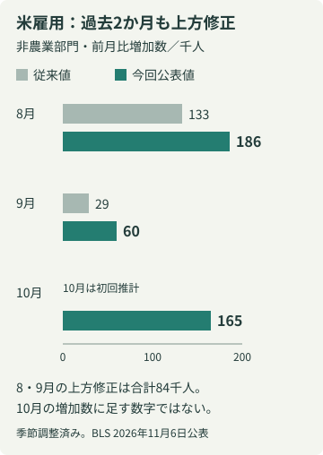
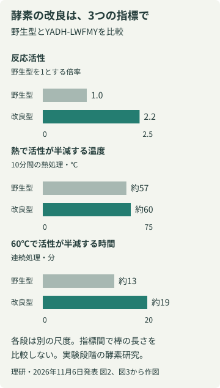

# アヤベ日報　2026年11月7日（土）

本紙 · 19記事 · 図解2点　情報確認 2026-11-07T07:39:47.060841+09:00

## 今朝の読みどころ

- 食料品減税法案が衆院通過 『実質ゼロ』を左右する給付の設計
- 米雇用16.5万人増 10月の強さに加え、夏の数字も上方修正
- 日経平均は3643円安 ETF売却益の活用方針も明らかに

## 01　食料品減税法案が衆院通過 『実質ゼロ』を左右する給付の設計

食料品の消費税を引き下げる関連法案が11月6日、衆議院本会議で可決され、参議院へ送られた。前号で報じた委員会可決から進んだのは、委員会の審議だけでなく衆院として法案を可決したことだ。ただし、法律が成立したわけではなく、店頭の税率もまだ変わっていない。政府・与党は2027年4月から2年間、飲食料品の税率を8％から1％へ下げ、所得に応じた支援金と組み合わせる構想を示している。

焦点は、税率の引下げと現金給付が別の仕組みだという点にある。税率1％は対象の買物全体に適用する設計だが、給付は対象者を選ぶ。したがって、政府・与党が掲げる『実質ゼロ』は、すべての購入者のレジで税がゼロになるという意味ではない。誰がどれだけ給付を受けるかが、最終的な負担を決める。税率の数字だけでは、家計ごとの効果は計算できない。

6日の審議で高市首相は、支援金の対象を現役勤労者の3割と同程度以上とする方向で検討すると説明した。これまで政府が示してきた約2000万人という参考値に対しては、対象が狭いとの質問が出た。自民党の説明でも、具体的な対象と支援額は今後の予算編成で定めるとしている。『3割以上』という方針は示されたが、個々人が受け取れる金額や所得の境目が確定した段階ではない。

財源も参院審議の争点になる。政府は税収の上振れ、基金や補助金の見直しなどを挙げ、来年度予算編成で具体化する考えを示した。野党は、採決の時点で給付対象や財源の具体像が不足していると批判した。参院は少数与党であり、衆院通過と成立の間にはなお政治的な交渉がある。これから読むべき続報は賛否の人数だけでなく、給付の所得上限・支援額・必要財源がどの条文や予算に落とし込まれるかだ。

出典：自由民主党・11月6日の法案説明 ／ TBS NEWS DIG・11月6日16:10 ／ FNN・11月6日18:14

**出典**

- [自由民主党・11月6日の法案説明](<https://www.jimin.jp/news/information/214551.html>)
- [TBS NEWS DIG・11月6日16:10](<https://newsdig.tbs.co.jp/articles/-/3067784?display=1>)
- [FNN・11月6日18:14](<https://www.fnn.jp/articles/FNN/1147518>)

## 02　米雇用16.5万人増 10月の強さに加え、夏の数字も上方修正

米労働統計局（BLS）が11月6日に発表した10月雇用統計では、農業以外の事業所で働く雇用者数が前月比16万5000人増えた。失業率は4.1％。新しい一か月分だけでなく、8月と9月の増加数も合わせて8万4000人上方修正され、雇用の伸びを従来より強く見る材料がそろった。市場の予想を上回ったという評価も報じられているが、今回は特に『以前の月の見え方が変わった』ことが重要だ。

8月の増加数は13万3000人から18万6000人へ、9月は2万9000人から6万人へ改定された。今回の改定後の8〜10月を平均すると、月13万7000人増となる。これは新しい雇用を二重に足した数字ではない。企業から追加の回答が届き、季節特有の増減をならす計算も更新された結果、過去月の推計が改められたものだ。9月の弱い前回公表値だけを覚えていると、秋の実態を小さく見積もりかねない。

10月の増加を主に支えたのは専門・事業サービス7万人、医療4万2000人、運輸・倉庫2万5000人。製造業も1万9000人増えた。一方で、全業種が同じように雇用を増やしたわけではない。小売、情報、金融、娯楽・接客など主要産業の一部は大きな変化なしとされた。雇用の総数だけでなく、どの業種で雇用が増えたかを読むと、回復の広がりと偏りを区別できる。

もう一つの調査である世帯調査では、十分な時間働きたいのに短時間就業となっている人が33万9000人増え、480万人になった。失業率が低くても、仕事量に不満を抱く層までなくなったわけではない。雇用者数は事業所調査、失業率やこの短時間就業の数字は世帯調査によるため、直接足し引きはできない。雇用増の強さと仕事の質の弱さが同じ月に表れる点が、今回の統計の読みどころだ。

8月と9月の雇用増はそれぞれ5万3000人、3万1000人上方修正。10月は初回推計16万5000人。全バーは同一尺度。出典：BLS、11月6日。編集部作図。

出典：BLS・2026年10月雇用統計（11月6日公表） ／ Axios・11月6日の雇用統計報道

**出典**

- [BLS・2026年10月雇用統計（11月6日公表）](<https://www.bls.gov/news.release/archives/empsit_11062026.htm>)
- [Axios・11月6日の雇用統計報道](<https://www.axios.com/2026/11/06/labor-market-employment-october>)

## 03　日経平均は3643円安 ETF売却益の活用方針も明らかに

11月6日の東京市場で日経平均株価は5万7434円77銭となり、前日から3643円13銭、5.96％下げて取引を終えた。TOPIXも5.90％安だった。朝の6万円割れという途中経過から、大引けの結果へと情報が更新された。

ロイターは米国の中間選挙後、AI投資の減速に対する警戒が相場に広がったと報じた。同日、高市首相は日銀のETF売却による追加的な収益を、経済安全保障に関わる投資のため発行する債券の償還に充てる方針を説明した。ETFは株式などをまとめて保有する上場投資信託だ。株価の下落が長引けば、投資の動きだけでなく税収や資産売却益の見込みも変わり得る。

ここには二つの別の判断がある。政府が収入をどの政策に使うかという財政の判断と、日銀が市場への影響を抑えながら資産を売る判断だ。株価が下がったから直ちに政策金利が変わる、あるいは売却が止まると決まったわけではない。今回は終値という確認済みの結果と、財源の組立てという新しい政策説明を区別して見る必要がある。

出典：フィスコ／株探・11月6日15:30 ／ Reuters・11月6日

**出典**

- [フィスコ／株探・11月6日15:30](<https://s.kabutan.jp/news/n202611061433/>)
- [Reuters・11月6日](<https://www.reuters.com/world/asia-pacific/japan-vigilant-market-moves-will-focus-boosting-economy-pm-takaichi-says-2026-11-06/>)

## 04　世界の食料価格は小幅下落 砂糖は雨による生産の遅れで逆行高

国連食糧農業機関（FAO）が11月6日に公表した10月の世界食料価格指数は133.9となり、前月比1.2％低下した。一方、前年同月よりは5.9％高い。これは国際取引される食料品の価格をまとめた指数で、日本のスーパーの販売価格が同じ割合で動いたという意味ではない。

内訳は一様でない。穀物は4.5％下がったが、砂糖は6.6％上昇し、4か月続けて値上がりした。FAOはブラジル中南部で雨がサトウキビの収穫・圧搾を妨げたことや、他の主要産地の生産見通しへの懸念を背景に挙げる。全体の小幅下落の中でも、天候が特定の原料の供給を細らせる構図が続いている。

出典：FAO・11月6日の公式発表

**出典**

- [FAO・11月6日の公式発表](<https://www.fao.org/newsroom/detail/fao-food-price-index-edges-down-in-october-amid-subdued-demand/en>)

## 05　ウクライナ、和平後の安全保障を要求 来週の3者協議前に調整

AP通信は11月6日、ゼレンスキー大統領が欧米の同盟国に戦後の明確な安全保障措置を求めたと報じた。ブリュッセルでは米英仏独・EUなどの当局者が、復興や2027年の資金、安全保障について2日間協議した。来週予定されるウクライナ・ロシア・米国の協議を前に、停戦後の安全をどう支えるかが改めて焦点になっている。

出典：AP・11月6日

**出典**

- [AP・11月6日](<https://apnews.com/article/ukraine-russia-war-trump-kushner-peace-713268db3dac59bff6ad6c831c72cdb6>)

## 06　米大統領首席補佐官にミラー氏 11月9日交代へ

トランプ米大統領は、首席補佐官をワイルズ氏からミラー氏へ11月9日付で交代させると表明した。

出典：共同通信／熊本日日新聞・11月7日05:48

**出典**

- [共同通信／熊本日日新聞・11月7日05:48](<https://www.kumanichi.com/articles/2055159>)

## 07　初代ウォークマンの軽やかさを、USB-Cで作り直す

ソニーが11月6日に発表した有線ヘッドホン「MDR-3R」は、1979年の初代ウォークマンに付属したMDR-3シリーズを、今のスマートフォンにつなぐ製品だ。発売は11月20日。細いヘッドバンドや小さな耳当てという姿だけでなく、当時の設計資料を基に23mmドライバーも新しく作ったという。価格はオープン価格。懐かしい外観を借りた新製品なのか、昔の聴き方を現代に戻す試みなのか。その境目が面白い。

大きく変わったのは接続だ。USB-Cの有線接続を採用し、充電や無線のペアリングをせず使える。マイクとリモコンも備え、音楽だけでなく通話や端末の操作へ用途を広げた。復刻の中心は形と音づくりの考え方であり、利用環境まで1979年に戻すわけではない。昔のヘッドホンと現代の端末の間を、新しい接続方式で埋める設計と読める。

ただし、端子が合えば何でも同じように動くとは限らない。対応条件はUSB Audio Class 1.0に対応する機器で、OSやアプリによって設定が必要だったり、一部機能が使えなかったりする場合がある。購入前には使用する機器の対応を確かめたい。

もう一つ分けて読みたいのは、設計の再現と聴感の評価だ。原型に近い音を目指したという説明はメーカーのもの。設計資料や振動板の寸法があっても、装着状態や再生する音源まで同じにはならない。本稿では実機を試聴しておらず、音質の優劣や再現度は判断できない。小型で軽快な有線ヘッドホンをあえて今作るという選択が、ノイズキャンセルや多機能化とは別の製品価値を示している。

選ぶ際には、復刻という物語への魅力と、普段の使い勝手を分けて考えたい。通勤中に何を聴くのか、通話をするのか。有線に戻る意味は、その使い方によって変わる。

出典：ソニー公式発表、11月6日 ／ GAME Watch、11月6日10:50

**出典**

- [ソニー公式発表、11月6日](<https://www.sony.jp/CorporateCruise/Press/202611/26-1106/>)
- [GAME Watch、11月6日10:50](<https://game.watch.impress.co.jp/docs/news/2154207.html>)

## 08　速さだけを競わない酵素設計、機械学習で熱への強さも探す

理化学研究所などは11月6日、機械学習と実験を組み合わせ、働きの強さと耐熱性を両立する酵素を設計したと発表した。酵母由来の酵素を改変し、加齢臭の原因物質の一つであるトランス-2-ノネナールへの反応活性を天然型の2.2倍にした。人体で消臭効果を確かめた研究ではない。

約200種類の変異体の実測データを基に、活性の有無、活性の強さ、熱への耐性を別々に予測し、有望な候補を実験で検証した。速く働いても壊れやすければ使いにくい。複数の条件を同時に見ることが、この探索の狙いだ。

図の3指標は同じ改良型の値だが、単位も尺度も異なる。将来はにおいセンサーへの応用が期待されるものの、今回示されたのは構成要素になり得る酵素の改良まで。測定器として実環境で働くかは別の検証が必要になる。

同じ改良型YADH-LWFMYの反応活性と熱耐性。各段は別の単位・尺度で、数値は理研発表の図2・図3に基づく。人体の消臭効果を示すものではない。編集部作図。

出典：理化学研究所、11月6日

**出典**

- [理化学研究所、11月6日](<https://www.riken.jp/press/2026/20261106_3/index.html>)

## 09　大阪市プレミアム商品券、メールアドレス流出の可能性を調査

大阪市は11月6日、「大阪市プレミアム付商品券2026」のメール配信に使う外部サービスへの不正アクセスにより、利用者や参加店舗のメールアドレスが流出した可能性があると公表した。市が報告を受けた対象は7月1日以降に配信したメールの記録。対象者や件数は調査中で、流出が確定したという発表ではない。

現時点で流出の可能性が示されているのはメールアドレスであり、商品券の利用者・店舗を管理するシステムへの不正アクセスは確認されていない。市は不審なメールのURLや添付を開かず、ID、パスワード、暗証番号、カード情報などを入力しないよう注意を促す。『商品券の対応が必要』と急がせる連絡が来ても、そのメールから進まず、市や商品券の公式案内を確認するのがよい。

出典：大阪市報道発表、11月6日20:10

**出典**

- [大阪市報道発表、11月6日20:10](<https://www.city.osaka.lg.jp/hodoshiryo/keizaisenryaku/0000691115.html>)

## 10　腸内細菌と慢性炎症、6803人のデータが示す二つの方向

東京医科大学や理化学研究所などのチームは、日本人6803人のデータから、腸内細菌と代謝物、慢性炎症の関係を調べた。健康な人と15の慢性疾患を対象に、炎症が低い方向と高い方向に関連する細菌群の特徴を整理した。研究の注目点は、発酵食品に含まれる菌そのものだけでなく、腸にすむ酪酸産生菌を介した関連が見えたことにある。

ただし、食事を変える介入試験ではなく、統計的な関連の解析だ。『この食品で病気が治る』『この菌だけ増やせばよい』とは言えない。個々の食品を善悪に分けるより、食事、腸内環境、炎症の間にある経路を細かく調べ、将来の検証課題を絞る研究として読みたい。 今後、介入による再検証がどこまで進むかにも注目したい。

出典：理研11月6日 ／ 東京医科大学11月5日発表PDF

**出典**

- [理研11月6日](<https://www.riken.jp/press/2026/20261106_1/index.html>)
- [東京医科大学11月5日発表PDF](<https://www.tokyo-med.ac.jp/news/893542b9f31d1ea9f82be1146d6fda5e27bdd6d1.pdf>)

## 11　大阪Bは東レ静岡へ、甲斐と西田の得点をどうつなぐか

大阪ブルテオンは11月7日、8日、東レアローズ静岡とのアウェー2連戦に臨む。開始は両日14時05分。バレーボールキングの第3節展望によると、前節第2戦では甲斐優斗がブロック4本を含む19得点、西田有志が18得点を挙げた。一方、東レ静岡は開幕連敗後に連勝し、選手起用を変えながら立て直している。

見るポイントは、得点を重ねた大阪Bの両翼が、相手のブロックと守備にどう対応するか。前節の得点数は好調を知る手掛かりだが、今節の先発や結果を保証するものではない。サーブで相手の攻撃を絞れるか、レシーブが崩れた場面でも攻撃の選択肢を残せるかを追うと、得点表だけでは見えない試合の流れが分かりやすくなりそうだ。

出典：バレーボールキング、第3節展望、11月6日12:15 ／ 大阪ブルテオン公式・今後の試合

**出典**

- [バレーボールキング、第3節展望、11月6日12:15](<https://volleyballking.jp/article/95917/>)
- [大阪ブルテオン公式・今後の試合](<https://www.osaka-bluteon.com/>)

## 12　新年のブルフェス、観戦と仕事体験を組み合わせる企画発表

大阪ブルテオンは11月6日、来年1月2日、3日の北海道イエロースターズ戦で「OSAKA B.L.U.E FESTA 2026-27」を開くと発表した。会場はAsueアリーナ大阪、両日17時05分開始。ららぽーとの協力で、選手入場や試合前の舞台裏、広報SNSなど、試合を支える仕事にも触れる体験を用意する。

企画には対象店舗での買い物と会員登録を条件とする抽選があり、年齢や会員資格の指定も異なる。体験付きのペアチケットでも、体験できるのは1組につき1人という点には注意したい。応募・買い上げ対象期間は11月23日まで。今回は開催概要の新発表であり、通常の観戦券の残席や販売状況を確認した記事ではない。詳細はクラブの公式案内で確認できる。

出典：大阪ブルテオン、11月6日

**出典**

- [大阪ブルテオン、11月6日](<https://www.osaka-bluteon.com/news/2026/20261106_03.html>)

## 13　GPT-6-Cyber、性能向上と利用範囲の管理が同時に課題へ

OpenAIはサイバーセキュリティ向けのGPT-6-Cyberを発表した。脆弱性を見つけるだけでなく、定めた範囲で悪用可能性を確かめる能力を高め、利用を審査済みの対象に絞る。性能向上は防御の助けになる一方、攻撃にも転用され得るためだ。

同社は自社の準備態勢評価でサイバー能力をCriticalと分類した。これは独立機関による認定ではなく、同社の枠組みによる判定。ベンチマークの数値だけで実環境の安全性を保証できない点も変わらない。開発者の性能説明と、アクセス対象や許可された操作範囲をどう管理するかを、対で読む必要がある。

出典：OpenAI、11月5日 ／ Reuters、11月5日

**出典**

- [OpenAI、11月5日](<https://openai.com/index/introducing-gpt-6-cyber/>)
- [Reuters、11月5日](<https://www.investing.com/news/stock-market-news/openai-launches-gpt6-cyber-with-critical-cybersecurity-rating-5005229>)

## 14　TikTokのおすすめ機能にEUが暫定判断、心の健康へのリスクを問題視

欧州委員会は11月6日、TikTokの『おすすめ』欄が利用者を有害な動画の連鎖へ誘い込み、デジタルサービス法（DSA）に違反しているとの暫定判断を示した。共同通信によると、孤独や悲しみ、体形などに関する動画が繰り返し表示され、特に子どもの心の健康を損なうリスクへの対策が不十分だとしている。

今回の判断は最終決定ではない。TikTokには反論の機会があり、違反が最終認定された場合には世界売上高の最大6％の制裁金が科され得る。焦点は個々の動画の削除だけでなく、似た内容を次々に勧める仕組みが利用体験をどう変えるかにある。制裁が確定した、利用禁止になったというニュースとは区別したい。

出典：共同通信／熊本日日新聞・11月6日21:10

**出典**

- [共同通信／熊本日日新聞・11月6日21:10](<https://www.kumanichi.com/articles/2055084>)

## 15　中国、高市首相の台湾発言に『是正』を要求

中国外務省は11月6日、高市首相の台湾有事を巡る発言から1年となるのを前に、改めて是正を求めた。共同通信によると、会見では『撤回』という語は用いられなかったが、外交筋は是正には撤回も含まれると説明した。言葉の違いだけから、中国側が立場を軟化させたとは判断できない。表現の変化と政策上の譲歩を分けて読む必要がある。

出典：共同通信／熊本日日新聞・11月6日19:46

**出典**

- [共同通信／熊本日日新聞・11月6日19:46](<https://www.kumanichi.com/articles/2055048>)

## 16　M-1決勝は12月20日、ラジオ裏実況と大阪の展覧会にも新情報

『M-1グランプリ2026』の決勝と敗者復活戦を12月20日に生放送すると、11月6日に発表された。準決勝は12月3日、東京のNEW PIER HALLで開催する。今年のエントリーは過去最多の1万2663組。決勝直前の敗者復活戦はEX THEATER ROPPONGIから届けられる。

ABCラジオとニッポン放送による同時ネットの裏実況番組も決まったが、出演者や放送時間の詳細は今後の発表となる。また、11月21日からルクア大阪で始まる『M-1感情爆発展』には、ミルクボーイへの取材を基にした体感企画も登場する。大会日程の確定と関連企画の発表が重なり、年末までの楽しみ方が少し具体的になった。

出典：ENCOUNT・11月6日 ／ クランクイン！・11月6日19:07

**出典**

- [ENCOUNT・11月6日](<https://encount.press/archives/1094150/>)
- [クランクイン！・11月6日19:07](<https://www.crank-in.net/news/193917/1>)

## 17　実質賃金が9カ月連続増 9月速報は2.2％プラス

厚生労働省が6日に公表した9月の毎月勤労統計速報では、従業員5人以上の事業所の現金給与総額が1人平均31万1409円となり、前年同月を4.6％上回った。物価変動を考慮した実質賃金は2.2％増で、9カ月連続のプラスだった。

基本給などの所定内給与は3.7％増。併せて発表した夏季賞与は、支給事業所の労働者1人平均で44万8765円、前年より5.3％増えた。これは賞与を支給した事業所の平均であり、すべての働き手が受け取った額ではない。

実質賃金の2.2％増は、持家の帰属家賃を除く消費者物価指数で計算した値。給与額も税・社会保険料を引く前の平均で、各家庭の手取りや生活実感が同じ幅で改善したという意味ではない。速報値は今後の確報で改訂され得る。

出典：厚生労働省・9月速報報道発表PDF ／ テレビ朝日

**出典**

- [厚生労働省・9月速報報道発表PDF](<https://www.mhlw.go.jp/toukei/itiran/roudou/monthly/r08/2609p/dl/houdou2609p.pdf>)
- [テレビ朝日](<https://news.tv-asahi.co.jp/news_society/articles/000545728.html>)

## 18　インフル全国は増加、大阪は減少 直近週の地域差

厚生労働省の6日公表資料によると、10月26日〜11月1日のインフルエンザ報告数は全国で1定点当たり10.26人だった。前週の9.49人から増えた一方、大阪府は6.11人から5.49人へ下がった。全国平均と身近な地域の動きは同じではない。

同じ週の京都府は8.21人、兵庫県は12.07人で、いずれも前週より減少した。全国では北海道が21.90人、愛媛県が27.89人と高く、地域差がある。数値は指定医療機関の週間報告をもとにした指標で、地域の全患者数や個人の感染確率を示すものではない。

これは11月6日当日の感染者数ではなく、11月1日までの1週間の状況。次の11月2〜8日分は13日公表予定で、報告対象期間と発表日を分けて読む必要がある。

出典：厚生労働省・インフルエンザ第44週

**出典**

- [厚生労働省・インフルエンザ第44週](<https://www.mhlw.go.jp/content/001766066.pdf>)

## 19　抑留中に亡くなった10人を新たに特定 資料照合を継続

厚生労働省は6日、旧ソ連などでの抑留中に死亡した人について、10月に新たに10人の身元を特定したと発表した。シベリア地域が8人、モンゴル地域が2人。漢字氏名と出身都道府県を同省サイトへ追加掲載する。

作業では1991年以降にロシア政府などから提供された名簿や関連文書を、日本側の資料と照合している。今回を含め、シベリア・モンゴル地域で個人を特定した人数は4万1270人になった。遺骨のDNA鑑定や新たな遺骨発見の発表ではなく、死亡記録を誰の記録かに結び付ける照合作業の進展だ。

同省は遺族が親族の死亡の経緯を確認できるよう、2007年から氏名や死亡年月日などを公開している。戦争終結から長い時間が過ぎても、記録の同定と遺族への情報提供は続いている。

出典：厚生労働省・抑留中死亡者の特定

**出典**

- [厚生労働省・抑留中死亡者の特定](<https://www.mhlw.go.jp/stf/newpage_76984.html>)
