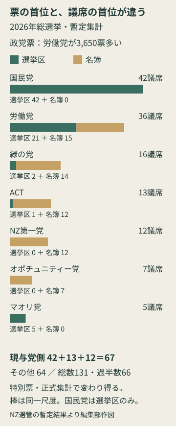
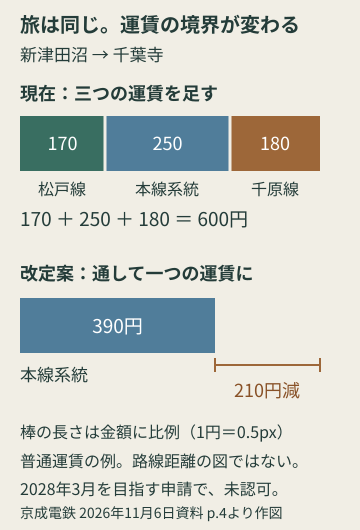
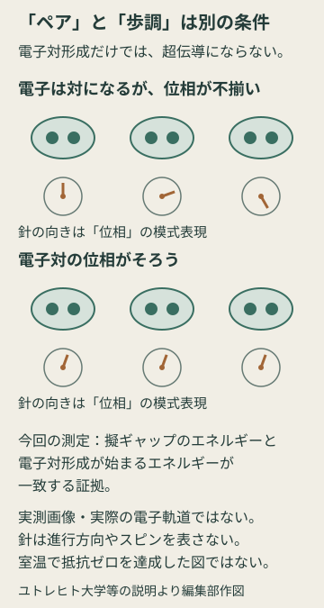

# アヤベ日報　2026年11月8日（日）

本紙 · 21記事 · 図解3点　情報確認 2026-11-08T07:49:01+09:00

## 今朝の読みどころ

- 未明の地震、知多市で震度5強 東海の交通にも影響
- NZ総選挙、得票で労働党、議席で国民党 政権の行方を分ける二つの票
- ソフトバンクのABB買収、中国事業を分離する案 最大市場を外す難しさ

## 01　未明の地震、知多市で震度5強 東海の交通にも影響

11月8日午前1時4分ごろ、静岡県西部を震源とする地震があり、愛知県知多市で震度5強を観測した。気象庁が午前3時5分に公表した暫定値は、地震の規模を示すマグニチュードが5.7、震源の深さが41km。津波の心配はない。共同通信の午前5時59分の報道では、愛知県内で転倒などによるけが人が20人以上に上った。

朝の移動にも影響が出ている。CBCテレビの午前6時44分のまとめでは、東海道新幹線は静岡―岐阜羽島間を速度を落として運転し、始発から遅れが発生。JR在来線は東海道線の豊橋―名古屋、武豊線の大府―武豊などで始発から運転を見合わせた。これは同時点の状況で、再開見込みは確定した運行時刻ではない。 その後、7時13〜29分更新のYahoo路線情報でも、新幹線の遅れと両在来線の見合わせが続いていることを確認した。

気象庁は、今回の地震を沈み込むフィリピン海プレートの内部で起きたものと説明した。南海トラフ地震の想定震源域内ではあるが、その規模から、プレート同士の固着状態の特段の変化を示すものではないとみている。一方、強く揺れた地域では落石や崖崩れの危険が高まる。発生から1週間程度、特に2～3日は最大震度5強程度の地震に注意するよう呼びかけている。

**出典**

- [気象庁・11月8日03:05発表PDF](<https://www.jma.go.jp/jma/press/2611/08a/kaisetsu202611080305.pdf>)
- [共同通信／日刊スポーツ・11月8日05:59](<https://www.nikkansports.com/general/news/202611080000010.html>)
- [CBCテレビ・交通情報、11月8日06:44](<https://newsdig.tbs.co.jp/articles/-/3069819?page=3>)
- [Yahoo路線情報・東海道新幹線](<https://transit.yahoo.co.jp/diainfo/7/0>)
- [Yahoo路線情報・東海道本線（豊橋―名古屋）](<https://transit.yahoo.co.jp/diainfo/192/193>)
- [Yahoo路線情報・武豊線](<https://transit.yahoo.co.jp/diainfo/199/0>)

## 02　NZ総選挙、得票で労働党、議席で国民党 政権の行方を分ける二つの票

ニュージーランドで11月7日に行われた総選挙は、暫定集計で現与党の国民党・ACT・ニュージーランド第一党が計67議席となった。選挙管理委員会が示す議会全体の見込みは131議席で、過半数は66。ところが政党への投票は、労働党が71万330票、国民党が70万6680票と、労働党が3650票上回る。なぜ、得票の首位と議席の首位が逆になるのか。

同国の選挙では、有権者は政党と地元候補にそれぞれ1票を投じる。原則として政党への票で各党の総議席を配分し、その枠にまず選挙区の当選者を入れ、残りを名簿の候補者で埋める。選挙区で20人が勝ち、政党票による配分が36議席なら、名簿からは16人を選ぶ。政党票の割合に議会全体を近づけるための仕組みだ。

ただし、選挙区で比例配分の枠より多く勝った党は、超過分を手放さない。その分だけ議会の総数が通常の120から増える。今回の暫定結果では、国民党は42議席をすべて選挙区で獲得し、名簿議席はゼロ。労働党は選挙区21と名簿15の計36だった。国民党の選挙区での強さが、政党票ではわずかに労働党を下回っても、議席で上回る結果を生んだ。

連立の算数も接戦だ。現与党側は国民党42、ACT13、第一党12で67。これ以外は労働党36、緑の党16、マオリ党5、オポチュニティー党7で計64となる。オポチュニティー党は政党票5.96％で、議席配分を受けるための5％の基準を超えた。単一政党が勝ったかどうかより、最終的にどの組合せで過半数を確保するかが政権を決める。

まだ約39万9365の特別票が未集計と見積もられ、通常票も正式集計で数え直す。選挙管理委員会は、海外からの票の到着を法律上10日間待ち、特別票の資格確認などを経て11月27日に正式結果を公表する予定だ。ガーディアンも政権の形は未決着と報じた。わずかな議席差に加え、選挙区の勝敗が総議席まで動かすため、今回の待ち時間は単なる発表の遅れではない。

政党票と選挙区票は別。国民党は政党票で労働党を下回っても、選挙区の当選者が多いため総議席では上回る。NZ選管の暫定集計を基に編集部作図。特別票と正式集計で変わり得る。

**出典**

- [NZ選管・2026年総選挙の暫定結果](<https://elections.nz/media-and-news/2026/2026-general-election-preliminary-results>)
- [NZ選管・全国集計と議席見込み](<https://electionresults.govt.nz/ge2026/>)
- [NZ選管・議員選出と超過議席の仕組み](<https://elections.nz/democracy-in-nz/what-is-new-zealands-system-of-government/how-are-mps-elected>)
- [The Guardian・11月7日の開票報道](<https://www.theguardian.com/world/2026/nov/07/new-zealand-election-too-close-to-call-vote-count>)

## 03　ソフトバンクのABB買収、中国事業を分離する案 最大市場を外す難しさ

ソフトバンクグループとスイスのABBが、ロボット事業の買収を進めるため中国部分を切り離す案を検討している。ブルームバーグの関係者取材を、ロイターが11月7日に報じた。中国事業を別の所有者の会社に置くという案で、両社が正式に決定した内容ではない。ソフトバンクは6日、中国当局から中国での事業買収を禁じる通知を4日に受け取ったと公表していた。

当初の契約は2025年10月8日に締結された。ABBがロボット事業を持ち株会社に移し、ソフトバンクの子会社がその全株式を53億7500万ドルで取得する設計だ。当時の換算で約8187億円、完了見通しは2026年半ばから後半だった。最初から欧州、中国、米国などの規制承認が条件だったため、契約締結だけでは事業の移転は完了しない。

切り離す対象は小さな付属事業ではない。ロイターによれば、中国はABBのロボット事業の約3割を占める最大市場だ。一方、ソフトバンクの買収説明によると、事業全体は2024年に約22億7900万ドルを売り上げ、当時約7000人を雇用していた。中国を除いた形に変われば、取得できる顧客基盤や成長機会も、当初契約の説明とは違ってくる。

ソフトバンクが掲げた狙いは、工場で実物を動かすロボットにAIを組み合わせることだった。ABBの販売網と産業ロボットの技術を、既存の物流・ロボット関連投資先などにつなぐ構想である。今回の障害は、AIの性能を上げれば解ける問題ではない。国境をまたいで、誰が事業を所有し、どの市場に届けられるかという条件が、技術投資の形を左右している。

ロイターは、ABBが別の買い手を探す選択肢も検討していると伝えた。ABBはこの報道へのコメントを控え、ソフトバンクからは営業時間外の照会に返答がなかった。公式に確認できる最新の立場は、両社が協議を続け、開示すべき決定があれば発表するというもの。中国部分を外した後の価格、持ち主、完了時期がどう組み直されるかが、取引の行方を見定める具体的な焦点となる。

**出典**

- [ソフトバンクグループ・11月6日の経過開示](<https://group.softbank/news/press/20261106>)
- [ソフトバンクグループ・2025年10月8日の買収契約](<https://group.softbank/en/news/press/20251008>)
- [Reuters／AOL・11月7日09:54 UTC](<https://www.aol.com/articles/softbank-abb-explore-china-carve-095413000.html>)

## 04　大阪Bが首位へ 甲斐は控え、富田とロペスでつかんだストレート勝ち

大阪ブルテオンは11月7日、静岡県沼津市の香陵アリーナで東レアローズ静岡を3―0で破った。セットは25―23、25―16、25―19。通算4勝1敗、勝ち点13となり首位に立った。同日、開幕4連勝だったジェイテクトSTINGS愛知がウルフドッグス名古屋に敗れ、上位3チームが4勝1敗で並んでいる。前号の試合展望から一歩進んで見たいのは、大阪Bがどの顔ぶれで、どう点を取ったかだ。

前節に19得点した甲斐優斗は、この日の先発ではなくリザーブだった。両サイドで攻守を担うアウトサイドヒッターには富田将馬とミゲル・ロペス、中央の攻撃とブロックを担うミドルには西川馨太郎とエバデダン・ラリーを起用。西田有志、セッターのアントワーヌ・ブリザール、守備専門のリベロ・山本智大も先発した。前節の得点上位者をそのまま今回の主役とする読み方では、実際の起用を見落とす。

クラブの試合報告で転機として追えるのは第1セットだ。15―10から相手のサーブに押され、16―15まで迫られた。そこで山本のパスからラリーの速攻、富田の中央からの速いバックアタックにつなぎ、立て直した。両端の強打だけでなく、中央を使って相手の守備を広げる攻め方が、接戦を抜け出す場面に表れている。

サムエルボ監督は試合後、ブロックで直接得点を重ねることはできなかったものの、相手のスパイクに触れて守りやすくし、そこから攻め返せた点を評価した。サーブミスも2本に抑えたという。これは監督の評価だが、得点者の名前だけでは見えにくい勝ち方を説明している。第3セット終盤には西田に代わって西山大翔も出場した。

甲斐らの起用理由は公表資料からは確定できない。それでも、異なる先発の組合せでストレート勝ちを収めた事実は残った。8日14時05分から同じ会場で第2戦。東レ静岡のサーブに詰め寄られた場面をどう修正するか、再戦での選手起用とともに見たい。

**出典**

- [大阪ブルテオン・11月7日の試合結果と先発、試合後コメント](<https://www.osaka-bluteon.com/game/result/detail/7>)
- [バレーボールマガジン・11月8日、男子の結果・順位](<https://volleyballmagazine.jp/703719/>)
- [SVリーグ公式・11月1日、甲斐の19得点の内訳](<https://www.svleague.jp/match/detail/37985/>)

## 05　たくろう万博が開幕 笑いの会場に戻ってきた『万博の記憶』

たくろうが主宰する『たくろう万博』が11月7日、大阪府吹田市の万博記念公園・もみじ川芝生広場で始まった。8日までの2日間。M-1グランプリ2025で優勝した赤木裕が、賞金の使い道を尋ねられて語った『万博をもう一度』という夢が形になった。漫才の大型イベントに『万博』と名付けただけでなく、来場者が会場を歩く体験そのものに昨年の記憶を織り込んでいる。

Lmaga.jpの初日取材では、入口に東ゲートを思わせる造形と各国の旗が並び、夢洲駅で親しまれた阿部寛の象印広告も再登場した。ミャクミャクのモニュメントを思わせる構図で、赤木が寝そべり、きむらバンドがお辞儀する大型パネルも設置。取材記事は、入口から反応する観客や撮影する来場者の姿を伝えている。舞台が始まる前の移動や写真撮影も、イベントの一部になった。

公式案内を読むと、外国のパビリオンも元の建物をそのまま再建したものではない。ヨルダン館は砂漠の砂、死海の塩水に物を浮かべる体験などを用意し、オランダ館は模型やユニフォーム、ミッフィーの立像など万博ゆかりの品を展示する。大規模な建築を繰り返す代わりに、触れたり見たりした記憶を持ち運べる形に置き換えた構成、と見ることができる。

一方、お笑い側も漫才だけに閉じていない。守谷日和の表現芸を至近距離で見る館や、レイチェルが音楽ネタを光と音の空間でつなぐ『Laugh&amp;Beat館』を設けた。客席から一本の舞台を見る時間と、自分で行き先を選んで歩く時間を組み合わせる。万博への愛着を入口に、普段の劇場とは違う芸人の見せ方を試す場にもなっている。

最終日の8日は午前・午後の漫才、音楽、盆踊りに加え、16時45分からソニーの技術協力によるリアルタイム字幕付きの漫才ステージを予定する。劇場型の2館には整理券が必要で、夜間券では観覧できない。すべてを一括で楽しめると考えず、公式の当日時間割と入場条件を見て回りたい。初日の来場者総数や全企画の実績は、今回確認した資料には示されていない。

**出典**

- [Lmaga.jp・11月7日の現地取材](<https://www.lmaga.jp/news/2026/11/1118274/>)
- [たくろう万博公式・開催趣旨と出演者](<https://takuro-expo.com/>)
- [公式・パビリオンの内容と整理券条件](<https://takuro-expo.com/pavilion/>)
- [公式・11月8日のタイムテーブル](<https://takuro-expo.com/timetable/>)

## 06　値上げする京成で、600円の旅が390円になる理由

京成電鉄が11月6日、2028年3月の実施を目指す運賃改定を申請した。全体では上限運賃ベースで14.1％の値上げだが、新津田沼から千葉寺へ行く普通運賃は600円から390円へ下がる計画だ。同じ改定で値上げと値下げが生じる理由は、鉄道会社の合併後も残っていた運賃の境界にある。

今の京成には本線系統、千原線、松戸線、成田空港線という四つの運賃制度がある。千原線と松戸線では、かつて別会社だった時代の制度を引き継いだ。同じ京成の路線を乗り継いでも、それぞれの運賃を足す仕組みだ。新津田沼―千葉寺の例では松戸線170円、本線系統250円、千原線180円で600円になる。

申請では千原線と松戸線を本線系統に統合する。この区間を一つの制度で計算すると390円で、差は210円。京成船橋―ちはら台も710円から520円へ下がる。単に各路線の単価を一律に安くするのではなく、乗り継ぎごとに運賃を積み上げる構造を変えるのが効いている。

すべてが一本化されるわけではない。成田空港線は北総線と運賃制度を共有するため残り、松戸線内だけの普通運賃・通勤定期には値上げを抑える別の実施運賃を設ける予定だ。通学定期は全体で11.5％下がる。バリアフリー料金の加算も廃止するが、今回の14.1％は現在の同料金を含めた比較である。

これは認可申請であり、2028年3月の実施はまだ確定していない。今朝の発見は『値上げ率』だけで各利用者の負担を読めないことだ。買収・統合が路線図の上では終わっていても、切符の計算まで一つになるには別の工程がある。

同じ旅の運賃計算を比較。距離比例ではない。京成電鉄11月6日申請資料p.4を基に編集部作図。認可前の計画。

**出典**

- [京成電鉄・運賃改定申請資料（11月6日、PDF）](<https://new-www.keisei.co.jp/cms/files/keisei/MASTER/0110/7jlhdCwM.pdf>)
- [鉄道プレスネット・制度と区間別運賃の解説](<https://news.railway-pressnet.com/archives/93529>)

## 07　Perplexityの常駐AI、仕事を「一回の依頼」から「継続する担当」へ

Perplexityが公開した「Teammates」は、調べ物を一度頼んで終わる使い方から、担当する仕事を継続して任せる使い方へ踏み込むAIだ。11月6日の公式更新では、計画を立て、複数の作業を並行して進め、結果を利用者の確認に戻す仕組みを紹介した。まずウェブ版のMax契約者が対象となる。The Decoderによると、Maxの料金は月200ドルだ。

仕事が続くための土台は、前の作業を忘れないことにある。Teammatesは既存のPerplexity Computerのプロジェクト、ファイル、作業手順、記憶を使う。メーカーが挙げる営業の例では、常連客の注文が途絶えたことを見つけ、注文履歴と問い合わせを調べ、連絡前に解決すべき問題を整理する。毎回同じ背景を説明する手間を減らし、前の結果を次の判断につなぐ設計だ。

もう一つの特徴は、仕事の引き継ぎまで含めたことだ。ウェブサイトの不具合を見つける担当から、修正を準備する担当へ結果を渡せる。Slackのチャンネルに加えれば、人間の同僚も仕事を渡したり進捗を聞いたりできる。独立したスレッドで作業を追えるため、会話の続きを眺めるだけでなく、どの担当が何をしているかを確認する製品になっている。

ただし、『常駐』は無制限の権限を意味しない。公式説明では既存のツール・プロジェクトの権限を引き継ぎ、担当ごとに環境とブラウザーのセッションを分ける。利用者は途中で方向を変えたり、デスクトップ操作を引き取ったりできる。長時間働かせるほど、完成物だけでなく、任せる対象と確認を戻す場面を先に決める使い方が重要になる。

OpenAIのDotsやAnthropicのDuetに続く参入だが、価格だけで同等の仕事量を比較することはできない。今回確認できたのは提供条件とメーカーが示した動作例で、実業務での精度や継続運用の費用を測った結果ではない。競争の焦点は、一問への回答の出来から、変更や引き継ぎのある仕事を最後まで扱えるかへ広がっている。

**出典**

- [Perplexity・Teammates公式紹介](<https://www.perplexity.ai/en-GB/hub/blog/teammates-are-agents-for-complex-ongoing-work>)
- [Perplexity・11月6日の更新情報](<https://www.perplexity.ai/changelog/teammates-fully-local-computer-on-mac-and-voice-mode>)
- [The Decoder・11月6日](<https://the-decoder.com/perplexity-now-has-its-own-always-on-ai-agent/>)
- [The Verge・11月5日](<https://www.theverge.com/ai-artificial-intelligence/1028302/perplexity-teammates-ai-agents-work>)

## 08　拡大鏡にもオートフォーカス ViXion Loupe、姿勢を変えても手元を追う

細かな作業で、よく見える距離に顔を固定し続けなくてよい拡大鏡を目指す。ViXionが11月4日に発表した「ViXion Loupe」は、11月7日を予約受付開始日とし、2027年2月1日の発売を予定する。税込29万7000円。工芸・宝飾の職人や精密機器の技術者など、両手を使って細部を見る仕事を想定した製品だ。

仕組みの要は、拡大することとピントを合わせることを組み合わせた点にある。前方の距離センサーが対象までの距離を測り、その距離に応じてフォーカスレンズを調整する。メーカーが示す作業距離は200〜1000ミリ、つまり20センチ〜1メートル。手元の対象との距離が変わっても、その範囲で自動的に合焦させる。拡大光学系をレンズに組み込み、拡大とピント調節という二つの働きを重ねたルーペだ。

倍率は2.5倍か3.5倍を購入時に選ぶ。この数字はズームの下限と上限ではない。途中で倍率を切り替えたり、レンズを交換したりすることはできず、両方使うならそれぞれの本体が必要になる。公式仕様では重さも2.5倍が62グラム、3.5倍が70グラムと異なる。拡大率を上げるほど良いと考えるより、実際に見る作業範囲と装着感を合わせて選ぶ製品だ。

約3時間の充電で約15時間動作するというメーカー仕様（使用条件により変動）で、充電端子はUSB Type-C。左右の目の間隔に合わせる調整幅は55〜73ミリで、複数人での共有も想定している。電池と調整機構を持たせる代わりに、作業者が毎回対象へ顔を寄せる負担を減らすという選択が見える。

自動合焦や快適性はメーカーの説明で、本紙による装着・実作業の検証は行っていない。また医療機器ではない。見どころは、単に小さい物を大きくする機能へ、距離に追随する仕組みを足したことだ。専門職向けの価格に見合うかは、自分の作業でどれだけ姿勢を変えるか、長時間掛けてどう感じるかが判断の中心になる。

**出典**

- [ViXion公式・製品仕様とFAQ](<https://www.vixion.jp/vixion-loupe>)
- [ViXion公式発表・11月4日](<https://prtimes.jp/main/html/rd/p/000000132.000105928.html>)
- [ITmedia PC USER・11月4日](<https://www.itmedia.co.jp/pcuser/articles/2611/04/news063.html>)

## 09　国家防衛戦略に継戦能力強化を検討 弾薬の備蓄と増産体制が焦点

政府が年末に改定する安全保障関連3文書のうち、国家防衛戦略に「継戦能力」の強化を明記する検討に入った。共同通信が11月7日、複数の関係者の話として報じた。継戦能力は、戦闘が長引いた際にも対応を続けられる力を指す。平時の弾薬・ミサイル備蓄と、有事に生産を増やせる体制を整えることが柱となる。

2022年の現行戦略にも継戦能力の確保は盛り込まれており、新しく概念が登場したわけではない。今回はウクライナ侵攻や対イラン攻撃で短期間に大量の弾薬が消費された経験を踏まえ、強化をどう書き込むかが論点だ。共同によると、防衛省が10月に示した検討状況でも、長期戦への対応や備蓄・増産を課題に挙げていた。

政権内には、方向性を理解しながらも、戦争を前提にした表現には慎重な意見があるという。与党内での調整を経て最終決定する段階で、改定済みではない。装備を購入する量だけでなく、使った後に補充できる生産基盤をどこまで持つかが、今回の検討の中身になる。

**出典**

- [共同通信／ライブドア・11月7日22:28](<https://news.livedoor.com/article/detail/32758936/>)

## 10　日越会談、AI時代の法整備協力へ ブドウとポメロの相互解禁も調整

11月9日の日越首脳会談で、日本によるベトナムの法制度整備支援を強化する文書を交換する方向だ。共同通信が7日に報じた。高市首相と、ベトナムのトー・ラム共産党書記長兼国家主席が会談し、デジタル化やAIに対応する法整備での協力を柱とする。

予定する事業期間は2027年4月から2030年3月。司法省や最高人民検察院に日本の専門家を派遣し、AI、暗号資産、国境をまたぐ取引などに対応するためのセミナーを現地で開く。JICAが1990年代から続けてきた民法や訴訟法の起草・改正、裁判実務の支援を、新しい取引の形へ広げる内容だ。

会談では日本産ブドウとベトナム産のかんきつ類ポメロの相互輸入解禁も扱う見通し。協議はほぼまとまり、来シーズンから輸出可能になる見込みだと伝えられた。7日時点の関係者取材に基づく会談前の報道であり、すでに解禁が発効したという発表ではない。

**出典**

- [共同通信／熊本日日新聞・11月7日18:23](<https://kumanichi.com/articles/2055318>)

## 11　フーシ派、リヤド攻撃を発表 イエメン側の死者32人と報道

イエメンのフーシ派は11月7日、サウジアラビアの首都リヤドの国際空港や、国有石油会社サウジアラムコの施設などを攻撃したと発表した。共同通信の8日午前7時28分の報道では、被害の有無は不明。サウジ主導の連合軍は、リヤド付近へ発射された巡航ミサイルを迎撃したと説明している。

一方、フーシ派側メディアは、サウジ側の攻撃でサヌアで少なくとも32人が死亡したと伝えた。これより前のロイター報道では、フーシ派側保健当局がサヌア東方のバニ・フシャイシュの住宅への攻撃で27人死亡、36人負傷と発表していた。ロイターはその説明を独自に検証できず、サウジ側も照会に直ちにコメントしなかった。

7月に再燃した戦闘で、2022年の国連仲介による休戦は大きく揺らいでいる。死者数は報道時点や対象範囲が異なり、いずれも当事者側の発表に基づく。攻撃主体や被害には、独立確認できていない部分が残る。今回確認できる新展開は、イエメンでの被害に加え、サウジの空港・石油施設をめぐる攻撃と迎撃の発表が重なったことだ。

**出典**

- [共同通信／熊本日日新聞・11月8日07:28](<https://kumanichi.com/articles/2055438>)
- [Reuters／Investing.com・11月7日](<https://www.investing.com/news/world-news/houthirun-health-ministry-says-airstrikes-it-blames-on-saudi-arabia-kill-27-near-yemen-capital-5010011>)

## 12　クラクフの中央市場広場で銃撃 6人死亡、容疑者を拘束

ポーランド南部クラクフの中央市場広場で11月7日、男が車で突入し、通行人らに向けて発砲した。共同通信が8日午前6時39分、現地報道として伝えたところでは、6人が死亡し、警察官2人を含む15人が負傷した。容疑者は警察との撃ち合いで負傷し、拘束されて病院へ運ばれた。

現場は聖マリア教会などがある旧市街の中心で、観光客も多く訪れる場所だ。トゥスク首相は記者会見で、容疑者の自宅から家族とみられる男女3人の遺体も見つかったと明らかにした。広場の事件との詳しい関係や動機は判明していない。早い段階の報道には死者5人という数字もあったが、本稿は6人に更新された朝の報道を用いている。

**出典**

- [共同通信／熊本日日新聞・11月8日06:39](<https://kumanichi.com/articles/2055383>)

## 13　外国人増への見方が変化 首都圏の中学生調査に二つの傾向

首都圏の公立中10校、約2000人を対象にした調査の分析で、日本に住む外国人が増えることを肯定的に捉えない生徒が、2025年には4割を超えた。2022年の2割超から増えたと、共同通信が11月7日に報じた。東京大学の仁平典宏教授による分析だ。

同時に、寛容さなどリベラルな志向を示す傾向も9割超にあった。教授は単純な保守化では説明できないとみる。ルールを厳しく守るべきだと考える生徒が、以前とは逆に外国人の増加を否定的に見るようになった点が特徴という。

ネット上の言説の影響は教授の示した可能性で、調査から因果関係が確定したわけではない。また、全国の中学生全体を代表する数字ではない。それでも、寛容さを重んじる回答と、外国人増加への否定的な回答が併存しうることを示している。

**出典**

- [共同通信・11月7日の調査分析報道](<https://news.livedoor.com/article/detail/32754021/>)

## 14　港区の倉庫火災、火勢収まる 少ない開口部が消火を難しく

大阪市港区で11月6日に発生した解体中の8階建て冷蔵倉庫の火災は、7日18時の関西テレビ報道によると火の勢いが収まった。約7500平方メートルが焼け、消防車は延べ165台出動した。報道時点では完全には消し止められておらず、消火活動が続いていた。

消火が長引いた背景には建物の構造がある。開口部が少なく、内部へ水を届けにくいため、重機で建物の一部を壊しながら放水したという。大阪市消防局も6日の発表で煙が広範囲へ広がっていると伝えていた。火勢が収まったことと、残り火まで消えた鎮火は区別が必要で、8日朝の完全鎮火を確認した記事ではない。

**出典**

- [関西テレビ／FNN・11月7日18:00の続報](<https://www.fnn.jp/articles/-/1148064>)
- [大阪市消防局・11月6日の火災情報](<https://www.city.osaka.lg.jp/shobo/page/0000691127.html>)

## 15　32億画素の空から見つける淡い星の集まり Rubinが天の川の隠れた伴天体を発見

チリのベラ・ルービン天文台による試験観測データから、天の川銀河に伴う二つの暗い天体が見つかった。ワシントン大学が11月5日に紹介したのは、遠い外縁部にある矮小銀河候補「Aquarius IV」と、銀河の中心方向のちりに隠れていた星団「Rubin-GC1」。観測したのは2025年4月〜2026年1月で、今週一晩の空に突然現れた天体ではない。

発見を支えたのは32億画素の大型カメラだけではない。星と、星に見える遠方の銀河や偽の検出を正しく分ける目録づくりが重要だった。Aquarius IVは、肉眼で画像を見ても分かりにくいほど淡い。少数の紛らわしい点が混ざるだけで埋もれる星の集まりを、探索の計算で拾い上げた。

二つの天体は、天の川が小さな銀河や星団を取り込みながら成長してきた歴史の手掛かりになる。ただしAquarius IVが矮小銀河か星団かは、さらに深い撮像と、光を波長別に分ける分光観測で確かめる必要がある。独立報道のUniverse Todayも、この分類が未確定であることを説明している。暗黒物質の存在をこの発見だけで新たに確定したわけではない。

今回の試験データが覆うのは、10年間の本観測計画で調べる範囲の15％。同じ空を繰り返し撮ると、弱い光をより確かに捉えられる。望遠鏡を大きくするだけでなく、画像を重ね、星の一覧の誤りを減らすことが、『すでに見た空』に残る天体を見つける鍵になっている。

**出典**

- [ワシントン大学・11月5日](<https://www.washington.edu/news/2026/11/05/rubin-observatory-milky-way-satellites/>)
- [Universe Today・11月3日](<https://www.universetoday.com/articles/the-vera-rubin-has-found-two-more-of-the-milky-ways-dim-satellites>)

## 16　電子がペアになっても電気抵抗は消えない 超伝導の「歩調」を探る新研究

オランダのユトレヒト大学などは11月5日、比較的高い温度で超伝導になる銅酸化物の、電子対を巡る研究成果を発表した。超伝導は電気抵抗がなくなる現象だが、電子が二つずつ組になるだけでは足りない。ペア同士の量子的な足並みがそろう「位相コヒーレンス」も必要になる。

今回の焦点は、こうした材料に現れる「擬ギャップ」という電子のエネルギー分布の特徴が、何を意味するかだった。研究室の説明によると、電子対を調べる顕微鏡を用い、調べた銅酸化物では、擬ギャップのエネルギーと電子が対を作り始めるエネルギーが一致する直接的な証拠を得た。物質の内部に別の秩序が生まれたためなのか、すでに電子が対になっているためなのかという長年の問いに、後者を支持する結果だ。

装置は、電流の微小な揺らぎを測ることで、一個ずつの電子が運ぶ電流と、電子対が運ぶ電流を区別する。大学は、対を保つ結合の強さは室温にも耐え得ると説明し、むしろ対同士の歩調をそろえることが、高温で超伝導を起こす制約になっていると解釈している。

室温で電気抵抗ゼロを実現した発表ではない。今回の意味は、電子を強く結び付ける方法だけでなく、できた対をどう協調させるかへ研究の問いを絞れる点にある。11月6日にPhys.orgも大学提供の記事で紹介した。ここで確認したのは研究チームの公表資料で、他の研究グループによる追試の結果ではない。

既知の仕組みを説明する概念図。針は電子の進む方向やスピンではなく量子的な位相を表す。今回の測定画像でも、室温超伝導の達成図でもない。ユトレヒト大学・研究室の説明を基に編集部作図。

**出典**

- [ユトレヒト大学・11月5日](<https://www.uu.nl/en/news/new-research-offers-hope-for-room-temperature-superconductivity>)
- [Phys.org・ユトレヒト大学提供、11月6日](<https://phys.org/news/2026-11-paired-electron-pairing-room-temperature.html>)
- [Allan研究室・研究成果の説明](<https://www.allanlab.org/publications/>)

## 17　Claudeが銀行口座を読む家計機能 複数口座を横断して支出を探す

Anthropicは11月5日、Claudeに「Personal Finance」を導入すると発表した。米国のPro、Max、Ultra契約者へ試験提供する。銀行やカードの口座を連携し、『今月は何に使ったか』『次の給料日までに何が引き落とされるか』と尋ねると、連携した口座を横断して支出や予定を整理する機能だ。日本向けの提供開始を知らせる発表ではない。

家計簿へ一件ずつ転記する代わりに、金融サービスとの接続を仲介するPlaidを通じてデータを読む。残高、利用限度額、最大2年分の取引などを分析し、二重請求らしい記録や増え続ける料金を探したり、週ごとのグラフや支払日カレンダーを作ったりする。アクセスは閲覧専用で、送金、資産運用、投資の実行はできない。

同社によると、この専用画面内の会話はモデルの学習に使わない。一方、分析できるのは利用者が連携した口座に限られ、数字の誤りもあり得る。回答の根拠となった取引へ戻れることが大切だ。家計アプリの一覧を眺める機能から、複数の口座の記録に質問して原因を探す機能へ、AIの用途を広げる動きといえる。

**出典**

- [Anthropic公式・11月5日](<https://claude.com/resources/articles/introducing-personal-finance-in-claude>)
- [MacRumors・11月5日](<https://www.macrumors.com/2026/11/05/claude-personal-finance/>)

## 18　OpenAI、Hacktronと共同検証へ 他社サービスとの接続部分を重点調査

OpenAIは11月6日、セキュリティ企業Hacktronと提携し、自社システムの脆弱性を共同で調べると発表した。両社の担当者が優先度の高い領域を選び、特にOpenAIの仕組みと外部サービスが連携する部分を検証する。Hacktronには、サイバー防御向けのDaybreak Redを通じた先端モデルへのアクセスも広げる。

Hacktronは、プログラム点検、許可された侵入試験、攻撃者の視点からの検証を行うAIエージェントを開発している。OpenAIは、同社が脆弱性報奨金制度を通じて発見・報告した問題を、提携のきっかけとして挙げた。新モデルの一般公開ではなく、外部の調査者と自社環境を調べる体制を広げる発表だ。

焦点が個々のアプリだけでなく接続部分にあるのは、エージェントが複数サービスをまたいで作業するためだ。今回の発表は提携と検証方針までで、新たに修正した脆弱性の件数や検証結果は示していない。前号のGPT-6-Cyberの性能紹介とは別に、その能力を自社の防御へどう使うかという動きになる。

**出典**

- [OpenAI公式発表・11月6日](<https://openai.com/index/partnering-with-hacktron/>)

## 19　『ピクチャログ』は11月25日配信 大喜利を二人一組の脱出劇に

松本人志が手掛ける新企画『ピクチャログ』の配信開始が11月25日17時に決まった。DOWNTOWN+とNetflixで同時配信し、第1〜3話を25日、第4〜6話を27日の同時刻に公開する。11月7日の発表で、従来の『11月末』から具体的な日時が定まった。

番組は、写真に短い答えを付ける『写真で一言』を中心にした大喜利と、身体を使う課題を組み合わせる。発想を担う役と体力勝負を担う役が二人一組で進み、各部屋では3回の回答失敗で脱落。松本が別室から判定する仕組みだ。笑い飯・西田幸治、ロバート・秋山竜次、堀内健らに、武蔵や武尊も加わる。

面白さの狙いは、答えだけを順に競う大喜利に、組合せや回答失敗が3回に限られる緊張感、身体的な負荷を持ち込むことにある。発表されたルールからはそう読めるが、現時点では本編配信前。今回確認できたのは構成と配信日程であり、番組の出来や視聴者の評価はこれからだ。

**出典**

- [FANY Magazine・11月7日の配信発表](<https://magazine.fany.lol/295686/>)
- [日刊スポーツ・11月7日22:14](<https://www.nikkansports.com/entertainment/news/202611070001887.html>)

## 20　大阪MV、2セット先取されてから逆転 SAGA久光の6連勝を止める

大阪マーヴェラスは11月7日、兵庫県尼崎市のベイコム総合体育館でSAGA久光スプリングスに3―2で逆転勝ちした。第1、2セットを16―25、19―25で落とした後、25―21、25―20で取り返し、最終セットを15―13で制した。開幕から唯一無敗だったSAGA久光の連勝は6で止まった。

大阪MVも6勝1敗に並んだが、7日終了時点の西地区順位はSAGA久光が勝ち点17で1位、大阪MVが16で2位。逆転勝利は首位奪取ではなく、勝敗で並び、直接対決をもう一戦残す結果となった。8日13時05分、同じ会場で再び対戦する。

この日は男子でもSTINGS愛知が初黒星を喫し、男女とも無敗チームがなくなった。大阪MVの試合は、2セットを先取した側でも最後まで勝利を固められなかった一戦だ。今回確認できた報道はセット経過と結果が中心のため、逆転の原因を特定選手や交代策に決め付けない。

**出典**

- [バレーボールマガジン・11月8日、女子結果・順位](<https://volleyballmagazine.jp/703756/>)
- [大阪マーヴェラス公式・試合日程](<https://www.osaka-marvelous.com/game/score/2026/index.html>)

## 21　堺BZは広島に1―3 途中出場の上村が追い上げるも届かず

日本製鉄堺ブレイザーズは11月7日、ホームの日本製鉄堺体育館で広島サンダーズに1―3で敗れた。セットは14―25、25―23、21―25、20―25。第2セットを取り返したものの、広島が第3、第4セットの序盤からリードし、前節からの2連勝を決めた。

堺は劣勢の中で交代選手を投入した。バレーボールキングの試合報道によると、第3セットに入った上村琉乃介は3枚ブロックを破るスパイクを決め、6点あった差を3点へ縮める局面に貢献。第4セットも途中出場で攻め、チームは17―17まで追い付いたが、20点台で再び離された。

通算3勝2敗、勝ち点10で7日終了時点の4位。交代策で追い付く力は見せた一方、追走する展開を勝利につなげられなかった。8日13時05分の再戦では、追い上げ以前に序盤の連続失点をどう抑えるかが焦点になる。

**出典**

- [バレーボールキング・11月7日17:29の試合報道](<https://volleyballking.jp/article/96689/>)
- [バレーボールマガジン・11月8日、男子結果・順位](<https://volleyballmagazine.jp/703719/>)
