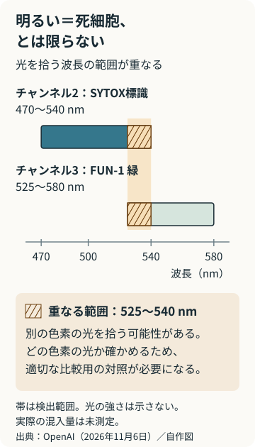
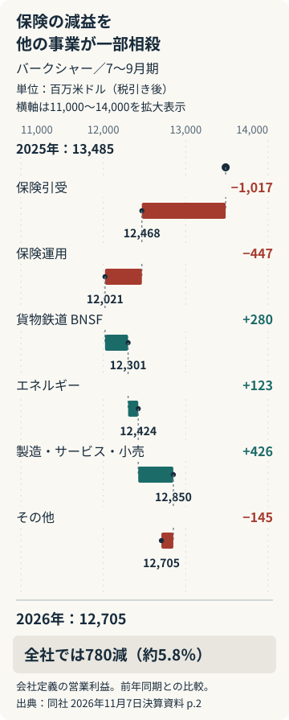

# アヤベ日報　2026年11月9日（月）

本紙 · 21記事 · 図解2点　情報確認 2026-11-09T07:38:00+09:00

## 今朝の読みどころ

- イスラエル、エイゼンコット氏に組閣委任 67人の推薦を政権に変えられるか
- 大阪Bが静岡で連勝 東レのセッター交代に苦しみ、第4セットで立て直す
- AIは実験写真の先を読めるか OpenAIが生データ100課題で試した「研究室の日常」

## 01　イスラエル、エイゼンコット氏に組閣委任 67人の推薦を政権に変えられるか

イスラエルのヘルツォグ大統領は8日、元軍参謀総長で野党ヤシャルを率いるガディ・エイゼンコット氏に、新政権をつくる最初の機会を正式に与えた。7日の委任方針発表から、各党との交渉期限が動き始める段階に進んだ。ただし、首相交代が決まったわけではない。10月27日の総選挙で、ネタニヤフ首相側も野党側も、単独の陣営では国会の過半数を確保できなかったからだ。

議席の内訳が難しさを物語る。Reutersによると、定数120のうち、ネタニヤフ氏の宗教・民族主義勢力は53議席、エイゼンコット氏側のユダヤ系4党は48議席、アラブ系2党は19議席。過半数は61議席である。第一党は27議席のリクードで、エイゼンコット氏のヤシャルは21議席の第二党だった。最大政党の党首と、組閣の最初の交渉役は必ずしも一致しない。

一方、大統領への推薦ではエイゼンコット氏67人、ネタニヤフ氏46人、誰も推薦しない会派が7人となった。大統領府はこの数字を7日に公表している。67は過半数を超えるが、推薦は『この人に交渉させる』という判断であって、同じ閣僚名簿や政策を支持する約束ではない。ヘルツォグ氏自身も5日の説明で、陣営間だけでなく陣営内部にも相互の拒否があり、組閣能力は明確でないと述べていた。

交渉には三つの大きな道がある。アラブ系勢力の支持を得る道、宗教上の厳格な生活を守る超正統派政党と組む道、そしてネタニヤフ氏との大連立である。最初の道では、閣外協力という、入閣せず重要な採決で政権を支える形も考えられる。しかし、エイゼンコット氏の協力相手であるリーベルマン氏は、アラブ系政党に支えられる少数政権にも、ネタニヤフ氏との大連立にも反対している。

二つ目の道では、兵役が交換条件になる。Reutersは、リーベルマン氏が超正統派男性の軍務を求める法律への支持を条件に、超正統派政党との協力に柔軟な姿勢を示したと報じた。エイゼンコット氏も、全国民の軍務・国民奉仕などを参加条件に掲げている。議席を足すだけでは、兵役を巡る立場の違いは消えない。

制度上の最初の期限は委任から28日で、大統領は最大14日の延長を認められる。大統領府の説明に従えば、交渉のための時間は原則4週間、延長を含め最長6週間となる。その間に必要なのは、新首相への期待を増やすことだけではなく、協力政党が同時に受け入れられる政策と役割分担をつくることだ。

この局面の焦点は、67人の推薦が、実際の政権を支える合意に変わるかどうかにある。8日の委任はネタニヤフ氏以外の指導者が組閣を主導する重要な前進だが、拒否してきた相手との妥協を誰が引き受けるのかという、選挙後の本当の交渉はここから始まる。

**出典**

- [イスラエル大統領府：11月7日の委任方針・推薦人数・法定期限](<https://www.president.gov.il/en/president-herzog-concludes-consultations-and-announces-he-will-task-gadi-eisenkot-with-forming-a-government/>)
- [イスラエル大統領府：11月5日の各会派協議後の説明](<https://www.president.gov.il/en/president-herzog-concludes-round-of-consultations-with-knesset-factions-at-the-presidents-residence/>)
- [Reuters：11月8日の正式委任と連立交渉（Investing.com掲載）](<https://www.investing.com/news/world-news/netanyahu-rival-eisenkot-seeks-wide-government-but-path-to-power-uncertain-5010275>)
- [AP：11月8日の委任式と協力政党の条件](<https://apnews.com/article/israel-elections-netanyahu-eisenkot-bec07675825bee5895315e2ea1cb5751>)

## 02　大阪Bが静岡で連勝 東レのセッター交代に苦しみ、第4セットで立て直す

男子バレーボールの大阪ブルテオンは11月8日、香陵アリーナで東レアローズ静岡に3－1で勝ち、前日のストレート勝ちに続く連勝を収めた。大阪Bから見た各セットは25－22、25－16、23－25、25－21。開幕から5勝1敗、勝ち点16となった。2セットを先取してから相手の変化に押し返され、最後は再び主導権を取り戻した試合だった。

先発のアウトサイドヒッターは富田将馬とミゲル・ロペス。西田有志、アントワーヌ・ブリザール、西川馨太郎、エバデダン・ラリー・アイケー、リベロの山本智大とともに入った。甲斐優斗は先発ではないが、第1、第3、第4セットに途中出場している。公式記録では攻撃の打数はなく、サーブを4本打った。先発から外れた理由は、今回確認できた資料では説明されていない。

変化が見えるのは東レ側の組み合わせだ。セッターは新貴裕が第1、第2セットに先発し、中島健斗が第2セット途中から入り、第3、第4セットに先発。ミドルブロッカーも、カネスキから李博へと第3セットの先発が変わった。大阪Bのサムエルボ監督は、相手のセッター交代後に中央からの攻撃との連係が良くなり、大阪Bが相手サーブから始まる攻防で得点を取り切れなくなった、と振り返った。交代と攻撃改善の評価は監督の説明であり、起用の狙いを独自に推定したものではない。

第3セットは20－22から西田の攻撃と西川のブロックで追い付いたが、取り切れなかった。第4セットにはマッカーシーが先発。大阪Bの試合報告によると、西田のサービスエースで6－3と先行し、エバデダンの速攻やマッカーシーのブロックで差を保った。20－16からはマッカーシーのサーブを起点に富田の後衛からの攻撃も決まり、連敗を避けようとする東レを振り切った。

数字では大阪Bの攻撃決定率が60.0％（100本中60本）、東レが44.4％（99本中44本）。とくに後衛からの攻撃は大阪Bが28本中20本、東レが17本中4本だった。一方、ブロック得点は双方8点で、大阪Bにもサーブミスが23本あった。監督が課題に挙げたのは、勝ったことだけでなく、2日続けて安定したプレーをすること。試合経過と評価は大阪Bの公式報告、起用と数値はSVリーグの速報記録に基づく。

**出典**

- [大阪ブルテオン：11月8日 東レ静岡戦・試合結果と監督コメント](<https://www.osaka-bluteon.com/game/result/detail/8>)
- [SVリーグ公式：試合番号434・B帳票（速報記録）](<https://www.svleague.jp/match/form/?id=37999&sheet=b>)
- [SV League Schedule：11月8日試合記録の一覧](<https://www.svleagueschedule.com/matches/2026-11-08-toray-arrows-shizuoka-vs-osaka-bluteon-37999>)

## 03　AIは実験写真の先を読めるか OpenAIが生データ100課題で試した「研究室の日常」

OpenAIは11月6日、酵素設計企業Ligoと作った評価試験「BioBasicsBench」を発表した。問うのは教科書の知識だけではない。実験で撮った写真や測定器の出力を渡し、何が分かるか、どこで失敗しているか、結論を出せないかを判断させる100課題だ。研究開発専門誌R&amp;D Worldも同日、実際の研究室では、整った論文の図より曖昧な証拠を読む力が必要になると報じた。

結果は前進を示した。考える量を多めにした共通の「xhigh」設定で、GPT-6 Astraは満点に対する平均獲得点66.7%、GPT-5.6 Solは43.8%だった。これは「100問中何問に完全正解したか」ではない。結論、測定値、理由などの採点項目に部分点があり、各課題を5回試している。比較したのはOpenAIの7モデルで、他社を含む順位表ではない。

読み取りが研究の役に立つのは、見えたものを実験条件と結び付けたときだ。一例では、細胞の蛍光が明るいことを、死細胞の印だと判断してよいかを問う。二つの検出範囲は470〜540ナノメートルと525〜580ナノメートルで重なる。Astraは、別の色素の光が混じり得るため、明るさだけでは結論を出せないとした。実験の成否を比べるための基準試料や条件を「対照」と呼ぶが、その対照が適切かまで読む必要がある。

一方、R&amp;D Worldが取り上げた失敗はもっと厄介だ。DNAの断片を大きさごとの帯として見る画像で、Astraは帯の二つの集団を見分けたのに、対照が示す意味を逆に解釈し、目的と異なるDNAを持つ試料を選んだ。観察の途中まで正しくても、その後の作業は間違った方向へ進み得る。

この試験の面白さは、AIの「目が良くなった」ことと「研究上の判断を任せられる」ことを切り分けられる点にある。編集上の見立てでは、日々の実験補助への近道は、回答を一つ出させるだけでなく、どの対照と観察がその結論を支えたかを研究者が確かめられる形にすることだ。今回の成績は開発企業による評価であり、第三者の再現試験や研究室全体の時間短縮を実証したものではない。

二つの検出範囲には重なりがある。明るさだけではどちらの色素に由来するか決められない。重なりは検出波長の範囲で、混入光量を表さない。 数値に基づく編集部の自作図。

**出典**

- [OpenAI（11月6日）BioBasicsBenchの方法・結果・具体例](<https://openai.com/index/measuring-how-ai-agents-handle-wet-lab-science/>)
- [R&amp;D World・Brian Buntz（11月6日）実験データ評価の独立報道](<https://www.rdworldonline.com/openai-unveils-biobasicsbench-a-benchmark-to-gauge-how-well-ai-agents-read-raw-experimental-data-across-100-routine-wet-lab-tasks/>)

## 04　COP31、きょう開幕へ 「電力35％」は発電所を増やすだけでは届かない

国連の気候変動会議COP31は9日、トルコのアンタルヤで開幕する。会期は20日まで。開催国トルコと、交渉を率いるオーストラリアが押し出す争点の一つは、工場、車、建物で使うエネルギーを、石油やガスから電気に置き換える『電化』だ。削減目標の数字だけでなく、実際に設備を替える投資と資金へのアクセスが問われる。

豪政府は6日の方針発表で、ボーエン気候変動・エネルギー相が190カ国超の合意づくりを主導し、電化の加速、投資、気候資金を使いやすくすること、海洋に関する行動を進めると説明した。太平洋の島しょ国との協力も重視する。開催場所を提供する役割と、正式交渉をまとめる役割を分担する会議となる。

提案は、2035年に世界の最終エネルギー消費の35％を電力で賄うこと。家庭や企業、交通が実際に使うエネルギーの比率であり、再生可能エネルギーの発電比率ではない。車や熱源など、使う側の設備を電気に替える目標だ。

国際エネルギー機関（IEA）は9月22日、現在の23％に対し、既存技術と燃料供給危機前の価格でも2035年には33％まで費用面で合理的に電化できると分析した。35％案はそれより2ポイント高い。分析値、政治提案、実績を分けて読む必要がある。

IEAが挙げる課題は発電・送電網への投資と、家計や企業の初期費用への支援などだ。電気を使う機械だけでなく、それを安定して動かす設備と資金を一緒に用意する必要がある。

交渉上の難しさも残る。日本時間9日朝のReutersによると、シンガポールのフー環境相は6日の記者向け説明で、温室効果ガス削減目標の大幅な上積みよりも、すでに約束した対策を実行する余地が大きいとの見方を示した。エネルギー安全保障への懸念が強まる中でも、災害や暑さに備える適応策などでは前進できるとしている。新しい旗印を作ることと、既存の約束を実現することを、同じ交渉の中で両立させる必要がある。

編集上の見立てでは、今回の焦点は新しい数字を掲げられるかだけではない。誰のどの設備を替え、費用をどう賄い、増える電力需要にどう対応するか。各国の合意が具体策を伴うほど、気候交渉は家計や企業の設備選択に近づく。

**出典**

- [UNFCCC：COP31会期・公式会議情報](<https://unfccc.int/cop31>)
- [豪政府：COP31での交渉方針（11月6日）](<https://minister.dcceew.gov.au/bowen/media-releases/australia-advance-practical-action-climate-change-cop31>)
- [IEA：電化の費用・設備・安全保障の分析（9月22日）](<https://www.iea.org/news/electrification-takes-centre-stage-as-hormuz-shock-spurs-countries-to-seek-to-enhance-energy-security>)
- [Reuters：シンガポール環境相が実行を重視（11月8日）](<https://www.reuters.com/sustainability/cop/climate-talks-should-focus-implementation-not-new-targets-singapore-says-2026-11-08/>)

## 05　宇宙で原子を冷やす理由 天宮の9.7ピコケルビンが広げる「観測の7秒」

北京大学と中国科学院上海光学精密機械研究所などのチームが、中国の宇宙ステーション「天宮」で原子雲の等価温度を9.7ピコケルビンまで下げた。研究は11月5日にScienceで公表され、北京大学が6日に発表した。ケルビンは絶対零度を0とする温度の単位で、ピコは1兆分の1。絶対零度にごく近い値だが、宇宙ステーションの室内を冷やしたわけではない。約2万個のルビジウム原子が、解放された後にどれだけゆっくり広がるかを温度に換算した結果である。

なぜ、冷やすために宇宙へ行くのか。地上では原子雲にも重力が働き、捕まえておく場所から下へずれようとする。閉じ込めを緩めてさらに冷やしたくても、落ちる力を支える必要がある。地球の周りを自由落下し続ける宇宙ステーションなら、見かけ上ほとんど重さのない環境を長く使える。Science Newsは、地上の落下塔でも短時間の無重量状態を作れるが、落下できる時間が上限になると説明している。

研究チームはレーザーで原子を捕まえ、エネルギーの高い原子を逃がす蒸発冷却などを使った。十分に冷やすと、多数の原子が同じ量子的な状態を共有する「ボース・アインシュタイン凝縮」になる。さらに、より広い光のわなへ移し、閉じ込める力を弱めた。独立科学媒体Phys.orgによると、その後の原子雲の広がりを三方向から測り、9.7ピコケルビンと評価した。不確かさを含む範囲は7.0〜12.9ピコケルビンだ。

低温記録と同じくらい重要なのが時間である。今回の自由膨張の観測時間は7秒。Phys.orgは、従来の落下塔実験では38ピコケルビンで2秒、国際宇宙ステーションの別の実験では52ピコケルビンで1秒だったと整理する。装置も手法も異なるため、同条件の競争ではないが、ゆっくり動く原子を長く観測できる組み合わせは、微小な変化を測る実験の足場になる。

その先にあるのは、温度の数字をさらに小さくする競争だけではない。原子を波として分けて重ね合わせ、重力などの影響を精密に読む測定や、通常の物質では調べにくい量子的状態を原子雲で再現する研究が考えられる。編集上の見立てでは、宇宙の価値は「地上より冷たい場所」にあるのではなく、落下と熱運動に邪魔されず実験を続けられる時間を買える点にある。新しい物理法則を発見した報告ではなく、そのための実験基盤を進めた成果だ。

**出典**

- [北京大学電子学院（11月6日）研究チームの発表](<https://ele.pku.edu.cn/info/1012/6785.htm>)
- [Science News・Emily Conover（11月5日）超低温記録と微小重力の解説](<https://www.sciencenews.org/article/lowest-temperature-china-space-station>)
- [Phys.org・Krystal Kasal（11月6日）方法・誤差範囲・観測時間](<https://phys.org/news/2026-11-scientists-temperature-china-space-station.html>)

## 06　巨大アヒルが浮かぶ造船所跡 北加賀屋のアートは「工場の広さ」をどう使うか

大阪市住之江区の名村造船所大阪工場跡地で11月8日、「すみのえアート・ビート2026」が開かれた。大阪スタイルの当日報道は、高さ9.5メートルのラバー・ダックの展示と、作品や飲食、ワークショップを楽しむ来場者の様子を伝えた。黄色い巨大なアヒルの背景にあるのは、工場を取り壊して別の施設にするのではなく、残った空間を文化の受け皿に変える試みだ。

会場のクリエイティブセンター大阪は造船所跡地を活用した施設。大阪ベイ経済新聞によると、2009年の近代化産業遺産認定をきっかけに始まった催しが、2013年に現在の名称となり、今回は17回目を迎えた。主催者の事前発表には、普段入れない場所を巡る見学や、実物大の船・橋を描いた現図場を見る企画も並ぶ。船を造るための場所そのものを、展示室に収まらない鑑賞対象にしている。

今回の発表では物販・飲食など63の出店が予定され、会場を3階にも広げた。3階では巨大なアヒルを上から見る視点も用意し、2階には光に反応するデジタルアートを置く構成だった。展示物を追加するだけでなく、階の高さや水辺、かつての作業空間の違いが、見え方と歩き方を変える。ただし、63店すべての当日の出店実績までは確認していない。

一日限りの祭りの周辺には、作品を継続して置ける場所もある。近隣のMASKは約1,000平方メートルの元鉄工所・倉庫を大型作品の保管と公開に活用し、「Open Storage 2026」を開催中だ。千島土地の10月9日発表によると、今年は名和晃平を中心に複数の作家を紹介する。大きな作品を保管するための空間と、一般客が見る場所を兼ねる点で、通常の美術館とは異なる使い方になっている。

この場所と制作のつながりは、今月27、28日に同センターで予定されるダミアン・ジャレと名和晃平の新作公演「Prism」にも続く。両者の協働は、2016年にここで制作された「VESSEL」から10年になる。工場の余白が、保存、鑑賞、制作、公演をつなぐ土台になったという見方ができる。MASKの公開は11月29日までの金・土・日曜と祝日、通常12～18時。祭りの翌週以降にも、北加賀屋の変化を現場でたどれる。

**出典**

- [大阪スタイル：11月8日のすみのえアート・ビート開催報告](<https://osaka.style/news/78997/>)
- [大阪ベイ経済新聞：造船所跡地で17回目、会場拡大などの事前取材](<https://osakabay.keizai.biz/headline/1528/>)
- [千島土地：すみのえアート・ビート2026の企画発表（10月19日）](<https://prtimes.jp/main/html/rd/p/000000090.000082775.html>)
- [千島土地：MASK Open StorageとPrismの発表（10月9日）](<https://prtimes.jp/main/html/rd/p/000000089.000082775.html>)
- [大阪市住之江区：北加賀屋のまちとアート](<https://www.city.osaka.lg.jp/suminoe/page/0000540426.html>)

## 07　拉致被害者家族、日朝会談の早期実現求める 高市首相は対話への用意表明

北朝鮮による拉致被害者全員の即時一括帰国を求める国民大集会が8日、東京都内で開かれた。高市首相は金正恩氏と会って率直に話し合いたいと述べ、日朝平壌宣言に基づく関係づくりに向け、対話し具体的に行動する用意があると表明した。首脳会談の日程や開催合意を発表したものではない。

首相は内閣発足から1年が過ぎても帰国を実現できていないことへの思いを語り、自らの任期中に突破口を開く決意を重ねて示した。FNNは、政府が具体的な成果に向けた働きかけを続けているとの発言も伝えた。

テレビ朝日によると、横田めぐみさんの母・早紀江さんらは政権への期待とともに、解決に向けた首脳会談の早期実現を求めた。家族が訴えたのは、長い時間が過ぎても救出が実現していないという切実さだ。政府の対話方針が改めて示された一方、家族にとって必要なのは、会談の実現と帰国という具体的な結果である。

**出典**

- [FNN：11月8日の国民大集会と首相発言](<https://www.fnn.jp/articles/-/1148349>)
- [テレビ朝日：家族の訴えと早期会談要請](<https://news.tv-asahi.co.jp/news_society/articles/000546243.html>)

## 08　中国で服役のアステラス社員、12月中旬に満期出所の見通し

中国でスパイ罪に問われ、懲役3年6月の判決を受けて服役しているアステラス製薬の日本人男性社員が、12月中旬に刑期を終えて帰国する見通しとなった。共同通信と読売新聞が7日、日中関係筋の情報として報じた。共同は、出所後に直ちに日本へ強制送還されるとの見方を伝えている。

男性は中国での任期を終えようとしていた2023年3月に拘束され、24年8月に起訴、25年7月に実刑判決を受けた。今回伝えられたのは、外交交渉による早期釈放ではなく、刑期満了に伴う出所の見通しだ。日本政府はこれまで首脳・外相会談などで早期解放を求めてきた。

出所日や帰国手続きの正式発表は、確認できた資料にはない。8日のReuters報道も日本の報道を紹介したもので、同社の照会に関係当局やアステラスから回答を得られていないと記している。報道各社の見通しと、中国当局による確定した発表は分けて受け止める必要がある。

**出典**

- [共同通信：満期出所の見通しと拘束経緯（熊本日日新聞掲載）](<https://www.kumanichi.com/articles/2055346>)
- [読売新聞：複数の日中関係筋による帰国見通し（ライブドア掲載）](<https://news.livedoor.com/article/detail/32758902/>)
- [Reuters：11月8日の追認報道と当局への照会状況](<https://www.reuters.com/world/china/astellas-employee-imprisoned-china-be-released-december-japanese-media-report-2026-11-08/>)

## 09　東大新課程に学生有志が異議 費用と教育内容を問題視

東京大学が2027年9月に始める「UTokyo College of Design」をめぐり、集英社オンラインは11月8日、新設の撤回を求める東京大学文学部学生有志会議への取材記事を公開した。担当者は、授業料を引き上げる一方で新課程に資源を投じることや、教育内容の説明に疑問を示した。一方、留学生が増えること自体は、キャンパスの国際化につながるとして歓迎する考えを示した。

大学の公式説明では、同課程は人文・社会科学から自然科学までの知識をデザインの手法と結び、社会課題に取り組む力を育てる。学士・修士を5年間で修了でき、授業はすべて英語。初年次は全員が寮で暮らす。「価値創造学部」は学士課程部分の設置申請に用いる和名で、学生募集には一貫して英語の課程名を使うとしている。

募集定員は100人で、初回の出願受付は11月5日に終了した。9月14日公表の募集要項には、授業料を年64万2960円、入学料を28万2000円と記載。経済状況に応じた給付型奨学金も設け、採用者には年240万円などを最長5年間支給する。費用は規則改正で変わる場合がある。

授業料の引き上げは2024年9月に決まり、2025年度の学部入学者から適用されている。当時、大学は教育・学修環境の改善に増収分を充てる方針と、授業料免除の対象拡大などを説明した。今回の取材では、集英社の新課程に関する問い合わせに対し、大学は公式ウェブサイトのURLを案内したという。

**出典**

- [集英社オンライン・11月8日付インタビュー](<https://shueisha.online/articles/-/259149>)
- [東京大学・課程の目的](<https://design.adm.u-tokyo.ac.jp/jp/>)
- [東京大学・学位と名称の説明](<https://design.adm.u-tokyo.ac.jp/jp/faq/>)
- [東京大学・募集定員と選抜方針](<https://design.adm.u-tokyo.ac.jp/admissions/application-guidelines-2027/>)
- [東京大学・募集日程、費用、奨学金](<https://design.adm.u-tokyo.ac.jp/admissions/application-guidelines-2027/route-a/>)
- [東京大学・出願受付終了](<https://design.adm.u-tokyo.ac.jp/jp/admissions/>)
- [東京大学・2024年9月24日授業料改定](<https://www.u-tokyo.ac.jp/content/400247772.pdf>)

## 10　梅田の書店で従業員が刺される 大槻ケンヂのサイン会は中止

11月8日午前、大阪市北区茶屋町のMARUZEN＆ジュンク堂書店梅田店で、20代の男性従業員が太ももを刺される事件があった。共同通信と日刊スポーツによると、命に別条はない。大阪府警は30代の男を傷害容疑で現行犯逮捕し、詳しい経緯を調べている。警察は2人に面識はなかったとみている。

同店で予定されていた大槻ケンヂの短編集「奇談師」のサイン会は中止となった。日刊スポーツは、大槻がXで中止を知らせ、店側も今後の案内をイベントページに掲載すると告知したことを報じた。大槻は移動中に連絡を受け、別の機会に実現できればとの思いを示したという。

振替日や翌日以降の店舗営業については、今回確認した報道では確定情報を得られていない。サイン会の参加予定者は、梅田店の案内で今後の対応を確かめる必要がある。堂島の店舗ではなく、茶屋町の梅田店で起きた事件である。

**出典**

- [共同通信：大阪の大型書店で男性刺される（11月8日14:26）](<https://news.livedoor.com/article/detail/32762614/>)
- [日刊スポーツ：大槻ケンヂのサイン会中止と事件続報（11月8日20:27）](<https://news.livedoor.com/article/detail/32764644/>)

## 11　内房線が全線で再開。仮設の折り返し設備を外し、通勤路をつなぎ直す

台風25号の大雨で一部区間が止まっていたJR内房線が11月8日午前、約1カ月半ぶりに全線で運転を再開した。テレビ朝日の現地報道によると、線路への土砂流入などで不通となった姉ケ崎―長浦間が復旧し、代行バスによる輸送も終了した。当初は復旧に少なくとも3カ月を要すると見込まれていたが、工事が進み再開を早めたという。

つながらなかった線路を直すだけで、直ちに通常運行へ戻れるわけではない。長浦駅には不通区間の手前で列車を折り返すための仮設設備があった。7日の運転終了後からそれを撤去し、安全確認を経て8日の全線再開に移った。不通の間に部分運行を支えた設備を、今度は直通運転のために取り除く作業だった。

袖ケ浦市が11月6日に掲載したJR東日本の運行計画では、9日から内房線・外房線を通常の本数に戻し、特急「さざなみ」も全列車を再開する予定だ。8日の全線開通は実績として確認できた一方、9日の全列車の運行結果を確認したものではない。月曜朝の通勤・通学は、代行輸送を挟んだ移動から鉄道での移動に戻る節目を迎える。

**出典**

- [テレビ朝日：11月8日の全線再開](<https://news.tv-asahi.co.jp/news_society/articles/000546160.html>)
- [テレビ朝日：仮設設備の撤去](<https://news.tv-asahi.co.jp/news_society/articles/000546165.html>)
- [袖ケ浦市：11月9日以降の運行計画](<https://www.city.sodegaura.lg.jp/soshiki/tokei/utbousenhukyuumitooshi.html>)
- [ANN・11月9日朝：再開後の運行（メ〜テレ掲載）](<https://www.nagoyatv.com/news/syakai.html?id=000546261>)

## 12　警察業務を妨げる動画の模倣、TikTokが審査語を追加

各地で起きている交番への侵入や警察官への挑発を撮影する行為について、TikTokの運営会社が投稿審査の対象語を追加していることが、11月9日朝の読売新聞の取材で分かった。運営側は、動画で使われる呼称を確認項目に加え、助長や模倣を防ぐため審査や啓発を改善すると説明した。

関西テレビが6日に放送し8日に配信した取材では、大阪府警は9月中旬以降、10月末までに約280件の関連事案を認知し、少年約50人を検挙・補導したと説明している。読売の取材に対し、富山県警も虚偽の通報への対応が、本当に助けを必要とする人への対応を遅らせうると指摘した。単に動画が不快だという問題ではなく、限られた現場の人手が割かれている。

今回の新しい情報は、以前の摘発例そのものより、拡散する場所の側が審査を変更した点にある。ただし、追加後に投稿や模倣がどれだけ減ったかという数字は報じられていない。ここで扱ったのは両媒体が確認した事例と運営会社の回答で、公開動画全体の流行規模を測ったものではない。

**出典**

- [読売新聞：運営会社への取材と各地の事例](<https://news.livedoor.com/article/detail/32765825/>)
- [関西テレビ：大阪府警への取材（11月6日放送・8日配信）](<https://www.fnn.jp/articles/-/1148315>)

## 13　G7外相会合、欧州などへのサイバー攻撃を協議へ イタリアが共同対応を提案

9～10日にパリで開かれるG7外相会合で、最近のサイバー攻撃などへの共同対応が議題になる。イタリアのタヤーニ外相は8日、議長国フランスのバロ外相が提案を受け入れたと説明した。7日に議題化を求めた段階から、実際の協議へ進む。

イタリア外務省は7日、タヤーニ氏の個人情報がダークウェブで流通していることを、サイバー対策部門が把握したと発表していた。ダークウェブは通常の検索などでは見つけにくい、専用の仕組みでアクセスするネット上の領域だ。同省はイタリアや欧州諸国に対する、サイバー攻撃などを組み合わせた脅威を取り上げるようG7議長国に求めた。

タヤーニ氏は8日、親ロシア派のハッカーを念頭に置きつつ、ロシア政府の関与を立証したとは述べていない。攻撃の背景についての政府の見方と、実行主体が技術的に特定された事実は別である。G7が協議するのは共同の対抗策であり、具体策の合意は会合後の確認事項となる。

**出典**

- [Reuters：11月8日の議題化表明とロシア政府関与に関する留保](<https://www.reuters.com/world/g7-ministers-discuss-recent-cyber-attacks-italy-says-2026-11-08/>)
- [イタリア外務省：11月7日の公表とG7への要請](<https://www.esteri.it/it/sala_stampa/archivionotizie/comunicati/2026/11/tajani-dati-personali-diffusi-sul-dark-web-chiesto-di-trattare-minacce-ibride-al-prossimo-g7-esteri-solidarieta-a-lo-voi-gabrielli-e-tassan-zanin/>)
- [AP：個人情報流出の公表と政府の説明](<https://apnews.com/article/italy-minister-tajani-cyberattack-41b956d638e95528bef84fd856d5b5d6>)

## 14　トランプ氏、協議進展なら対イラン再攻撃は「可能性低い」 軍事圧力は維持

トランプ米大統領は8日のCNN電話取材で、イランの核計画やホルムズ海峡の再開を巡る協議が前進する限り、新たな大規模攻撃が必要になる可能性は低いとの見方を示した。Reutersもこの発言を報じた。条件は強力な合意の成立で、無条件の攻撃停止や和平合意の発表ではない。

同じインタビューで大統領は、米軍は行動の準備があり、イランの橋などのインフラを攻撃対象として想定しているとも述べた。対話を優先する可能性を語る一方で、軍事的な圧力は残した形だ。対象数や攻撃能力に関する大統領の主張を、独立に検証された軍事情勢とは扱えない。

CNNによると、仲介国カタールを含む関係国は交渉の詳しい状況を公にしていない。今回の新しい材料は、米大統領が8日の取材で示した条件付きの姿勢である。交渉が進んだかどうかの政治的な説明と、海峡の航行や実際の攻撃がどう変わったかは、別々に確かめる必要がある。

**出典**

- [CNN：11月8日の本人への電話取材（KESQ掲載）](<https://kesq.com/news/national-politics/cnn-us-politics/2026/11/08/trump-says-renewed-attacks-on-iran-highly-unlikely-if-talks-show-progress/>)
- [Reuters：CNN取材での条件付き発言](<https://www.reuters.com/world/middle-east/trump-says-he-is-unlikely-order-iran-attack-if-talks-progress-cnn-reports-2026-11-08/>)
- [AP：11月8日の中東情勢、発言の確認](<https://apnews.com/article/mideast-news-november-8-2026-090d96e25872f5c63e105b9dd3e5dc60>)

## 15　バークシャー、自社株買い96億ドル 保険の減益を鉄道・製造業が一部補う

米バークシャー・ハサウェイが7日に発表した7～9月期決算では、自社株買いが約96億ドル、1～9月累計では約144億ドルとなった。自社株買いは、企業が市場などから自分の株式を買い戻すこと。グレッグ・アベルCEOの下で、積み上がった資金をどう使うかが数字に表れた。

一方、本業に近い収益をみるために同社が示す営業利益は127億500万ドルで、前年同期の134億8500万ドルから約5.8％減った。この指標は税引き後の利益から投資損益などを除く同社独自の集計で、一般企業の損益計算書の営業利益と同じ定義ではない。純利益は221億1200万ドルだった。

減益の中心は保険だ。保険料収入と保険金支払いなどの差から得る保険引受利益は、23億6900万ドルから13億5200万ドルへ減少。保険の運用収益も減った。他方、貨物鉄道BNSF、エネルギー、製造・サービス・小売部門はいずれも増益となり、保険部門の落ち込みを一部埋めた。

Reutersは、保険会社Geicoの収益低下に、顧客回復を狙った保険料引き下げなどが影響したと伝えた。全社の利益だけでは見えないのは、この部門ごとの違いである。今回の決算には、資金を株主へ振り向ける判断と、保険以外の幅広い事業が収益を支える構図の両方が示されている。

保険の二部門で14億6400万ドル減益。鉄道・エネルギー・製造等の増益8億2900万ドルが一部を補った。全社では7億8000万ドル減。 数値に基づく編集部の自作図。

**出典**

- [Berkshire Hathaway：11月7日の決算発表PDF](<https://www.berkshirehathaway.com/news/nov0726.pdf>)
- [Reuters：自社株買いと事業別収益の背景（Investing.com掲載）](<https://ca.investing.com/news/stock-market-news/berkshire-hathaway-accelerates-stock-buybacks-operating-profit-falls-4941143>)

## 16　Claudeは何を覚え直すのか Anthropicが「記憶の手直し」を公開

Anthropicは11月6日、AIが会話をまたいで使う記憶の設計と評価を公開した。ここでいう記憶は、学習済みモデルの内部を書き換えるものではなく、経験から作ったメモを後の作業で読み直す仕組みだ。仕事中に記録する工程と、仕事の合間に元のログと突き合わせて整理する工程を分けている。

具体例はゲームの道案内だった。Claudeは洞窟の入口側にある建物を出口側と取り違えて記憶し、まだ通っていない洞窟を通過済みと判断した。間違ったメモは、次の行動にも同じ誤りを持ち込む。記録を後から検証する工程は、文章を短く整えるだけでなく、その前提自体を修正するために使われる。

データベースの設問に答える評価では、正答を教えられた後、何を間違え、どのルールを確かめたかを次の回へ残せるモデルほど記憶を活用した。一方、「失敗だけ記録せよ」と限定すると、強いモデルで得られていた効果が小さくなったと同社は報告する。覚える量だけでなく、残す内容の選び方が仕事の成否を左右する。

今回の公開は新モデルの発売ではなく、開発企業による設計と実験の説明である。評価中は正答が返されるため、日常の仕事でも同じ改善が起きるとは限らない。ただ、昨日の誤りを今日も繰り返さないAIを作るには、メモを持たせるだけでなく、根拠に戻って直す機会が要るという具体的な課題が見える。

**出典**

- [Anthropic（11月6日）The components of agent memory](<https://www.anthropic.com/research/components-of-agent-memory>)
- [Hacker News・原記事をめぐる公開スレッド（候補発掘）](<https://news.ycombinator.com/item?id=50402212>)

## 17　Jackery 100Dは容量より出力を選んだ 約110グラム軽く、USB-Cは140Wへ

Jackery Japanは小型電源「Explorer 100D」を11月5日に発売し、6日に発表した。通常価格は税込1万7,900円。従来の100 Plusから、重量を約965グラムから約855グラムへ減らし、持ち運び用のハンドルを付けた。机や撮影場所を移りながら、ノートPCやカメラの電源を持ち歩く使い方を狙う。

改良の中心は、ためる電気の量より一度に渡す力だ。容量は99Whから96Whへ少し減った一方、USB-Cの単独使用時の最大出力は100Wから140Wへ、全ポート合計は128Wから158Wへ増えた。USB-Cが2口、USB-Aが1口あり、最大3台を同時に充電できる。ただし、各USB-Cの140Wを2口同時に出せるという意味ではない。

電池はリン酸鉄リチウムイオン方式。メーカーは約3,000回の充放電後も初期容量の80%以上を維持するとし、旧型の約2,000回から延ばした。これは公称条件での値で、今回の記事で実測した寿命ではない。

新型を選ぶ理由は、旧型より長く使える容量ではなく、荷物を軽くしながら高出力のUSB機器に対応しやすくなることだ。公式サイトでは11月30日まで30%引きの発売キャンペーンを案内している。サンドゴールドが先行し、ブラックは順次発売予定となっている。

**出典**

- [Jackery Japan（11月6日）公式発表と旧モデル比較](<https://prtimes.jp/main/html/rd/p/000000374.000039188.html>)
- [デジカメ Watch（11月6日）Explorer 100D報道](<https://dc.watch.impress.co.jp/docs/news/2154386.html>)

## 18　星を探して撮る望遠鏡、Seestar S30 Plusをビクセンが国内販売へ

ビクセンは11月6日、ZWO製のスマート天体望遠鏡「Seestar S30 Plus」を国内で販売すると発表した。望遠と広角の二つのレンズ、目標の天体へ向ける自動導入機能を備えるSeestarシリーズの新モデルで、同社は初めてスマート望遠鏡を使う人向けと位置付ける。

見どころは、自分で星の位置を探して望遠鏡を向ける操作と、撮影の機器をまとめる方向性にある。ただし、今回確定したのは国内取扱い。発売日と価格、詳細な仕様はまだ発表されていない。ビクセンは生産数に限りがあり、発売後も届くまで時間がかかる見込みとしている。従来機から何が変わるかは、次の仕様公開で比べることになる。

**出典**

- [ビクセン（11月6日）国内販売決定の公式発表](<https://prtimes.jp/main/html/rd/p/000000273.000134758.html>)
- [デジカメ Watch（11月6日）Seestar S30 Plus国内取扱い](<https://dc.watch.impress.co.jp/docs/news/2154343.html>)

## 19　たくろう万博が閉幕、2日間で2万2千人 最後は盆踊りで観客と輪

お笑いコンビ・たくろうが大阪・万博記念公園で開いた「たくろう万博」は11月8日、2日間の日程を終えた。日刊スポーツによると、両日合わせて2万2,000人が来場。最終盤にはレイザーラモン、藤崎マーケット、島田珠代らも加わる盆踊りが行われ、赤木裕はTHE BLUE HEARTSの「情熱の薔薇」を歌った。

前日までの展示や開幕の話題から一歩進んだのは、芸人の発想が実際の大きな催しとして完走したことだ。終演後の取材で赤木は、何げなく口にしたことが実現した驚きを語った。きむらバンドは、こうした経験を経て、軽々しく言葉にすることへの慎重さと日々を大切にする思いを示した。

公式の最終日タイムテーブルには、音楽、字幕を使う漫才、盆踊り、エンディングまでが組まれていた。閉幕報道で確認できる最後の盆踊りは、出演者を見るだけの舞台から、観客も参加する祭りへと広げた締めくくりとなった。

**出典**

- [日刊スポーツ：たくろう万博閉幕、2日間2万2000人（11月8日）](<https://www.nikkansports.com/entertainment/news/202611080001870.html>)
- [たくろう万博公式：11月8日のタイムテーブル](<https://takuro-expo.com/timetable/>)
- [FANY Magazine：初日11月7日のステージとフィナーレの報告](<https://magazine.fany.lol/295789/>)

## 20　大阪MVは再び2セット先行を許し、今度は逆転ならず SAGA久光に1－3

女子バレーボールの大阪マーヴェラスは11月8日、ベイコム総合体育館でSAGA久光スプリングスに1－3で敗れた。大阪MVから見たスコアは22－25、23－25、25－23、18－25。前日は2セットを失ってから3－2で逆転したが、同じ相手との2戦目は第3セットを取り返した後に続かなかった。大阪MVは6勝2敗、SAGA久光は7勝1敗となった。

大阪MVのセッターは第1、第2セットに東美奈、第3、第4セットに塩出仁美が先発した。酒井大祐監督は、相手の高い守備力を前に攻撃を決め切れず、相手の攻撃も止められなかったと公式記録の談話で振り返り、攻撃の精度と変化を課題に挙げた。セッター交代の理由そのものは、この談話では説明されていない。

攻撃決定率は大阪MV37.8％、SAGA久光38.9％と近い一方、攻撃のミスは大阪MVが15本、SAGA久光が7本だった。後衛からの攻撃による得点も3対8で差が付いた。これだけで敗因を一つに絞ることはできないが、単にラリーをつなぐだけでなく、最後の一打を得点にできたかを見る材料になる。

SAGA久光の中田久美監督は、前日の課題を修正し、相手の守備に対してどう得点するかを確認して臨み、落ち着いて対応できたと説明した。連日の対戦では、前日の勝ち方がそのまま再現されるとは限らない。今回は前日に敗れたSAGA久光が、相手の守備への対応を見直したと語り、勝利を収めた。

**出典**

- [SVリーグ公式：11月8日 大阪MV対SAGA久光・A帳票と両監督談話](<https://www.svleague.jp/match/form/?id=37481&sheet=a>)
- [SVリーグ公式：同試合B帳票・起用と個人/チーム記録](<https://www.svleague.jp/match/form/?id=37481&sheet=b>)
- [SAGA久光公式：11月8日の試合結果](<https://saga-springs.co.jp/match/results/1052.php>)

## 21　九州場所初日、大の里が黒星 義ノ富士が俵際で残り、物言い後も軍配変わらず

大相撲九州場所は11月8日、福岡国際センターで初日を迎えた。2場所連続7度目の優勝を目指す横綱大の里は、小結義ノ富士に突き落としで敗れた。横綱豊昇龍は、新小結美ノ海を押し出して白星発進。両横綱の出足が分かれた。

大の里は相手を土俵際まで追い込んだが、義ノ富士の回り込みに前へ落ち、先に手をついた。物言いがついて映像も確認されたものの、義ノ富士に上がった軍配は維持された。日刊スポーツが伝えた浅香山審判部長の説明では、義ノ富士が俵際に残っていたことが判断の要点だった。

大の里はこの取組前まで義ノ富士に1勝4敗で、今回も分の悪い相手を突破できなかった。日刊スポーツの取材には気持ちを切り替える考えを示しており、9日の2日目は藤凌駕と対戦する。

大関陣も霧島が宇良を押し倒した一方、安青錦は朝乃山に寄り倒され、琴桜は藤凌駕に押し出された。上位陣がそろって白星を重ねる初日とはならず、大の里には早くも立て直しが求められる。

**出典**

- [共同通信：九州場所初日、両横綱は明暗（熊本日日新聞掲載）](<https://kumanichi.com/articles/2055562>)
- [日刊スポーツ：大の里、初日黒星と取組後の談話](<https://www.nikkansports.com/battle/sumo/news/202611080001895.html>)
- [日刊スポーツ：浅香山審判部長が物言いの判断を説明](<https://www.nikkansports.com/battle/sumo/news/202611080001830.html>)
