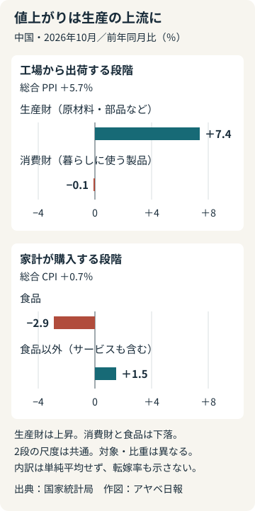
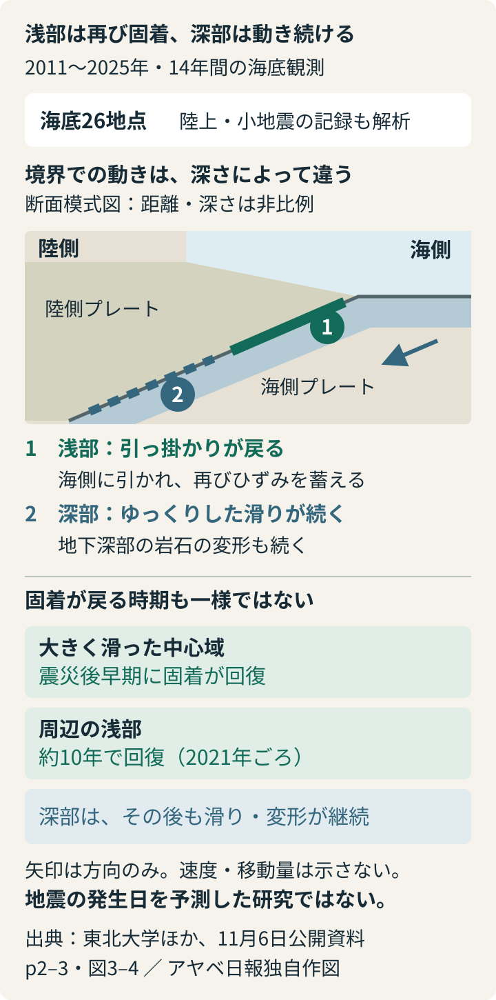

# アヤベ日報　2026年11月10日（火）

本紙 · 20記事 · 図解2点　情報確認 2026-11-10T07:59:55+09:00

## 今朝の読みどころ

- 中国の工場価格は5.7％上昇、家計の物価は0.7％ 値上がりはどこで止まるのか
- 日越首脳、重要鉱物の協力を具体化へ 資源だけでなく電力と人材も結ぶ
- 震災後の海底、再びひずみをためる側へ 26地点が捉えたプレート境界の変化

## 01　中国の工場価格は5.7％上昇、家計の物価は0.7％ 値上がりはどこで止まるのか

中国国家統計局が9日に公表した10月の物価統計では、工場から製品を出荷する時の価格を測る生産者物価指数（PPI）が前年同月比5.7％上昇した。一方、家計が買う商品やサービスの価格を測る消費者物価指数（CPI）は0.7％上昇。工場側は9月の5.0％から加速し、家計側は0.9％から鈍化した。ロイターによれば、PPIの伸びは2022年6月以来の大きさだ。

なぜ、工場の値上がりがそのまま買い物の値段に表れないのか。まず、工場価格の中身が一様ではない。原材料や部品など生産に使う「生産財」は7.4％上昇したが、消費者が使う「消費財」は0.1％下落した。企業向けの取引で価格が上がっていても、家計向けの製品全体が同じ強さで値上がりしているわけではない。

上流を押し上げたのはエネルギーだ。国家統計局の説明では、国際エネルギー価格の上昇と冬に備える需要などが、石油・天然ガス、石炭、精製油、化学原料、都市ガスなどに波及した。関連6業種だけで、PPIの前月比上昇幅0.7％の8割超を説明するという。燃料を買う側の負担が増し、その燃料を使う工程へ広がる経路が読み取れる。

店頭では逆方向の力も働く。食品は前年同月より2.9％安く、野菜は16.9％、豚肉は8.6％下落した。食品以外は1.5％上昇しているため、CPI全体の0.7％だけを見ると、食品の値下がりが他の値上がりを和らげている構造を見落とす。食品とエネルギーを除く指標も0.8％上昇にとどまり、9月の1.0％から鈍った。

ロイターは、国内の需要の弱さが企業のコスト増を消費者へ十分に転嫁することを難しくしていると説明する。ここから見えるのは、景気が強いから全体の価格が上がるというより、資源の値上がりと家計側の弱さが同居する姿だ。ただし、二つの指数は対象も比重も違い、差の5ポイントをそのまま企業の損失や未転嫁分とは計算できない。

今後の分かれ目は、エネルギー高が落ち着くか、家計向け商品の価格にも広く波及するかだ。工場の総合値だけでなく、生産財と消費財、食品と食品以外を分けると、値上がりがどの段階に集中しているかを追える。今回の数字は11月の物価ではなく、10月の実績を9日に公表したものとなる。

工場の生産財価格上昇と、消費財・食品の下落を同じ尺度で比べる。2026年10月、前年同月比。両指数の対象と比重は異なり、単純平均や価格転嫁率を表す図ではない。

**出典**

- [中国国家統計局：10月の生産者物価・主要データ表](<https://www.stats.gov.cn/sj/zxfb/202611/t20261109_1965794.html>)
- [中国国家統計局：10月の消費者物価・主要データ表](<https://www.stats.gov.cn/sj/zxfb/202611/t20261109_1965795.html>)
- [中国国家統計局：10月物価の解説](<https://www.stats.gov.cn/xxgk/jd/sjjd2020/202611/t20261109_1965796.html>)
- [Reuters：工場価格上昇と消費者物価鈍化（9日）](<https://www.reuters.com/world/asia-pacific/chinas-october-producer-inflation-quickens-further-consumer-prices-edge-down-2026-11-09/>)

## 02　日越首脳、重要鉱物の協力を具体化へ 資源だけでなく電力と人材も結ぶ

高市早苗首相とベトナムのトー・ラム共産党書記長兼国家主席は9日夜、東京で会談し、重要鉱物、とくにレアアースを巡る具体的な協力を進めることで一致した。両首脳は共同ビジョン声明を発表。8日号で伝えた会談前の法整備協力や農産物の調整から、資源、電力、人材、安全保障を含む首脳間の合意へ進んだ。

会談の焦点は、資源を買う約束だけではない。外務省の発表は、供給網を強くするためのレアアース協力と、ベトナムの増える電力需要に対応するLNG・ガス火力発電事業の早期実現を併記した。LNGは液化した天然ガスで、日本企業も事業に参画する。資源の確保と、企業が生産を続けるための電力の確保を、同時に協力の対象とした形だ。

ただし、重要鉱物の供給量や投資額が決まったとは読めない。共同声明の第18項は、国際開発金融機関との協力も含めて、案件を特定し具体化する可能性を検討するとしている。第17項ではエネルギー協力15件やLNG事業の早期実施、国家エネルギー備蓄への技術・人材・金融面の支援を挙げる。構想を実際の事業へ落とし込む作業が残っている。

もう一つの柱が人材だ。TBSは、半導体の共同研究に加え、ベトナムが掲げるAIの博士人材100人の育成に日本が貢献する方針を伝えた。共同声明も日越大学を半導体などの高度人材を育てる拠点に発展させる方向を記す。工場や設備への投資に、研究開発を担う人を育てる協力を組み合わせる点が、今回の具体的な特徴になる。

安全保障では、国連平和維持活動（PKO）向けの資機材を、相手国の安全保障能力を支援する日本の制度「OSA」で供与することを目指す。外務省はベトナム向けでは初のOSAと説明しているが、機材がすでに渡ったわけではない。共同声明は12月にベトナムで外務・防衛次官級協議を開くことも発表した。

領事通報についても、相手国の国民を拘束した場合などに自国へ知らせる仕組みの全件義務化を含む国際約束へ、予備協議を始めることで一致した。協定の締結や発効まで終わったという意味ではない。今回の合意を評価する次の材料は、鉱物案件の内容、電力事業の実施条件、人材育成や機材供与の日程が、どこまで具体的に示されるかとなる。

**出典**

- [外務省：日・ベトナム首脳会談（9日）](<https://www.mofa.go.jp/mofaj/s_sa/sea1/vn/pageit_000001_00016.html>)
- [外務省：日本・ベトナム共同ビジョン声明](<https://www.mofa.go.jp/mofaj/files/101115362.pdf>)
- [TBS：重要鉱物協力とAI人材育成（9日23:00）](<https://newsdig.tbs.co.jp/articles/withbloomberg/3073197?display=1>)

## 03　震災後の海底、再びひずみをためる側へ 26地点が捉えたプレート境界の変化

東日本大震災で大きく動いた日本海溝のプレート境界が、再びひずみを蓄える状態へ戻っている。東北大学などの研究チームが11月6日に公表し、9日に共同通信が報じた。震災後の変動を14年間追うことで、境界で続く動きと、地下深部で続く動きを分けて調べた成果だ。論文は5日付の科学誌Scienceに掲載された。

地震後に地面が動いていても、プレート同士が滑り続けているとは限らない。地震で力を受けた深部の岩石も、時間をかけて変形するからだ。一方、境界が摩擦で引っ掛かる「固着」が戻れば、沈み込む海側のプレートが陸側を引っ張り、ひずみをためる。複数の動きが重なるため、地表の移動だけでは境界の状態を読み違えかねない。

研究チームは2011～25年の海底26地点の位置変化を、陸上観測や繰り返す小地震の記録と合わせて解析した。海底の測量には、衛星で位置を決めた海上の船などから音波を送り、海底の装置までの距離を測る方法を使う。陸から遠い震源域の真上に観測点を置くことで、境界の動きを絞り込んだ。

共同通信によると、岩手沖と福島沖～茨城沖では、震災後に続いたゆっくりした滑りが2021年ごろまでに収まり、西向きの動きに変わった。大きく滑った宮城沖では、震災後まもなく西向きの動きを捉えた。ひずみをため直す時期は、震源域全体で一斉ではなかった。

大学の解析では、周辺の浅い境界が約10年かけて固着を回復する一方、深部の岩石の変形と、それに伴う境界のゆっくりした滑りは続く。震災の影響が残ることと、次の地震へ向けてひずみが蓄積することは、同時に起こりうる。今回分かったのはその回復過程であり、次の地震の発生日を予測した研究ではない。

2011〜2025年の観測と東北大学などの11月6日公開資料に基づく独自模式図。距離・深さは非比例。固着が戻る時期は場所により異なり、発生日の予測ではない。

**出典**

- [東北大学：11月6日公開の研究発表](<https://www.tohoku.ac.jp/japanese/2026/11/press20261106-01-relocking.html>)
- [東北大学・JAMSTEC・東大地震研：詳細資料と観測図](<https://www.tohoku.ac.jp/japanese/newimg/pressimg/tohokuuniv_press20261106_web01_relocking.pdf>)
- [共同通信：日本海溝周辺でひずみの蓄積再開（11月9日、熊本日日新聞）](<https://kumanichi.com/articles/2055787>)

## 04　Claude 5.2、難しい仕事を任せる上位モデルへ 単価引き下げと使い分けの実際

Anthropicは米国時間9日、Claude Fable 5.2とClaude Mythos 5.2を発表した。長い工程を伴う技術開発に向けた上位モデルの更新だ。同じ基盤モデルを使いながら、Fableにはサイバーセキュリティーや生物分野の悪用防止制限を設け、Mythosは審査を通った組織に提供する。

同社の試験では、ソフトウエアの変更を評価するFrontierCode 2.0でFable 5.2が49.1％、5.1が32.4％だった。いずれも推論に使う計算を多く割くXhigh設定の値だ。The Vergeは、発表前の利用で電子機器の設計などにも取り組んだという同社の説明を伝えた。ただし、開発企業の試験や事例であり、あらゆる仕事で同じ改善が出るとは限らない。

利用者に分かりやすい変化は料金だ。API、つまり自作のアプリから呼び出す場合、100万トークン当たりの通常入力は10ドルから8ドル、出力は50ドルから40ドルになった。トークンは文章を処理するための小さな単位で、文字数とは一致しない。前世代比では入力・出力とも2割安いが、Opus 5.5の通常単価の2倍でもある。

単価だけでは、仕事一件の費用は決まらない。難問で遠回りをせず、少ない処理量で終えられれば総額を抑えられる一方、考える深さを上げれば消費量も変わる。公式移行ガイドではAPIの初期設定がOpus 5.5のmediumからFable 5.2のhighへ変わるため、同じ条件で比較したい開発者は設定を明示する必要がある。追加料金の高速モードもあり、速度と費用を別々に選ぶ構成だ。

もう一つの変更は、会話の引き継ぎにある。Fable 5.2が保持した推論情報を、旧モデルは読み取れない。途中でOpus 5.5などへ切り替えても文章や道具の実行記録は残るが、それまでの推論情報は引き継がれない。また、自作プログラムが過去の会話を書き換えるとエラーになる条件も広がる。複数モデルを交代させるアプリでは、性能テストだけでなく、長い仕事を最後まで渡せるかの確認が必要になる。

Anthropic自身は、一般的な開発や知的作業をまずOpus 5.5で始め、難度に応じて上位・下位モデルへ移る使い方を勧める。今回の更新の見どころは、すべての仕事を最上位へ置き換えることより、従来は行き詰まった技術課題に、費用と継続性を見ながら上位モデルを投入できる選択肢が増えたことにある。

**出典**

- [Anthropic：Claude Fable 5.2／Mythos 5.2発表](<https://www.anthropic.com/claude-fable-and-mythos-5-2>)
- [Claude公式技術資料：新機能・互換性・料金](<https://platform.claude.com/docs/en/models/fable-5-2/whats-new-fable-5-2>)
- [Claude公式移行ガイド：Opusからの切り替え](<https://platform.claude.com/docs/en/models/fable-5-2/migration-guide>)
- [The Verge：新モデル発表の独立報道](<https://www.theverge.com/ai-artificial-intelligence/1030005/anthropic-claude-fable-mythos-5-2>)

## 05　都構想、4特別区でも選挙区は24？ 「地域の代表」と「少数派の声」が交差

大阪都構想を巡り、特別区の議員をどの範囲で選ぶかが再び争点になった。共同通信の9日報道によると、四つの特別区をそれぞれ一つの選挙区とする方針を9月に決めた後、現在の24行政区を選挙区として残す案が大阪維新の会内で急浮上した。近く意見を集約するという。行政の区割りを四つにすることと、議員を四つの選挙区で選ぶことは、別々の制度設計だ。

9月18日の法定協議会資料では、維新案は第一区13人、第二区17人、第三区18人、第四区22人、合計70人の議員を選ぶ仕組みだった。2027年の次の統一地方選から適用される大阪市議の定数を、特別区ごとに合算している。特別区全体を一つの選挙区とするのが原則だが、複数に分ける場合は特別区設置協定書に定めることができる。

では、同じ定数でも何が変わるのか。現在の行政区を単位とする次回市議選の枠は、一つの区につき2～5人。これを13～22人の枠にまとめれば、候補者はより広い範囲から票を集められる。9月の協議会で提案側が挙げた利点も、小さな選挙区では難しい少数会派の当選を容易にし、多様な意見を議会に反映させるという点だった。

一方、共同通信によると、維新の市議団幹部は、人口の少ない行政区を地盤とする候補者が選ばれにくくなり、議員の出身地域が偏る可能性を指摘した。広域に薄く分布する政治的な少数意見を拾うことと、小さな地域にも代表を確保することは、必ずしも同じ選挙区割りで達成できない。今回の再検討は、その二つをどう両立させるかという問題でもある。

9月の議事録では、4選挙区案は異議なく了承されている。ただし、9日の報道は24選挙区案が再浮上した段階で、新たな区割りや議席配分が正式決定したわけではない。維新に有利な制度になるとの野党の批判もあるが、どの党が何議席増減するかまでは確認できない。今後の判断点は、選挙区数だけでなく、人口差をどう扱い、各地域と少数意見の双方をどう代表させるかになる。

**出典**

- [共同通信・11月9日：大阪都構想、選挙区議論が再燃](<https://news.livedoor.com/article/detail/32773358/>)
- [大阪市：第9回副首都・大阪にふさわしい大都市制度協議会](<https://www.city.osaka.lg.jp/fukushutosuishin/page/0000687696.html>)
- [協議会資料4：特別区議会議員の定数（維新案）](<https://www.city.osaka.lg.jp/fukushutosuishin/cmsfiles/contents/0000687/687696/05_siryo4.pdf>)
- [第9回協議会議事録](<https://www.city.osaka.lg.jp/fukushutosuishin/cmsfiles/contents/0000687/687696/9giziroku.pdf>)

## 06　衆院比例31減の法案まとまる 統一名簿の具体設計は先送り

自民党、日本維新の会、国民民主党の実務者は9日、衆院の比例代表を31議席減らす法案をまとめた。テレビ朝日によると、衆院全体を434議席とする内容で、3党は週内の共同提出を目指す。法案の取りまとめ段階であり、削減が成立・施行したわけではない。

議席数だけでなく、票の配り方も変える。比例議席の配分方式を現在のドント式から、中小政党が議席を得やすいとされる修正サンラグ式へ変更するほか、中国・四国の比例ブロックを統合する。小選挙区で敗れた候補が比例で復活当選するための最低得票率も、その小選挙区の有効投票の10分の1から6分の1へ引き上げる案だ。

一方、複数政党が候補者を一つの比例名簿にまとめる「統一名簿」は、制度を整える方針を書き込むにとどまり、具体的な仕組みは今後の検討となった。共同通信によると、施行は国勢調査を踏まえた小選挙区の区割り改定と同日とし、2027年内を想定する。各党の手続きと国会審議で、削減と配分変更を組み合わせた案がどう扱われるかが次の段階だ。

**出典**

- [テレビ朝日：3党の定数削減法案取りまとめ（9日18:44）](<https://news.tv-asahi.co.jp/news_society/articles/000546440.html>)
- [共同通信／神戸新聞：施行時期と統一名簿の扱い（9日18:47）](<https://www.kobe-np.co.jp/news/zenkoku/compact/202611/0021016714.shtml>)

## 07　南ア地方選、ANCは得票3割に 水道・電力への不満が長期与党を揺らす

南アフリカの選挙管理委員会は8日夜、4日投票の地方選の最終結果を発表した。政府系SAnewsが伝えた全国集計では、アフリカ民族会議（ANC）が30.76％、民主同盟（DA）が24.64％、ズマ元大統領の政党MKが9.76％。ANCは最多の票を得たものの、AP通信によると前回地方選から得票率を約15ポイント落とした。

ANCはマンデラ氏の下で人種隔離政策を終わらせ、1994年から国政を担ってきた。APは、水道や電力など日常の公共サービスを十分に届けられないことへの不満を、支持離れの背景として伝える。今回の投票は地方自治体の運営を選ぶもので、大統領や国会を直接選び直したわけではない。

地方選の全国得票で首位でも、各都市を単独で運営できるとは限らない。SAnewsの結果には、ANCが単独過半数を得た自治体と、単に第1党となった自治体を分けた数字が示されている。自治体ごとに、議会で必要な支持を集めて首長や運営体制をつくる局面へ移る。解放運動としての実績を、暮らしの行政での評価にどう結び直すかが問われた選挙となった。

**出典**

- [SAnews：選管による地方選最終結果（8日）](<https://www.sanews.gov.za/node/85517>)
- [AP：ANCの支持離れと公共サービス（9日）](<https://apnews.com/article/south-africa-anc-explainer-mandela-elections-26362a728d3449072f1e08e86f26cf55>)

## 08　カナダ、ロシア関連62の個人・団体を追加制裁 ミサイルと資金経路を狙う

カナダのアナンド外相は9日、パリでのG7外相会合に合わせ、ロシア関連の38団体と24人を新たな制裁対象に加えると発表した。対象には弾道ミサイル技術の開発やサイバー活動に関わる者が含まれる。前号で伝えたG7の協議予定から、参加国による具体的な措置が示された。

カナダ政府は、軍需産業だけでなく暗号資産の交換業者など、戦争継続を資金面で支える経路も対象とする狙いを説明した。製造に必要な技術と資金の両方に圧力をかける内容だ。キーウ・インディペンデントは、ロシアの電力網攻撃によって、冬を前にウクライナで電気・暖房・水の供給に支障が出ている中での発表と伝えた。

制裁でどの程度の調達や資金移動を止められるかは、発表だけでは確認できない。今回確認できるのは追加対象とカナダ側の目的であり、ロシアのミサイル能力がすでに低下したという成果の報告ではない。

**出典**

- [カナダ外務省：対露追加制裁（9日）](<https://www.canada.ca/en/global-affairs/news/2026/11/minister-anand-announces-additional-sanctions-to-reduce-russias-missile-capabilities-and-raise-economic-costs.html>)
- [The Kyiv Independent：追加対象とウクライナ情勢（9日）](<https://kyivindependent.com/canada-unveils-new-russia-sanctions-targeting-defense-industry-cyber-activities/>)

## 09　9月の景気指数は持ち直し 自動車生産が回復、先行指数は17カ月ぶり低下

内閣府が9日発表した9月の景気動向指数速報で、景気の現状を示す一致指数は119.5となり、前月より0.7ポイント上がった。2020年を100とする指数で、上昇は2カ月ぶり。生産や雇用などを組み合わせる基調判断は、引き続き「改善を示している」とした。

読売新聞は、熊本地震や台風で落ち込んだ自動車生産の回復、翌年の省エネ基準厳格化を見越したエアコン出荷、AI・データセンター需要に伴う半導体製造装置の生産を背景に挙げた。内閣府資料でも、鉱工業生産と生産財の出荷が押し上げに寄与している。

一方、数カ月先の動きを探る先行指数は116.4で、1.6ポイント低下。17カ月ぶりの低下となり、新築マンションの着工減などが影響したと読売は伝える。ただし、一致指数の判断は数カ月の平均も含む機械的な基準によるもので、先行指数が単月で下がっただけで景気後退入りが確定するわけではない。今回の統計が映すのは9月の動きだ。

**出典**

- [内閣府：9月景気動向指数・結果の概要（9日）](<https://www.esri.cao.go.jp/jp/stat/di/202609psummary.pdf>)
- [読売新聞／ライブドア：生産回復の内訳（9日16:57）](<https://news.livedoor.com/article/detail/32771083/>)

## 10　短観に賃金の見通しを追加 日銀、来年6月から企業に年2回調査

日本銀行は9日、企業の景況感や投資計画を調べる「短観」に、2027年6月調査から賃金の項目を加えると発表した。調査は6月と12月の年2回。今年12月には一部企業で予備調査を行い、実務上の流れを確認する。

調べるのは、正社員1人当たりの所定内給与が前年からどれほど変わるか。残業代などを除く給与の動きを、前年度の実績、当年度の計画・見込み、翌年度の予測に分けて企業へ尋ねる。4月の最終案では、正社員と非正社員の人数構成の変化に左右されにくく、企業の賃金設定の姿勢を捉えることを狙いとしていた。

これまでに払われた給与だけでなく、企業が次年度をどう見込むかをつかむ材料が増える。一方、非正社員や賞与を含む給与全体を測る数字ではない。日銀は回答負担を軽くするため、来年3月から在庫水準について尋ねる二つの判断項目を廃止する。調査の追加と引き換えに、従来の情報の一部はなくなる。

**出典**

- [日本銀行：短観の賃金項目開始（9日）](<https://www.boj.or.jp/statistics/outline/notice_2026/data/not261109a.pdf>)
- [日本銀行：調査項目見直しの最終案（4月、制度背景）](<https://www.boj.or.jp/research/brp/ron_2026/data/ron260416a.pdf>)

## 11　7月30日の円買いは過去最大7兆9756億円 財務省が日別の介入額を公表

財務省は9日、7〜9月の為替介入の詳しい実績を発表した。7月30日のドル売り・円買いは7兆9756億円で、テレビ朝日によると1日当たりの円買い介入として過去最大。従来最大だった今年4月30日の6兆2787億円を上回った。11月9日に新たに介入したという発表ではなく、夏に実施した金額の内訳が今回明らかになった。

公式表には、翌7月31日の5兆5523億円、8月3日の1兆8714億円も記載され、四半期の合計は15兆3993億円となった。3日とも米ドルを売って日本円を買う取引で、円安を抑える方向へ資金を投入した。

介入は、市場で円を買う直接的な行動だ。規模の大きさは確認できる一方、効果がどの程度続いたかを、この金額表だけから判定することはできない。売買の日付と金額を公開することで、当時の相場の動きと政策対応を、後から具体的に検証する材料がそろった。

**出典**

- [財務省：7〜9月期の外国為替平衡操作実績（9日）](<https://www.mof.go.jp/policy/international_policy/reference/feio/data/quarter/2026_3Q.html>)
- [テレビ朝日：7月30日は1日当たり過去最大（9日12:17）](<https://news.tv-asahi.co.jp/news_economy/articles/000546357.html>)

## 12　PS Portalに本体ストレージ追加 日本語専用モデル、用途は後日発表へ

ソニー・インタラクティブエンタテインメントは9日、PlayStation Portalの日本語専用モデルを12月10日に発売すると発表した。税込3万9980円で、予約は11月13日午前10時から。新たに本体ストレージを搭載し、製品名から「リモート」を外す。

新しい保存領域で何ができるかは、まだ明らかではない。同社は将来の機能への活用を説明するにとどめ、4Gamerも容量と具体的用途は未公表と報じる。ゲームを本体に入れて通信なしで遊べるようになる、と受け取ることはできない。8インチ・1080pの画面など基本仕様は従来を引き継ぐ。

PS5本体なしで対応ゲームを遊べるクラウド配信は、2025年に対応した既存機能だ。新製品にはPS Plusプレミアム1カ月利用権を付け、その遊び方を前面に出す。クラウド利用には同プランへの加入とWi-Fiが必要で、付属利用権も解約しなければ自動更新される。本体言語は日本語、利用アカウントの国・地域も日本に限られる。

**出典**

- [PlayStation公式：新モデルの仕様・利用条件](<https://blog.ja.playstation.com/2026/11/09/20261109-playstation-portal-announcement-o/>)
- [4Gamer：ストレージ追加と未公表事項](<https://www.4gamer.net/games/990/G999027/20261109003/>)

## 13　MediumがノートアプリTK 書きかけの文章からAIを呼び、仲間と育てる

ブログサービスのMediumが9日、ノートアプリ「TK」を公開した。文章の途中で「@TK」と入力すると、確認したい事柄を尋ねたり、以前書いた段落を探したりできる。別のチャットへ移らずに、書く作業の中へAIの補助を呼び込む設計だ。

特徴は個人用メモで終わらない点にある。Librariesという共有空間に文章を集め、仲間と草稿を読み合える。The Vergeの取材では、本づくりやレシピなどを持ち寄る使い方が紹介された。検索流入や閲覧数を競うブログから、限られた相手とのやり取りへ軸足を広げるMediumの試みでもある。

公式発表では、過去のメモをまとめて元の記述へ戻れる要約を作るほか、AIが外部の道具につながる共通方式MCPも提供する。Markdown形式の読み込み・書き出しに対応する一方、基本はクラウド上で共同作業する構成だ。公開時点ではWeb・iOS・Android向けに無料提供され、専用デスクトップアプリはまだない。

**出典**

- [Medium CEOの公式発表：TKの機能と設計](<https://medium.com/blog/tk-a-new-private-notebook-app-from-medium-13d3d6efdce1>)
- [The Verge：CEO取材とアプリ紹介](<https://www.theverge.com/tech/1029676/medium-tk-notes-app>)

## 14　酸化ガリウムの性能、計算から実測へ 電気と熱の設計に二つの基礎値

北海道大学と京都大学は9日、高い電圧を扱う半導体の候補「α型酸化ガリウム」の薄膜で、電気と熱の設計に必要な性質を実測したと発表した。電力を変換・制御する部品に期待される材料だが、基本値の多くを計算に頼っていた。論文は5日に公開された。

室温で、結晶中の電子の動きやすさに関わる「有効質量」は電子の静止質量の0.40倍、膜の厚み方向の熱伝導率は19 W／（m・K）だった。熱伝導率は、温度差があるときの熱の伝わりやすさを示す。研究グループは霧状の原料を使って作った高品質の膜を測った。

高い電圧に耐えることと、運転中の熱を逃がせることは別の条件だ。今回の実測は両方を考える設計の土台になる。完成したパワー半導体の消費電力や寿命を試した研究ではなく、既存材料を置き換えたという成果でもない。

**出典**

- [北海道大学：電子有効質量と熱伝導率の実測](<https://www.hokudai.ac.jp/news/2026/11/post-2495.html>)
- [京都大学工学研究科：測定対象・数値・論文情報](<https://www.t.kyoto-u.ac.jp/ja/research/topics/20261109>)

## 15　NTT西日本、都市対抗の雪辱で初優勝へ王手 決勝は東芝

社会人野球の日本選手権は9日、京セラドーム大阪で準決勝を行い、NTT西日本が西濃運輸を6―1で破った。夏の都市対抗決勝では敗れた相手に、今度は七回の集中打で勝ち切った。10日の決勝では、初優勝を狙う大阪のNTT西日本と、34年ぶり3度目を目指す東芝が対戦する。

NTT西日本は1―0の七回、主将・水島滉陽の2点適時打でリードを広げ、代打の中村篤人が3ランを放った。日刊スポーツによると、中村はゴロを打たせる投手の特徴を踏まえ、フライを打てる球を待っていた。最低でも犠牲フライという場面で、打球を上げる狙いが左翼への本塁打につながった。

対照的に、東芝が日本通運を2―1で下した決勝点は内野ゴロから生まれた。同点の六回1死一、三塁、萩原義輝はフルカウントからのヒットエンドランで二ゴロを打ち、三塁走者を迎え入れた。打者本人は、走者が動くためゴロなら併殺を避けられると考えていたという。長打で一気に突き放したNTT西日本と、アウト一つを1点に換えた東芝が、最後の一戦に残った。

**出典**

- [共同通信：決勝はNTT西日本―東芝](<https://www.kumanichi.com/articles/2055816>)
- [日刊スポーツ：NTT西日本・中村篤人の代打3ラン](<https://www.nikkansports.com/baseball/news/202611090001154.html>)
- [日刊スポーツ：東芝・萩原義輝、勝ち越しの二ゴロ](<https://www.nikkansports.com/baseball/news/202611090001665.html>)

## 16　硬貨1万9300枚を大阪で検査 造幣局の「大試験」、全て基準内

大阪市北区の造幣局で9日、硬貨の重さを確かめる「製造貨幣大試験」が行われ、検査した1万9300枚が全て基準内に収まった。155回目となる今年は、普段使う1円から500円までの硬貨のほか、愛知・名古屋アジアパラ大会の千円銀貨なども対象となった。電子天秤に加え、大型の手動天秤も使われた。

これは、その日に持ち込まれた硬貨を無作為に数える催しではない。財務省の実施要領では、製造日の生産量に応じて試験用の硬貨を取り分けて保管する。例えば500円硬貨は2万枚ごと、1円硬貨は20万枚ごとに1枚を抜き取る。端数がある場合も1枚を加える仕組みだ。

通常貨幣は原則1000枚単位で重さを調べる。500円硬貨なら合計7100グラムを基準に、上下13グラムまでが許容範囲。一方、対象の千円銀貨は1枚ずつ量る。今回の合格は、こうして集めた試験用貨幣が定められた質量の範囲に入ったという意味で、市中にある全ての硬貨を検査したわけではない。身近な硬貨の均一性を、製造から保管、計量へとつながる手順で確かめた。

**出典**

- [共同通信：造幣局で第155回製造貨幣大試験](<https://www.kumanichi.com/articles/2055721>)
- [財務省：第155回製造貨幣大試験を実施します](<https://www.mof.go.jp/policy/currency/coin/test/20261009.html>)
- [財務省：第155回製造貨幣大試験実施要領](<https://www.mof.go.jp/policy/currency/coin/test/20261009a.html>)

## 17　大の里は初白星も内容に課題 豊昇龍は復帰後2連勝

大相撲九州場所は9日の2日目、横綱・大の里が藤凌駕を寄り切り、1勝1敗とした。初日の黒星から連敗は避けたものの、日刊スポーツによると、得意の右が一瞬入っても、引いて相手を呼び込み、土俵際を回り込む苦しい相撲。最後に右を差して形勢を変えたが、本人は取り口に課題を残した。

3場所連続の休場から戻った豊昇龍は、朝乃山を寄り倒して2連勝。大関陣も全員が勝ち、霧島は2連勝、安青錦と琴桜は1勝1敗になった。まだ序盤だが、初日に敗れた大の里が踏みとどまり、休場明けの豊昇龍が白星を重ねるという、両横綱の異なる出だしが見えてきた。

**出典**

- [共同通信：九州場所2日目、両横綱と3大関が勝利](<https://www.kumanichi.com/articles/2055855>)
- [日刊スポーツ：大の里、苦しい相撲で初白星](<https://www.nikkansports.com/battle/sumo/news/202611090001583.html>)

## 18　『ゴジラ-0.0』日米で週末首位 北米3254館へ広がった封切り

『ゴジラ-0.0』の公開後初のまとまった興行成績が9日に公表され、日本映画で初めて日本と北米の週末興行ランキングで同時に首位となった。日本では3日の公開から8日までの6日間で観客161万人、興行収入25億円を突破。北米では6日に3254館で公開され、プレビュー上映を含む最初の3日間の興収は3160万ドルだった。

前作に続く作品の物語や完成度だけでなく、今回は最初からどれだけ広く上映され、観客を集められるかも焦点だった。AV Watchによると、北米の3254館は日本映画として最大の公開規模。公開直後の首位は、その広い上映機会が実際の動員につながったことを示す。ただし、封切り時の勢いが数週間後まで続くかは、まだ分からない。

国内の週末3日間だけを切り出すと、動員69万9000人、興収11億3000万円。シネマトゥデイも興行通信社のランキングに基づき首位を報じている。国内累計25億円は6日間、北米3160万ドルは3日間の数字であり、そのまま市場の大小を比べることはできない。世界全体の週末首位については発表時点で見込みとされており、確定記録には含めない。

**出典**

- [AV Watch：日米オープニング同時1位、公開規模と興収](<https://av.watch.impress.co.jp/docs/news/2154863.html>)
- [シネマトゥデイ：国内週末映画動員ランキング](<https://www.cinematoday.jp/news/N0157891>)

## 19　銀座で「偽基地局」を摘発 通信妨害と不審SMSの関連を捜査

警視庁は、東京・銀座で車に積んだ無線設備を無免許で使い、携帯電話の通信を妨げたとして、31歳の男を電波法違反容疑で摘発した。共同通信によると、7日に現行犯逮捕し、9日に重要無線通信妨害の疑いも加えて送検した。容疑者は否認している。

関東総合通信局と警視庁による共同取り締まりだった。ケータイ Watchは同局の発表を基に、設備が正規の携帯電話基地局になりすます『偽基地局』で、周辺端末へのSMS送信やフィッシングを目的に使われた疑いを伝えている。ここで確認されているのは通信妨害の容疑であり、個々の詐欺被害との関係は捜査の対象だ。

都内の観光地では昨年から、不審な中国語SMSが届く事案が相次いでいた。今回の報道は、現場の設備と運用者を対象とした摘発を伝えた。ただし、捜査中の段階で詐欺の全容や有罪を決めつけるべきではない。

**出典**

- [共同通信：逮捕・送検と否認（ライブドア掲載）](<https://news.livedoor.com/article/detail/32767510/>)
- [ケータイ Watch：関東総合通信局の告発発表](<https://k-tai.watch.impress.co.jp/docs/news/2154809.html>)

## 20　ホンダ、オハイオに30億ドルの新工場 HV需要に対応し、EVにも余地

ホンダは米国時間9日、オハイオ州に約30億ドルを投じ、新たな完成車工場を建設すると発表した。2029年中の稼働を目指し、年間最大24万台を生産、約2,000人を新規雇用する計画だ。北米全体の生産能力は現行の167万台から191万台に増える。

主眼はハイブリッド車（HV）の需要拡大への対応だが、工場はガソリン車や電気自動車（EV）も生産できるようにする。需要の強い車種を増やしながら、数年後の市場変化に応じてつくる車を切り替える余地を残す構成である。完成車工場だけでなく、エンジンや変速機、カナダの既存拠点にも投資する。

Reutersも9日に新工場計画を報じた。生産能力と雇用は稼働後の計画値で、現在の実績ではない。ホンダは2029年以降に北米で大型HVを順次投入する方針で、その新車展開を、車種を切り替えられる工場と周辺の部品供給網で支える。

**出典**

- [Honda：北米工場建設・生産拠点投資の発表](<https://global.honda/jp/news/2026/c261110b.html>)
- [Reuters：新工場と米国投資（11月9日）](<https://www.reuters.com/business/autos-transportation/honda-build-new-3-billion-auto-plant-ohio-adding-2000-jobs-2026-11-09/>)
