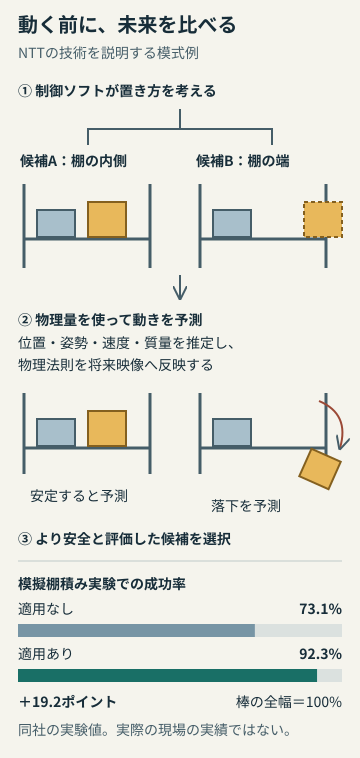
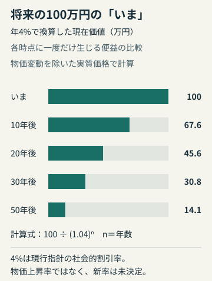

# アヤベ日報　2026年11月12日（木）

本紙 · 19記事 · 図解2点　情報確認 2026-11-12T07:45:15+09:00

## 今朝の読みどころ

- Amazonの「見つからない商品」が変わる。公取委が表示改善の確約計画を認定
- 「無料体験のつもりが有料」に歯止め。EUがネット消費者保護の法案
- 荷物を動かす前に、崩れる未来を見比べる。NTTの物理予測AI

## 01　Amazonの「見つからない商品」が変わる。公取委が表示改善の確約計画を認定

公正取引委員会は11月11日、アマゾンジャパンの商品表示を巡る確約計画を認定した。焦点は、単に価格が安いかどうかではない。ほかの通販サイトより高い商品がAmazonの商品詳細ページで見つけにくくなり、出品者が販売機会を失う仕組みだった。競合サイトより高くても、Amazon内で購入できる最安の出品へ進める入口を分かりやすく表示することが、改善の中心となる。

これまで「おすすめ出品」の資格を得るには、Amazonが比較する他サイトの同一商品の最安値以下であることが必要だった。条件を満たす出品がないと、Amazon内の最安商品も詳細ページには出品情報が載らず、別の一覧画面を開かないと探せない。公取委は、消費者には売っていないように見える状態が出品者の販売機会を実質的に失わせ、競合通販の競争にも悪影響を与え得るとみた。

一見すると、最安値を求める仕組みは買い手の味方に映る。だが競争政策が問うのは、目の前の値札だけでなく、別の店が安く売る余地まで残されているかだ。他サイトで値下げした結果、Amazonでも同じ水準まで下げないと売りにくくなるなら、出品者にとっては他サイトで独自に値下げする判断が重くなる。これは価格競争と商品表示を切り離せない、ネット通販ならではの問題である。

今回の手続きは、独占禁止法違反を認定した判決や排除措置命令ではない。事業者が改善を約束し、公取委が内容と実行可能性を確認する「確約手続き」だ。共同通信によると、公取委は違反認定を待つより自主改善で問題を早く解消する判断を取り、欧米で同様の表示を巡る法的措置が続く中での対応となった。

買い手にとっては購入可能な商品を見落としにくくなり、出品者には価格を決める余地が戻ることが期待される。ただし、すべての商品が値下がりする、あるいは他サイトと同じ価格になるという話ではない。比較するときは送料や配送条件も含め、実際に支払う額を見る必要がある。注目したいのは、画面の分かりやすさが改善するかと、その改善が売り手どうしの競争につながるかの両方だ。

**出典**

- [公正取引委員会・アマゾンジャパンの確約計画認定（11月11日）](<https://www.jftc.go.jp/houdou/pressrelease/2026/nov/261111_daigo.amazon.html>)
- [共同通信・アマゾンが最安値条件を撤回（11月11日16:45）](<https://kumanichi.com/articles/2056599>)

## 02　「無料体験のつもりが有料」に歯止め。EUがネット消費者保護の法案

欧州委員会は現地11月11日、デジタル公正法案（DFA）を発表した。無料体験から望まない有料契約へ移る仕組み、解約しづらいサブスクリプション、買い急がせる画面表示などを幅広く対象にする。成立・施行済みではなく、EU加盟国と欧州議会の合意が必要な提案の段階だが、ネット上の商売で「選ばせ方」そのものを問う大きな制度変更となる。

欧州委員会が例示するのは、在庫がわずかだと偽って購入を急がせる表示や、過剰な支出を促す設計だ。価格の透明性、インフルエンサーの商業投稿の明示、未成年を狙う不公正な個別広告・価格への制限も盛り込む。利用者が依存的な設計機能を無効にできる選択肢や、デジタル契約を理解し、解約しやすくする仕組みも柱となっている。

チケットなどの変動価格も争点だ。欧州委員会の説明では、仮想の待機列で現在価格と最高価格を示すことを求める。価格変動そのものを一律になくすというより、待って購入画面へ進むまで費用が見えず、費やした時間を理由に買ってしまうような状況を減らす狙いと読める。消費者に必要なのは安さだけでなく、買うかやめるかを決める時点で条件が見えることだ。

同時に提案された消費者保護協力規則の改正は、複数加盟国の消費者に大きな影響が及ぶ案件について、欧州委員会の直接調査や制裁権限を強める。Euronewsによれば、この執行制度の改正に基づく重大な広域案件では、企業の全世界年間売上高の最大6％に相当する制裁金が想定されている。「DFAのすべての違反に自動的に6％」と読むのは正確ではない。

一方、ロイターは企業側から既存法との重複や余分な義務への懸念が出ていると報じた。EUにはすでにデジタルサービス法などがあり、新しい保護策を増やすほど、どの規則が何を求めるかの整理も重要になる。今回の案は消費者保護の強化だけでなく、簡素化の提案と組み合わせられている。

日本の契約がこの発表で直ちに変わるわけではない。それでも、国際展開するアプリや通販サービスにとって、解約、広告表示、価格提示をどう設計するかという実務上の論点は共通する。今後は法案交渉で対象や義務がどう定まるか、そして利用者が迷わず断れる画面へ実装されるかを見たい。

**出典**

- [欧州委員会・Making your online experience fairer（11月11日）](<https://commission.europa.eu/news-and-media/news/making-your-online-experience-fairer-2026-11-11_en>)
- [欧州委員会・Digital Fairness Act](<https://commission.europa.eu/law/law-topic/consumer-protection-law/digital-fairness-act_en>)
- [Euronews・EU targets subscription traps（11月11日）](<https://www.euronews.com/2026/11/11/eu-targets-subscription-traps-addictive-design-and-hidden-fees-with-new-digital-rules>)
- [Reuters・EU threatens significant fines（11月11日）](<https://www.reuters.com/world/eu-threatens-significant-fines-unfair-online-trade-practices-2026-11-11/>)

## 03　荷物を動かす前に、崩れる未来を見比べる。NTTの物理予測AI

NTTは11月11日、ロボットが複数の動かし方を試す前に、その後の荷崩れや落下を予測する技術を発表した。小型ロボットで荷物の棚積みを模擬した実験では、成功率が73.1%から92.3%に上がった。差は19.2ポイント。ただし、これは同社の実験条件での成績であり、空港や物流拠点で同じ数字を達成したという発表ではない。

仕組みの中心は、映像生成モデルに組み込む「物理制御アダプタ」だ。位置や姿勢、速度、質量といった物体の情報を明示的に推定し、運動方程式に基づく計算を将来映像へ反映する。映像として自然に見えることだけを頼りにすると、予測の途中で物が消えたり、衝突の結果を取り違えたりする問題がある。NTTは物理法則を手掛かりに、そのような破綻を抑えるという。

例えば棚に箱を置く場面なら、制御ソフトが考えた複数の置き方について、周囲の荷物が落ちないかを先に評価する。これは理解のための模式例で、特定の箱や置き方を使った実験結果を示すものではない。大切なのは、予測モデルがロボットの全操作を置き換えるのではなく、画像・言語・動作を結ぶ既存のVLAモデルや動作計画ソフトが出した候補を比べ、行動前の判断を補強する点だ。判断と実行の間に、失敗を見つける段階を挟む設計になる。

まず想定する用途は、形や重さがそろわない空港手荷物の積み込み・積み降ろし。Mujinと連携して社会実証を進める方針で、11月18〜25日のNTT R&amp;D FORUM 2026に展示する。定形の部品と違い、旅行かばんや小口荷物の組み合わせを学習データだけで網羅するのは難しい。物理量を手掛かりに未知の配置にも対応しようとする狙いは、その現場の事情とつながっている。

ここから先に確かめたいのは、予測の精度だけではない。現場の処理速度に間に合うか、重さなどの推定を外した場合にどう安全を保つか、多様な荷物で成績が再現するかが実用性を左右する。発表には公開ベンチマークでの評価もあるが、今回確認できた本文だけでは、実運用の費用対効果や長期の稼働率までは判断できない。「未来を想像するAI」が、現場で失敗を減らす道具になるかを追う段階だ。

図は動作候補を比較する仕組みの説明用模式例で、実際の実験配置ではない。成功率はNTTの模擬棚積み実験。差の19.2ポイントは編集部計算。実環境での性能を示さない。 作図：アヤベ日報。出典の図・写真は転載していません。

**出典**

- [NTT、ロボットが動く前に未来を予測](<https://group.ntt/jp/newsrelease/2026/11/11/261111b.html>)
- [AI Watch：NTT、ロボットの荷崩れを防ぐAI技術](<https://ai.watch.impress.co.jp/docs/news/2155156.html>)

## 04　IBM、520量子ビットの次世代チップへ。2027年は2枚をつなぐ計画

IBMは米国時間11月11日、次世代量子プロセッサー「Nighthawk r3」の計画を公表した。1チップでプログラムに使える量子ビットを520個とし、1万回の量子操作に対応する設計だ。さらに2027年に2チップを接続して、1,040量子ビットのシステムにする計画を示した。いずれも新システムが完成して一般提供されたというニュースではなく、開発の方向を示す発表として読む必要がある。

現在のNighthawk r2は9月に導入され、計算に使える量子ビットは120個。IBMは毎秒最大10万サンプルを取得できると説明する。量子計算では、回路を一度動かして答えが確定するとは限らず、多数の測定結果を集める。そこで、量子ビットを次の計算に使える状態へ素早く戻す技術が、実際の待ち時間を左右する。規模を大きくするだけでなく、同じ計算を繰り返す速度を上げるという話だ。

独立媒体Ars Technicaが注目したのは、従来の拡張計画との違いである。以前は120量子ビットのチップ9枚をつなぐ構想だったのに対し、今回は大きなチップ2枚で近い規模を目指す。接続する枚数が少なければ万事解決するわけではなく、チップの大型化とチップ間接続を両立させる必要がある。同記事は、その接続を含む開発が引き続き重要だと位置づけている。

数字を読む際には、製造された物理的な素子の総数、計算に使える量子ビット数、誤り訂正後に使える論理量子ビット数を混同しないことも大切だ。今回の520という値はプログラム可能な量子ビットの数で、520個の誤り訂正済み論理量子ビットを提供するという意味ではない。また、既存機より速いという評価を、そのまま最良の古典コンピューターに勝った証明へ読み替えることもできない。

今回見えてきたのは、量子計算の競争軸が「何個載せたか」から、精度を保ってどれだけ速く結果を集め、複数チップを実用的につなぐかへ広がっていることだ。これは発表を踏まえた編集上の見方である。読者が次に確認したいのは、2027年の提供時期、接続した状態での計算品質、実際の利用者が解ける問題の範囲。ロードマップと達成済みの性能を分けて追うと、量子技術の進歩を過大にも過小にも評価せずに済む。

**出典**

- [IBM：Nighthawkの速度・品質と2027年の拡張計画](<https://newsroom.ibm.com/2026-11-11-ibm-quantum-nighthawk-demonstrates-new-levels-of-speed-and-quality,-with-plans-to-scale-beyond-1,000-qubits-in-2027>)
- [Ars Technica：IBM to offer access to a dual-processor quantum system in 2027](<https://arstechnica.com/science/2026/11/ibm-to-offer-access-to-a-dual-processor-quantum-system-in-2027/>)

## 05　膨らんだ電池にも行き先を。大阪市、25消防署で24時間回収へ

使わなくなったモバイルバッテリーを、どこへ持っていけばよいか。大阪市が11月11日に発表した新しい答えは、消防署だ。12月1日から、市内25消防署の本署でリチウムイオン電池などの回収を始める。窓口は24時間、365日対応。消防局と環境局が連携し、家庭での保管中だけでなく、収集車やごみ処理施設で起きる火災も減らす狙いがある。開始日は来月なので、発表されたその日から持ち込める制度ではない。

注目したいのは、回収対象に膨張・変形した電池も明記されたこと。小型充電式電池、モバイルバッテリーのほか、ワイヤレスイヤホンなど電池を本体から取り外せない製品は、そのまま受け付ける。ただし、どんな製品でも持ち込めるわけではない。通常品は直径28センチ、高さ21センチの回収容器、膨張・変形品は直径19センチ、高さ18センチの専用容器に収まる大きさに限られる。対象も大阪市内の家庭から出るものだけで、会社や商店の廃棄物は含まれない。

持ち込み方にも決まりがある。市の案内では、金属端子やリード線をビニールテープで覆って絶縁し、窓口の職員へ直接渡す。消防署の前に置いて帰る方式ではなく、出張所まで含めたすべての消防施設が受付場所になるわけでもない。回収できない大きさのものについては、市が示す条件に従い環境事業センターへ相談する。環境事業センターによる訪問回収の案内も併記されており、消防署への持ち込みだけが唯一の経路ではない。

リチウムイオン電池は衝撃や熱に弱く、破損や強い圧力で発熱・発火することがある。市は電池関連の火災の急増を背景として挙げているが、今回の発表だけで回収による削減効果まで分かるわけではない。それでも、適切に捨てるよう呼び掛けるだけでなく、身近な場所と時間の選択肢を増やす点には意味がある。便利な機器を買うときには見えにくい「使い終えた後」の問題を、市民が実際に使える窓口へ落とし込んだ施策として読みたい。年末の片付けを考える人には、開始日と最寄りの本署、対象品の条件を確認しておく価値がある。

大阪市の公表資料2件に基づく制度紹介です。独立した取材報道による確認は行っていません。

**出典**

- [大阪市・電池関連火災防止の取組開始](<https://www.city.osaka.lg.jp/hodoshiryo/shobo/0000691202.html>)
- [大阪市・消防署でリチウムイオン電池の回収を始めます](<https://www.city.osaka.lg.jp/shobo/page/0000688551.html>)

## 06　2025年参院選は「違憲状態」。合区後初めて最高裁が判断

最高裁大法廷は11月11日、1票の格差が最大3.13倍だった2025年7月の参院選について「違憲状態」と判断した。弁護士グループが求めた選挙無効は認めず、請求を棄却した。選挙をやり直す判断ではないが、国会に格差是正を迫る内容となる。隣接県を一つの選挙区にする合区が2016年参院選から適用されて以来、この判断は初めてだ。

共同通信によると、最高裁は2010年選挙の5.00倍、2013年の4.77倍を違憲状態とし、その後は2016年の3.08倍、2019年の3.00倍、2022年の3.03倍を合憲としていた。今回の全国16件の高裁段階の判断も、合憲5件と違憲状態11件に分かれていた。今回の数値だけから「3倍が絶対的な境界」とは言えない。今後の焦点は、地域代表という参院の役割と、住む場所で票の重みが異なる問題を、選挙制度の設計でどう両立させるかだ。

**出典**

- [共同通信・最高裁、昨年参院選「違憲状態」（11月11日16:51）](<https://kumanichi.com/articles/2056595>)
- [最高裁判所・令和8(行ツ)36 選挙無効請求事件（2026年11月11日大法廷判決）](<https://www.courts.go.jp/hanrei/97268/detail2/index.html>)

## 07　公共事業のものさしを見直しへ。将来の効果をどう評価するか

高市首相は11月11日の経済財政諮問会議で、公共インフラの投資基準見直しを急ぎ、2027年度から実行するよう国土交通相に指示した。鍵になるのが「社会的割引率」だ。道路や橋などが将来生む効果を、いまの価値に換算する際に使う。国交省の現行技術指針では当面年4％とし、参考比較には1％・2％を使える。これを下げれば遠い将来の便益が大きく評価され、事業が進みやすくなる可能性がある。

会議の有識者資料は、金利情勢や頻発する激甚災害を踏まえた評価の見直しを求めた。同時に、人件費・資材価格の上昇への対応、建設人材の確保、既存インフラの集約や予防保全も挙げている。評価を通りやすくするだけでは、工事の担い手や維持費は確保できないからだ。新しい割引率の数値が決まったわけではない。地方の必要な投資を拾えるか、長期の費用まで説明できるかが、今後の具体化で問われる。

各時点に一度だけ100万円の便益が生じる仮定で比較した計算例。毎年100万円を得る累積便益ではない。基準年度の実質価格による換算で、4%は物価上昇率でも改定後の新率でもない。 作図：アヤベ日報。出典の図・写真は転載していません。

**出典**

- [共同通信・公共投資基準、27年度緩和（11月11日19:31）](<https://kumanichi.com/articles/2056730>)
- [内閣府・11月11日経済財政諮問会議資料4](<https://www5.cao.go.jp/keizai-shimon/kaigi/minutes/2026/1111shiryo_04.pdf>)
- [国交省・公共事業評価の費用便益分析に関する技術指針（2025年9月）](<https://www.mlit.go.jp/tec/hyouka/public/250918_shishin/shishin/shishin250918.pdf>)
- [国交省・現在価値の計算方法](<https://www.mlit.go.jp/report/press/content/001583005.pdf>)

## 08　露・ウクライナが大規模捕虜交換で原則合意。人数は12日に調整

アブダビで行われたロシア、ウクライナ、米国の高官協議は現地11月11日、2日間の日程を終え、大規模な捕虜交換で原則合意した。米側のクシュナー氏は侵攻後で最大規模になると説明し、人数は12日に決めるとした。昨日の協議開始から一歩進んだ具体的な人道措置だが、この段階で釈放が完了したわけではない。

ロイターによると、領土を含む主要な問題の相違は残り、米側は当事者間の信頼不足を認めている。クシュナー氏とウィットコフ特使は12日にモスクワでプーチン大統領と協議し、その後ダブリンでゼレンスキー大統領と会う予定だ。共同通信は、安全保障や衝突回避、停戦監視を巡る協議で進展があったとの米側説明も伝えた。評価すべきは捕虜帰還への道が開いたこと。ただし、その進展と包括的な停戦合意は分けて見る必要がある。次に確認したいのは交換人数の確定と、実際の帰還がいつ始まるかだ。

**出典**

- [Reuters・Russia, Ukraine reach deal on prisoner swap（11月11日）](<https://www.reuters.com/world/europe/us-russia-ukraine-start-second-day-abu-dhabi-peace-talks-2026-11-11/>)
- [共同通信・最大規模の捕虜釈放合意（11月11日22:28）](<https://kumanichi.com/articles/2056775>)

## 09　クロマグロ、総枠は増やせても配分が決まらない

水産庁は11月11日、中西部太平洋まぐろ類委員会（WCPFC）北小委員会で、太平洋クロマグロの国別漁獲枠に合意できなかったと発表した。焦点は大型魚の取り分で、日本と韓国の主張に隔たりがある。2027年から新しい枠を適用するには、今月末に始まる年次会合が閉幕するまでに、国・地域別の配分をまとめる必要がある。

地域全体では、大型魚を現行比25％増、小型魚を6％減とすることに8月に合意していた。今回はその総量を誰にどれだけ割り当てるかという交渉だ。日本は関係する日本、韓国、台湾の大型魚枠をそれぞれ25％増やす案を主張したが、今回のオンライン会合ではまとまらなかった。全体の増枠合意と、日本の漁業者が実際に使える枠の確定は別の段階になる。「マグロが増えるからすぐ安くなる」と飛びつくより、月内の配分交渉と、その後の国内配分がどう決まるかを追いたい。

**出典**

- [共同通信・マグロの国別漁獲枠合意見送り（11月11日18:01）](<https://kumanichi.com/articles/2056675>)
- [FNN・太平洋クロマグロの漁獲枠の配分比率 11日は韓国・台湾と合意に至らず（2026年11月11日18:10）](<https://www.fnn.jp/articles/-/1150443>)

## 10　子どものネット利用、管理から相談へ。年齢別の関わり方案

こども家庭庁は11月10日、子どもの発達に合わせたインターネット利用の支え方を示す案を専門家会議に提示した。0〜18歳を六つの段階に分け、低年齢では大人が環境を整えて一緒に使い、成長に合わせて本人の判断へ移していく考え方だ。法律の年齢制限が決まったのではなく、家庭や学校、事業者が共通して考えるための整理となる。

例えば10〜12歳では家庭のルール作りに本人の意見を取り入れ、13〜15歳は直接管理を少しずつ減らして助言・相談へ、16〜18歳は自己決定を基本に必要な支援を行う。年齢区分はおおむねの目安で、一律の医学的・法的な線引きではない。資料は、危険を遠ざけることと、学びや表現の機会を広げることを両輪に置き、家庭だけへ負担を負わせない点も強調している。SNSの一定年齢未満への利用制限は別途議論中。今回の案を、その禁止が決まった知らせと混同しないで読みたい。

**出典**

- [こども家庭庁・11月10日会議資料（PDF）](<https://www.cfa.go.jp/assets/contents/node/basic_page/field_ref_resources/d83aacab-197b-47fb-8815-6a5abb7afb07/6f2e3f1e/20261109_councils_internet-kaigi_d83aacab_02.pdf>)
- [TBS・年齢に応じた大人の関与の案](<https://newsdig.tbs.co.jp/articles/-/3073971?display=1>)

## 11　COP31で屋根上太陽光の連携拡大。2030年に3億世帯を目指す

トルコのCOP31では、発電所だけでなく家の屋根もエネルギー転換の舞台になっている。世界太陽光発電協議会（GSC）は現地11月10日、バングラデシュ、ケニア、ナイジェリア、パラオ、バヌアツが、屋根上太陽光の世界宣言を支持したと発表した。先行する豪州に続く動きで、太陽光を使う住宅を2030年に3億世帯へ倍増させる構想を後押しする。

法的拘束力のない任意の宣言だが、重視するのはパネルの枚数だけではない。設置許可の簡素化、家庭が利用できる資金、分散型電源に対応する配電網、施工人材の育成を並べている。設備価格が下がっても、初期費用を払えない、接続できない、工事を頼めないという壁が残るためだ。GSCは業界団体であり、この発表は実施主体側の説明でもある。今回の支持拡大を、COP31全参加国の合意や、設置完了の実績と混同してはいけない。外交の大きな排出目標を、家庭が導入できる条件へ落とす動きとして見ると面白い。

業界団体GSCの11月10日発表に基づきます。設置実績の独立検証ではありません。

**出典**

- [GSC・Global Rooftop Solar Declaration支持拡大（11月10日）](<https://new.globalsolarcouncil.org/news/global-coalition-of-leaders-endorse-global-rooftop-solar-declaration-at-cop31/>)
- [300 Million Solar Homes・Global Rooftop Solar Declaration（宣言本文）](<https://www.300millionsolarhomes.org/global-rooftop-solar-declaration>)

## 12　ドコモの5G SAで再び障害。その他の5G・4GとMVNOは対象外

NTTドコモの5G専用設備を使う通信サービス「5G SA」で11月11日午前10時34分、全国的な通信障害が発生し、午後7時17分に復旧した。8時間43分、通話やデータ通信が利用しづらい状態が続いた。共同通信によると、同じサービスでは5、6日にも障害があり、前回は全国約150万人に影響が出ていた。この人数を今回の被害規模と取り違えないことが大切だ。

今回の対象は利用に追加手続きが必要な高速通信サービスで、一般契約者や、ドコモ回線を借りるMVNOの契約者には影響がなかったとされる。不正アクセスは確認されておらず、契約者を収容する交換機で混雑が起きた原因を調べている。前回は保守作業中の装置不具合がきっかけだったが、今回も同じ原因と断定はできない。相次ぐ障害では「ドコモ全体が止まった」という大きな言い方より、自分の契約が対象か、復旧したか、原因が確定したかを分けて確認するほうが役に立つ。

**出典**

- [共同通信・ドコモ高速通信でまた障害（11月11日23:03）](<https://kumanichi.com/articles/2056549>)
- [NTTドコモ・5G SA通信障害 お詫び／復旧（2026年11月11日20:45時点）](<https://www.docomo.ne.jp/info/network/kanto/pages/261111_13_m.html>)

## 13　AI工場の冷却を一つの設計図に。ダイキンが60MWモデル

ダイキンは11月11日、米子会社が発表したデータセンター向け冷却設計「D60-W」を紹介した。米国での発表日は10日。NVIDIAのDSX AI Factory Platformに対応し、60MWのIT負荷を六つのユニットで支える標準設計モデルだ。これは単体の冷凍機の発売というより、ラックから外気への排熱までを一つの構成として設計するための出発点になる。

負荷の92%は液冷、残る8%は空冷で扱い、それぞれ温度の異なる循環系統を使う。気候が適した場所では外気を利用するドライクーラーが年間の大半を担い、暑い時期に冷凍機が補う。冷却塔への補給水をなくす設計だが、施設全体の水消費がゼロになるという意味ではない。

AIの供給能力を考えるとき、半導体の数と同じくらい、熱を逃がし続けられるかが重要になる。今回の設計は設備間の組み合わせを整理する提案だ。ただし、同社製の冷却液分配ユニットとデータセンター用ドライクーラーは開発中で、提供目標は2027年後半。構成機器がすべて今すぐそろうと受け取らないようにしたい。

**出典**

- [Daikin：60 MW AI Factory Cooling Reference Architecture](<https://www.daikin.com/press/2026/20261111>)
- [AI Watch：ダイキンのデータセンター冷却モデル](<https://ai.watch.impress.co.jp/docs/news/2155512.html>)

## 14　Pixelの11月更新、Geminiの複数手順タスクが日本へ

Googleの11月版Pixel Dropが展開される。米公式ブログは11月10日付、日本の報道は11日。Pixel 10へのGemini Intelligence拡大に加え、買い物や配車など複数の手順を伴うタスクをGeminiに任せる機能が、日本、英国、インドでも利用対象になる。話し言葉から不要なつなぎ言葉を除き、文章を整える音声入力機能も紹介された。

同時に持ち物用トラッカー「Pixel Tag」の発売も案内された。国内報道による日本の発売日は11月12日で、単品5,010円、4個組16,940円。離れた持ち物にはFind Hubネットワーク、近くの探索にはUWBによる方向・距離案内を使う。米国の11日発売と、日本の12日発売を区別しておきたい。

更新は数週間かけて順次配信され、機能ごとに対象端末、地域、言語などの条件が異なる。対応Pixelを持っていても、すべての機能が今日同時に届くとは限らない。利用前には機種と機能別の条件を確認し、AIが整えた文章や進める手順を画面で確かめるのが実用的だ。

**出典**

- [Google：November Pixel Drop](<https://blog.google/products-and-platforms/devices/pixel/november-2026-pixel-drop/>)
- [AI Watch：Pixel 10でGemini Intelligence](<https://ai.watch.impress.co.jp/docs/news/2155527.html>)
- [Google日本公式・11月のPixel Drop](<https://blog.google/intl/ja-jp/products/devices-services/november-2026-pixel-drop/>)

## 15　ネットが止まっても家電を操作。法人向け「リンクREMO」

リンクジャパンは11月11日、法人向けスマートリモコン「リンクREMO」を発売した。インターネット接続だけに頼らず、スマートフォンとBluetoothでつないで赤外線家電を操作する。回線やクラウドの障害時、あるいは新築住宅でWi-Fiが開通する前にも、HomeLinkアプリから家電を動かせる点が特徴だ。

対応機器が通信を中継する独自のBTメッシュ技術を採用し、最大2,000台の対応デバイスでネットワークを構成できるとする。Siriによる対応操作に加え、AlexaやGoogleアシスタントを使うクラウド経由の操作も案内している。ただし、「ネットなしで可能な家電制御」と、あらゆる音声AI機能がオフラインで動くことは同義ではない。

住宅設備のスマート化では、便利な機能を増やすだけでなく、障害時に何が残るかが使い勝手を左右する。今回の製品は、その基本操作を家の中の通信で保つ考え方として注目できる。一方、法人向けの発売であり、一般向けの購入価格や導入条件は今回確認できていない。対応家電や設置条件も案件ごとの確認が必要になる。

**出典**

- [AI Watch：リンクREMO発売](<https://ai.watch.impress.co.jp/docs/news/2155431.html>)
- [リンクジャパン：リンクREMO発売告知](<https://linkjapan.co.jp/news/261111_linkremo/>)

## 16　大阪4市のごみ逼迫、東大阪側が一時受け入れへ

大阪市、守口市、八尾市、松原市のごみ処理が逼迫している問題で、東大阪市と大東市のごみ処理を担う東大阪都市清掃施設組合が、大阪市と八尾市から出る家庭ごみの一部を一時的に受け入れることになった。MBSが11月11日に報じた。期間は11月16日から12月18日までの予定で、祝日を含む月・火・木・金曜日に、1日約200トンを受け入れる。

大阪広域環境施設組合では鶴見工場の建て替えに加え、ほかの工場の想定外の故障などが重なり、7月ごろから処理が厳しくなっていた。11日午前9時のごみピットの貯留率は、6工場合計で108％。組合は、12月中旬以降に鶴見を除く6工場がすべて稼働すれば逼迫は解消するとしている。今回の受け入れは、そこまでをつなぐ広域の支援だ。収集したごみは自動的に処理できるものではなく、施設の修繕や近隣自治体との連携に支えられていることが見える。解消は現時点の見通しであり、すでに正常化したという話ではない。

**出典**

- [MBS・大阪4市のごみ処理問題、東大阪で一時受け入れ](<https://newsdig.tbs.co.jp/articles/mbs/3077697?display=1>)
- [朝日新聞・東大阪、大東の組合もごみ受け入れへ 大阪市など4市の処理逼迫問題](<https://www.asahi.com/articles/ASVCC1GT8VCCOXIE02PM.html>)

## 17　大阪市に転生したら、行政サービスが攻略法になる

大阪市は11月11日、市政情報を探索型RPG風の無料ブラウザゲームにした「大阪市に転生した勇者がこの街の攻略法を知ってレベルMAXになる話」を公開した。主な対象は10～30代。大阪の街を模した3つのステージで困りごとを抱えたキャラクターに出会い、11問のクイズを解きながら進む。冒険が進むと勇者の見た目にも大阪らしさが増していくという。

扱うのは、消費生活相談やヤングケアラー支援、防災アプリ、図書館の電子書籍、美術研究所やクラフトパークなど、暮らしに近い11の施策だ。全ステージを終えると、関連する市政情報の一覧画像を保存できる。単に知識を試すクイズで終わらず、困ったときに見返せる資料を持ち帰る設計が面白い。行政のページを自分から探しに行く機会が少ない人に、まず触れてもらうための試みである。実際に制度利用が増えるかは今後の課題だが、「相談先を知ること」をゲームの攻略に置き換えた広報として目を引く。

**出典**

- [大阪市・転生勇者の市政情報クイズ公開](<https://www.city.osaka.lg.jp/hodoshiryo/seisakukikakushitsu/0000688886.html>)
- [大阪市・転生勇者WEBコンテンツ公開（市民向け詳細）](<https://www.city.osaka.lg.jp/seisakukikakushitsu/page/0000689068.html>)

## 18　吉本新喜劇が横浜の花博へ。「園芸」と「演芸」の協定

吉本興業ホールディングスと2027年国際園芸博覧会協会が11月11日、包括連携協定を結んだ。横浜で来春開幕する「GREEN×EXPO 2027」に向け、新喜劇を使ったプロモーションなどを展開する。渋谷よしもと漫才劇場の締結式には西川きよし、藤井隆、囲碁将棋、NMB48の塩月希依音と平山真衣らが参加した。博覧会は来年3月19日から9月26日まで、横浜市の旧上瀬谷通信施設で開かれる。

具体策として発表されたのは、新喜劇との連携に加え、会期中の2027年7月17～19日に会場で行う「YOSHIMOTO DAYS」。お笑い、音楽、アートを交えて花や緑に触れる3日間とし、FANYやBSよしもとなどでも発信する。大阪・関西万博に携わった芸人やアイドルの経験を、次の博覧会へつなぐ形になる。見どころは出演者の顔ぶれだけではない。園芸をもともと好きな人以外にも、新喜劇やライブを入口として届けようとする協定だ。現段階は企画の発表であり、個々の公演内容や出演者がすべて確定したわけではない。

**出典**

- [FANY Magazine・GREEN×EXPO 2027と包括連携協定](<https://magazine.fany.lol/296236/>)
- [日刊スポーツ・吉本興業がGREEN×EXPO2027と協定](<https://www.nikkansports.com/entertainment/news/202611110000487.html>)
- [吉本興業公式プレスリリース・包括連携協定締結](<https://prtimes.jp/main/html/rd/p/000005480.000029501.html>)

## 19　鳥取の食フェス、出店者が運営不備を訴え。集客予測と準備の重さ

鳥取県倉吉市で11月7〜8日に開かれた「ローカルフードファイト in 鳥取」を巡り、出店者から会場設備の準備不足や売り上げへの不満が出ている。日テレNEWS NNNの10日放送・11日公開の報道は、テントや電気、水回りが予定どおり整わなかったとする出店者の証言を伝えた。事前の主催側発表は全国の店舗が東西に分かれて売り上げを競う企画を掲げ、地域への経済効果を期待していた。

報道には、集客の見込みを基に食材を大量に準備した店や、初日で撤退した店が登場する。ただし、宣伝された来場目標と、確認済みの実来場者数は別物だ。正確な総来場者数をここで断定することはできない。主催側は同記事の取材に、代金の精算や説明を進める意向を示している。今後見るべきは、証言に対する事実確認と説明、各店への精算が実際に進むか。SNSで広がる評判だけで責任を決めつけず、集客予測、当日の供給設備、売上金の流れを分けて追う必要がある。

**出典**

- [日テレNEWS NNN配信・食フェス出店者と主催側への取材（11月11日）](<https://news.livedoor.com/article/detail/32785841/>)
- [主催側事前発表・ローカルフードファイト開催概要](<https://prtimes.jp/main/html/rd/p/000000002.000192673.html>)
