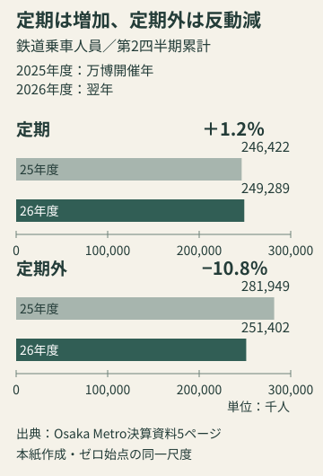
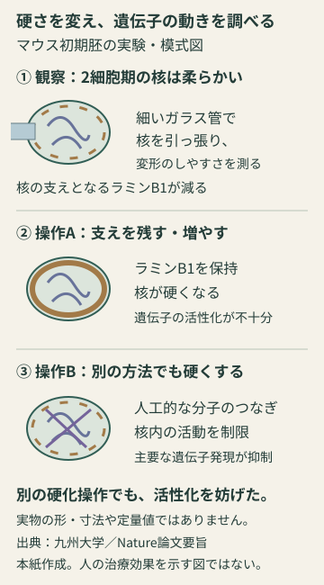

# アヤベ日報　2026年11月13日（金）

本紙 · 19記事 · 図解2点　情報確認 2026-11-13T07:50:25+09:00

## 今朝の読みどころ

- フアン氏がNVIDIAのCEOなどを辞任。財務責任者が暫定CEOに
- 利上げ慎重論は何を見ているのか――浅田日銀委員の説明
- 欧州は和平交渉の席へ入れるのか。米特使の説明とロシアの留保

## 01　フアン氏がNVIDIAのCEOなどを辞任。財務責任者が暫定CEOに

NVIDIAは米国時間11月12日、ジェンスン・フアン氏が社長、最高経営責任者（CEO）、取締役を辞任したと発表した。米証券取引委員会（SEC）への提出書類では、取締役会が11日に即時の辞任を受理したと確認できる。

後任を探す間は、最高財務責任者のコレット・クレス氏が暫定CEOを兼務する。取締役会議長にはハーヴィー・ジョーンズ氏が就く。正式なCEOは社内外から探す方針だ。11月17日の決算発表予定は維持され、会社は製品計画や顧客への約束を継続する見通しを示した。

新体制の特徴は、日々の経営と財務をクレス氏が担い、取締役会には同社初の議長を置くことだ。正式CEOを探す間の指揮系統を早く定める一方、後任探しは社内に限定しない。創業者の即時退任で空いた役割を、一人の恒久的な後継者へすぐ渡す形にはしていない。

人事の確定と、事業が従来どおり進むかは別の問いになる。会社は製品計画と顧客への約束の継続を掲げた。暫定CEOが財務責任者も兼ねるなか、決算説明はこの方針を具体的に聞く最初の節目になる。発表予定の11月17日は米国日付で、決算そのものはまだ公表されていない。

公式文書は報道されている疑惑の真偽を認定していない。退任の公表と、個別の疑惑の事実認定は別だ。今は後任探しと、事業継続への具体的な説明を分けて追う局面にある。

会社発表とSEC提出書類に基づく解説。独立報道の直接本文は今回取得できず、経営陣の説明を独立検証済みとは扱っていません。

出典：公式発表 一次資料

**出典**

- [公式発表](<https://investor.nvidia.com/news/press-release-details/2026/NVIDIA-Announces-CEO-Transition/>)
- [一次資料](<https://www.sec.gov/Archives/edgar/data/1045810/000104581026000082/nvda-20261111.htm>)

## 02　利上げ慎重論は何を見ているのか――浅田日銀委員の説明

日銀の浅田審議委員は12日の講演と記者会見で、追加利上げに慎重な理由を説明した。物価が上がっているかどうかだけでなく、賃金と消費が持続的に物価を押し上げる力になっているかを重視する立場だ。これは新たな金融政策決定ではなく、政策委員の一人による判断材料の説明である。

講演では、現在の政策金利が中立金利に近づくにつれ、追加利上げが実体経済に与える作用は、引締めを始めた当初より強まると指摘した。中立金利とは、景気を刺激も抑制もしない金利水準の目安。正確な一点を観測できる数字ではないため、同じ物価統計を見ても、どこまで金利を上げるべきかの判断は分かれうる。

浅田氏は実質賃金の改善を認めつつ、消費はまだ力強くなく、現在の物価上昇を需要主導とだけ見るべきではないとした。一方で、基調的な物価上昇率が2％を超えて強まる可能性も否定していない。『物価が上がらないから待つ』ではなく、上振れと消費の弱さを両方見ながら速度を選ぶ考え方だ。

ロイターの会見報道によれば、浅田氏は利上げを絶対に否定しているわけではなく、今後、緩やかな利上げが必要になる可能性を示した。現時点で利下げを提案する考えも示していない。慎重姿勢をそのまま利下げ転換と読むのは早い。次に確かめたいのは、名目の物価だけでなく、賃金の購買力と家計消費が同時に強まるかどうかである。

出典：日本銀行・浅田審議委員講演 ロイター／Newsweek・浅田委員会見

**出典**

- [日本銀行・浅田審議委員講演](<https://www.boj.or.jp/about/press/koen_2026/ko261112a.htm>)
- [ロイター／Newsweek・浅田委員会見](<https://www.newsweekjapan.jp/articles/-/339919>)

## 03　欧州は和平交渉の席へ入れるのか。米特使の説明とロシアの留保

米特使ウィトコフ氏は12日のプーチン大統領との会談後、次回のウクライナ和平協議に欧州代表が加わると説明した。一方、ロシア大統領補佐官ウシャコフ氏は参加を確認せず、プーチン氏は停戦後の欧州部隊派遣に反対した。交渉の席が広がるという米側の説明と、安全保障の中身での一致は分けて見る必要がある。

ゼレンスキー大統領は同日、ダブリンで欧州理事会・欧州委員会の両トップと会談した。ウクライナ大統領府によると、欧州の安全保障、欧州からの支援、欧州が引き受ける約束を論じる以上、交渉への十分な参加が重要だと訴えた。欧州は支援する側であるだけでなく、合意後に責任を負う当事者でもある。

AP通信によれば、米側とウクライナ側は欧州の交渉代表を一人にまとめたい意向だ。今回の直接協議では、大規模な捕虜交換の合意以外に大きな突破口はなかった。人数調整を報じた前号からの新しい争点は、誰が席に着き、誰が安全を保証するのかへ移っている。

編集上の見方として、代表参加は合意を実行可能にする条件の一つだが、それ自体が停戦ではない。参加者を増やす話と、停戦後の駐留を認める話は別々に決着しなければならない。

ここで整理したいのは、交渉を始める合意、停戦条件の合意、その条件を守らせる仕組みの三段階だ。席を設ける話は第一段階に属し、そこから先に自動的に進むわけではない。支援を求める相手が決定過程に入らなければ、約束の内容と負担が食い違いかねない。欧州の参加をめぐる問いは、外交上の顔ぶれだけでなく、合意後の責任を誰が引き受けるのかという問いでもある。

次に確かめるべきなのは、欧州側の代表が正式に決まり、参加を双方が認めるか。その次に、会議で扱う議題と安全保障の約束が具体化するかだ。「参加する」との一方の説明と、全当事者が合意した開催要領を混同しない。この区別を保てば、交渉再開という前向きな動きも評価しながら、和平成立を早合点せずに済む。

出典：Reuters・12日の米露協議 ウクライナ大統領府・EU首脳との会談 AP・米特使のモスクワ／ダブリン訪問

**出典**

- [Reuters・12日の米露協議](<https://www.reuters.com/world/europe/us-envoys-arrive-moscow-latest-round-ukrainian-peace-talks-with-putin-2026-11-12/>)
- [ウクライナ大統領府・EU首脳との会談](<https://www.president.gov.ua/en/news/volodimir-zelenskij-obgovoriv-iz-prezidentami-yevroradi-ta-y-107297>)
- [AP・米特使のモスクワ／ダブリン訪問](<https://apnews.com/article/russia-ukraine-war-putin-kushner-witkoff-683810203340077f33611fd1d1757b23>)

## 04　万博翌年のメトロ、減収でも定期利用は増加

Osaka Metroが12日発表した2026年度第2四半期決算は、営業収益1054億円で前年同期比17.5％減、営業利益253億円で27.0％減だった。万博開催年との比較だけを見ると落込みは大きい。しかし会社は、万博のなかった2024年度と比べれば、営業収益も営業利益も増えていると説明する。比較する年を変えると、見える景色も変わる。

さらに鉄道の乗車人員を分けると、全体は5.2％減でも、定期利用は1.2％増えた。定期外利用は10.8％減。万博来場者などを含む非日常の移動が多かった前年の反動と、日常利用の動きは同じではない。定期利用の増加を見落としたまま、大阪の移動需要全体が一様に弱くなったと結論づけるのは適切でない。

図1｜万博開催年の2025年度と2026年度の第2四半期累計を比較。定期と定期外で方向が違う。横軸は0から、人数の単位は千人。Osaka Metro決算資料5ページの公表値から本紙作成（補助比較図）。

鉄道運輸収入は853億円で11.6％減。定期外の収入は17.7％減り、定期の0.4％減より落込みが大きかった。乗車人員と収入は違う指標なので、人数の変化率だけから売上を計算することもできない。図では人数を同じ尺度で比較し、収入の数字は本文で別に扱う。

会社は鉄道・バスの反動に加え、不動産販売の反動も減収要因に挙げた。万博関連の委託費などは減ったものの、売上の減少を埋め切れなかったという。今後の評価軸は、前年の特需をそのまま維持できたかではなく、日常需要を支えながら平時の収益力をどこまで積み上げられるかだ。決算は大阪経済全体の統計ではなく、あくまで同社グループの業績である。

会社公表の決算と運輸成績を再集計した解説です。独立報道の直接本文は取得できていません。

出典：Osaka Metro・2026年度第2四半期決算 Osaka Metro決算説明資料

**出典**

- [Osaka Metro・2026年度第2四半期決算](<https://subway.osakametro.co.jp/news/news_release/20261112_2026nendo_2qkessan.php>)
- [Osaka Metro決算説明資料](<https://www.osakametro.co.jp/company/library/20261112_2026nendo_2qkessan/2026_2Q_kessan.pdf>)

## 05　比例31議席削減法案を共同提出、配分方法も変更案

自民、日本維新の会、国民民主の3党は12日、衆院比例代表の定数を31議席減らす法案を共同提出した。人数の削減だけでなく、中小政党に配慮した『修正サン・ラグ方式』への議席配分変更、複数政党が共同で名簿を届ける『統一名簿方式』も盛り込んでいる。

与党は来週の委員会審議開始、月内の衆院通過を目指す。まだ成立した制度ではない。見るべき点は議員の総数だけではなく、各党に票が議席として配分される仕組みがどう変わるかだ。配分方式と定数削減を一緒に審議するため、それぞれの効果を分けて確かめる必要がある。

出典：KAB／ANN・衆議院比例定数31減法案を提出

**出典**

- [KAB／ANN・衆議院比例定数31減法案を提出](<https://www.kab.co.jp/news/article/17045359>)

## 06　無印、廃棄するはずのカード番号を保持

良品計画は12日の会見で、廃棄すべきクレジットカード番号を保管し続け、流出した可能性があることを認めた。KAB／ANNによると対象はMUJIカード約109万件。2021年7月までに番号の収集を停止し、既存分も削除する方針へ変更していたが、実際の廃棄がされていなかったという。再発行費用と不正利用被害は同社が負担する方針だ。

新しい論点は、不正アクセス対策だけでなく『使わなくなったデータを本当に消したか』の管理にある。9日の会社発表ではネットストアの再開延期とパスワード再設定方針を案内していた。流出の可能性と、不正利用が確認された件数を混同しないようにしたい。

出典：KAB／ANN・無印カード会見 良品計画・ネットストアのお知らせ第4報

**出典**

- [KAB／ANN・無印カード会見](<https://www.kab.co.jp/news/article/17044762>)
- [良品計画・ネットストアのお知らせ第4報](<https://www.ryohin-keikaku.jp/news/articles/2026_1109_01>)

## 07　冬の電気・ガス支援、3か月で標準世帯約7000円減の計画

政府は12月から2月の3か月間、電気・ガス料金を標準的な世帯で合計約7000円軽減する計画だ。12日夕のANN報道では、電気・ガス向けに5218億円余、LPガスや灯油利用者、特別高圧の事業者などへの支援に1300億円を充て、計6518億円余の予備費支出を13日に閣議決定する予定とされた。

7000円は各世帯に一律に振り込まれる給付額ではなく、標準的な使用量に基づく軽減の目安。利用量やエネルギーの種類で効果は異なる。紙面時点では『決定予定』の報道であり、決定済みの制度や請求書への反映時期と取り違えない。

出典：KAB／ANN・冬のエネルギー支援

**出典**

- [KAB／ANN・冬のエネルギー支援](<https://www.kab.co.jp/news/article/17045643>)

## 08　丸亀製麺、基本のうどん5品を値下げへ

丸亀製麺は25日から、かけうどんや釜玉うどんなど人気の5商品を最大60円値下げする。12日のANN報道では、かけうどんは440円から390円になる。原材料高のなかでの値下げは、基本の商品を利用しやすくし、天ぷらなどと組み合わせる楽しみにつなげる狙いだ。

背景として会社が挙げたのは、外食を除く食料品の消費税引下げが実現した場合、家庭で食べる方へ需要が移る懸念。税率変更はなお議論中で、値下げという企業の決定とは確度が違う。今後の政策を先読みした価格戦略として見るニュースである。

出典：KAB／ANN・丸亀製麺値下げ

**出典**

- [KAB／ANN・丸亀製麺値下げ](<https://www.kab.co.jp/news/article/17045494>)

## 09　亀岡の採卵鶏農場で今季初、鳥インフル防疫開始

農林水産省は12日、京都府亀岡市の採卵鶏農場で、今季国内の家きん農場で初めて高病原性鳥インフルエンザの疑似患畜を確認したと発表した。飼養羽数は約20万羽。11日の異常通報と簡易検査を経て、12日8時30分の遺伝子検査で確認された。

国は殺処分などの防疫措置、半径3キロ以内の移動制限、3～10キロの搬出制限などを行う。これは農場の防疫と供給への影響を分けて考えるニュースだ。農水省は、国内の現状で鶏肉や卵を食べることによる人への感染はないと考えていると説明する。今回だけで卵価格の上昇幅まで断定はできない。

出典：農水省・京都府の疑似患畜確認

**出典**

- [農水省・京都府の疑似患畜確認](<https://www.maff.go.jp/j/press/syouan/douei/261111.html>)

## 10　ホルムズの船舶被害が続く。イランの「4隻」と独立航行情報を分ける

イラン軍は12日、ホルムズ海峡でタンカー4隻が爆発に遭ったと発表した。ロイターは、その説明を直ちに独立確認できなかったとしている。機雷に接触したという当事者の説明を、確認済みの原因として書くことはできない。

一方、英国海軍の海事情報機関UKMTOが公開する共同海事情報センターの12日付資料は、ラスアルハイマ北西のタンカーが機関室に正体不明の飛翔物を受け、乗員は全員安全に避難した事案などを記録する。被害の存在と攻撃手段・主体の確定は別だ。同資料はホルムズ海峡の脅威を深刻（SEVERE）に据え置いており、外交協議や市場の期待だけから航路が安全になったとは言えない。

二つの情報を足して被害隻数を数えることもできない。同じ船を含む可能性があり、位置・時刻・船舶の同定が必要になる。

出典：Reuters・イラン軍の4隻被害発表 JMIC Update113・12日13:00 UTC基準

**出典**

- [Reuters・イラン軍の4隻被害発表](<https://www.reuters.com/world/middle-east/two-oil-tankers-disabled-by-explosions-strait-hormuz-irgc-says-2026-11-12/>)
- [JMIC Update113・12日13:00 UTC基準](<https://www.ukmto.org/-/media/ukmto/products/jmic_advisory_update_113_12-nov.pdf>)

## 11　台湾はAcer創業者をAPECへ。半導体とAI協力を前面に

頼清徳総統は12日、アジア太平洋経済協力（APEC）代表団の出発前会見で、台湾は他の参加メンバーと対等に交流する原則で参加すると説明した。代表はAcer創業者の施振栄氏。総統府は前日に、18〜19日に中国・深圳で開かれる首脳会議への派遣を発表している。

12日の会見で示した軸は、APECへの積極参加、国際技術協力と強靱なAI供給網、主要パートナーとの協力強化の三つだ。台湾の半導体産業を、政治的な立場の表明だけでなく具体的な経済協力の入口として打ち出す構えが見える。実際の会談成果は会議後に別途確認が必要で、参加方針の発表を成果と先取りはできない。

出発前の方針と会議の実績を分けて追えば、代表団が掲げた経済協力が具体的な相手や取り決めへつながるかを確かめられる。

出典：台湾総統府・12日の出発前会見 台湾総統府・代表指名

**出典**

- [台湾総統府・12日の出発前会見](<https://english.president.gov.tw/NEWS/7241>)
- [台湾総統府・代表指名](<https://english.president.gov.tw/NEWS/7239>)

## 12　英国、電化ロードマップと民間資金計画を公表

英国政府は12日、クリーン電化ロードマップを公表した。電源と送電網を整え、建物、交通、産業で直接燃やしている燃料を電力に置き換える取り組みを連動させる方針だ。2035年の最終エネルギーに占める電力35％は本紙11月9日号で既報であり、新目標としては扱わない。

同日の首相演説では、世界のクリーンエネルギー事業へ50億ポンドの民間資金を呼び込むことを目指すAmplify計画への支援を表明した。調達済み額ではなく目標額だ。電化の比率そのものより、設備の初期費用をどう賄い、電源・送電網・利用機器を一緒に整えるかが今回の追加情報になる。

出典：英国政府・クリーン電化ロードマップ Reuters・COP31の首脳発言と対立点 英国首相・COP31演説原文

**出典**

- [英国政府・クリーン電化ロードマップ](<https://www.gov.uk/government/publications/uk-clean-electrification-roadmap/the-uks-clean-electrification-roadmap>)
- [Reuters・COP31の首脳発言と対立点](<https://ca.marketscreener.com/news/world-leaders-set-out-clashing-priorities-as-cop31-turns-to-negotiations-ce785ed8df8af72c>)
- [英国首相・COP31演説原文](<https://www.gov.uk/government/speeches/pm-speech-at-cop31-climate-summit-12-november-2026>)

## 13　中立選手も入国制限の対象に。フィンランドがロシア選手を制限

フィンランド政府は12日、ロシア国民の短期査証による就労への制限を強め、16日から査証・入国・短期滞在の判断に適用すると発表した。プロスポーツも対象で、国旗を掲げない中立選手にも適用する。政府は国際関係への脅威を理由に挙げている。

国際スケート連盟は同日、タンペレの世界選手権などへの影響を調べ、フィンランド側と主催者に説明を求めると表明した。競技団体の出場資格と、開催国の入国審査は別の判断だ。連盟の声明は政府の行為で選手を罰すべきでないとするが、今回の入国制限が撤回されたという意味ではない。

今後は大会の出場条件だけでなく、対象となる選手が開催国へ入れるかも確認が必要になる。競技上の中立資格だけでは解消しない問題が残った。

出典：フィンランド外務省・入国制限 ISU・12日の声明

**出典**

- [フィンランド外務省・入国制限](<https://um.fi/current-affairs/-/asset_publisher/gc654PySnjTX/content/venalaisurheilijoiden-maahantuloa-rajoitetaan/35732>)
- [ISU・12日の声明](<https://www.isu.org/en/news/isu-statement-november-12-2026>)

## 14　イタリア、脅迫メールだけで一律避難しない方針へ

爆破予告メールが相次ぐイタリアで、政府は12日、一斉送信メールを受け取ったこと以外に具体的危険を示す材料がなければ、建物を避難させない方針を示した。ロイターが伝えた政府集計では、この日3,778校が警告を受け、避難したのは77校だった。

教育省文書は、実際の危険を示す具体的材料があれば、県段階の政府代表である知事が避難を命じられることも明記する。学校は判断材料を当局へ渡す。これは警告を無視する一般論ではなく、同種メールによる一律停止と、個別の危険評価を切り分ける変更だ。

重要なのは、誰が危険を評価し、どんな追加情報があれば避難へ切り替えるかという責任の所在だ。メール件数が多いこと自体を安全の証明にはしていない。

出典：Reuters・12日の学校対応 イタリア教育省文書（ANSA公開PDF）

**出典**

- [Reuters・12日の学校対応](<https://www.reuters.com/world/europe/italys-meloni-seeks-curb-hoax-bomb-evacuations-2026-11-12/>)
- [イタリア教育省文書（ANSA公開PDF）](<https://videoembed.ansa.it/documents/1794485415191_Mailmassive.pdf>)

## 15　遺伝子が動き始めるとき、核は一時的に柔らかくなる

九州大学などの研究グループは、初期のマウス胚で細胞核が一時的に柔らかくなり、受精卵自身の遺伝子が働き始める過程を支えると報告した。発表は11月12日。生きた胚の核を細い測定器で調べ、2細胞期に柔らかさが変化することを捉えた。

研究では、細胞内の分解に関わるLC3が核を支えるラミンB1の除去に関与するという。DNAの文字列だけでなく、その入れ物である核の物理的な性質にも、遺伝子の働きを調整する役割があることを示す成果だ。

図2｜柔らかさの観察だけでなく、異なる方法で核を硬くして結果を確かめた。大学発表とNature論文要旨に基づく本紙の模式図。実物写真・寸法比・定量値ではなく、マウス胚の実験の関係を示す。

『柔らかい核で遺伝子が働いた』という観察だけでは、柔らかさが原因なのか、発生が進んだ結果なのかを分けにくい。この研究は、核を硬くする操作を加えて確かめた点が重要だ。論文要旨ではラミンB1を残す・増やす操作に加え、人工的な分子のつなぎで核を硬くする別の方法でも、遺伝子の活性化が妨げられたと報告している。

対象はマウスの初期胚で、人の治療法が完成したという話ではない。遺伝情報の文字列だけでなく、その入れ物の物理的な性質にも目を向けると、発生を調べる問いが広がる。

大学発表と論文要旨・図説明で確認。論文の後続全文と独立取材報道は未確認です。

出典：公式発表 Nature・論文要旨と図1説明

**出典**

- [公式発表](<https://www.kyushu-u.ac.jp/ja/researches/view/1617/>)
- [Nature・論文要旨と図1説明](<https://www.nature.com/articles/s41586-026-11240-w>)

## 16　小さな録音機を、会社の情報管理へつなぐ

アンカー・ジャパンは11月12日、法人向け「Soundcore Work for Notta」の受注を始めた。約10gの装着型レコーダーとNottaを組み合わせ、個人の文字起こしだけでなく、チームで記録を管理・共有する用途を狙う。

今回の違いは録音機の小ささよりも、組織に渡す際の管理機能だ。発表ではSAML認証、IPアドレス制限、アクセス権限の管理を挙げる。音声・文字データはAI学習に使わず、日本国内に保存し、通信・保存時に暗号化するという。これは提供会社の説明であり、本紙の独立監査結果ではない。

会議録を個人の手元からチームへ移すと、文字起こしの精度だけでなく、読める人をどう分けるかが重要になる。小型録音機と認証・アクセス制限を一組にした点に、今回の法人向け製品の狙いがある。

出典：公式発表

**出典**

- [公式発表](<https://corp.ankerjapan.com/news/657>)

## 17　ポケともに第2の性格。ロボット同士の会話も

シャープは会話AIロボット「ポケとも」の第2弾「おれさまタイプ」を12月5日に日本と台湾で発売する。従来の「むじゃきタイプ」と組み合わせられ、同日から同じアプリに登録した2台のロボット同士でも会話できるようになる。

注目したいのは、単に声や外見の選択肢が増えるだけでなく、人と1台の会話から、複数のキャラクターがいる空間へ設計が広がる点だ。2〜5台の会話枠をまとめるシェアプランも用意する。自発的なロボット同士の会話は回数枠を消費しない。

人に答える道具から、隣にいる別のロボットともやり取りする存在へ。会話の相手を増やす仕組みが今回の新しさだ。実機での自然さや楽しさは未検証。

出典：公式発表

**出典**

- [公式発表](<https://corporate.jp.sharp/news/261112-a.html>)

## 18　テレビの1分を劇場で。ミキBASEが公開収録へ

MBS「ミキBASE」が12月14日、よしもと漫才劇場で公開収録を行うと11月12日に案内した。2020年春に始まり7年目を迎えた番組が、スタジオから劇場へ場を移す。企画は『1分アピール王決定戦』。短い持ち時間で若手の個性を伝える構成だ。

ミキに加え、NMB48の塩月希依音さん、友田莉杏さんらが出演予定。開演は19時、放送は2027年2月22日と3月1日の深夜を予定している。劇場の客席と、後日編集されて届くテレビでは、同じ1分でも受け取られ方が違いそうだ。

劇場では観客の反応もその場にある。短い持ち時間に個性を凝縮する企画が、公開収録ではどう映るかが見どころ。残席や購入可能性を確かめた案内ではなく、番組と公演の新情報として紹介する。

出典：公式発表

**出典**

- [公式発表](<https://magazine.fany.lol/296174/>)

## 19　熱海富士が5連勝。藤青雲は豊昇龍から白星

大相撲九州場所5日目の12日、熱海富士は藤ノ川を寄り倒して5戦全勝を守った。横綱・大の里は宇良をはたき込み、霧島と琴桜も勝って、いずれも4勝1敗。場所序盤を終え、全勝の熱海富士を1敗勢が追う展開になった。

一方、豊昇龍は藤青雲に寄り切られ、2勝3敗となった。勝った藤青雲も2勝3敗。上位の星が動くなか、無傷を維持した熱海富士の次の一番が序盤の焦点になる。成績は12日の取組終了時点。

出典：日刊スポーツ・九州場所5日目取組結果

**出典**

- [日刊スポーツ・九州場所5日目取組結果](<https://www.nikkansports.com/battle/sumo/score/>)
