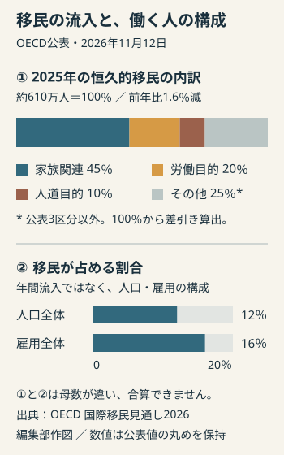
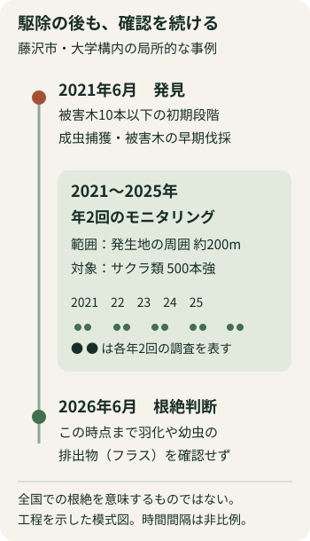

# アヤベ日報　2026年11月14日（土）

本紙 · 20記事 · 図解2点　情報確認 2026-11-14T07:45:05+09:00

## 今朝の読みどころ

- メールが開けても、配送には時間差 Microsoft障害、14日朝も滞留解消へ
- 給付対象を勤労者の半数以上へ 増えたのは対象像、所得線引きはこれから
- 大阪市の行政メール107万件漏えい確定 対象期間と配信の経路が見えた

## 01　メールが開けても、配送には時間差 Microsoft障害、14日朝も滞留解消へ

深掘り

OutlookやTeamsなどを巻き込んだ世界的な障害について、Microsoftは13日、広い範囲で回復と安定化が進んだと説明した。ただし、全利用者の完全復旧宣言ではない。東海国立大学機構が掲載する14日5時1分時点の同社説明では、滞留したメールの処理と通信量の配分調整が続き、全面復旧の見通し時刻は示されていない。

なぜ画面が戻っても『復旧完了』にならないのか。今回の説明には二つの仕事がある。一つは利用者がサービスへ接続できる状態を戻すこと。もう一つは、止まっていた間にたまったメールを順番に処理することだ。入口が開いた時点でも、配送待ちの列は残りうる。同機構が転載した会社の説明も、サービスへのアクセスが先に回復し、メールの流れが後から正常化する場合があるとしている。

同機構自身が確認した影響は、組織メールの送受信不能、Outlookの起動不能、TeamsやSharePointの一部機能の利用不能。独立報道のロイターも、政府機関や企業に連絡の遅れが広がったと伝えた。単に一つのアプリが開かないだけでなく、会議、予定管理、顧客連絡が同時に揺らぐ問題になった。

原因についてはMicrosoftが、以前のネットワーク容量拡張時の問題が最近の変更で表面化したと説明している。サイバー攻撃やAIに関連する問題ではないというのが同社の現時点の説明で、詳細な事後報告は別途公表する方針だ。本紙はMicrosoftの公開状況ページ本文を直接取得できず、公式な利用機関による転載と報道を照合した。内部の障害経路を独自に特定したものではない。

ここからの読み筋は、復旧を一つのスイッチで考えないことにある。接続、処理待ちの解消、安定した運用という段階を分けると、『使えるようになった』という体験と『まだ遅れている』という体験が並ぶ理由が見える。原因を断定する速報より、どの機能がどの段階まで戻ったかが、利用者には切実な情報となる。

出典東海国立大学機構・障害情報／Microsoft説明の転載ロイター・世界的通信障害の安定化EL PAÍS・復旧の進行と各国への影響

**出典**

- [東海国立大学機構・障害情報／Microsoft説明の転載](<https://thersac.icts.thers.ac.jp/hc/en-us/articles/64262985209881-November-13-2026-Microsoft-365-Outage-MO1550821>)
- [ロイター・世界的通信障害の安定化](<https://www.gaitameonline.com/reuters/outdir/20261113nRTROPT20261113211713KCN3WO2MG.html>)
- [EL PAÍS・復旧の進行と各国への影響](<https://english.elpais.com/technology/2026-11-13/microsoft-fails-to-restore-services-after-more-than-12-hours-of-global-disruption.html>)

## 02　給付対象を勤労者の半数以上へ 増えたのは対象像、所得線引きはこれから

深掘り

高市首相は13日、参院特別委員会で『就業者負担軽減支援金』を現役勤労者の半数以上に届く制度にする方針を示した。これまでの約3割を目安とする説明から、中所得層まで対象を広げる方向へ動いた。時事通信は、対象が約2000万人の例示から約3000万人規模になると伝えている。

仕組みの狙いは、税や社会保険料を差し引いた手取りを、所得に応じた給付で補うことだ。内閣法制局が公表する法案理由は、低中所得の就業者への負担軽減に加え、働く意欲の後押しや就業調整の緩和を掲げる。全員へ同額を配る制度というより、所得との関係で支援額を設計する構想と読める。

13日に示された先行導入の方向は、2027年度からの2年間。支援基本額は年最大2万5000円程度、子ども加算は5000円程度とする検討で、首相は夫婦と子2人の世帯で年最大6万円の例を示した。これは条件を満たし最大限の支援を受ける例であり、すべての4人世帯への一律給付額ではない。所得上限の具体額や個々の受給資格を、現段階で決め打ちはできない。

対象を広げるほど、支援を薄く広くするのか、必要性の高い層へ厚くするのかという配分が問われる。テレビ朝日の国会報道では、食料品の消費税減税と合わせた財源をめぐり、税収の上振れ、基金の返納、税外収入を挙げる首相と、その確実性を問う議員との応酬もあった。支援金単独の費用と減税を含む費用を混ぜないことも大切だ。

法案は衆院を通過し、参院で審議中。今回の新事実は対象拡大と給付水準の説明であって、支給の開始ではない。政策の次の焦点は『半数以上』をどの所得線で実現し、所得が増える際に給付がどう変わるよう設計するか。手取りを増やす目的が、実際の働き方にどうつながるかは、その具体化で決まる。

出典時事通信・対象と先行導入の説明テレビ朝日・13日の参院審議内閣法制局・法案の提出理由衆議院・法案審議経過

**出典**

- [時事通信・対象と先行導入の説明](<https://www.nippon.com/ja/articles/-/57392>)
- [テレビ朝日・13日の参院審議](<https://news.tv-asahi.co.jp/news_politics/articles/000547605.html>)
- [内閣法制局・法案の提出理由](<https://www.clb.go.jp/recent-laws/diet_bill/detail/id=5343>)
- [衆議院・法案審議経過](<https://www.shugiin.go.jp/Internet/itdb_gian.nsf/html/gian/keika/1DE342E.htm>)

## 03　大阪市の行政メール107万件漏えい確定 対象期間と配信の経路が見えた

深掘り

大阪市は13日、行政オンラインシステムの利用者のメールアドレス107万8713件が漏えいしたと公表した。住民票の写しの請求などに使うシステムで、今月初めの『可能性』という段階から、対象項目と件数の確認へ進んだ。市は、9月16日に登録利用者へ一斉のお知らせを送ったため、件数が大きくなったと説明している。

対象は7月1日から10月31日までに、同システムからメールを受け取ったアドレス。申請時だけでなく、登録や変更、ログイン、処理状況の通知なども含まれる。最近手続きをしていない人でも、一斉のお知らせを受信していれば対象期間との関係を確認する必要がある。件数はメールアドレスの数であり、そのまま人口や世帯数とは比較できない。

どこから流出したのか。市のシステム提供事業者TKCが利用する外部メール配信サービスへの不正アクセスが起点となった。読売新聞の報道は配信事業者をアララとしている。市の説明では、外部サービス側が提供した情報をシステム提供事業者が分類・照合し、対象を特定した。行政サービスの画面だけでなく、通知を届ける外部の経路にも情報が置かれていたわけだ。

市は個々のアドレスが対象かという問い合わせには回答できず、対象者への個別通知は検討中としている。受信履歴を確かめる際の送信元は、市が公表した info-osaka-online@city.osaka.lg.jp。これは自分の過去の利用をたどる手掛かりであり、同じ差出人表示の新着メールを無条件に信用してよいという意味ではない。

今回の確定数を受けても、原因や影響範囲、再発防止策の詳細について市の検証は続く。記事を読むうえでは『漏えいの確定』と『安全対策の完了』を分けたい。市は不審なリンクや添付を開かず、メール内のリンクではなく市の公式サイトから情報を確認するよう呼び掛けている。別に公表された商品券事業の漏えい件数と足し合わせることもしない。

出典大阪市・11月13日終報大阪市・利用者向け説明読売新聞・行政オンライン利用者の漏えい

**出典**

- [大阪市・11月13日終報](<https://www.city.osaka.lg.jp/hodoshiryo/ictsenryakushitsu/0000691472.html>)
- [大阪市・利用者向け説明](<https://www.city.osaka.lg.jp/ictsenryakushitsu/page/0000691479.html>)
- [読売新聞・行政オンライン利用者の漏えい](<https://news.livedoor.com/article/detail/32809688/>)

## 04　移民は減っても、人手の支えは大きい OECDが示す『人数の先』

深掘り

OECDが12日公表した国際移民見通しによると、加盟国への恒久的な移民は2025年に約610万人となり、前年比1.6％減った。減少は2年連続だが、2019年をなお12.5％上回る。『移民が減少した』という見出しと、『労働市場で移民の重要性が増した』という実態は両立する。年間に新しく受け入れた人数と、すでに暮らし働いている人々の役割は別の指標だからだ。

恒久的な移民には家族との合流、仕事、人道的な保護など、長期の居住につながる異なる経路が含まれる。2025年は家族関連が全体の45％、労働目的が20％、人道目的が10％を占めた。AFPが報告書を伝えた記事では、労働目的は13％増え、人道目的は26％減ったとされる。総数の小幅減少だけから、どの分野でも受け入れが縮んだとは言えない。

国ごとの差も大きい。米国、英国、カナダ、ドイツでは流入が減る一方、スペイン、イタリア、ポルトガルでは増加した。とくにポルトガルの大幅増には、滞っていた居住許可の処理が進んだ影響がある。統計の増減を、その年に国境を越えた人の動きとそのまま重ねるのは危うい。制度変更や事務処理の時期まで読む必要がある。

OECD全体で移民は人口の12％を占める一方、雇用に占める割合は16％に達する。2014～24年の雇用増加の半分以上を移民が担った国も、加盟国の過半数に上った。ただし、人数を確保すれば課題が解決するわけではない。報告書は、高い教育や専門技能を持つ人でも、その能力に見合わない仕事に就く『技能の過少活用』を問題にする。

外国で得た資格の認定、仕事と技能の適切な組み合わせ、職場への定着が重要になる。高齢化で需要が増す介護分野も、海外からの採用だけでなく、働く条件や人材を引き留める環境を整えなければ持続しない。OECDの提言は、移民の受け入れを国内の投資や生産性改善の代わりにしない、というものだ。

この統計から考えるべき問いは、受け入れを増やすか減らすかだけではない。どの経路で来た人が、どの仕事に就き、能力を生かせているのか。流入の総数と、生活・就労の仕組みを分けて見ることで、人手不足をめぐる議論の輪郭がはっきりする。最後の点は報告書の数値と提言からの整理であり、特定国の政策効果を断定するものではない。

編集部作図。OECD「国際移民見通し2026」公表値。その他は差分計算。

出典OECD・国際移民見通し2026の公表OECD・Executive summaryAFP・Migration to developed countries declines for second year

**出典**

- [OECD・国際移民見通し2026の公表](<https://www.oecd.org/en/about/news/press-releases/2026/11/migration-to-oecd-countries-declines-for-second-consecutive-year-but-remains-high-by-historical-standards.html>)
- [OECD・Executive summary](<https://www.oecd.org/en/publications/international-migration-outlook-2026_a9eab36b-en/full-report/executive-summary_9312236a.html>)
- [AFP・Migration to developed countries declines for second year](<https://origin-zh9p7m-www.afp.com/en/migration-developed-countries-declines-second-year-oecd>)

## 05　防衛費は5年60兆円規模の調整 既存43兆円計画との違い

ニュース

共同通信は13日、政府が2027〜31年度の5年間の防衛費について60兆円規模を視野に調整に入ったと報じた。年末の安全保障関連3文書の改定に合わせた検討で、正式決定ではない。無人機や弾薬、ミサイルの確保が柱になるとされる。

現行の2023〜27年度の計画は、防衛力整備の水準を43兆円程度としている。財務省資料はこれと別に、年度ごとの予算編成に伴う防衛関係費を40.5兆円程度と記す。計画の水準と毎年の予算、支払いと契約では物差しが違い、異なる数字を単純につなぐと増額幅を取り違える。

報道では大幅増税の回避が論点だが、税負担が全く増えないと決まったわけではない。装備の数量と納入時期、隊員や施設を維持する費用、財源の組み合わせをどう確保するかが次の争点となる。

出典共同通信・60兆円規模の調整財務省・2026年10月の財政資料／防衛

**出典**

- [共同通信・60兆円規模の調整](<https://www.kobe-np.co.jp/news/zenkoku/compact/202611/0021030900.shtml>)
- [財務省・2026年10月の財政資料／防衛](<https://www.mof.go.jp/policy/budget/fiscal_condition/related_data/202610_03.pdf>)

## 06　大阪都構想の移行期間、担当部署は8年を提言していた

ニュース

大阪市を特別区へ再編する大阪都構想で、システム改修には8年必要だと市の担当部署が市長に提言していたことが13日、共同通信の取材で分かった。法定協議会が10日に決めた移行期間は3年9カ月。新事実は移行日そのものではなく、その決定に先立つ技術側の見積もりとの隔たりだ。

報道によると、担当部署は業者の正式な費用見積もりを取る必要も指摘していた。見積もりでは作業手順が整理され、期間の精度が上がるためだが、数カ月を要することから聞き取りで済ませたという。

8年という提言だけで短縮が不可能と証明されたわけでも、政治的に決めた日付だけで実行可能性が裏付けられたわけでもない。システムをいつ、どの順に移すのかという作業計画が、制度設計と並ぶ論点として表に出てきた。特別区への移行自体は住民投票で可決された場合の計画だ。

出典共同通信・担当部署の提言

**出典**

- [共同通信・担当部署の提言](<https://www.kumanichi.com/articles/2057488>)

## 07　東大が総長選考を再回答 学内投票1位候補への評価を説明

ニュース

東京大学は13日、次期総長選考をめぐる教職員有志の2回目の質問書への回答を公表した。共同通信によると、学内投票1位の染谷隆夫副学長について、選考会議で組織運営の統治やリスク管理への姿勢、改革の必要性の認識に課題を挙げる意見があったと説明した。これは会議で出た評価の紹介であり、本紙が候補者の能力を認定したものではない。

9月の選考では、学内投票2位の藤垣裕子教授が選ばれた。大学の公式資料は、意向投票に加え候補者資料、推薦書、面接、所信表明などを総合的に考慮する仕組みを明示している。票の順位だけで決まる制度ではない一方、何を決め手として総合評価したかが説明を求められてきた。

今回の続報は選考のやり直しではなく、候補者への評価を一段具体的に示したことにある。回答原文の全文は取得できていないため、13日の内容は共同通信が伝えた範囲に限定する。制度の説明と、その制度を今回どう使ったかの説明は、別々に確かめる必要がある。

出典共同通信・11月13日の再回答東京大学・2026年度総長選考の公式資料

**出典**

- [共同通信・11月13日の再回答](<https://www.kumanichi.com/articles/2057586>)
- [東京大学・2026年度総長選考の公式資料](<https://www.u-tokyo.ac.jp/ja/about/public-info/r8_president-selection.html>)

## 08　輪島朝市通りに最初の店舗兼住宅 来春の店再開へ

ニュース

能登半島地震の火災で焼失した輪島市の朝市通り周辺に13日、店舗兼住宅が完成して所有者へ引き渡された。共同通信によると、更地となった一帯で建物ができるのは震災後初めて。再建したのは、大正時代から続く錦光堂・廣瀬屋漆器店だ。

6月の地鎮祭から工事を進め、近隣の商業施設が開く2027年春に合わせて店舗を再開する予定。住宅の完成、店の営業再開、通り全体のにぎわいの回復は、それぞれ時間の異なる工程となる。

地震と火災で失われたのは約240棟。今回の一棟を地域全体の復興完了と呼ぶことはできないが、土地の上に暮らしと商いの拠点が戻ったという、具体的な前進だ。

出典共同通信・輪島朝市の店舗兼住宅完成

**出典**

- [共同通信・輪島朝市の店舗兼住宅完成](<https://www.kobe-np.co.jp/news/zenkoku/compact/202611/0021031171.shtml>)

## 09　大阪の商品券メール漏えい、可能性から件数確定へ

ニュース

大阪市は13日、プレミアム付商品券2026事業で使う外部メール配信サービスから、利用者3万3868件、参加店舗1万4669件のメールアドレスが漏えいしたと発表した。6日に公表した「漏えいの可能性」から、調査によって対象件数が判明した続報となる。

対象は7月以降に配信された一部のメールに関係するアドレス。市が掲載した配信件数には重複があるため、それらを足した数と漏えいアドレス数は一致しない。また、市は商品券の利用者・店舗を管理する本体システムへの不正アクセスは、発表時点で確認されていないと説明している。

市は不審なメールのリンクや添付を開かず、IDやパスワードなどを入力しないよう呼び掛けた。行政オンラインシステムの記事とは別事業の公表であり、件数は合算していない。

出典大阪市・11月13日終報

**出典**

- [大阪市・11月13日終報](<https://www.city.osaka.lg.jp/hodoshiryo/keizaisenryaku/0000691292.html>)

## 10　ドイツ予算案、借入れは戦後2番目の規模 委員会が承認

ニュース

ドイツ連邦議会の予算委員会は13日未明、2027年予算案を承認した。ロイターによると歳出は約5610億ユーロ、新規借入れは特別基金分を含め2104億ユーロ。コロナ禍の2021年に記録した2154億ユーロに次ぐ、戦後2番目の規模となる。現段階は委員会承認で、議会本会議での採決を残す。

背景には、インフラ投資と防衛力の立て直しを進めるメルツ政権の方針がある。一方、連立内での調整ではプラスチック包装への課税案を撤回し、砂糖入り飲料への課税を2028年に延期。電力税の引き下げも先送りし、低所得家庭の子どもへの支援削減は取り下げた。支出の拡大だけでなく、負担と給付をどこに置くかの折衝が続いた。

注意したいのは『本体予算の借入れ』と『特別基金を含む総借入れ』の違いだ。本体は約1230億ユーロで、2104億ユーロと矛盾する数字ではない。今後は本会議の決定と、投資が実際の事業へ移る過程が焦点になる。

出典ロイター／ニューズウィーク日本版・独予算案、戦後2番目の新規借り入れ規模

**出典**

- [ロイター／ニューズウィーク日本版・独予算案、戦後2番目の新規借り入れ規模](<https://www.newsweekjapan.jp/articles/-/340102>)

## 11　COP31、電化を進める合意と化石燃料からの移行に隔たり

ニュース

トルコ・アンタルヤで開かれているCOP31では、化石燃料からの移行を合意にどう書き込むかをめぐり対立が表面化している。13日付ロイターによると、サウジアラビアやロシアは化石燃料を制限する文言に抵抗し、インドなども開発やエネルギー利用が制約されることを警戒する。一方、ブラジルは移行の道筋を明確にするよう求めている。

議長国トルコは電化を重視する。10日の公式会見で示した目標は、世界の最終エネルギー消費に占める電力の割合を、現在の約23％から2035年に35％へ引き上げることだ。これは発電量に占める再生可能エネルギーの比率ではなく、交通や建物、産業を含めたエネルギー利用の電化を指す。

交渉を担う豪州とトルコは各国の意見を集め、来週初めの草案作成を目指す。電化への賛同と化石燃料を減らす約束がどこまで結びつくかが焦点だ。まだ交渉序盤であり、対立があることを最終合意の失敗とは扱えない。

出典ロイター・COP31、化石燃料巡る対立色濃くUNFCCC・11月10日議長会見

**出典**

- [ロイター・COP31、化石燃料巡る対立色濃く](<https://www.gaitameonline.com/reuters/outdir/20261113nRTROPT20261113193243KCN3WO2FL.html>)
- [UNFCCC・11月10日議長会見](<https://unfccc.int/news/transcript-of-press-conference-opening-remarks-today-of-cop31-president-president-of-negotiations-un>)

## 12　ウクライナ和平協議、欧州側は5カ国とEUの代表で参加へ

ニュース

EUのコスタ大統領は13日、米国が仲介する次回のロシア・ウクライナ和平交渉に、英国、フランス、ドイツ、イタリア、ポーランドとEUの代表が参加することで合意したと発表した。ダブリンでの非公式EU首脳会合で決まった。次回協議の日程は明らかになっていない。

前号で取り上げた『欧州を誰が代表するのか』という論点が、具体的な参加国の枠組みに進んだ形だ。EUからは欧州委員会と欧州理事会の双方が代表を出す。英国はEU加盟国ではないが、この欧州側の枠組みに含まれる。

ただし、参加者の合意と、停戦や和平条件の合意は別である。フォンデアライエン欧州委員長はウクライナ支援とロシアへの圧力を続け、現時点で制裁を緩める考えはないとした。今回確認できた前進は交渉の席に着く欧州側の構成であり、戦争終結が決まったというニュースではない。

出典共同通信／熊本日日新聞・欧州5カ国とEU、和平交渉に参加へ

**出典**

- [共同通信／熊本日日新聞・欧州5カ国とEU、和平交渉に参加へ](<https://www.kumanichi.com/articles/2057671>)

## 13　北米通商交渉、米財務長官は楽観 対メキシコ関税警告は続く

ニュース

ベセント米財務長官は13日、カナダ、メキシコとの貿易合意に楽観的な見方を示した。CNBCのインタビューでの発言だが、条件や合意時期の詳細は示していない。ロイターによると、7月にトランプ大統領が米国・メキシコ・カナダ協定（USMCA）の延長を見送った後も交渉が続いている。

その一方、トランプ氏は前日の12日、米国へ向かう移民の流入をメキシコが阻止しなければ、同国への関税を倍増すると警告していた。ベセント氏はこの警告には言及しなかった。通商交渉の見通しと、移民政策を理由にした関税圧力が並行している。

現段階で確認できるのは財務長官の見通しであって、合意成立や関税変更の確定ではない。北米をまたぐ企業活動を読む際も、前向きな発言をそのまま制度の変更として扱わず、交渉の正式結果を見分ける必要がある。

出典ロイター・米財務長官、加・メキシコとの貿易合意楽観視

**出典**

- [ロイター・米財務長官、加・メキシコとの貿易合意楽観視](<https://www.gaitameonline.com/reuters/outdir/20261113nRTROPT20261113152213KCN3WO1Y4.html>)

## 14　米全土の空港で出発停止措置 管制通信に問題

ニュース

米連邦航空局（FAA）は13日、管制の通信問題を受け全米の空港で航空機の出発を停止した。AP通信によると、地域間の航空交通を扱う22の管制センターに影響し、技術者が調べている。飛行中の航空機に一斉の緊急着陸を命じたという話ではない。

13日の発表・報道に基づく速報。校了直前の再取得ができず、その後の解除状況は未確認。Microsoft障害との因果関係は確認されていない。

出典AP通信・管制通信障害The Verge・出発停止と着陸の扱い

**出典**

- [AP通信・管制通信障害](<https://apnews.com/article/flights-halted-airports-faa-f81b0904331dafad6133f291e5f531a8>)
- [The Verge・出発停止と着陸の扱い](<https://www.theverge.com/news/1033489/faa-ground-stop>)

## 15　OpenAI、購入ごとに承認するWallet 米国で限定提供開始

ニュース

OpenAIは13日、AIエージェントによる支払いを支えるChatGPT Walletを発表した。開始時の対象は米国の18歳以上のChatGPT Pro利用者で、対応する米国発行カードを持つ人。dotsを通じて順次提供し、日本での一般提供を発表したものではない。

仕組みの中心は、元のカード情報をエージェントや販売店へ直接渡さないことだ。利用者が商品、合計額、使用カードを確認して生体認証などで購入を承認すると、カードネットワークが支払い用の代替情報を発行する。American Express、Mastercard、Visaと協力した。

現行の説明は購入ごとの確認を前提とする。金額や期間を決めて全面的に任せる方式は将来像として示されており、今すぐ無条件で自動購入できるという発表ではない。販売店側の既存の決済・不正検知システムとの互換性も課題に挙げている。ここでは公式発表の仕組みと提供範囲を整理したもので、独立した安全性試験や利用レビューではない。

出典OpenAI・ChatGPT Wallet発表

**出典**

- [OpenAI・ChatGPT Wallet発表](<https://openai.com/index/introducing-chatgpt-wallet/>)

## 16　不安定さが熱を生む。核融合プラズマの常識に新しい補助線

ニュース

核融合科学研究所などは13日、大型ヘリカル装置LHDで、プラズマが自ら発生させた波によって加熱される過程を捉えたと発表した。不安定性は熱を逃がすものとして抑える研究が中心だったが、今回はあえて不安定な状態を詳しく観測した。

波が生じると粒子の速度分布が一時的にゆがみ、そのゆがみが戻った後には分布の広がりが増えた。これは温度上昇を意味する。重要なのは、核融合反応による自己加熱の全過程や発電を実証したわけではないこと。高温維持を支える一つの物理過程を取り出して示した成果だ。

編集部の読み筋は、「不安定だから全部なくす」から、「どの不安定性が何を運ぶのかを分ける」への転換にある。不安定性ごとの熱輸送を見分ける研究につながる。

出典核融合科学研究所・11月13日発表

**出典**

- [核融合科学研究所・11月13日発表](<https://www.nifs.ac.jp/news/research/261113.html>)

## 17　サクラを守る早期防除 5年間見守った成果

ニュース

日本大学と森林総合研究所は13日、神奈川県藤沢市の大学構内で見つかったクビアカツヤカミキリの定着個体群について、局所的な根絶を確認したと発表した。2021年の発見時に被害木が10本以下の集中した段階だったこと、成虫捕獲と疑わしい木の迅速な伐採を組み合わせられたことが重要だった。

さらに発生地の周囲約200メートル、サクラ類500本強を2021〜25年に年2回調べ、26年6月まで新たな羽化や幼虫の排出物を確認しなかった。木を切って終わりではなく、その後も監視し続けた点が成果を支えている。

対象は飛び地的な発生地で、周辺から新たな成虫が入らなかった条件も有利に働いた。したがって、広く定着した地域でも同じ費用や期間で根絶できるという証明ではない。サクラを残すために被害木を切る判断と、目に見える虫が消えた後の調査をどう続けるか。防除は一度の作業より、早期発見と長い確認を結び付ける体制が問われる。

編集部作図。森林総合研究所・日本大学の11月13日発表に基づく。期間は縮尺ではありません。

出典森林総合研究所・日本大学発表

**出典**

- [森林総合研究所・日本大学発表](<https://www.ffpri.go.jp/press/2026/20261113/index.html>)

## 18　道路の緑化、同じ緑でも中身は10年後まで違う

ニュース

北海道大学などは13日、道路盛土の斜面に表土をブロックのまま移した場所では、10年後も移植元に近い植物群集が保たれたと発表した。植物だけでなく根や土中の種子、土壌生物を含む層を、できるだけ崩さず移す工法を追跡した研究だ。

比較相手は、表土を一度崩して敷き戻す工法。施工直後はブロック移植の方が外来植物の被度を低く抑えたが、10年後には両工法の外来植物の被度が同程度になった。一方で、植物の種の組み合わせには違いが残った。単に地面が緑で覆われたかだけでは、地域の生態系に近づいたかを見分けられない。

今回の知見は北海道の調査地に基づく。短期間で侵食を防ぐ目的と、土地本来の植物を戻す目的を分けて施工方法を選ぶことが大切だ。造成直後の見栄えではなく、10年後に何が生えているかを評価する研究と言える。

出典北海道大学・11月13日研究発表

**出典**

- [北海道大学・11月13日研究発表](<https://www.hokudai.ac.jp/news/2026/11/10-19.html>)

## 19　Anker Space 2 Pro発売 独自チップで遮音を強化、約265グラム

ニュース

アンカー・ジャパンは12日、ワイヤレスヘッドホン「Anker Space 2 Pro」を発売した。税込3万2990円。独自チップThusと8基のマイクを使うノイズキャンセリング、35ミリドライバー、LDAC、2台同時接続を備える。重さは約265グラムで、ANC使用時の再生時間は最大30時間とする。

同社が示す従来機比約1.5倍のノイズキャンセリング強度は、20ヘルツ〜2キロヘルツという条件付きの自社比較だ。全周波数やあらゆる装着状態で体感が1.5倍になるという意味ではない。また、最大再生時間も音量や利用環境によって変わる。

演算チップの高性能化を遮音や通話処理に使う方向が目を引く。装着時の圧迫感や外音の聞こえ方は、仕様表とは別に実機評価が必要になる。

出典アンカー・ジャパン公式発表

**出典**

- [アンカー・ジャパン公式発表](<https://corp.ankerjapan.com/news/654>)

## 20　ウエスP、20周年へSNS動画を連作 第1弾は伊藤英明

ニュース

ウエスPが2027年の芸歴20周年に向け、世界の著名人20人と順次共演するSNS動画企画を始めた。13日午前9時に公開された第1弾には俳優の伊藤英明が登場。公式発表によると、日本とアメリカ圏を重点に、俳優やクリエイターなどとのコラボレーションを広げる。

公開先は本人のTikTokやInstagramなど。20周年用のロゴを付けた投稿として展開するため、劇場公演の開催やチケット発売とは別の企画だ。現時点で確認できる具体的な第1弾と、今後の20人という計画は区別しておきたい。

周年の節目を短い動画の連作で届けるのがおもしろい。身体を使った笑いと国境を越えるSNSの組み合わせを、異なるゲストで試す企画になりそうだ。

出典FANY Magazine・11月13日

**出典**

- [FANY Magazine・11月13日](<https://magazine.fany.lol/296472/>)
