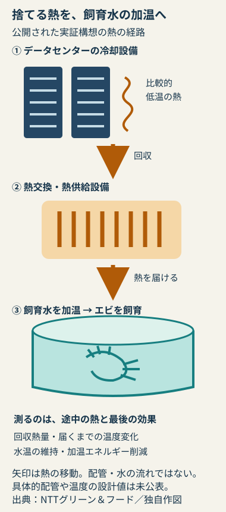
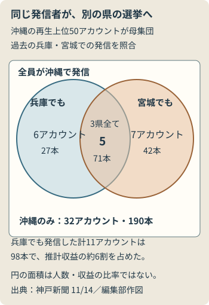

# アヤベ日報　2026年11月15日（日）

本紙 · 16記事 · 図解2点　情報確認 2026-11-15T07:37:57.595153+09:00

## 今朝の読みどころ

- 領土だけでは決まらない和平交渉 ウクライナが求める三つの条件
- 高齢者医療の3割負担案 公費の入れ方で変わる現役の保険料
- データセンターの熱でエビを育てる。問われるのは「温かさ」より安定供給

## 01　領土だけでは決まらない和平交渉 ウクライナが求める三つの条件

深掘り

ウクライナのゼレンスキー大統領は14日公表の記者向け発言で、米国側がNATO加盟と引き換えに東部ドンバスから撤退する可能性を尋ねたと明らかにした。今週のアブダビ協議を受けた説明で、加盟と領土の問題を結び付ける問いが出たのは初めてだという。ロイターとAFPが報じた。

ウクライナにとって、この提案で問われるのは停戦線だけではない。撤退後に再び攻撃されたとき誰が守るのか、自国軍を維持できるのか、破壊された経済を何で立て直すのか。キーウ・インディペンデントによると、ゼレンスキー氏が求める包括策は、NATOやEUによる保証、兵員・装備・資金を伴う強いウクライナ軍、財源を明示した復興計画からなる。外交・軍事・経済を一つの組として交渉する構えだ。

米国が持ち出したNATO加盟は、領土撤退という重い選択に対して、将来の安全を交換材料にする発想になる。ただしロシアのプーチン大統領はウクライナのNATO加盟を受け入れ難い一線としてきた。領土でロシアの要求に近づく案が、安全保障ではロシアの要求と衝突する。取引の形が示されても、双方の利益が単純につり合うわけではない。

さらにNATOの条約第10条は、新規加盟国の招請に全加盟国の一致を求める。米国の支持だけで提供できる条件ではない。安全の保証についても、第4条の協議と第5条の集団防衛では内容が異なる。ゼレンスキー氏は米兵の駐留について米側が否定したとも説明しており、ウクライナ側は「安全を保証する」という言葉を、具体的に誰が何をする約束なのかへ落とし込もうとしている。

国民の判断も交渉の条件になる。ゼレンスキー氏は必要な保証が具体化した場合に国民の意見を求めるとし、占領地をロシア領と認めるものではないと述べた。一方、AFPによればエネルギー施設を対象とする停戦案もロシアに拒まれたという。冬の攻撃を止めたい当面の課題と、戦後の再侵攻を防ぐ長期の課題が重なる。今回表に出たのは、土地の交換だけでは処理できない和平の難しさだ。提案の詳細や各国の正式な合意はまだない。

出典ロイター・ゼレンスキー氏の説明AFP・米側打診と停戦協議Kyiv Independent・安全保障の条件NATO・北大西洋条約原文

**出典**

- [ロイター・ゼレンスキー氏の説明](<https://www.gaitameonline.com/reuters/outdir/20261114nRTROPT20261114162434KCN3WP0LW.html>)
- [AFP・米側打診と停戦協議](<https://www.afp.com/en/us-proposes-ukraine-cede-territory-exchange-joining-nato-zelensky>)
- [Kyiv Independent・安全保障の条件](<https://kyivindependent.com/us-floats-nato-membership-for-ukraine-in-exchange-for-donbas-withdrawal-zelensky-says/>)
- [NATO・北大西洋条約原文](<https://nato.int/en/about-us/official-texts-and-resources/official-texts/1949/04/04/the-north-atlantic-treaty>)

## 02　高齢者医療の3割負担案 公費の入れ方で変わる現役の保険料

深掘り

自民党と日本維新の会が13日の実務者協議で、高齢者の医療費窓口負担を議論した。14日の読売報道によると、維新は70～74歳も含め原則3割を主張する一方、75歳以上の3割負担にも公費を入れるよう求めている。患者の負担を増やせば現役世代の保険料は下がる、とは限らない。制度上の事情がある。

後期高齢者の医療費は、患者が窓口で払う部分と、保険から給付する部分に分かれる。通常の給付部分には約5割の公費が入り、約4割を現役世代からの支援金で支える。ところが現役並み所得者の給付には公費を投入しない。その区分だけ広げると、窓口支払いが増える一方で公費が外れ、現役側への請求がかえって増えうる。厚労省の2025年11月の部会資料も、この負担構造を既に論点として示していた。

つまり今回の争点は「何割払うか」と「残りを誰が払うか」の組み合わせだ。読売は、3割負担の給付費の半分を公費で賄う場合、年約5000億円規模の財源が必要との試算を伝える。ただしこれは決定済み予算ではない。政府・与党が年末の工程表に向けて論点整理を進める段階で、対象の所得条件、公費の財源、受診への影響が残る。窓口割合だけで家計への損得を判断できない改革として見ておきたい。

出典読売新聞：13日の与党実務者協議（14日報道）厚生労働省：高齢者医療における負担の在り方（2025年11月13日）

**出典**

- [読売新聞：13日の与党実務者協議（14日報道）](<https://news.livedoor.com/article/detail/32814548/>)
- [厚生労働省：高齢者医療における負担の在り方（2025年11月13日）](<https://www.mhlw.go.jp/content/12401000/001594826.pdf>)

## 03　データセンターの熱でエビを育てる。問われるのは「温かさ」より安定供給

深掘り

捨てていた熱を、食べ物を育てる熱へ。NTTドコモビジネスなど4社が13日に発表した共同実証は、データセンターの排熱をバナメイエビの陸上養殖に回す計画だ。2026年度は熱の回収と測定、2027年度は飼育を行い、2028年3月まで検証する。まだ出荷の成功を知らせるニュースではない。

組み合わせる理由は、双方の困りごとが逆向きだからだ。データセンターの排熱は比較的低温で、使い道が限られる。一方、陸上養殖には水温を保つための加温費がかかる。実証では水温維持と加温エネルギー削減に加え、データセンターの運用を妨げないかも確かめる。

ここで大事なのは、エビが育ったという一例だけで終わらせないことだ。冷却方式や排熱条件から適切な養殖規模を決める設計手法までが目標に入っている。編集部の見立てでは、「熱がある場所に水槽を置く」より、年間の供給と必要量を合わせられるかが普及の分かれ目になる。削減率や採算は、まだ結果待ちだ。

ITmediaの担当者取材では、バナメイエビは16〜18週間の短い育成技術があることが選定理由とされた。育ったエビの出荷は可能な状態になれば検討する段階で、行き先も未定。スーパーに並ぶ日を先取りするより、まず測定と飼育の二段階を見届けたい。

編集部作図。NTTグリーン＆フードの10月7日構想と4社の11月13日実証計画に基づく模式図。熱の流れを示し、配管の設計や温度は表していません。

出典NTTドコモビジネス・共同実証発表ITmedia・担当者取材NTTグリーン＆フード・実証構想と概念図（10月7日）

**出典**

- [NTTドコモビジネス・共同実証発表](<https://www.ntt.com/about-us/press-releases/news/article/2026/1113.html>)
- [ITmedia・担当者取材](<https://www.itmedia.co.jp/news/article/2611/13/2000003200/>)
- [NTTグリーン＆フード・実証構想と概念図（10月7日）](<https://www.ntt-green-and-food.com/news/1455/>)

## 04　京阪4社のLINEアカウントで情報流出のおそれ 共通サービスの権限を悪用

深掘り

京阪ホールディングスが14日、グループ4社の六つの公式LINEアカウントで、登録者情報が流出した可能性を公表した。対象は京阪電車ファン情報、京都タワーサンド、枚方モール、京阪百貨店とホテル2施設。共同通信は延べ約28万人分と報じたが、公式資料はアカウント間にも情報項目間にも重複があると注記している。28万人の別々の人が一律に同じ情報を失った、という意味ではない。

地元で確認すべき違いは、登録先によって情報の深さが異なることだ。枚方モールはLINE表示名等が最大4万6957人、生年月日・性別のいずれかが最大3万5025人。京阪百貨店はLINE情報が最大5万1223人、氏名・連絡先など六項目のいずれかが最大2万8000人としている。LINEユーザーIDも、友だち検索に使うLINE IDとは別物だ。公表値は精査前の最大範囲で、被害確定人数ではない。

原因は、LINE本体ではなく連携サービスCOMSBIのSaaS版への不正アクセス。提供元ソニックムーブは、複数企業を扱える社内アカウントの権限が悪用されたと説明する。管理を便利にする共通の権限が、企業をまたいだ影響の経路になった形だ。同社はアクセス遮断や認証情報の更新を実施し、2段階認証の必須化などを掲げる。京阪の公表時点で関連する二次被害は未確認で、サービスはカード情報を保持していない。登録先の公式案内を確かめ、不審な連絡のリンクや認証情報の要求に応じないことが当面の対応になる。

出典京阪HD：14日公表・対象項目と人数の原表ソニックムーブ：COMSBI不正アクセスの経緯と対策共同通信：京阪HDで情報流出か

**出典**

- [京阪HD：14日公表・対象項目と人数の原表](<https://www.keihan.co.jp/corporate/info/release/assets/261114_keihan-holdings.pdf>)
- [ソニックムーブ：COMSBI不正アクセスの経緯と対策](<https://sonicmoov.com/news/5ttj9ndzh>)
- [共同通信：京阪HDで情報流出か](<https://www.kumanichi.com/articles/2057754>)

## 05　米軍駐留経費、米側「3倍」と日本側「1.4倍」の隔たり

ニュース

TBSが14日、2027年度からの在日米軍駐留経費の日本側負担について、米側が5年間で3兆円超を要求し、日本側は年平均約3000億円への増額を検討していると報じた。現行の年平均約2110億円に対し、米側は約3倍、日本側は約1.4倍という開きになる。日本側には施設改修費を拡充する案があり、年内合意を目指すという。

防衛省によると、現行特別協定は2027年3月末まで。負担対象は労務費、光熱水料、訓練移転費、訓練資機材調達費などに分かれ、施設整備にも別の枠組みがある。「米軍への支払い」一括ではなく、何を増やす提案なのかが交渉の中身になる。米側要求も日本側検討額も、締結済みの合意ではない。前日伝えた防衛費全体の5年総額とも区別する必要がある。

出典TBS：在日米軍駐留経費交渉（mixi配信本文）防衛省：同盟強靱化予算・現行特別協定

**出典**

- [TBS：在日米軍駐留経費交渉（mixi配信本文）](<https://news.mixi.jp/view_news.pl?id=9027383&media_id=266>)
- [防衛省：同盟強靱化予算・現行特別協定](<https://www.mod.go.jp/j/approach/zaibeigun/us_keihi/>)

## 06　選挙動画の収益、県をまたぐ11アカウントに集中

ニュース

神戸新聞など地方紙6紙と東京大の研究者による分析で、9月の沖縄県知事選の動画再生上位50アカウントのうち、11は2024年の兵庫県知事選でも関連動画を配信していた。14日の報道によると、この11アカウントが出した98本は分析対象330本の約3割だが、推計収益は最大約827万円で全体の約6割を占めた。

選挙ごとに別の地域の有権者へ届く動画が、継続的な収益源になりうる構造を示す。ただし数値は再生数からの推計で、実際の入金額でも、投票結果への影響の測定でもない。県をまたいで発信すること自体を不正とする根拠にもならない。見る側には、動画の主張だけでなく、発信者が他の選挙で何を配信してきたかを確かめる視点を与える調査だ。

編集部作図。神戸新聞の11月14日調査報道による。円の面積は比率ではありません。推計収益は実入金額や投票への効果を示しません。

出典神戸新聞：地方紙6紙・研究者による分析

**出典**

- [神戸新聞：地方紙6紙・研究者による分析](<https://www.kobe-np.co.jp/news/society/202611/0021030732.shtml>)

## 07　拉致から49年、家族が新潟集会で早期帰国を訴え

ニュース

横田めぐみさんが1977年11月15日に拉致されて、きょうで49年になる。前日の14日、新潟市の県民集会で母・早紀江さんが川崎市から中継参加し、長年解決が見えない苦しさと帰国への願いを語った。NST報道によると、弟で家族会代表の拓也さんは9月の米政府高官らとの面会を報告し、日朝首脳会談の実現に期待を寄せた。

集会では、全被害者の救出を求める約3万5000人分の署名が政府に渡された。これは交渉進展の発表ではなく、家族が改めて政府の行動を求めた出来事だ。節目の日付だけでなく、家族に残された時間という切迫した問題として受け止めたい。

出典NST：14日新潟県民集会の現地報道

**出典**

- [NST：14日新潟県民集会の現地報道](<https://www.fnn.jp/articles/-/1152535>)

## 08　両陛下が大阪入り。きょう海づくり大会、泉州2会場でも催し

ニュース

天皇皇后両陛下が14日午後、大阪府に到着し、海づくり大会の関連作品を鑑賞、漁業関係者らと懇談した。TBSによると、きょう15日は岸和田市で式典、泉佐野市のりんくう公園で放流行事に臨む予定。大阪開催は初めてで、水産資源の管理と環境保全を考える機会になる。

一般向けの「豊かな海づくりフェスティバル」は、きょうも9時30分～16時30分、岸和田旧港地区緑地と泉佐野市りんくうアイスパークで開催予定。府案内では入場無料・事前申込不要で、展示や体験、飲食販売、式典等の中継を用意する。両会場に駐車場はない。式典への自由参加とは別の催しなので、訪れる際は公式の会場・当日案内を確認したい。

出典TBS：両陛下の大阪到着・14日の行程大阪府：関連フェスティバルの日時・会場大阪府：大会の目的・大阪初開催

**出典**

- [TBS：両陛下の大阪到着・14日の行程](<https://news.mixi.jp/view_news.pl?id=9028202&media_id=266>)
- [大阪府：関連フェスティバルの日時・会場](<https://www.pref.osaka.lg.jp/hodo/fumin/o120130/prs_51038.html>)
- [大阪府：大会の目的・大阪初開催](<https://www.pref.osaka.lg.jp/o120130/suisan/zen_yutaumitaikai/index.html>)

## 09　米中の貿易理事会が初会合 「300億ドルずつ」は何を意味するか

深掘り

米中両国は13日、経済・貿易協議の枠組みに設けた貿易理事会の初会合をオンラインで開いた。中国商務省が14日に発表し、ロイターも報じた。関税、双方300億ドル規模の輸入品を対象とする関税引き下げ、農産物貿易など、これまでの協議成果の実施を話し合ったという。

300億ドルは相手国へ渡す資金でも、関税の減収額でもない。9月28日に商務省が示した枠組みでは、2024年の貿易額を基準に、それぞれ約300億ドル分の輸入商品を選んで関税待遇を改善する。いくら貿易するかではなく、どの商品を対象にするかという交渉なのだ。

品目を見ると双方の違いが分かる。米側は玩具や家電など、中国側は農産物や医療機器などを挙げていた。消費財や生産・医療に関わる品を、それぞれの市場の需要に合わせて選ぶ形になっている。枠組みは対象品の9割超について追加関税を取り除き、最恵国待遇の税率にする設計だ。通常の税率へ戻す意味であり、全商品を無税にする仕組みではない。

輸入する企業の側から見れば、大きな総額より自社の商品がリストに入るかが先に来る。対象外の品にはこの枠組みの恩恵をそのまま見込めないし、対象でも通常税率は品目によって違う。したがって仕入れ費用を見積もる際には、対象品目、適用される税率、施行日という順に確認することになる。これは公表された制度から導ける実務上の読み筋だ。

今回の会議はその実施を扱う窓口が動き始めたというニュースだ。農産物も議題に含まれ、関税以外の貿易上の関心事項も話し合った。商品ごとの問題を首脳同士の会談だけに預けず、継続して協議する場を持つことに意味がある。ただし14日の発表には、新税率の施行日や新たな農産物購入量の記載はない。

出典中国商務省・11月14日の初会合発表中国商務省・9月28日の枠組み説明ロイター・初会合報道

**出典**

- [中国商務省・11月14日の初会合発表](<https://www.mofcom.gov.cn/xwfb/rcxwfb/art/2026/art_c564995ff6054093a1ed039e10c89aad.html>)
- [中国商務省・9月28日の枠組み説明](<https://www.mofcom.gov.cn/xwfb/rcxwfb/art/2026/art_7f879be341ec4137a22f6d0360a5a291.html>)
- [ロイター・初会合報道](<https://www.streetinsider.com/Reuters/China,%2BUS%2Bdiscuss%2Btariffs,%2Bfarm%2Btrade%2Bat%2Bfirst%2Btrade%2Bcouncil%2Bmeeting/27346078.html>)

## 10　全米の離陸停止は解除 欠航・遅延の回復は別の段階

ニュース

米国の全国的な離陸停止は、米東部時間13日午後8時15分、日本時間14日午前10時15分に解除された。ロイターが運輸長官の説明として伝えた。前号の「停止」から「段階的な運航再開」へ進んだが、通常のダイヤに戻ったという発表ではない。

同報道が引用したフライトレーダー24の集計では、欠航は6600便超、遅延は8600便に上った。通信障害の解消と、欠航で崩れた運航予定の回復には時間差がある。長官も、航空各社が通常運航を取り戻すまで時間がかかると説明した。

FAAの一次発表は複数の航空管制センターの通信問題を理由に挙げ、調査中としている。通信が戻れば再開できる管制と、停止中に乱れたダイヤを立て直す航空会社。復旧には、この二つの仕事がある。今回確認した政府文書に原因の確定報告はなく、欠航・遅延数も報道時点の集計だ。

出典ロイター・停止解除と運航再開FAA・全国離陸停止に関する一次発表

**出典**

- [ロイター・停止解除と運航再開](<https://www.gaitameonline.com/reuters/outdir/20261114nRTROPT20261114040413KCN3WP079.html>)
- [FAA・全国離陸停止に関する一次発表](<https://www.faa.gov/newsroom/faa-statement-nationwide-ground-stop>)

## 11　首相、16日からマニラ・深圳へ 安保と経済の会議が続く

ニュース

高市首相は16日から19日まで、ASEAN関連首脳会議とAPEC首脳会議に出席するためマニラ、深圳を訪れる予定だ。外務省の公式日程では、17日に日・ASEAN首脳会議や東アジア首脳会議などを組み、日米豪印のクアッド首脳会合も「調整中」として記載している。

18日に深圳へ移り、19日のAPECでは貿易・投資、エネルギー、デジタル経済・AIを議論する予定。マニラでの地域協力から、深圳での経済課題へ続く行程だ。別々の会議が同じ週に集まるため、日本の安全保障上の協力と経済上の関係をどう両立させるかが見える外交日程になる。

出典外務省・首相出張日程

**出典**

- [外務省・首相出張日程](<https://www.mofa.go.jp/mofaj/pageit_000001_03314.html>)

## 12　日メキシコ、供給網とエネルギーで連携 経済対話の初会合を目指す

ニュース

茂木外相とメキシコのベラスコ外相は13日、東京で会談し、供給網の強靱化を含む経済安全保障で連携を深める方針を確認した。外務省によると、エネルギーに加え、水処理などでも協力を進め、ハイレベル経済対話の初会合を早期に開くため調整する。

供給網とは、工場や港だけの話ではない。日テレは、中東情勢の悪化を受けて日本がメキシコ産原油を輸入した経緯を伝えた。石油の調達先を広げる動きに、日本企業が現地で活動しやすい事業環境の整備を重ねる。外務省発表で、日本側が企業の活動条件への協力を要請したのはその具体的な一歩だ。

日本の重点分野とメキシコ側の計画には、重要インフラ、医療・保健、農業・食など共通する分野があるという。資源を買う関係にとどまらず、双方の産業政策を接続する余地を探る会談だった。新たな原油契約の数量や価格は、今回の発表では示されていない。

出典外務省・日メキシコ外相会談日テレNEWS NNN・エネルギー協力報道

**出典**

- [外務省・日メキシコ外相会談](<https://www.mofa.go.jp/mofaj/press/release/pressit_000001_04471.html>)
- [日テレNEWS NNN・エネルギー協力報道](<https://news.livedoor.com/article/detail/32813881/>)

## 13　AI眼鏡、米韓で予約開始。「見えているものを送る」境界も商品仕様に

深掘り

Googleは12日、Samsungと協業するIntelligent Eyewearの予約を開始した。Warby Parkerのモデルは395ドルから、Gentle Monsterは449ドルからで、一般発売は12月10日。米国・韓国の対象アカウント向けで、日本の発売案内ではない。

視界を手がかりにGeminiへ話しかけ、ポスターを見ながら予定の空きを確かめるなど、スマホを取り出さない使い方を狙う。約41グラム、電池は最大9時間という公称値。装着時間の長い眼鏡だからこそ、便利さと同じくらい周囲に何が伝わるかが重要になる。

同時に示された保護策では、写真・動画の保存用撮影は外向きのランプで知らせ、ランプを覆ったり無効化したりすると録画を止める設計だ。Geminiが処理するカメラ画像では周囲の人の顔を自動で隠す処理を行い、その画像をGeminiの履歴に残さず、モデル学習や広告にも使わないとしている。

ただし、これは「眼鏡が扱うすべての情報を保存しない」という話ではない。Geminiとの会話には履歴の確認・削除や設定が別にあり、カメラやマイクへのアプリ権限も管理する。編集部としては、撮影の告知、AIへの画像送信、会話の保存を分けて読むのが、この製品を理解する近道だと考える。

これらはメーカーの設計説明で、第三者が日常環境で効果を検証した結果ではない。録画ランプがあること自体を、周りの同意や撮影禁止場所のルールの代わりにはできない。

出典Google・製品発表Google・プライバシー設計

**出典**

- [Google・製品発表](<https://blog.google/innovation-and-ai/technology/xr-ar/google-intelligent-eyewear-collections-pre-order/>)
- [Google・プライバシー設計](<https://blog.google/innovation-and-ai/technology/safety-security/intelligent-eyewear-privacy-protections/>)

## 14　Gemini 4 Hydrogenは「深く考える役」と「実行する役」を分ける

ニュース

Googleは12日、日常のコーディングや複数手順の作業向けにGemini 4 Hydrogenを発表した。長い推論を担うCarbonやArgonに対し、実行の速さと効率を狙う位置づけ。APIはAIが扱う文字列の単位であるトークン100万個当たり入力1.50ドル、出力7.50ドルで、100万トークンの文脈長でも一律としている。

注目は、開発環境AntigravityのOrchestratorが、同じ作業中にCarbonとHydrogenを切り替える点だ。Googleの評価では、Carbonに近い成功率を保ちつつ、サービスの利用枠の消費量を24％、所要時間を19％減らした。これは同社の特定ベンチマーク上の結果で、普段の仕事が一律にその分速くなるという意味ではない。

一つの最高性能モデルにすべて任せるだけでなく、難所の判断と日常的な実行を分担させる方向が見える。利用先もAI Studio、API、Geminiアプリなどに広げる。選ぶ際はモデル名の強さだけでなく、往復の手間や検証込みの時間を測るのがよさそうだ。

出典Google・Hydrogen発表（11月13日更新）

**出典**

- [Google・Hydrogen発表（11月13日更新）](<https://blog.google/innovation-and-ai/models-and-research/gemini-models/introducing-gemini-4-hydrogen/>)

## 15　ブルテオン、鹿児島に3–0。接戦の第3セットを終盤にひっくり返す

ニュース

大阪ブルテオンは14日、パナソニックアリーナでフラーゴラッド鹿児島に25–19、25–18、25–22のストレート勝ち。3,016人が入ったホームで勝ち点3を得た。スコアは快勝だが、第3セットは先行を許してから取り戻した。

公式試合レポートによると、第3セットは甲斐優斗のサービスエースで17–17に追いつき、マッカーシーのサーブから22–21と逆転。最後は西田有志のスパイクで締めた。サムエルボ監督は攻撃の強みを評価する一方、第3セット序盤を課題に挙げ、鹿児島の速いフロートサーブへの対応にも触れた。

15日は同会場で14:05から第2戦。勝った形を再現できるかに加え、前日に苦しんだ入りの部分をどう変えるかを見ると、同じ相手との連戦が少し違って見える。

出典大阪ブルテオン・第4節GAME1試合結果大阪ブルテオン・試合日程

**出典**

- [大阪ブルテオン・第4節GAME1試合結果](<https://www.osaka-bluteon.com/game/result/detail/9>)
- [大阪ブルテオン・試合日程](<https://www.osaka-bluteon.com/game/date_list>)

## 16　田津原理音が架空の県をつくる。単独ライブの外にも続く笑い

ニュース

田津原理音の単独ライブ「峰戸県咲森市」は、舞台の地名から架空だ。12日公開のFANYの取材記事では、県内2番目の自治体という設定に加え、広報アカウントや小道具、ジオラマまで制作していることが紹介された。大阪公演は12月12日、よしもと漫才劇場で19:30開演、配信も予定する。

面白いのは、設定を完成させてから客に見せるだけではないところ。共演芸人の、雨が少ないというアドリブを受け、雨具店のジオラマと動画を作った例が取材に出てくる。架空の町の情報が増えるほど、次のネタの舞台も育っていく。

これは発売開始の速報ではなく、制作の見方を変える話題。公演外の広報まで作品の一部になる発想は、短い動画や一回の舞台を越えて笑いを積み重ねる試みとして興味深い。SNSの元投稿は今回取得できず、反応数や評判は判断していない。

出典FANY Magazine・田津原理音取材

**出典**

- [FANY Magazine・田津原理音取材](<https://magazine.fany.lol/296293/>)
