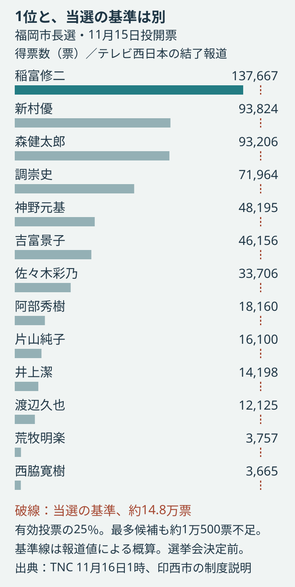
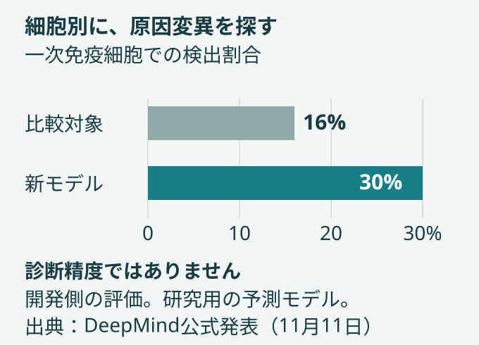
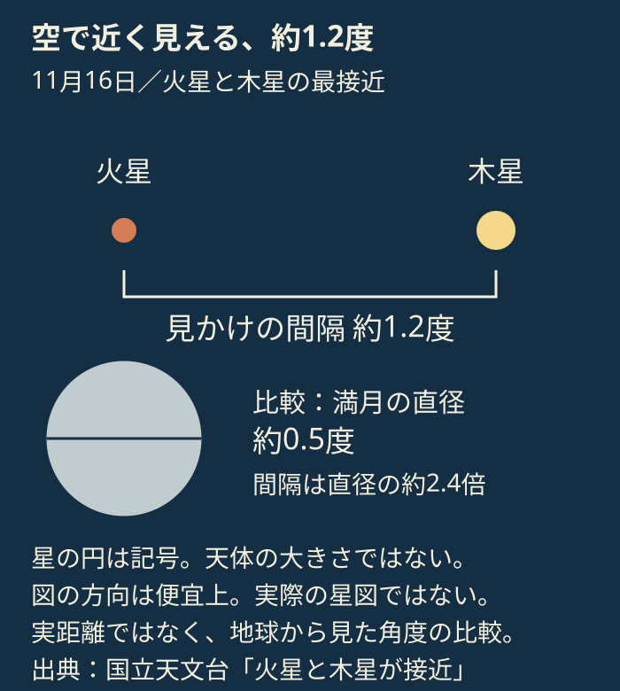

# アヤベ日報　2026年11月16日（月）

本紙 · 20記事 · 図解3点　情報確認 2026-11-16T07:41:27+09:00

## 今朝の読みどころ

- 最多得票でも当選しない。福岡市長選が再選挙へ
- 防衛AIは「使う場所」から実装へ。機密データの扱いが焦点
- 減税への期待と内閣支持は別。共同調査で効果「小さい」63.5％

## 01　最多得票でも当選しない。福岡市長選が再選挙へ

深掘り

15日投開票の福岡市長選は、13人の候補全員が当選に必要な得票に届かず、再選挙となる見通しになった。テレビ西日本が16日午前1時に伝えた開票結了の結果では、最多の稲富修二氏は13万7667票。16日の選挙会で正式に決まる見通しで、再選挙の日程はまだ確定していない。

なぜ、1位が決まったのに選び直すのか。市長選には順位だけでなく、有効投票の4分の1以上という法定得票数の条件がある。白票などの無効票を除いた有効票が分母であり、有権者全員の4分の1ではない。今回は最多候補でも、その線に約1万500票届かなかったと報じられている。

図は報道された13候補の得票を同じ尺度で並べたものだ。上位2人だけがほぼ半分ずつを占める選挙とは異なり、複数候補へ票が分かれていることが分かる。ただし、この分布から各候補の政策への賛否や、どの候補が出なければ誰が勝ったかまでは読み取れない。

再選挙は上位2人による決選投票ではない。自治体の制度説明によると、候補者の届出から改めて行い、今回出た人が出ないことも、新しい人が立候補することもできる。通常は14日間の異議申出期間を経た後、50日以内に行う。報道には年明けの日程案もあるが、本稿では決定済みとして載せない。

編集部が注目するのは、最初の選挙が示した順位と、法律が求める最低限の支持の広がりが別だった点だ。次に見るべきなのは、単に誰が前回の票を足すかではなく、候補の顔ぶれと争点がどう整理されるか。福岡市の開票速報ページは取得できなかったため、数字は地元局の結了報道、仕組みは自治体の制度説明で照合した。

全候補の得票を同じ尺度で比較。数値はテレビ西日本の開票結了報道、基準線は約14.8万票の概算。市の正式開票表は取得できていない。

出典テレビ西日本｜福岡市長選・開票結了（16日1時）印西市選管｜再選挙の制度説明

**出典**

- [テレビ西日本｜福岡市長選・開票結了（16日1時）](<https://www.fnn.jp/articles/-/1152917>)
- [印西市選管｜再選挙の制度説明](<https://www.city.inzai.lg.jp/0000018095.html>)

## 02　防衛AIは「使う場所」から実装へ。機密データの扱いが焦点

深掘り

小泉防衛相は15日、新たな「Defense AI Vision」を11月末をめどに公表すると発表した。2024年7月の基本方針を見直す。会見で示した軸は、人間が判断と責任を持つこと、データを防衛力へつなげること、迅速な導入と安全・保全を両立することの三つだ。新方針そのものの全文公開ではなく、策定の予告である。

従来方針が目標の探知・識別などの活用分野を示していたのに対し、今回は部隊の現場で使える形へ移すことを重視する。読売新聞は、航空自衛隊の自動警戒管制システムに2027年3月にAIを導入する方針も報じた。これは運用開始を確認した報道ではなく、今後の計画として分けておく。

会見の具体的な論点は、機密性の高い情報をクラウドで扱うための準備だった。大臣は情報の機密性に応じた安全確保と、日本側が自立して運営・管理できることを挙げ、基準づくりが必要だと説明した。モデルの性能だけでなく、どこに情報が置かれ、誰が管理し、継続して使えるのかが導入の条件になる。

ここからは編集部の整理になる。AIを試す段階なら出力の出来が目につくが、警戒や指揮を支える仕組みに組み込む段階では、誤った入力や通信の途絶が起きた時の扱いも問われる。「人間が責任を持つ」という原則と、現場が出力を点検できる運用を結び付ける必要がある。今回の会見だけでは具体的な審査基準や監査方法までは確認できない。

今月末の文書で見るべき点は、導入予定の一覧だけではない。データの管理、検証の責任、機密の保全がどのような手順として書かれるかだ。新ビジョンの公表と、安全な実装が終わったことを同じにせず、方針から運用までの距離を追いたい。

出典防衛省｜15日臨時会見・全文読売新聞｜基本方針見直しと導入計画

**出典**

- [防衛省｜15日臨時会見・全文](<https://www.mod.go.jp/j/press/kisha/2026/1115a_r.html>)
- [読売新聞｜基本方針見直しと導入計画](<https://news.livedoor.com/article/detail/32825092/>)

## 03　減税への期待と内閣支持は別。共同調査で効果「小さい」63.5％

ニュース

共同通信が14、15日に行った全国電話世論調査では、審議中の消費税減税について、物価高対策としての効果が小さいとの回答が63.5％、大きいが30.9％だった。財源や支援金制度の詳細について首相の説明が必要との回答は85.6％。内閣支持率は50.4％で前月から1.3ポイント増だった。

有効回答は固定電話425人、携帯電話624人。支持率がほぼ横ばいでも、個別政策の効果や説明には厳しい見方がある。政策への期待を尋ねた調査であり、実施後の物価や家計負担を測定した結果ではない。減税が実際に価格へどう反映されるかは、別の検証が必要になる。

出典共同通信｜全国電話世論調査（15日）

**出典**

- [共同通信｜全国電話世論調査（15日）](<https://news.livedoor.com/article/detail/32823762/>)

## 04　嘉手納にF-15EXが常駐へ。「到着」は機種転換の次の段階

ニュース

米空軍第18航空団は、F-15EX戦闘機が15日に沖縄の嘉手納基地へ到着したと発表した。実戦任務用の同機を配備する米国外の基地として初めてとなる。2022年11月に始まった旧F-15C/Dの段階的な撤収から、新しい常駐機へ置き換える節目だ。

部隊は米国内で操縦・整備の準備を進めてきた。一方、Task &amp; Purposeは、一時的な派遣も引き続き行われていると報道。36機を常駐させる計画と、今回最初の機体が着いたことは分けて読む必要がある。第18航空団も、これから飛行運用への統合と部隊としての経験蓄積に焦点を移すとしている。

出典米空軍第18航空団｜到着発表Task &amp; Purpose｜常駐機の到着と移行期

**出典**

- [米空軍第18航空団｜到着発表](<https://www.dvidshub.net/news/579371/kadena-welcomes-first-permanently-assigned-f-15ex-eagle-ii-aircraft>)
- [Task &amp; Purpose｜常駐機の到着と移行期](<https://taskandpurpose.com/news/f15ex-arrive-kadena-air-force/>)

## 05　枚方の3歳児死亡、日常的な虐待の疑いを捜査

ニュース

大阪府枚方市で8月に3歳の女の子が死亡し両親が逮捕された事件で、関西テレビは15日、古いものを含む多数のあざがあったことや、体重が平均を大きく下回っていたことを報じた。警察は日常的な暴行に加え、育児放棄があった可能性も調べている。

父親には殺人、母親には保護責任者遺棄致死の疑いが持たれている。いずれも捜査段階であり、今回判明した身体の状態だけで経緯の全てが確定したわけではない。被害児の氏名や詳細な傷の描写は繰り返さず、今後の捜査と、周囲が危険を捉えられたかの検証を待つ。

出典関西テレビ｜15日の捜査関係者取材

**出典**

- [関西テレビ｜15日の捜査関係者取材](<https://www.fnn.jp/articles/-/1152732>)

## 06　ハンズ渋谷店が営業終了。問い合わせは新宿店へ

ニュース

ハンズ渋谷店は15日で営業を終えた。店舗公式サイトも営業終了を告知している。理由は賃貸借契約の満了で、長年の買い物の場所が一つ区切りを迎えた。ブランド全体の営業終了ではなく、他店舗とネットストアは続く。

実用上の引継ぎもある。渋谷店で買った商品や利用したサービスについての問い合わせは、閉店後は新宿店が受け付けると案内されている。古い営業時間やセール告知が検索に残っていても、もう訪問できる店舗として扱わないようにしたい。

出典ハンズ渋谷店｜営業終了の最新告知一覧ハンズ｜終了理由と問い合わせ引継ぎ

**出典**

- [ハンズ渋谷店｜営業終了の最新告知一覧](<https://store.hands.net/shibuya/item/>)
- [ハンズ｜終了理由と問い合わせ引継ぎ](<https://store.hands.net/shibuya/item/sb-closed.html>)

## 07　運航再開の次は原因究明。米当局、69台のルーターの一斉送信を停止

深掘り

米国の航空管制通信障害で、新たな対処と調査対象が明らかになった。ダフィー運輸長官は15日のABC番組で、全国にある同種ルーター69台について、ネットワーク全体へデータを送る機能を止めたと説明した。アーカンソー州の機器だけでなく、テキサス州アマリロの機器も調査している。前号で伝えた地上待機命令の解除から、焦点は「何を遮断して運航を戻せたか」「なぜ障害が広がったか」へ移っている。

運輸省が公開した15日の説明によると、アーカンソー州エルドラドで銅線から光ファイバーへの更新作業を進め、ルーターを起動した際、約3週間前に更新したアマリロ側でも大量の通信が発生した。機器はL3Harrisの研究施設に運ばれ、FAA担当者も調査に参加している。設置作業の問題か、機器自体の不具合かという根本原因はまだ確定していない。サイバー攻撃を示す兆候はないというのが現時点の当局説明であり、調査終了の宣言ではない。

L3Harrisは14日の声明で、FAAなどと進める銅線から光回線への転換の70％超が完了し、今回の調査を支援していると述べた。一方、声明は自社の過失や特定機器の欠陥を認めたものではない。更新率と信頼性は別の指標だ。多くの回線を置き換えたことだけで、障害時に影響を切り分けられる仕組みまで完成したとは読めない。

背景を確かめるため2024年の米政府監査院（GAO）報告を見ると、FAAの138システムのうち51が維持困難、54が維持困難になる恐れありと評価されていた。これは当時の点検結果で、今回壊れた機器の特定や、2026年時点の残数を示す数字ではない。古さへの警告は以前から存在したが、それを今回の直接原因の証明にすり替えないことが大切になる。

【読み解き】運航を戻す応急措置、根本原因の特定、全体更新の予算は三つの異なる課題だ。69台の送信機能停止はまず被害拡大を防ぐ対処であり、交換作業や設計上の弱点が解消したことまで保証しない。追加予算を巡る議論でも、「機器を新しくする資金」と「通信全体のつながり方を改める資金」を区別して読む必要がある。今後の調査報告で見るべきなのは、単一機器への責任追及だけでなく、異常な通信を局所で止められなかった理由と再発防止の検証方法だ。

出典ABC News｜15日の長官インタビューと69台への対処米運輸省｜11月15日の調査説明L3Harris｜11月14日の声明米GAO｜2024年の老朽システム評価

**出典**

- [ABC News｜15日の長官インタビューと69台への対処](<https://abcnews.com/Politics/transportation-secretary-duffy-atc-routers-ability-broadcast-data/story?id=138155545>)
- [米運輸省｜11月15日の調査説明](<https://www.transportation.gov/briefing-room/icymi-trumps-transportation-secretary-sean-p-duffy-provides-update-across-sunday>)
- [L3Harris｜11月14日の声明](<https://www.l3harris.com/newsroom/press-release/2026/11/l3harris-statement-nov-13-ground-stop>)
- [米GAO｜2024年の老朽システム評価](<https://www.gao.gov/products/gao-24-107001>)

## 08　ミャンマーの政治代表はまだ戻さない。ASEANが示した条件付きの道

深掘り

ASEAN首脳は15日、マニラでミャンマーへの対応を見直し、首脳会議と外相会議には非政治的代表を受け入れる現行措置を維持した。その一方、和平に向けた持続的で具体的な進展があれば、政治代表の全面復帰を段階的に検討する方針も示した。「復帰を決めた」のでも「接触を打ち切った」のでもない。制限を残しながら、関与の度合いを成果に結びつける決定だ。

公式決定の24項は、五項目合意の実施に意味のある進展があるまで首脳・外相会議の代表制限を続けると定める。続く25項が、現地の状況と持続的・具体的な進展を条件として段階復帰の可能性を置いている。この順序が重要だ。将来の選択肢を示した文言を、そのまま現在の制限解除と読むことはできない。

独立報道のロイターは、タイなど一部加盟国がミャンマーへの接触を強め、政治指導者の主要会議参加を認めるよう圧力が増していたと伝える。今回の決定は加盟国による個別の関与も認めるが、ASEAN議長との協議を伴う。各国が別々に動く現実を否定するより、共通の和平方針の中につなぎ止めようとする構成と読める。

文書は、民間人への暴力への懸念を示す一方、人道支援には限定的な進展があったとする。政治的な代表資格と、住民へ援助を届けるための接触は同じものではない。また、特使の長期化は検討の継続を求めた段階で、新たな長期任期が正式に発足したわけではない。制度の継続性を高める案と、実際の人事・任期決定も分けておきたい。

TBSは、日本や米国、中国も参加する関連首脳会議の開幕を報じ、高市首相と李強首相の接触の有無を注目点に挙げた。ただし参加予定から二国間会談の成立は導けない。前号の日本首相の訪問日程とは別に、今朝の新事実は、地域側がミャンマーの参加条件をどう決めたかにある。

【読み解き】この決定の効き目を測る物差しは、次の集合写真に誰が写るかだけではない。暴力の停止、人道支援への接近、包摂的な対話に実際の変化が生じ、それを根拠に参加資格が変わるかが核心となる。「関与」は即座の承認ではなく、「制限維持」も働きかけの放棄ではない。外交上の接触を成果の代わりに数えず、具体的な進展と判断の関係を追いたい。

出典ASEAN｜11月15日採択の五項目合意実施に関する決定Reuters｜制限維持と段階復帰の道TBS｜ASEAN関連首脳会議開幕

**出典**

- [ASEAN｜11月15日採択の五項目合意実施に関する決定](<https://asean.org/wp-content/uploads/2026/11/FINAL-ASEAN-Leaders-Review-and-Decision-on-the-Implementation-of-the-Five-Point-Consensus-15-November-2026.pdf>)
- [Reuters｜制限維持と段階復帰の道](<https://www.reuters.com/world/asia-pacific/asean-continue-constructive-principled-engagement-with-myanmar-blocs-chair-2026-11-15/>)
- [TBS｜ASEAN関連首脳会議開幕](<https://newsdig.tbs.co.jp/articles/withbloomberg/3086919?display=1>)

## 09　米中露の19日会談をロシア側が確認。日程と合意の見込みは別

ニュース

ロシアのペスコフ大統領報道官は14日、プーチン大統領、習近平国家主席、トランプ大統領の三者会談を19日に深圳で開くことで合意したと記者団に述べた。インタファクスが発言を伝えた。APECに合わせた会談の日取りがロシア側から示されたのが新しい動きだ。

ただし日程が固まることと、三者の狙いがそろうことは違う。ロイターの14日の分析報道では、米側が核軍備管理での対話を重視する一方、ロシアはウクライナ戦争を自国に有利な形で終える機会と捉えるという。米高官は核問題で今回何らかの合意が得られるとは期待していないとも説明している。会談予定だけから、停戦や核削減の合意を先取りすることはできない。

中国を含む三者が同じ制約を引き受けるか、戦争の当事国が席にいない場で何を話すかは、開催の象徴性とは別の問題になる。編集部として注目するのは、発表文に三者共通の議題が明記されるか、会談後に具体的な協議の枠組みが残るかだ。前号のウクライナ側の安全保障要求を、今回の三者会談で受け入れられた条件として扱わない。

出典Interfax｜ペスコフ報道官の11月14日の説明Reuters／MarketScreener｜三者会談の異なる狙い

**出典**

- [Interfax｜ペスコフ報道官の11月14日の説明](<https://www.interfax.ru/russia/1129025>)
- [Reuters／MarketScreener｜三者会談の異なる狙い](<https://ca.marketscreener.com/news/a-new-yalta-trump-and-putin-push-for-a-meeting-that-xi-is-wary-of-hosting-ce785ededa8af52c>)

## 10　南スーダン、初の総選挙を来年2月へ延期。登録は始まる

ニュース

南スーダンの選挙管理委員会が14日に示した改定日程で、独立後初の国政選挙の投票日が12月22日から2027年2月11日へ移った。APによると、日程表には延期理由が書かれていない。治安や資金不足への懸念があることと、それを委員会が今回の公式理由として示したことは区別する必要がある。

一方、現地のRadio Tamazujは15日、有権者登録が14日に始まり、28日まで全国3,161か所で行われると報じた。投票延期は、登録作業もすべて停止したという意味ではない。登録の開始と、延期後の投票が実施できるかは別々に見ていく段階となる。

同局の制度解説では、登録には成人であることに加え、選挙区とのつながりや本人確認の条件があり、身分証以外に認められる証明の仕組みもある。海外在住者については法律上の規定があっても、実施方法や日程が自動的に決まるわけではない。読者がニュースを判断するうえでも、法律上の権利、窓口の開設、実際に登録できた人数を混同しないことが肝心だ。今後は新しい投票日の再発表だけでなく、登録と安全な政治参加がどこまで進むかが焦点になる。

出典AP／ABC News｜選挙延期と改定日程Radio Tamazuj｜登録開始と制度の解説

**出典**

- [AP／ABC News｜選挙延期と改定日程](<https://abcnews.com/International/wireStory/south-sudan-postpones-national-elections-february-2027-138138151>)
- [Radio Tamazuj｜登録開始と制度の解説](<https://www.radiotamazuj.org/en/news/article/voter-registration-what-you-need-to-know>)

## 11　ホルムズ付近で船舶攻撃の報告。イランの「沈没」主張は独立確認なし

ニュース

15日、ペルシャ湾からホルムズ海峡へ向かうタンカーが攻撃されたとの報告が出た。Iran Internationalが伝えた英海事貿易機関UKMTOの情報では、インド側海運当局から通報があり、乗員は全員無事だった。船体の損傷と環境への影響は不明とされた。

別にイラン革命防衛隊は、指定外の経路を通ったタンカー2隻が機雷に接触し、そのうち原油200万バレル超を積む大型船が沈んだと主張した。AFPはこの主張を伝えるとともに、独立した確認がないこと、船名や船籍が示されていないことを明記している。UKMTOが把握した攻撃と、革命防衛隊のいう事故が同じものかも分かっていない。

したがって、二つの情報を足し合わせて「3隻が被害」と数えたり、沈没と大量流出を確定事項として伝えたりする段階ではない。現時点で比較的はっきりしているのは攻撃の通報と乗員の安全に関する報告で、沈没や積載量はイラン側の主張として留める。エネルギー輸送への懸念を読む際も、未確認の被害量をそのまま供給減に置き換えず、船舶の特定、運航会社の確認、航路への実際の影響を待つ必要がある。

出典Iran International｜UKMTOの攻撃通報AFP／Arab News｜イランの沈没主張と未確認事項

**出典**

- [Iran International｜UKMTOの攻撃通報](<https://www.iranintl.com/en/202611150746>)
- [AFP／Arab News｜イランの沈没主張と未確認事項](<https://www.arabnews.com/middle-east/iran-says-supertanker-with-2-million-barrels-of-oil-sank-in-gulf-3012053>)

## 12　OpenAIが科学ブログを開設。「証明の候補」をどう検証するか

ニュース

OpenAIは11月15日、科学者がAIを使った研究成果と方法を紹介する科学ブログを開設した。発見の発表だけでなく、計算、文献調査、実験計画での使い方や、結果の確かめ方、手法の限界も扱う方針だ。新製品の告知とは違い、研究がどこまで進み、何がまだ分からないかを読む場所になる。

初回の寄稿は物理学者Nathaniel Craigによるもの。GPT-6 Astraと進めた、素粒子の標準模型を時空の格子上で定義する研究を解説した。原論文の提出日は10月6日で、11月15日に新たな証明が出たという話ではない。今回の新しさは研究者本人による過程と限界の説明だ。標準模型を相互作用が弱い場合の補正計算に頼らず扱うための「候補」であり、完成した定説とは区別したい。

原論文は、許された範囲の場について、格子の細かさを段階的に変えながら比較し、必要な数学的条件を構成したとする。一方、Craigは現実的なシミュレーションへの応用には作業が残り、有限の格子間隔で反射陽性という条件を満たすかも検討中だと書いている。これは計算を確率の保存される量子論へ結びつける上で関わる条件である。

編集部の見方として、この発表を読む軸は「AIが難問を解いた」という一文より、提案・証明の点検・計算への応用を分けて示している点にある。著者と企業の一次説明を確認した段階で、独立した検証の完了は確認していない。科学ブログの新設と、そこで紹介された研究の確立度は別のニュースとして受け止めたい。

出典OpenAI｜科学ブログ開設（11月15日）Nathaniel Craig｜標準模型の格子定義候補を解説原論文要旨・提出履歴（10月6日）

**出典**

- [OpenAI｜科学ブログ開設（11月15日）](<https://openai.com/index/our-new-blog-for-science/>)
- [Nathaniel Craig｜標準模型の格子定義候補を解説](<https://openai.com/index/step-toward-defining-the-standard-model/>)
- [原論文要旨・提出履歴（10月6日）](<https://arxiv.org/abs/2610.09093>)

## 13　AlphaGenome 2、DNAの変化が「どの細胞に影響するか」を予測

深掘り

Google DeepMindが11月11日に公表したAlphaGenome 2は、DNA配列の変化が遺伝子の働きに与える影響を、細胞の種類や状態ごとに予測する研究用AIだ。今回見たいのは単なる大型化ではなく、同じDNAを持つ細胞でも、心筋や免疫細胞では読み出す遺伝子が違うという問題への近づき方である。前号の対話AIとは別の、生命科学向けの更新だ。

従来モデルはDNA配列から多数の組織の出力を並行して予測した。新モデルでは約100万文字のDNA配列に加えて、対象とする組織・細胞型・細胞状態を条件として与える。発表によると、68組織、1億件を超す個々の細胞プロファイルを学習に使った。組織をまとめた平均だけでは見えにくい影響を、特定の細胞に絞って探す設計になっている。

公式コミュニティーの説明では、一次免疫細胞における原因変異の検出割合は比較対象の16％から30％になった。約2倍という見出しは、この評価の改善を指す。病気を診断できる確率が30％になったわけでも、あらゆる遺伝子の働きを2倍正確に予測するという意味でもない。図も評価対象を限定して読む必要がある。

もう一つの変更は、研究者が得た細胞の遺伝子活動データを条件として使い、追加学習なしで未知の細胞状態を調べられることだ。遺伝子活動など一つの測定から、まだ測っていない別の性質を推定する機能や、DNAメチル化の予測も加えられた。これは測定を不要にするというより、次にどこを測るかを絞る道具として読むのが自然だ。

研究用APIは非商用研究向けに提供され、商用研究は非公開プレビューとされる。公式発表は臨床・診断目的で検証または承認されたものではないと明記している。「疾患との関連を見つける」「細胞での作用を予測する」「患者に使える診断を成立させる」は別の段階であり、本稿は個人の検査や治療を勧めるものではない。

編集部の問いは、平均から細胞別へ解像度を上げると、研究の進め方が何を得るのか、ということだ。多数の候補を同じ順番で調べる代わりに、変異・標的遺伝子・作用する細胞を組み合わせて仮説を立てられれば、実験の順序を具体化できる。その期待と、AIの予測が実験で裏づけられた事実とは分けて追う。今回は公式本文と公式コミュニティーを直接確認した。NatureとThe Vergeの独立報道は本文を取得できず、評価値は開発側の報告として掲載する。

開発側の評価値。対象とする細胞・検出課題を限定した比較で、患者の診断精度ではない。出典：AlphaGenome公式コミュニティー。

出典Google DeepMind｜AlphaGenome 2発表（11月11日）公式コミュニティー｜変更点と評価対象

**出典**

- [Google DeepMind｜AlphaGenome 2発表（11月11日）](<https://deepmind.google/blog/alphagenome-2-deciphering-how-cells-read-dna-to-better-understand-disease/>)
- [公式コミュニティー｜変更点と評価対象](<https://www.alphagenomecommunity.com/t/alphagenome-2-predicting-regulatory-activity-and-variant-effects-across-cell-states/1008>)

## 14　被災建物を遠隔で判定。デジタルツインの実証で見えた範囲

ニュース

ソフトバンクは11月11日、和歌山県すさみ町と、被災建物の応急危険度判定を遠隔で行う実証結果を発表した。旧江住小学校の校舎と体育館に模擬的な損傷を作り、3次元スキャナーやドローンで取得したデータを、離れた場所の有資格者が確認した。実災害で運用済みという発表ではない。

今回の実証では、鉄筋コンクリート造の応急危険度判定に必要な全項目を遠隔で確認・評価できたとしている。柱や壁の損傷だけでなく、高所の部材や建物の変形も対象だ。写真を見るだけでなく、3次元データの測量機能で形の変化を数値として扱える点が要になる。判定するのは人で、AIによる自動判定は将来の検討事項である。

応急危険度判定は、地震後の倒壊や落下物による二次災害を防ぐためのものだ。遠隔化が実用になれば、現地に専門家が集まるまでの待ち時間や危険な場所へ入る負担を減らす余地がある。ただし、災害後に素早くデータを取る方法の確立は、同社自身が今後の課題に挙げている。

編集部が次に確かめたいのは、平時の模擬損傷を捉えられたことから、災害直後の現場へ移せるかという段差だ。通信・撮影・判定を一続きに動かせなければ、遠隔の画面だけ整っても支援は届かない。今回は実証の到達点として読み、全国への提供時期や現場での判断の置き換えを先取りしない。

出典ソフトバンク｜すさみ町での遠隔応急危険度判定実証（11月11日）

**出典**

- [ソフトバンク｜すさみ町での遠隔応急危険度判定実証（11月11日）](<https://www.softbank.jp/corp/news/press/sbkk/2026/20261111_02/>)

## 15　店頭のおせちが立体に。裸眼3Dは「見えた」と「売れた」を分けたい

ニュース

とんでん、ソフトバンク、SBクリエイティブは11月12日、さいたま市のとんでん白幡店で、裸眼3Dの電子看板を使う実証を報道陣に公開した。ITmediaとガジェット通信の現地取材では、おせち料理が専用メガネなしで立体的に見えたと報告されている。家庭向けの新ディスプレイ発売ではなく、飲食店の商品紹介で役立つかを確かめる試みだ。

ITmediaが会場で聞いた説明では、既存の2D映像をAIで立体視用の映像へ変換し、カメラで見る人の目の位置を追って表示を調整する。専用映像を毎回作らず、手持ちの動画を使えることが運用面の狙いだ。同記事の記者は、体を動かすと見える角度が変わった一方、他の人が体験中に離れて見るとゆがみも見えたと記している。

この現地報告が示す制約は、1台が追える視点が1人という点だ。複数の客が同時に通りかかる店舗では、一人の目には効果的でも、周囲の人に同じ体験を届けられるとは限らない。実証では注目や商品への関心、運用のしやすさを確かめ、結果を踏まえて商用化を検討するという。

編集部の読みどころは、立体映像そのものより、既存素材を使う手間の少なさと、複数人で見る売り場との相性にある。「立体に見えた」という取材者の観察は、購買を増やしたという結論ではない。新鮮な見た目を売上効果へ短絡させず、今後の実証結果を待ちたい。

出典ITmedia｜11月12日の現地体験・会場説明を直接取材ガジェット通信｜同体験会の参加報告（11月13日）

**出典**

- [ITmedia｜11月12日の現地体験・会場説明を直接取材](<https://www.itmedia.co.jp/news/article/2611/13/2000003195/>)
- [ガジェット通信｜同体験会の参加報告（11月13日）](<https://getnews.jp/archives/3754834>)

## 16　火星と木星は16日に最接近。近いのは空での見かけの位置

ニュース

国立天文台によると、火星と木星は16日に空の上で最も近づき、見かけの間隔は約1.2度になる。満月の見かけの直径の2倍強だ。今号が届くころには16日未明の観測時間は過ぎているが、前後の夜も位置の変化を追える。

夜半過ぎの東の空で、明るい木星と赤みを帯びた火星を探す。惑星が実際に接近衝突するという意味ではなく、地球から見る方向が近くなる現象だ。天文台の図は14日から18日の午前2時ごろ、東京からの見え方を示す。地域ごとの出入りの時刻は同ページの暦計算リンクで確認できる。

見かけの角度を同一尺度で比べた編集部の図。星の円の大きさと方向は便宜的な記号で、実際の星図ではない。出典：国立天文台。

出典国立天文台｜火星と木星の接近

**出典**

- [国立天文台｜火星と木星の接近](<https://www.nao.ac.jp/astro/sky/2026/11-topics03.html>)

## 17　ブルテオン、今度は第3セットも先行。鹿児島に連日の3–0

ニュース

大阪ブルテオンは15日、枚方市のパナソニックアリーナでフラーゴラッド鹿児島に3–0で勝った。セットスコアは25–16、25–16、25–20。前日もストレート勝ちだったが、今回は第3セットの序盤から主導権を握った。

第3セットはブリザール、富田のサーブやミドルの速攻で流れをつくり、甲斐のサービスエースで12–5に。甲斐は試合後、前日の反省を生かしてセットの入りを改善できたと振り返った。途中からバグナス、中村、仲本らにも出場機会が広がった。

SVリーグの公式記録では、チームのサービスエースは8本で鹿児島の2本を上回る。甲斐はそのうち3本を決め、アタックも11打数9得点。ブロック得点は両軍3点ずつなので、得点数だけで『ブロックで圧倒した』と読むより、サーブで崩し、攻撃を決め切った一戦として見る方が記録に合う。

出典大阪ブルテオン・11月15日試合レポートSVリーグ・公式記録

**出典**

- [大阪ブルテオン・11月15日試合レポート](<https://www.osaka-bluteon.com/game/result/detail/10>)
- [SVリーグ・公式記録](<https://www.svleague.jp/match/detail/38013/>)

## 18　侍ジャパンがアジアCS3連覇。長打と7回1失点で決勝を制す

ニュース

アジアプロ野球チャンピオンシップの決勝が15日、東京ドームで行われ、日本が韓国に5–1で勝った。今大会は4戦全勝で、2017年、2023年に続く3連覇。井口資仁監督は初めて率いた大会を優勝で終えた。

初回に西川史礁が先制本塁打、3回には宗山塁が適時二塁打。5回は正木智也の3ランで突き放した。正木は4試合続けて本塁打を放ち、大会計5本。先発の髙橋宏斗は7回4安打1失点、7奪三振で、打線の援護を守った。

MVPは19打数10安打、11打点の宗山。若手の打力が目立つ大会だった一方、決勝では髙橋が6回まで走者を得点圏に進めなかった。長打だけでなく、相手に反撃のまとまった機会を与えない投球も勝利を支えた。

出典侍ジャパン・決勝公式レポートTBS・日本5–1韓国

**出典**

- [侍ジャパン・決勝公式レポート](<https://www.japan-baseball.jp/jp/news/press/20261115_4.html>)
- [TBS・日本5–1韓国](<https://newsdig.tbs.co.jp/articles/-/3087032?display=1>)

## 19　九州場所は1敗5人で折り返し。豊昇龍は4勝4敗に

ニュース

九州場所8日目の15日、大の里は高安を寄り切って7勝1敗。霧島も琴櫻との大関対決を制した。熱海富士、若元春、金峰山を合わせた5人が1敗で首位に並び、後半戦へ入る。

一方、豊昇龍は伯乃富士に押し出されて4勝4敗となった。3場所連続休場から復帰した場所で、ここからまず白星を積み直せるかが焦点。十両は若隆景と玉正鳳が8連勝を保った。

出典共同通信・九州場所8日目日刊スポーツ・8日目取組結果

**出典**

- [共同通信・九州場所8日目](<https://www.kumanichi.com/articles/2058096>)
- [日刊スポーツ・8日目取組結果](<https://www.nikkansports.com/battle/sumo/score/>)

## 20　大喜利を『強い回答』だけで競わない。川北と堂前のゼロワン

ニュース

きょう16日19時30分、東京・小劇場B1でチーム対抗大喜利バトル『ゼロワン』が開かれる。真空ジェシカ川北がゲームマスターと解説、ロングコートダディ堂前が審査役。人力舎、マセキ、吉本の3チームが参加する。

面白さの大きさだけでなく、審査で付く点を狙った数値へ近づける企画だ。ただし、主催者ページは『持ち点101をゼロに』、配信ページは『お題ごとの目標数値へ』と説明が異なる。細かな運用は当日の説明を待ちたい。相手の好みと場面を読む大喜利という見どころは共通している。

出典SLUSH-PILE.・主催者の公演案内FANY Online Ticket・出演者と企画概要

**出典**

- [SLUSH-PILE.・主催者の公演案内](<https://slush-pile.jp/%E3%83%81%E3%83%BC%E3%83%A0%E5%AF%BE%E6%8A%97%E5%A4%A7%E5%96%9C%E5%88%A9%E3%83%90%E3%83%88%E3%83%AB%E3%80%8C%E3%82%BC%E3%83%AD%E3%83%AF%E3%83%B3%E3%80%8D/>)
- [FANY Online Ticket・出演者と企画概要](<https://online-ticket.yoshimoto.co.jp/collections/%E3%81%9D%E3%81%AE%E4%BB%96%E9%85%8D%E4%BF%A1%E3%82%A4%E3%83%99%E3%83%B3%E3%83%88/products/zeroone-261116>)
