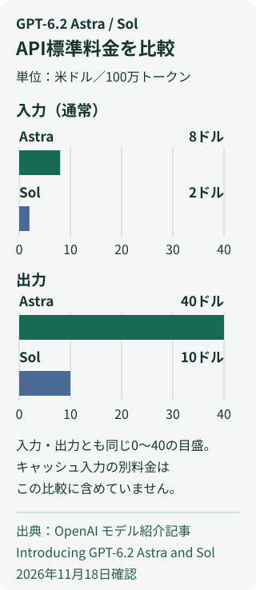
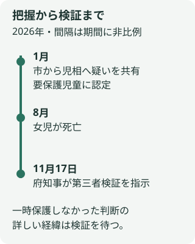
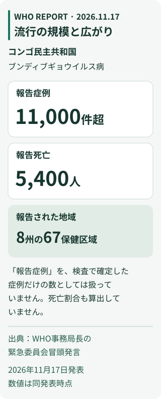

# アヤベ日報　2026年11月18日（水）

本紙 · 18記事 · 図解3点　情報確認 2026-11-18 07:47 JST

## 今朝の読みどころ

- OpenAI、GPT-6.2の2モデルを発表
- 枚方3歳児死亡、府が児相対応の第三者検証へ
- 安全保障の政府広報、配信者起用に批判 政府は狙い説明

## 01　OpenAI、GPT-6.2の2モデルを発表

OpenAIは11月17日、複雑な専門業務向けのGPT-6.2 Astraと、日常業務向けのGPT-6.2 Solを発表した。資料やコードの作成だけでなく、Web画面や3D設計に関する作業も改善したと説明する。

違いは単に「賢い方」と「安い方」ではない。Astraは難しい仕事の品質を、Solは幅広い日常作業の効率を主な用途に置く。いずれも利用可能なプランや機能には条件がある。実務に取り入れる際は、手元の図面や書式で出力を確認したい。

APIの標準料金はAstraが100万トークンあたり入力8ドル、出力40ドル。Solは入力2ドル、出力10ドルで、同じ文章でも入力と出力に別の単価が掛かる。トークンは文章を細かく区切った単位だ。Astraの入力・出力単価は前世代のGPT-6 Astraより20％低いと同社は説明する。一方、同じ仕事に必要な総額は入出力の量にも左右され、単価の差だけでは決まらない。例えば入力100万トークンと出力10万トークンを標準料金で使うと、Astraは8ドルに出力4ドルを加えて12ドル、Solは2ドルに1ドルを加えて3ドルになる。キャッシュ割引や他の料金は含まない単純な計算だ。自分の用途でどの程度の出力を必要とするかも重要になる。性能の改善幅は同社の評価であり、すべての作業で同じ差が出るとまでは言えない。

通常のAPI料金。キャッシュ入力は別料金です。

出典を読む

**出典**

- [出典を読む](<https://openai.com/index/introducing-gpt-6-2-astra-sol/>)

## 02　枚方3歳児死亡、府が児相対応の第三者検証へ

大阪府枚方市で3歳の女児が死亡し両親が逮捕された事件を巡り、吉村知事は17日、児童相談所の対応について第三者による検証を指示した。市も有識者を含む振り返り会議を立ち上げる方針だ。

市などによると、今年1月に虐待の疑いが府の児童相談所へ共有され、女児は継続的な見守りが必要な要保護児童とされていた。一方、児相は緊急性がないとして一時保護をしなかったと報じられている。

問われるのは、情報が届いたかだけでなく、複数回の通告をどの時点でどう評価し、市と児相の間で誰が何を確認したかだ。知事は重い事案と把握できなかった理由を個別に調べる必要があると述べた。原因や責任の結論は検証を待つ必要がある。市長は年度内の最終まとめを目指すと説明している。大阪府には重大な児童虐待事例の分析や児童相談所の業務点検を担う専門部会があるが、今回の検証をどの体制で進めるかは別途確認が必要だ。

関西テレビの11月17日の報道に基づく。

出典を読む 大阪府の検証制度

**出典**

- [出典を読む](<https://www.fnn.jp/articles/-/1154189>)
- [大阪府の検証制度](<https://www.pref.osaka.lg.jp/o090130/kateishien/jidougyakutaitaisaku/tenkenkensyou.html>)

## 03　安全保障の政府広報、配信者起用に批判 政府は狙い説明

政府は16日、安全保障を説明する広報サイトに、都市伝説などを扱う配信者ナオキマン氏を起用した。17日、木原官房長官は20〜30代を主な対象に、日常生活との関わりを分かりやすく伝える工夫だと説明した。

一方、同氏が陰謀論や都市伝説を紹介してきたことから、政府広報にふさわしいか疑問視する声がSNSに出ている。若い世代に届きやすい人を選ぶ利点と、情報の信頼性をどう担保するかが論点になる。

反応の件数や、賛成と反対の比率は今回確認できていない。SNS上の一部の声を世論全体と同一視せず、広報の具体的な説明内容と根拠をそれぞれ点検する必要がある。

出典を読む

**出典**

- [出典を読む](<https://news.tv-asahi.co.jp/news_politics/articles/000548524.html>)

## 04　日米豪印、4か国の哨戒機による海上訓練へ

日本、米国、オーストラリア、インドの首脳は17日、マニラで会合を開き、2027年に4か国の哨戒機が海上訓練で飛行する協力を発表した。哨戒機は広い海域を監視する航空機だ。

4か国は重要鉱物やエネルギーの供給網、サイバー分野でも連携を強める。政府説明では経済的威圧や恣意的な輸出規制に深刻な懸念を表明した。2027年早期の企業首脳フォーラムも予定する。

共同飛行の発表は、軍事同盟を新設したことや、具体的な訓練の全容が決まったことを意味しない。供給網の協力は、特定国への依存をどう減らすかという経済面の課題ともつながる。

出典を読む

**出典**

- [出典を読む](<https://www.mofa.go.jp/mofaj/fp/nsp/page1_001702_00004.html>)

## 05　日米首脳が短時間懇談、米中ロ会談前に連携確認

高市首相は17日、訪問先のフィリピンでトランプ米大統領と短時間懇談し、今後も緊密に連携することを確認した。テレビ朝日が18日未明に報じた。

米中ロ首脳は19日、中国・深圳で会談する予定だ。日本にとっては、核軍縮やウクライナを巡る議論が自国の安全保障環境とどう関わるかが焦点になる。

懇談の詳細なやりとりや、3首脳会談の結果はまだ明らかではない。前号で伝えた開催予定に加わった新しい動きとして、日米間の懇談が行われたことを押さえたい。

出典を読む

**出典**

- [出典を読む](<https://news.tv-asahi.co.jp/news_politics/articles/000548601.html>)

## 06　米イラン、仲介協議の一方で攻撃の応酬

ロイターによると、17日、イランがバーレーンの米軍レーダーを標的にしたと発表した後、米軍はイランのミサイル発射拠点を攻撃した。バーレーンは攻撃を迎撃し、死傷者や被害の報告はないと説明している。

同じ日にカタールはイランとの協議を行い、オマーンでもイラン外相と海上交通の安全などが話し合われた。軍事行動と外交の窓口が並行している。

ホルムズ海峡は戦争前、世界の石油と液化天然ガスの約5分の1が通る重要な航路だった。イラン側は船舶の火災も発表したが、ロイターは独立に確認できていないとしている。

出典を読む

**出典**

- [出典を読む](<https://www.reuters.com/world/middle-east/oman-iran-foreign-ministers-discuss-safeguarding-maritime-corridors-2026-11-17/>)

## 07　コンゴのエボラ流行、報告症例は1万1千件超

WHOは17日、コンゴ民主共和国で続くブンディブギョウイルス病について、報告症例が1万1千件を超え、死亡は5400人に上ったと説明した。8州67保健区域に広がっている。

症例数は前回の緊急委員会から3カ月で倍以上になった。WHOによれば新規報告は毎週400〜500件。確定した死亡の約3分の2は治療施設外で起きており、発見と受診の遅れが課題だ。

エボラは複数のウイルスによる病気の総称で、既存のワクチンを今回の型にそのまま有効と決めつけることはできない。報告症例の全てが検査確定例という意味でもない。ケニアでも関連例が報告され、最後の患者の退院後、42日間の監視が始まった。ロイターは医療従事者の給与未払いや物資配分も課題と伝えた。検査拠点や病床が増えても、現場の人員と物資が継続して動けるかが対応を左右する。WHOは治安悪化を大きな障害とし、今月の襲撃後に1000人以上の接触者を追跡できなくなったと説明した。感染者と接触した人を把握し、早く検査やケアにつなげる作業が中断されれば、症例の発見も遅れやすくなる。

WHOの11月17日発言に基づく。報告症例と検査確定症例は同義ではありません。

出典を読む Reuters配信

**出典**

- [出典を読む](<https://www.who.int/news-room/speeches/item/who-director-general-s-opening-remarks-at-the-third-ihr-emergency-committee-meeting-on-bundibugyo-virus-disease-epidemic-in-the-democratic-republic-of-the-congo---17-november-2026>)
- [Reuters配信](<https://new.streetinsider.com/Reuters/Congo%27s%2BEbola%2Boutbreak%2Bis%2Bspreading%2Band%2Bkilling%2Bat%2Ba%2Brecord%2Bpace/27360092.html>)

## 08　地球を27年観測したTerra、12月に観測終了へ

NASAは17日、地球観測衛星Terraの科学データ収集を12月1日で終えると発表した。設計上は約6年の寿命を想定していたが、約27年間にわたり観測を続けた。

地表、森林火災の煙、大気や氷雪などを複数の機器で測ってきた。同じ観測体系が長く続くと、ある年の画像だけでは分からない変化を比較しやすい。

軌道の変化や機器の老朽化を受け、燃料を使って軌道を下げ、2027年1月に全システムを停止する予定だ。12月1日は観測終了日であって落下日ではない。蓄積データは引き続き無料で利用できる。

出典を読む

**出典**

- [出典を読む](<https://science.nasa.gov/blogs/science-news/2026/11/17/nasas-terra-mission-to-end/>)

## 09　NVIDIA、科学計算とつなぐAIを発表

NVIDIAは16日、科学分野向けのAIモデルやデータ、追加学習の手順をまとめた「Nemotron for Science」を発表した。文章の解釈やコード生成に加え、外部の計算ツールを呼び出す使い方を想定する。

論文の要約だけでなく、研究者が必要な計算を組み込んだ作業を支援する狙いだ。モデルと化学分野の評価用データを公開し、同社の計算基盤との接続も示している。

ただし、計算を実行できることと、科学的な結論が正しいことは別だ。成果の妥当性は、分野ごとの検証や再現性を含めて評価する必要がある。現時点の性能説明は同社の発表として読む。

出典を読む

**出典**

- [出典を読む](<https://investor.nvidia.com/news/press-release-details/2026/NVIDIA-Introduces-Nemotron-for-Science-to-Accelerate-Discoveries-With-Agents/default.aspx>)

## 10　大阪市の文化施設、申込情報の流出可能性を調査

大阪市は17日、市立こども文化センターがイベント申込に利用した外部サービス「teket」で、参加者情報が流出した可能性を公表した。

対象となる施設の申込は10事業、計1091件。ただしこれは調査対象の申込件数であり、同施設から1091件の流出が確定したという意味ではない。運営会社側の情報流出は確認されているが、施設の参加者情報が含まれたかは調査中だ。

施設側への連絡から市への報告までの経緯も検証するという。市は不審なメールなどに注意を呼び掛けている。市のシステム自体への侵入が確認されたという発表ではない。

出典を読む

**出典**

- [出典を読む](<https://www.city.osaka.lg.jp/hodoshiryo/kodomo/0000691734.html>)

## 11　ガザの冬、食料と避難所の支援が不足

世界食糧計画（WFP）と国際移住機関（IOM）は17日、ガザで冬の雨と支援不足が重なり、食料や避難場所の確保が難しくなっていると警告した。170万人超が避難生活を送り、140万人が深刻な食料不安に直面しているという。

両機関によると、11月初旬以降、少なくとも4万の避難用シェルターが損傷・破壊され、約1700の避難場所の半数超が洪水の危険にさらされる。雨は寝る場所だけでなく、備蓄した食料や衛生状態にも影響する。

資金不足によりWFPの温かい食事の提供は隔日となり、食料包や現金支援も縮小した。食料の供給を支援に依存する状況では、支援量の減少と天候悪化が同時に家計を圧迫する。IOM側は約10万張りのテントが搬入待ちと説明し、イスラエル側の援助調整機関は物資や医薬品の搬入を続けていると説明している。搬入待ちの数量はIOMの説明で、独立した現物集計ではない。WFPによるとガザに人道・商業物資を運び込むための認可された通過地点はケレム・シャローム1カ所に限られ、輸送時間と費用を押し上げている。排水や暖房の材料も遅延や搬入制限に直面しているという。

出典を読む Reuters配信等

**出典**

- [出典を読む](<https://www.wfp.org/news/winter-hits-gaza-hard-food-and-shelter-aid-runs-short-iom-and-wfp-warn>)
- [Reuters配信等](<https://www.timesofisrael.com/liveblog_entry/un-agency-warns-of-risk-of-hypothermia-deaths-in-gaza-without-more-winter-supplies/>)

## 12　カナダと中国、農水産物などの追加関税を緩和

カナダのカーニー首相は17日、中国・深圳で習近平国家主席と会談し、カナダ産品に対する追加の関税緩和を発表した。首相府によると、対象は冷凍豚肉やエビなどの水産物で、約4億カナダドル相当という。

カナダ側も一部中国製の鉄鋼・アルミニウムについて、関税免除措置を2年間延長し、国内での供給が不十分な32品目を対象に加える。互いに必要とする食品と工業素材を中心にした措置だ。

首相府は、関税の影響を受けていた貿易の90％超に当たる約75億カナダドル分で市場アクセスが回復したと説明する。政府の試算であり、全面的な関税撤廃や全ての貿易正常化を意味しない。業界紙は、豚の内臓類には依然として関税の障壁が残ると伝える。冷凍のカット肉で前進があっても、部位ごとの市場アクセスは同じではない。業界関係者は、中国では内臓類を加工原料に回すより高値で販売できるため、冷凍カット肉以外の条件も重要だと指摘する。対象品目が増えたことと、業界の交渉課題がすべて解消したことは区別したい。

出典を読む 業界紙の取材

**出典**

- [出典を読む](<https://www.pm.gc.ca/en/news/news-releases/2026/11/17/prime-minister-carney-advances-canadas-strategic-partnership-china>)
- [業界紙の取材](<https://www.producer.com/daily/china-to-cut-tariffs-on-canadian-pork-seafood-after-carney-xi-meeting/>)

## 13　織田作之助賞、又吉直樹さんら5作品が最終候補

大阪市は17日、第43回織田作之助賞の最終候補5作品を発表した。候補は太田靖久さん「人並みというもの」、川越宗一さん「絢爛の法」、佐佐木陸さん「ごみのはての」、西川美和さん「わたしの知らない子どもたち」、又吉直樹さん「生きとるわ」の5作。

選考と結果発表は12月14日の予定。最終候補への選出は受賞を意味しない。

対象は2025年10月から2026年9月に初版が刊行された新鋭・気鋭の作家の小説。受賞作品の発表記者会見も同日に予定されている。

出典を読む

**出典**

- [出典を読む](<https://www.city.osaka.lg.jp/hodoshiryo/keizaisenryaku/0000690738.html>)

## 14　岡村隆史さん「花の駐在さん」、大阪で公開収録へ

岡村隆史さんの「花の駐在さん」が12月23日19時から、COOL JAPAN PARK OSAKAのTTホールで公開収録される。FANYが17日に発表した。

バッテリィズ、フースーヤ、エルフのはるさんらが出演予定。一般発売は11月20日10時からで、前売り3500円。発表によると配信チケットはない。

公開収録の会場は大阪城公園内。テレビ番組を客席から見られる機会となる。出演者や販売条件は公式案内で確認できる。

出典を読む

**出典**

- [出典を読む](<https://magazine.fany.lol/296601/>)

## 15　衆院31議席削減案が審議入り、与党は月内通過目指す

衆院の比例代表定数を31減らす法案は17日、政治改革特別委員会で趣旨説明が行われ、審議入りした。前日予定されていた説明が実施に進んだ。国民民主党も共同提出し、自民党と日本維新の会は月内の衆院通過を目指す一方、一部野党は反発している。

法案は衆院全体の465議席のうち、比例を176から145に減らし、中国と四国の比例ブロックを統合する。小選挙区の数はこの削減の対象ではない。

議席配分を現行のドント式から、中小政党に有利とされる修正サンラグ式に変える一方、政党が候補者名簿を一本化する制度は方針にとどめ、詳細を先送った。小選挙区と比例の重複立候補者が、小選挙区で敗れた場合に比例で復活できる基準も、得票が有効投票の10分の1以上から6分の1以上へ厳しくする。小選挙区での得票が少ない候補の復活に影響する仕組みだ。中国・四国を一つにまとめれば、議席を配分する地域の区切り自体も変わる。議席数の削減と配分方式の変更は同時に提案されており、どの党が何議席得るかは得票の分布にも左右される。共同提出者は人口推計を削減幅の根拠にしている。法案は成立前であり、審議入りと可決は別だ。

出典を読む 衆議院の法案要綱

**出典**

- [出典を読む](<https://www.thenews.ne.jp/detail/3961697/>)
- [衆議院の法案要綱](<https://www.shugiin.go.jp/internet/itdb_annai.nsf/html/statics/housei/pdf/222hou3youkou.pdf/%24File/222hou3youkou.pdf>)

## 16　背面にも画面、Xiaomi 18 Proシリーズ国内発表

シャオミは17日、背面ディスプレイを備える「Xiaomi 18 Pro」と「Pro Max」を国内向けに発表し、予約を始めた。発売は11月27日予定で、販売先によって異なる。

背面画面には通知や画像を表示でき、リアカメラの映像を映して自撮りの構図確認にも使える。ライカと共同開発したカメラを搭載し、メインと望遠の最大画素数はそれぞれ2億画素だ。

市場想定価格は256GBモデルでProが税込20万9800円、Pro Maxが23万9800円。日本のおサイフケータイに必要なFeliCaに対応するのはPro Maxだけという違いがある。画質や電池の実力は実機で検証していない。

出典を読む

**出典**

- [出典を読む](<https://prtimes.jp/main/html/rd/p/000000262.000098799.html>)

## 17　栃木が香港でリーグ公式戦、来年3月にきんでんと2試合

バレーボールのSVリーグGROWTH男子に所属するレーヴィス栃木は17日、2027年3月6、7日に香港で、きんでんトリニティーブリッツとの公式戦を開くと発表した。

バレーボールキングによると、会場は収容約500人のHong Kong Academy体育館。開始予定は日本時間で6日15時5分、7日12時5分。

リーグの海外での認知拡大とファンとの接点づくりの一環。栃木は2025年12月にも香港の12〜15歳を栃木に招いた練習交流を行っており、今回の公式戦はその活動ともつながる。

出典を読む

**出典**

- [出典を読む](<https://volleyballking.jp/article/97353/>)

## 18　熱海富士が大の里を破る、1敗首位は2人に

大相撲九州場所10日目の17日、関脇熱海富士が横綱大の里との1敗対決を押し出しで制した。立ち合いから前に出て、右を差された後も攻め続けた。

大関霧島も敗れ、1敗は熱海富士と平幕若元春の2人。大の里は2敗に後退した。

9日目終了時に4人だった1敗勢は2人に絞られた。

出典を読む

**出典**

- [出典を読む](<https://www.nikkansports.com/battle/sumo/news/202611170001439.html>)
