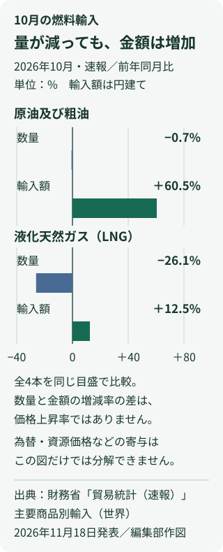

# アヤベ日報　2026年11月19日（木）

本紙 · 15記事 · 図解1点　情報確認 2026-11-19T07:41:25+09:00

## 今朝の読みどころ

- 日本版DBS、照会システムの稼働を延期
- 大阪都構想、2031年に4区とする協定書案
- 輸出が過去最高でも赤字 燃料は量減・金額増

## 01　日本版DBS、照会システムの稼働を延期

こども家庭庁は18日、子どもと接する仕事に就く人の性犯罪歴を確認する「日本版DBS」のシステムについて、12月25日の稼働開始を見送ると明らかにした。多数の深刻な脆弱性が見つかったためで、新たな稼働時期は示していない。書類などによる代替手段を12月初旬に公表する方針だ。

法律自体の施行と、照会システムの稼働は別だ。こども家庭庁の制度案内によると、法律は12月25日施行。学校や認可保育所などは確認が義務となり、塾やスポーツクラブなどは認定を受けて取り組む仕組みだ。制度は前科の確認だけではない。こども家庭庁の保護者向け資料は、子どもの日常観察や面談、相談窓口、職員研修による予防・早期発見も挙げている。施設が制度の対象か、相談や保護の仕組みがあるかも重要だ。書類による代替照会の受付方法や処理期間は今後の公表を待つ。

出典：報道・取材1 / 報道・取材2 / 公式資料3 / 公式資料4

**出典**

- [報道・取材1](<https://news.tv-asahi.co.jp/news_society/articles/000548798.html>)
- [報道・取材2](<https://www.kumanichi.com/articles/2059295>)
- [公式資料3](<https://www.cfa.go.jp/policies/child-safety/efforts/koseibouhou>)
- [公式資料4](<https://www.cfa.go.jp/assets/contents/node/basic_page/field_ref_resources/80127231-8582-476e-a6e7-9347e725ed96/8ed72261/20251225_policies_child-safety_efforts_koseibouhou_12.pdf>)

## 02　大阪都構想、2031年に4区とする協定書案

大阪府・市の法定協議会で18日、大阪市を2031年1月1日に廃止し、淀川、北、中央、天王寺の4特別区へ再編する協定書案がまとまった。正式決定は26日の予定だ。共同通信によると、維新は2027年4月の統一地方選前半と同じ11日に住民投票を行うことを目指すが、投票日は決まっていない。

今回固まったのは案で、総務相への報告や府市議会の承認などが残る。18日の会議資料には東京都北区の回答も含まれ、同名自治体による行政手続きや災害情報の混同を懸念して名称の再検討を求めている。北区の回答は、大阪側の判断を尊重しながら、混同を避ける具体策が示されていないと指摘した。名称の好みだけでなく、手続きや報道、特に災害時の避難情報をどう区別するかという実務上の論点がある。ただし回答は意見表明で、法的に名称を拒否した決定ではない。

出典：報道・取材1 / 公式資料2 / 公式資料3

**出典**

- [報道・取材1](<https://www.nikkansports.com/general/news/202611180002002.html>)
- [公式資料2](<https://www.city.osaka.lg.jp/fukushutosuishin/page/0000691857.html>)
- [公式資料3](<https://www.city.osaka.lg.jp/fukushutosuishin/cmsfiles/contents/0000691/691857/02_siryo2.pdf>)

## 03　輸出が過去最高でも赤字 燃料は量減・金額増

財務省が18日公表した10月の貿易統計速報によると、輸出は前年同月比20.5％増の11兆7688億円、輸入は21.6％増の12兆2453億円だった。差し引きは4765億円の赤字で、6か月連続の赤字。前年同月より赤字額は57.8％拡大した。

金額の伸びだけでは、取引量が同じように増えたとは分からない。輸出数量指数は5.8％増だった一方、輸入数量指数は0.2％減った。原油及び粗油は数量が0.7％減ったのに輸入額は60.5％増、液化天然ガスも数量26.1％減に対して輸入額12.5％増だった。

図は前年同月比を並べたもので、数量と金額の差をそのまま価格上昇率として扱うことはできない。為替、国際価格、品種構成などの寄与を、この数字だけから分けることもできない。

数量と金額はどちらも前年同月比。出典：財務省貿易統計速報。

出典：公式資料1 / 公式資料2

**出典**

- [公式資料1](<https://www.customs.go.jp/toukei/shinbun/trade-st/2026/2026104.html>)
- [公式資料2](<https://www.customs.go.jp/toukei/shinbun/trade-st/gaiyo2026_10.pdf>)

## 04　政治資金監視委、2028年4月までの設置目指す

与野党は18日の実務者協議で、第三者機関「政治資金監視委員会」を2028年4月までに設ける方針で一致した。政治資金収支報告書のデータベース本格始動に合わせる考えだ。

公明、国民民主両党の骨子案は、国会議員関係の政治団体の報告書を点検し、虚偽記載などの疑いがあれば総務省に立ち入り検査を要請する仕組みを盛り込む。ただし、制度設計には未決着の論点がある。設置時期を目指す合意と、権限を定める法律の成立は別の段階だ。

出典：報道・取材1 / 報道・取材2

**出典**

- [報道・取材1](<https://www.kumanichi.com/articles/2059264>)
- [報道・取材2](<https://newsdig.tbs.co.jp/articles/withbloomberg/3096125?display=1>)

## 05　リニア開業見通しの年内公表、JR東海が断念

JR東海の丹羽俊介社長は18日、リニア中央新幹線の品川―名古屋間について、開業時期の見通しを年内に示す方針を断念した。テレビ朝日は、静岡工区を請け負う大成建設の営業停止処分などにより着工が不透明になっていたと伝えた。

木原官房長官は沿線関係者の見通しを確保するため早期の提示を求め、長野県の阿部知事も見通しが示されないことに遺憾の意を表した。今回の変化は見通しの公表延期であり、新しい開業年が決まったわけではない。

出典：報道・取材1 / 報道・取材2 / 報道・取材3

**出典**

- [報道・取材1](<https://news.tv-asahi.co.jp/news_society/articles/000548841.html>)
- [報道・取材2](<https://news.tv-asahi.co.jp/news_politics/articles/000548756.html>)
- [報道・取材3](<https://www.kumanichi.com/articles/2059279>)

## 06　米上院選、アラスカの勝敗判明で民主56議席へ

米中間選挙の上院選で最後まで接戦だったアラスカ州について、CNNは現地17日、民主党のメアリー・ペルトラ元下院議員の勝利が確実になったと報じた。テレビ朝日によると同州で民主党候補が勝つのは2008年以来で、上院100議席は民主56、共和44となる見通しだ。

ペルトラ氏は漁業保護や食料・エネルギー価格への対策を訴え、共和党現職のダン・サリバン氏と競った。3日の投開票から約2週間を経た報道機関の当選確実判断であり、公式な結果認証とは区別する。

出典：報道・取材1

**出典**

- [報道・取材1](<https://news.tv-asahi.co.jp/news_international/articles/000548741.html>)

## 07　イラン、クウェートの米軍基地を攻撃したと発表

イラン共和国軍は18日、クウェートのアリ・アル・サレム空軍基地をドローンで攻撃したと発表した。イラン国営放送の報道をテレビ朝日が伝えた。配備された迎撃ミサイル「パトリオット」が標的だったとしているが、命中や被害の状況は確認できない。

17日夜にはイランのゲシュム島で爆発が報じられた。ロイターなどは当局者の話として米軍によるミサイル基地への空爆と伝えたが、記事時点で米軍自身は関与に関する声明を出していない。前号で扱ったバーレーンへの攻撃に続き、別の湾岸国の米軍施設への攻撃をイラン側が主張した。

出典：報道・取材1

**出典**

- [報道・取材1](<https://news.tv-asahi.co.jp/news_international/articles/000548797.html>)

## 08　APEC晩餐会で市場開放を訴え 米中ロ会談は19日

中国・深圳でAPEC首脳会議の歓迎晩餐会が開かれ、習近平国家主席は市場を相互に開く重要性を訴えた。テレビ朝日は、関税や貿易規制を強める動きをけん制する発言と伝えた。

19日午後には米国、中国、ロシアの3者会談が予定されている。トランプ大統領は核軍縮やイラン情勢を協議するとしている。前号の日米懇談から、首脳が中国に集まり会談当日を迎えた段階に進んだ。19日早朝時点で会談結果はまだ出ていない。

出典：報道・取材1 / 報道・取材2

**出典**

- [報道・取材1](<https://news.tv-asahi.co.jp/news_international/articles/000548947.html>)
- [報道・取材2](<https://www.fnn.jp/articles/-/1154798>)

## 09　政府広報の起用は広告会社提案 個別金額は非公表

木原官房長官は18日、安全保障の政府広報へのユーチューバー「ナオキマン」起用について、広告会社側の提案を内閣府が採用したと説明した。共同通信によると、提案元は大広と大広WEDOの共同企業体だった。前号で扱った起用への批判と政府説明に、選定経緯が加わった。

若年層向け広報経費全体の上限は1億5千万円だが、今回の起用にかかった個別の金額は明らかになっていない。総額の上限を出演料と同一視することはできない。

出典：報道・取材1 / 報道・取材2

**出典**

- [報道・取材1](<https://news.tv-asahi.co.jp/news_politics/articles/000548828.html>)
- [報道・取材2](<https://www.kumanichi.com/articles/2059321>)

## 10　M-1でピンマイクを使わない理由

M-1グランプリの制作スタッフは18日公開の取材で、漫才の音と映像をどう届けるかを語った。FANYの取材によると、音響は中央のサンパチマイクとフロアマイクを使い、マイクとの距離によって生まれる声の抑揚を生かす。

映像では話している人だけでなく、相方の表情や間も捉えるツーショットを重視するという。舞台の会話を放送に移す際、何を残そうとしているのかが見える。映像の切り替えをわずかに遅らせ、漫才のリズムを損なわない工夫もあるという。プロデューサーと総合演出はいずれもスポーツ中継の経験者だ。記事は主催側の媒体による制作スタッフ取材で、効果を独自検証したものではない。

出典：報道・取材1 / 報道・取材2

**出典**

- [報道・取材1](<https://magazine.fany.lol/294589/>)
- [報道・取材2](<https://magazine.fany.lol/294725/>)

## 11　イラン男子代表、ピアッツァ監督と契約更新せず

イラン・バレーボール連盟は17日、男子代表のロベルト・ピアッツァ監督と契約を更新しないと発表した。18日のバレーボールキングによると、連盟は代表への早期合流と継続的な指導時間を求めたが、ポーランドのクラブとも契約する監督との条件が折り合わなかった。

報道上の焦点は代表とクラブの兼務時間であり、単純に成績不振による解任と決めつけることはできない。連盟の元投稿はこの号では直接確認できていない。

出典：報道・取材1

**出典**

- [報道・取材1](<https://volleyballking.jp/article/97430/>)

## 12　日印の外務・防衛閣僚が19日に協議

日本とインドは19日、東京で外相と防衛相が参加する「2＋2」と外相間の戦略対話を開く予定だ。安全保障に加え、経済や経済安全保障を含む二国間協力を議論する。

前日の18日には、茂木外相とジャイシャンカル印外相が国際会議「ライシナ東京」のレセプションで挨拶した。茂木氏は来年の国交樹立75周年を見据え、協力関係を広げる考えを示した。会合の予定と、これからまとまる協議結果は別に扱う。

出典：公式資料1 / 公式資料2

**出典**

- [公式資料1](<https://www.mofa.go.jp/mofaj/press/release/pressit_000001_04480.html>)
- [公式資料2](<https://www.mofa.go.jp/mofaj/press/release/pressit_000001_04486.html>)

## 13　Suicaの新キャラクターは紫のうさぎ 愛称はこれから

JR東日本は18日、Suicaの新しいイメージキャラクターを投票結果に基づいて決定した。採用された紫のうさぎを描いた世戸ヒロアキさんのB案は、総数166万4399票のうち86万152票を獲得した。

愛称は12月15日15時59分まで募集し、選考委員会が由来や込められた思いも踏まえて選ぶ。発表は2027年3月31日のバトンタッチ式を予定する。デザインは投票で決まったが、名前は応募数の多さだけで決まるわけではない。

出典：公式資料1 / 報道・取材2

**出典**

- [公式資料1](<https://www.jreast.co.jp/press/2026/20261118_ho01.pdf>)
- [報道・取材2](<https://www.watch.impress.co.jp/docs/news/2157432.html>)

## 14　社員証をAppleウォレットで利用、企業向け入退室管理が対応

パナソニック エレクトリックワークスは18日、入退室管理システム「eX-SG」がAppleウォレットの社員証に対応したと発表した。導入企業では初期設定後、iPhoneやApple Watchを読み取り機にかざして入室できる。エクスプレスモードなら端末のロック解除も不要という。

物理カードを発行する手間を減らせる一方、利用には対応端末・OSに加え、企業側の設備と別途サービス契約が必要だ。誰でも手元の社員証を登録できる仕組みではない。

出典：公式資料1 / 報道・取材2

**出典**

- [公式資料1](<https://news.panasonic.com/jp/press/jn261118-1>)
- [報道・取材2](<https://www.watch.impress.co.jp/docs/news/2157527.html>)

## 15　GeminiのTask、日本を含む6カ国で無料提供へ

GoogleはGeminiに作業を任せる「Task」の無料提供を、日本を含む6カ国で順次始めると発表した。アプリ内で会話からTaskへ切り替え、接続したサービスを使う作業を依頼する仕組みだ。

同社によると決済では利用者が事前に上限額を設定できる。ただしメール転送やテキスト送信など一部の高度な機能は米国からの提供。買い物かごへの追加などは継続的に許可できる一方、購入前には確認または事前承認が必要だという。対応カードの決済にはカード情報を置き換えたデジタルトークンを使い、作業環境を利用者専用の仮想マシンに分離するとも説明する。これらは提供元の説明で、安全性を独立に実証した結果ではない。発表機能すべてが日本ですぐ使えるわけでもない。

出典：公式資料1 / 報道・取材2

**出典**

- [公式資料1](<https://blog.google/innovation-and-ai/products/gemini-app/tasks-in-gemini-free-new-features/>)
- [報道・取材2](<https://www.watch.impress.co.jp/docs/news/2157422.html>)
