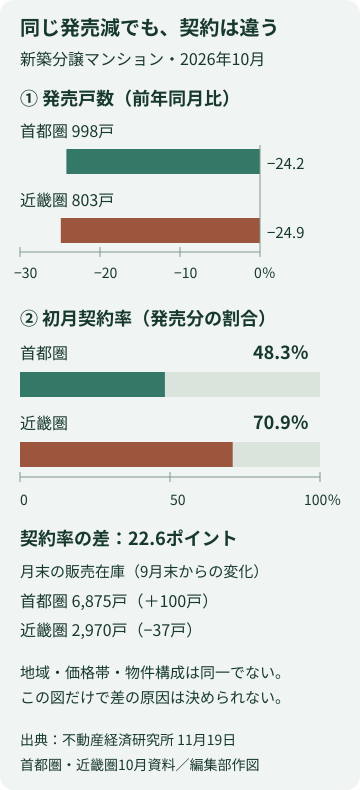
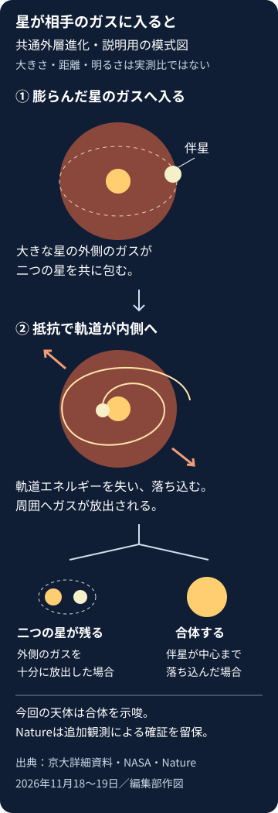

# アヤベ日報　2026年11月20日（金）

本紙 · 23記事 · 図解2点　情報確認 2026-11-20T07:43:52+09:00

## 今朝の読みどころ

- 伊丹3歳児死亡、家庭復帰の判断に何が届いていたのか
- 米中ロの平和宣言、核弾頭を減らす約束までは踏み込まず
- ロヒンギャ迫害でミャンマーの国家責任、ICJは帰還と賠償も命令

## 01　伊丹3歳児死亡、家庭復帰の判断に何が届いていたのか

国内社会 / 深掘り

兵庫県伊丹市で1月に3歳の女児が死亡した事件で、県警は19日、傷害致死容疑で逮捕した父親を送検した。父親は容疑を否認しており、事実認定は今後の手続きに委ねられる。19日夜から20日朝にかけて、女児が家庭へ戻る前の情報が、福祉施設と児童相談所にそれぞれどう残っていたかが報じられた。

女児は虐待の疑いで過去に2度保護され、児童福祉施設に入所していた。児相に取材した神戸新聞によると、家庭復帰に向けて2024年10月からまず一時的な外出を重ね、25年9～12月に自宅で14回外泊した。この期間、母親が児相に出した日誌には、頰や膝のあざなどの軽いけがに関する記述が約10回あり、転んだ、ぶつけたなどの説明が添えられていた。

一方、ABCが伝えた県の説明では、外泊を始めた直後、女児は施設の職員に父親を怖がり、たたかれる趣旨の話をしていた。このやり取りを県が把握したのは死後の施設への聞き取りで、家庭復帰の判断時には児相に共有されていなかったという。時事通信が捜査関係者への取材で報じたのも、児相の関係先に残った記録だ。児相自身が当時知っていたという意味ではない。

これらの報道を合わせると、児相に情報が何もなかったのではなく、保護者から届いたけがの報告と、施設で職員が聞いた子どもの話が、家庭に戻すかどうかを判断する段階で突き合わされていなかったとみられる。これだけで原因や責任は断定できない。県の検証で確かめたいのは、複数回のけがをその都度の出来事として扱ったのか、外泊の継続を見直す材料として集め直したのか、そして施設側から新しい情報を届ける手順が実際に機能していたかだ。

出典：ABCニュース：県の説明 ／ 神戸新聞：児相への取材 ／ 時事通信：捜査関係者への取材（配信先）

**出典**

- [ABCニュース：県の説明](<https://www.asahi.co.jp/webnews/pages/abc_63695.html>)
- [神戸新聞：児相への取材](<https://www.kobe-np.co.jp/news/society/202611/0021053180.shtml>)
- [時事通信：捜査関係者への取材（配信先）](<https://www.thenews.ne.jp/detail/3971704/>)

## 02　米中ロの平和宣言、核弾頭を減らす約束までは踏み込まず

国際 / 深掘り

米国のトランプ大統領、中国の習近平国家主席、ロシアのプーチン大統領は19日、中国・深圳のアジア太平洋経済協力会議（APEC）に合わせ、初の3者首脳会談を開いた。会談後、3カ国は「平和宣言」を公表。今後、核兵器使用の危険を減らし、拡散を防ぐために対話するとした。前日号で伝えた会談の予定に対し、今回は共同文書が出た。

核をめぐって首脳がそろって書面で示したのは、核戦争を戦ってはならないという認識と、危険を減らすための対話だ。一方、何発をいつまでに減らすのか、各国の保有数をどう照合するのか、次の協議をいつ開くのかは明記されていない。兵器を持つ3カ国が対話に同意したことと、保有数を抑える約束を結ぶことは別だ。次に交渉の進展を測るなら、会合の日程や参加者に加え、数量や査察といった具体的な協議項目が示されるかが目安になる。

AFPによると、プーチン氏は会談冒頭でウクライナ紛争に言及した。しかし宣言にはウクライナやイランの個別の和平案は入っていない。残る項目は、国連改革、石油精製品の生産・供給拡大、国際刑事裁判所（ICC）などに管轄権の濫用を戒める内容だ。核リスクへの対話と、すでに続いている戦争を終わらせる合意は、この文書からは同じ成果として数えられない。

出典：米ホワイトハウス・平和宣言全文 ／ AFP・会談と冒頭発言 ／ AFP・宣言の報道

**出典**

- [米ホワイトハウス・平和宣言全文](<https://www.whitehouse.gov/briefings-statements/2026/11/u-s-russia-china-heads-of-state-declaration-toward-peace/>)
- [AFP・会談と冒頭発言](<https://www.afpbb.com/articles/-/3663299?cx_part=related_yahoo>)
- [AFP・宣言の報道](<https://www.afpbb.com/articles/-/3663301?cx_part=topstory>)

## 03　ロヒンギャ迫害でミャンマーの国家責任、ICJは帰還と賠償も命令

国際 / 深掘り

国際司法裁判所（ICJ）は19日、ミャンマーが2017年の軍事作戦で、少数派ロヒンギャに対するジェノサイドを行ったと認定した。ジェノサイド認定は9対6。大量の殺害などの行為だけでなく、特定の集団を全部または一部破壊する意図も問われる。AP通信によると、裁判所は武装勢力に対する正当な作戦だったとするミャンマー側の主張を退けた。2019年にガンビアが提訴し、20年の証拠保全などの暫定措置を経て、今回は事件の中身について判断した。

この裁判が認めたのは国家の条約違反で、個人にその場で刑罰を科したわけではない。判決はミャンマーに、疑いのある人物の捜査と必要に応じた訴追、再発防止を求めた。被害者の救済として、国内外に逃れた人が安全に、自ら望んで、尊厳を保って帰還できるようにし、家族の再会を可能にする措置も命じた。元の状態に戻す措置では埋められない被害については賠償が必要とされた。

AP通信によれば、約120万人のロヒンギャ難民がバングラデシュに暮らす。判決には当事国を法的に拘束する力がある一方、裁判所自体が現地で帰還を実行するわけではない。賠償額や方法も次の手続きに残り、ミャンマーは帰還などの措置と賠償について2年以内に報告を求められた。国家責任の認定は救済の根拠になるが、安全な帰還がすでに始まったという意味ではない。

出典：ICJ判決発表・Refworld掲載 ／ AP通信・判決と難民の状況

**出典**

- [ICJ判決発表・Refworld掲載](<https://www.refworld.org/sites/default/files/2026-11/178-20261119-pre-01-00-en.pdf>)
- [AP通信・判決と難民の状況](<https://www.khaosodenglish.com/news/international/2026/11/19/in-a-landmark-judgment-top-un-court-says-myanmar-committed-genocide-against-the-rohingya/>)

## 04　新築マンション、首都圏と近畿圏で契約率に差

経済・大阪 / 深掘り

不動産経済研究所が19日発表した10月の新築分譲マンション調査で、発売戸数は首都圏が前年同月比24.2％減の998戸、近畿圏が24.9％減の803戸だった。近畿圏は同研究所の調査では、1973年の調査開始以来、10月として最も少なかった。発売の落ち込みはよく似ているが、発売した住戸のうち最初の月に契約された割合には差がある。首都圏は48.3％、近畿圏は70.9％で、22.6ポイント開いた。

9月末から10月末にかけて、販売在庫は首都圏で100戸増の6875戸、近畿圏では37戸減の2970戸。新たに売り出した住戸が減っても、以前から販売している住戸がどれだけ売れたかによって、月末に残る数の動きは変わる。発売戸数だけでは、買い手が付きやすいか、在庫が積み上がっているかまでは分からない。

近畿の中でも、大阪市内の初月契約率は71.7％、府内の大阪市以外は57.5％だった。発売の15.2％を占める投資用物件を除くと、近畿圏の契約率は70.2％。投資用を除いても同月の首都圏全体を上回るが、地域や価格帯の構成は揃っておらず、需要の強さを一つの原因に帰すことはできない。

平均価格は首都圏9308万円、近畿圏6161万円。これはその月に発売された新築の平均で、前年と同じ家の値段を追ったものではない。大阪で探すなら、圏域全体の平均価格だけでなく、希望エリアでどんな住戸が何戸発売され、どれだけ契約されたかを見るほうが市場をつかみやすい。

2026年10月の新築分譲マンション。発売増減率は前年同月比、契約率は当月発売分に占める割合。物件構成は同一ではありません。出典：不動産経済研究所の首都圏・近畿圏資料。編集部作図。

出典：不動産経済研究所：首都圏2026年10月 ／ 不動産経済研究所：近畿圏2026年10月 ／ ロイター：首都圏の発売・価格・在庫

**出典**

- [不動産経済研究所：首都圏2026年10月](<https://www.fudousankeizai.co.jp/share/mansion/693/g8GauCn1.pdf>)
- [不動産経済研究所：近畿圏2026年10月](<https://www.fudousankeizai.co.jp/share/mansion/692/g8GauCn2.pdf>)
- [ロイター：首都圏の発売・価格・在庫](<https://www.newsweekjapan.jp/articles/-/340685>)

## 05　星が星をのみ込む7年間、爆発前から追った観測

科学 / 深掘り

京都大学などの国際研究チームは19日、アンドロメダ銀河の天体AT 2025abaoについて、巨大な星に小さな伴星がのみ込まれていく過程を調べた成果を公表した。論文掲載は18日。観測された急増光は2025年10月で、きのう新しく爆発したというニュースではない。2018年から約7年間続いた変化を、複数の望遠鏡のデータからつなぎ合わせた研究だ。

なぜ星は、相手に近づくだけで明るくなるのか。研究チームの説明では、小さな星が大きな星の外側のガスに入ると、抵抗によって軌道運動のエネルギーを失い、内側へ落ち込む。その過程でガスが放出され、徐々に明るくなる。二つの星が同じガスの層に包まれる状態を『共通外層』と呼ぶ。モデルから推定した質量は、主星が太陽の約7倍、伴星が約0.7倍だった。

ただし、のみ込まれれば必ず一つの星になるわけではない。ガスを十分に吹き飛ばせれば、二つの星が近い軌道で生き残る可能性もある。今回は合体を示すと考えられる急増光が起き、せいめい望遠鏡の分光観測、ウェッブ宇宙望遠鏡の赤外線観測などで過程を調べた。Natureの紹介は、合体の最終的な確証には今後の観測が必要と留保している。爆発後だけでなく、その前兆を長く追えたことが、星の運命を分ける仕組みの検証材料となる。

共通外層進化の説明図。大きさ・距離・明るさは実測比ではありません。京都大学詳細資料、NASA、Natureに基づき編集部作図。

出典：京都大学・11月19日 ／ NASA・観測経過 ／ Nature・結果と留保

**出典**

- [京都大学・11月19日](<https://www.kyoto-u.ac.jp/ja/research-news/2026-11-19>)
- [NASA・観測経過](<https://science.nasa.gov/missions/webb/nasa-data-clinches-first-of-its-kind-stellar-merger/>)
- [Nature・結果と留保](<https://www.natureasia.com/en/info/press-releases/detail/9486>)

## 06　就業者向け現金給付、給与収入の下限を56万円程度で検討

国内政治

片山さつき財務相は19日の参院特別委員会で、働く人に所得に応じて現金を支給する「就業者負担軽減支援金」の対象となる給与収入の下限を、年56万円程度とする方向で検討すると述べた。これまで説明してきた53万円程度から、雇用保険の適用水準を参考にしつつ、最低賃金の上昇を踏まえて引き上げる考えだ。

今回示された数字は一人が受け取る額ではなく、対象に入るための収入の下限案だ。共同通信によると、片山氏は16日の委員会で年収100万～450万円程度の人が約3000万人に当たると説明。対象者は制度の線引き次第で約3200万人となる可能性があるが、これは実際に支給した人数ではない。個別に誰が対象となるかは、制度の確定を待つ必要がある。

出典：共同通信：参院特別委での財務相答弁 ／ 東スポWEB：財務相の答弁（配信先）

**出典**

- [共同通信：参院特別委での財務相答弁](<https://kumanichi.com/articles/2059719>)
- [東スポWEB：財務相の答弁（配信先）](<https://news.livedoor.com/article/detail/32856222/>)

## 07　日銀総裁、消費が弱い中でも追加利上げの方針を維持

経済

日銀の植田和男総裁は19日、参院財政金融委員会で、経済・物価・金融情勢に応じて引き続き政策金利を引き上げる方針を示した。前月の金融政策決定会合で維持した政策金利は1.25％程度。今回も利上げの日程や幅を決めたわけではない。

ロイターによると、植田氏は7～9月期の個人消費の弱さに物価高や天候が影響したと説明し、家計の所得が支えるとの見方を示した。一方、日銀の説明資料は円安や原油高、半導体価格の上昇が今後の物価を押し上げるとみる。企業が上がった仕入れ費用を販売価格に移しやすくなると、円安の影響が広い品目に及ぶ可能性がある。日銀が次の判断で見るのは、消費の一時的な減速だけでなく、物価の基調が目標の2％を超えて上振れ続ける兆しがあるかどうかだ。

出典：日本銀行：総裁説明の全文 ／ ロイター：参院での発言と市場の見方

**出典**

- [日本銀行：総裁説明の全文](<https://www.boj.or.jp/mopo/diet/d_state/data/dst261119a.pdf>)
- [ロイター：参院での発言と市場の見方](<https://www.reuters.com/markets/us/boj-governor-ueda-says-financial-conditions-loose-despite-rate-hikes-2026-11-19/>)

## 08　機械受注9月は0.3％減、7～9月では1.2％増

経済

内閣府が19日公表した9月の機械受注では、民間企業の設備投資に先行する指標として用いる、船舶・電力を除いた民間受注額が、季節調整後で前月比0.3％減だった。8月は5.2％増で、9月は2カ月ぶりの減少。大型案件などで月による振れが出る指標だ。内閣府は、持ち直しの動きがみられるとの見方を据え置いた。

同じ指標で7～9月をまとめると前期比1.2％増だった。10～12月は4.3％増の見通しだが、これは9月末の調査による企業側の見込みで、受注が実現した数字ではない。今回の公表は、月ごとの減速と、四半期でみた水準の方向が同じとは限らないことを示している。

出典：内閣府：機械受注統計の概要・原表 ／ ロイター：四半期見通しと背景

**出典**

- [内閣府：機械受注統計の概要・原表](<https://www.esri.cao.go.jp/jp/stat/juchu/2026/2609gaiyou.pdf>)
- [ロイター：四半期見通しと背景](<https://www.newsweekjapan.jp/articles/-/340661>)

## 09　米粉・飼料向けの米、生産性で支援額を変える案

経済

農林水産省は19日、米粉用・飼料用・加工用など、主食用ではない米の交付金を見直す案を自民党の会合で示した。共同通信によると、同じ面積でより多く収穫すると支援単価が高まる設計で、多収や高温に強い品種、農地の集約などを条件とする。地域平均より収量が一定以上低い場合は交付対象外とし、交付金を受けながら収穫を十分に行わないことを防ぐ狙いもある。

農水省は別に、民間在庫の高水準を踏まえ、2027年産の主食用米の生産見通しを693万トンに設定している。今回の制度案は、主食用に供給が偏らないよう別の用途に作付けを誘導しながら、水田の生産を維持する考えだ。交付条件の詳細や、転作先の買い手がどれだけ確保できるかが実際の効果を左右する。

出典：共同通信：19日に示された制度の概要 ／ 農林水産省：用途別需給見通しの説明

**出典**

- [共同通信：19日に示された制度の概要](<https://kumanichi.com/articles/2059697>)
- [農林水産省：用途別需給見通しの説明](<https://www.maff.go.jp/j/press-conf/261102.html>)

## 10　楽天証券、情報漏えいのおそれで金融庁の報告命令

経済・社会

楽天証券は19日、顧客情報が外部に漏れた可能性がある問題で、金融庁から金融商品取引法と個人情報保護法に基づく報告徴求命令を受けたと発表した。会社が自主的に調査結果を知らせる段階から、監督当局が法律に基づいて報告を求める段階に進んだ。同社は原因の分析を続け、再発防止策をまとめるとしている。

テレビ朝日によると、同社が17日に公表したのは、最大1572万件の顧客情報が漏れた恐れだ。そのうち約447万口座では、出金先口座番号や申告した年収、金融資産なども対象に含まれる可能性がある。いずれも漏えいが確定した件数とは異なる。19日の命令受領によって、情報が実際に持ち出された範囲までただちに確定したわけではない。

出典：楽天証券：報告徴求命令の受領 ／ テレビ朝日：報告徴求命令と経緯 ／ 共同通信：監督当局の対応

**出典**

- [楽天証券：報告徴求命令の受領](<https://www.rakuten-sec.co.jp/web/company/newsrelease/pdf/press2026111901.pdf>)
- [テレビ朝日：報告徴求命令と経緯](<https://news.tv-asahi.co.jp/news_economy/articles/000549144.html>)
- [共同通信：監督当局の対応](<https://www.kobe-np.co.jp/news/zenkoku/compact/202611/0021052531.shtml>)

## 11　大阪市の緊急通報事業、誤請求の最終集計は70件

大阪

大阪市は19日、緊急通報システム事業の利用者負担金で、請求漏れ32件と過大請求38件があったと発表した。現行事業者との契約が始まった2015年10月までさかのぼった結果、9月発表の28件から42件増えた。過大請求は計183万5043円、請求漏れは計146万9435円。新たに判明した利用者らには、説明のうえ順次返金または請求する。

市によると、システムが判定した負担区分を紙の申請書に誤って写し、そのまま事業者へ伝えるなどのミスがあった。市は2022年10月以降に利用決定した人から、負担区分を含む一覧をシステムから抽出し、事業者にデータで渡す方法へ変えている。今回の終報は、紙での引き継ぎをやめた後も、過去分の請求に誤りが残っていたことを示した。

出典：大阪市：誤請求の追加調査・最終報告

**出典**

- [大阪市：誤請求の追加調査・最終報告](<https://www.city.osaka.lg.jp/hodoshiryo/fukushi/0000691515.html>)

## 12　日印2＋2、領事協力の協議と海底ケーブル協力で一致

日本外交

日本とインドの外務・防衛閣僚は19日、東京で第4回の「2＋2」会合を開き、在外自国民への支援を巡る机上演習の実施を含む領事協力について協議を行うことで一致した。机上演習は、実際に避難を行う訓練ではなく、想定事例に沿って関係機関の連絡や対応を検討するものだ。海底通信ケーブルでは、障害が起きても別経路を使えるなどの信頼性を備えたネットワーク整備で協力を強める。

共同声明は、重要産業の供給網を乱す恣意的な輸出規制などに深刻な懸念を表明した。時事通信は中国を念頭に置くと報じたが、声明の当該箇所は国を名指ししていない。同日の外相間対話では、半導体、重要鉱物、情報通信、クリーンエネルギー、医薬品の5分野で協力の具体化を確認した。前日号の開催予定から、共同対応を想定する領事協力と経済安全保障の対象が明らかになった。

出典：防衛省・共同声明 ／ 外務省・外相間戦略対話 ／ 時事通信・会合結果

**出典**

- [防衛省・共同声明](<https://www.mod.go.jp/j/approach/exchange/area/2026/20261119_ind-j_b.html>)
- [外務省・外相間戦略対話](<https://www.mofa.go.jp/mofaj/press/release/pressit_000001_04493.html>)
- [時事通信・会合結果](<https://www.nippon.com/ja/articles/-/57756>)

## 13　高市首相、米中・米中ロ会談後にトランプ氏から説明受ける

日本外交

高市首相は19日午後10時半から約20分間、米国のトランプ大統領と電話協議した。外務省によると、大統領は深圳で行った米中および米中ロ会談について説明し、両首脳はインド太平洋やウクライナ情勢を巡る連携を確認した。17日のマニラでの日米豪印首脳会合を踏まえ、自由で開かれたインド太平洋を推進することでも一致した。

一方、高市氏は電話後の記者対応で、米中ロ宣言が言及した国際刑事裁判所（ICC）について、日本は従来から支持しており、日米の考え方は異なると述べた。外務省の電話会談概要ではICCについての議論は記載されていない。日米が地域情勢で協力を確認したことと、日本が3カ国の宣言全体を支持したことは同義ではない。

出典：外務省・日米首脳電話会談 ／ FNN・会談後の首相発言

**出典**

- [外務省・日米首脳電話会談](<https://www.mofa.go.jp/mofaj/na/na1/us/pageit_000001_03340.html>)
- [FNN・会談後の首相発言](<https://www.fnn.jp/articles/-/1155946>)

## 14　米民主党、下院議長候補にジェフリーズ氏 1月に本会議で選出へ

国際

米民主党は現地18日、来年1月に始まる新議会の下院議長候補に、ハキーム・ジェフリーズ院内総務を指名した。中間選挙で民主党が下院の多数を取ったことから、選ばれれば米国初の黒人下院議長になる見通しだ。ただし現時点では党の候補で、議長への正式選出は新議会を待つ。

読売新聞によると、ジェフリーズ氏は2012年の下院選で初当選し、22年に党下院トップに選ばれた。下院議長は大統領職の継承順位で副大統領に次ぐ。指名後の会見で本人は、食料・住宅・医療などの負担軽減と政権の監視を掲げた。前日号の上院議席の見通しから、下院多数派が誰を議長に立てるかへ焦点が進んだ。

出典：ジェフリーズ議員・指名後会見 ／ 読売新聞・党内指名と議長職

**出典**

- [ジェフリーズ議員・指名後会見](<https://jeffries.house.gov/2026/11/18/speaker-designate-jeffries-were-committed-to-delivering-the-change-that-the-american-people-deserve/>)
- [読売新聞・党内指名と議長職](<https://news.livedoor.com/article/detail/32851801/>)

## 15　ガザ中部で地上作戦、ハマスは停戦違反と非難

国際

イスラエル軍は18日、パレスチナ自治区ガザ中部で地上作戦を始めたと発表した。AFPは19日、現地記者が難民キャンプ付近で軍の戦車の展開を確認したと報じた。イスラエル軍は自軍への脅威に対処する作戦だと説明し、ハマスは停戦違反だと非難した。現場で車両が確認されたことは、各当事者の説明や法的評価まで裏づけるものではない。

両者は米国が仲介した停戦合意を巡り、相手が先に違反したとの非難を繰り返してきた。18日号では避難民の越冬を扱ったが、今回は停戦下での地上作戦という別の動きだ。作戦の終了や新たな包括的休戦について、この報道は確認していない。

出典：AFP・ガザ現地報道

**出典**

- [AFP・ガザ現地報道](<https://www.afpbb.com/articles/biz/3663178?ctm_campaign=biz_news>)

## 16　ChatGPTが遅くなったとき、AIは何を直し、人は何を決めるのか

科学・技術

OpenAIは19日、ChatGPTなどの性能低下を調べて修正案を作る社内システム「Performance Factory」を紹介した。同社によると、約3か月余りで1,700件以上の調査を追跡し、600件超で根本原因を特定した。修正がすべて完了した件数ではない。

調査では、同じ種類の処理そのものが遅くなったのか、もともと時間のかかる処理の割合が増えたのかを分ける。個々の処理を変えなくても、仕事の組み合わせによって全体の速度は変わるからだ。

もっともらしい原因に飛びつく誤りを減らすため、別のCodexセッションに反証を任せる。変更の影響を受けなかった処理との比較や、変更を戻した後の回復を確かめる仕組みだ。本番への反映は技術者が判断し、その後の回復を再測定する。AIの案を出す速さだけでなく、原因の根拠と結果を確かめる工程を組み込んだ取り組みで、実績は提供元の報告に基づく。

出典：OpenAI 技術解説（11月19日）

**出典**

- [OpenAI 技術解説（11月19日）](<https://openai.com/index/how-openai-performance-factory-keeps-chatgpt-fast/>)

## 17　送電線点検AI、なぜ現場だけで学習させないのか

科学・技術

Jパワー、日立製作所、マクニカは19日、電力など重要インフラ向けに、現場で機械を動かすAIの開発基盤を共同検討すると発表した。最初の対象は送電線の点検ドローン。Jパワーの発電・送変電設備を使った実証を検討する段階で、既存の点検が置き換わると決まったわけではない。

実物の設備だけで学習と試験を行えば、時間・費用・安全上の制約がある。そこで設備や周囲の環境をコンピューター上に再現した「デジタルツイン」でAIに学ばせ、検証したモデルを実機に載せる。その後、実機で得られたデータを再び学習と検証に回す構想だ。仮想環境は試験の回数を増やす助けにはなるが、実環境での挙動まで保証するわけではない。実機から仮想側へ結果を戻すのは、その隔たりを次の検証に反映するためだ。

また、設備を識別し、異常の兆候や移動経路を判断する処理は、すべてを遠隔のクラウドへ送らず、機体側など現場近くで動かす技術を検討する。これはデータセンターでの学習と、飛行中に機器が答えを出す実行とを分ける考え方だ。会社側は通信への常時依存を減らす狙いを示すが、実際にどんな条件で人の点検を補えるか、識別性能や運用条件は今後の実証による。

出典：Jパワー 共同発表（11月19日） ／ AI Watch（11月19日）

**出典**

- [Jパワー 共同発表（11月19日）](<https://www.jpower.co.jp/news/2026/11/news261119.html>)
- [AI Watch（11月19日）](<https://ai.watch.impress.co.jp/docs/news/2157923.html>)

## 18　熱で落ちる充電出力を、ファンで維持するAnker新機種

ガジェット

アンカー・ジャパンは19日、スマートフォンの背面に磁石で取り付ける「MagGo Power Bank 2 Pro」を発売した。無線充電規格Qi2の最大25Wに対応し、接触面の放熱構造とファンを組み合わせた。熱で出力が落ちるのを抑え、充電中に高出力を維持しやすくする狙いだ。

容量は10,000mAh、重さ約222g、厚さ約18mm、税込16,990円。側面の画面で残量、出力や温度を確認できる。USB-C単独出力は最大45Wだが、無線と同時に使うと合計最大15Wになる。一律に25Wで充電できるわけではなく、対応端末と使用条件に左右される。メーカーが示すiPhone 18 Proの0％から50％まで約25分は自社測定値で、こちらの実機測定ではない。

出典：アンカー・ジャパン 製品発表 ／ テクノエッジ（11月19日）

**出典**

- [アンカー・ジャパン 製品発表](<https://corp.ankerjapan.com/news/658>)
- [テクノエッジ（11月19日）](<https://www.techno-edge.net/article/2026/11/19/5775.html>)

## 19　生成した映像の中を歩き、天気も変えるGenie 4

科学・技術

Googleは19日、対話的な世界生成モデル「Genie 4」を、開発者向けのGemini APIとGoogle AI Studioで利用できるようにしたと発表した。前日には一部のGoogle AI Ultra契約者向けにProject Genieで展開を始めていた。研究発表は10月で、今回の新しさは利用経路の追加だ。

出発点は文章または参照画像。あらかじめ作った動画を見るだけでなく、生成中の場面をキーボードで移動し、文章で天気や光、物の配置を変えられるという。公式説明では開発者向け出力は720p・毎秒24コマで、足音などの効果音や台詞も同時に生成する。場面の一貫性を保つのは同社の説明で、長い操作や複雑な場面でどこまで維持できるかはここでは実測していない。

出典：Google 開発者向け発表（11月19日） ／ Google DeepMind Project Genie発表

**出典**

- [Google 開発者向け発表（11月19日）](<https://blog.google/innovation-and-ai/technology/developers-tools/genie-4-in-gemini-api/>)
- [Google DeepMind Project Genie発表](<https://blog.google/innovation-and-ai/models-and-research/google-deepmind/genie-4-now-available-project-genie/?type=AI>)

## 20　大阪Bと信州松本、アタック決定率1位と2位の対戦

スポーツ

SVリーグ男子の大阪ブルテオンは21、22日、本拠地パナソニックアリーナで信州松本トライデンツと戦う。19日のリーグ公式展望では、チームのアタック決定率は大阪Bが57.0％、信州松本が51.9％で、第5節前の1、2位。大阪Bはミゲル・ロペスの61.7％を筆頭に、同指標の個人上位10人に4人が入る。

数字上は互いに攻撃が武器だが、前節の松本は東京グレートベアーズとの初戦で15本のブロック得点を挙げて勝った。大阪の打ち手が一人に偏らないぶん、松本が最初の攻撃だけでなく、拾った後の打ち直しにもどこまで網を張れるかが一つの見どころになる。アタック決定率はシーズン序盤の攻撃の指標で、勝率を意味しない。試合は両日14時05分開始予定。

出典：SVリーグ公式 第5節展望 ／ J SPORTS 対戦日程と展望

**出典**

- [SVリーグ公式 第5節展望](<https://sports.yahoo.co.jp/official/detail/2026111800042-spnaviow>)
- [J SPORTS 対戦日程と展望](<https://news.jsports.co.jp/volleyball/article/20190310240068/>)

## 21　コントでも結果を出した生姜猫、初の全編漫才単独へ

大阪・お笑い

森ノ宮を拠点とするよしもと漫才劇場のトリオ、生姜猫が、12月22日にCOOL JAPAN PARK OSAKA SSホールで初の全編漫才の単独公演「ニンニクケン」を開く。19日の主催側発表によると、川﨑、ケージュ、カンサイの幼なじみ3人による公演で、開演は21時。

3人は2025年のM-1で準決勝へ進み、2026年にはキングオブコントでも準決勝へ。コントで知られる客にも漫才を見せたい、というメンバーの意気込みが発表に並ぶ。初めて漫才をするという意味ではなく、これまで両方を続けてきた3人が一晩を漫才に振り切る初の試みだ。主催側発表の日程では、会場の先行受付は20日11時から、一般発売と配信販売は28日10時から。

出典：FANY Magazine 主催側発表（11月19日）

**出典**

- [FANY Magazine 主催側発表（11月19日）](<https://magazine.fany.lol/296315/>)

## 22　舞台なら表情で伝わることを、ぼる塾・酒寄はどう書いたか

文化・お笑い

ぼる塾の酒寄希望が、12月2日に出す初小説『時をかけるファミレス』について、19日公開のインタビューで執筆時の工夫を語った。24時間営業のファミレスで時間帯ごとに焦点を当てる人物が変わる連作だ。刊行自体は10月に発表済みで、新たに明かしたのは書く側から見た舞台との違い。

漫才やコントでは、出演者の見た目や人物像が分かっていれば、突拍子もない行動にも観客がついてこられる。小説ではその手掛かりが文字しかなく、説明を増やしすぎても流れを止める。酒寄はその加減に苦心したという。文芸誌に寄稿した、ファミレスで女芸人がミステリーを書く短編が出発点で、その店を舞台に一人の主人公を固定しない構成へ広げた。

出典：FANY Magazine 本人インタビュー（11月19日）

**出典**

- [FANY Magazine 本人インタビュー（11月19日）](<https://magazine.fany.lol/297085/>)

## 23　山小屋は宿だけではない、登山道と救助を支える収益の循環

環境・社会

北海道大学などは19日、国立公園の山小屋が担う公共サービスの分析を公表した。対象は本州中部の5国立公園にある232の山小屋・避難小屋。環境省の調査データを比較したところ、スタッフが常駐する民営の山小屋では、登山道整備や山岳救助なども広く担っていた。

宿泊料が宿の維持だけでなく、登山道や救助活動へ再び使われる構造があるという。輸送費の上昇や豪雨災害、利用形態の変化は、その公共機能の維持にも響く。研究チームは公的な財政支援と法的位置づけの改善、事業者が協議に加わる体制を提言した。国立公園全体を国が直接管理していると考えると見えにくい、民間施設の役割を示す研究だ。論文の公開は10月25日で、今回の新着は大学の研究発表。全国の全山小屋を調べた結果ではない。

出典：北海道大学・11月19日発表

**出典**

- [北海道大学・11月19日発表](<https://www.hokudai.ac.jp/news/2026/11/post-2509.html>)
