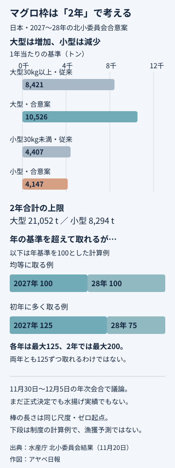
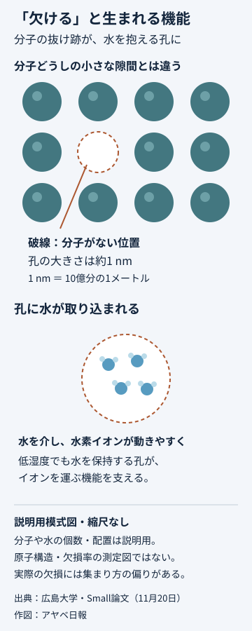

# アヤベ日報　2026年11月21日（土）

本紙 · 21記事 · 図解2点　情報確認 2026-11-21T07:36:46+09:00

## 今朝の読みどころ

- 虐待死受け全国緊急点検、児相と自治体・警察の連携を検証
- 大型クロマグロの日本枠25％増へ、小型魚は削減
- COP31は延長へ。電気を増やす目標だけでは、なぜ折り合えないのか

## 01　虐待死受け全国緊急点検、児相と自治体・警察の連携を検証

大阪府枚方市と兵庫県伊丹市で子どもが死亡した事件を受け、中司宏こども政策担当相は20日、市町村と児童相談所、児童相談所と警察の連携状況を全国で緊急点検すると発表した。虐待が疑われる情報をルールに沿って共有していたかを調べ、課題が見つかれば改善を求める。点検を終える時期と結果の公表は、この日の説明では決まっていない。

二つの事件では、保護の判断に先立って情報がどこまで伝わっていたかが異なる。枚方では府の児童相談所が事件の約7カ月前に虐待の疑いを把握しながら、一時保護や警察への情報共有には至らなかったとFNNは報じた。一方、伊丹では施設職員が聞いた子どもの訴えが、家庭復帰を判断する時点で児童相談所に共有されていなかったと兵庫県は説明している。前者では把握後にどう動いたか、後者では判断する側に重要な情報がなぜ届かなかったかが、それぞれ検証の焦点になる。

今回の点検が見るのは、連絡窓口や協定があるかだけではない。共同通信によると、国は情報が実際に共有されるまでの運用を調べ、一時保護が必要かを判断する指針の改善にもつなげる。市町村職員が緊急性を判断するための手引きを作り、児相の元職員らを派遣して市町村職員と家庭を訪問する取り組みも進める。テレビ朝日は、安全を一度確認したケースでも家庭の変化を継続して確認し、必要なら一時保護する方針を伝えた。

今後、点検の効果を判断するには、情報が届いた時点と、その後に安全確認や再評価をした時点を分けて確かめる必要がある。送った記録が残っても、受け取った側が複数の兆候を一つの案件として読み取れなければ、危険度の見立ては変わらない。全国点検の発表はこうした運用を調べる出発点であって、個々の事件で何が起きたか、誰がどの判断をしたかの結論ではない。

出典：FNN：全国点検の内容と2事件の経緯 ／ テレビ朝日：安全確認と点検時期 ／ 共同通信：点検と判断指針の見直し ／ ABC：伊丹の情報共有に関する県の説明

**出典**

- [FNN：全国点検の内容と2事件の経緯](<https://www.fnn.jp/articles/-/1156084>)
- [テレビ朝日：安全確認と点検時期](<https://news.tv-asahi.co.jp/news_politics/articles/000549361.html>)
- [共同通信：点検と判断指針の見直し](<https://news.livedoor.com/article/detail/32860989/>)
- [ABC：伊丹の情報共有に関する県の説明](<https://www.asahi.co.jp/webnews/pages/abc_63695.html>)

## 02　大型クロマグロの日本枠25％増へ、小型魚は削減

太平洋クロマグロの資源管理を話し合う中西部太平洋まぐろ類委員会の北小委員会が20日、2027～28年の漁獲上限案に合意した。水産庁によると、日本の大型魚（30キログラム以上）は1年当たりの基準が8421トンから1万526トンへと2105トン増える。一方で小型魚（30キログラム未満）の基準は4407トンから4147トンへと260トン減る。増枠の見出しだけでは、魚を選ばず取れる量が一様に増えたように見えるが、二つの枠は反対の方向に動く。

合意案は1年の数字だけで管理するわけではない。日本の大型魚の2年合計は2万1052トン、小型魚は8294トンが上限。その範囲内なら、各年は年当たり基準の125％まで漁獲できる。つまり、ある年に基準のちょうど1.25倍を取れば、残りの年は通算上限までの0.75倍分しか残らない。両年とも1.25倍ずつ取れる仕組みではない。基準を持たせることで年ごとの操業に幅を持たせつつ、2年間に取れる総量を制限する。

大きな枠組みは、KABによると8月の国際会議で示されていた。20日に進んだのは、増やす枠を各国・地域にどのように配分するかだ。水産庁の結果資料では、日本のほか、韓国と台湾にも大型魚の枠が示されている。ここで挙がった数字は漁業者が実際に水揚げした量ではなく、資源管理上、そこまでに抑える合意案の数字だ。海況や漁の条件次第で実際の水揚げは変わるため、これだけで店頭価格が下がるとは言えない。

今回の合意は正式決定の前段階に当たる。水産庁は、11月30日から12月5日にバヌアツで開かれる委員会の年次会合で、この案を議論するとしている。年次会合でどの上限が確定するかを見れば、27年の操業に使える枠がどこまで変わるかが分かる。

大型と小型の枠は逆方向。各年の余裕は2年間の総量の範囲に限られます。 自作図：アヤベ日報。データ・研究の出典は下記リンク。

出典：水産庁：北小委員会結果と漁獲上限表 ／ 水産庁：30キログラムの区分と現行枠 ／ KAB：配分交渉と年次会合への経緯

**出典**

- [水産庁：北小委員会結果と漁獲上限表](<https://www.maff.go.jp/j/pr/event/attach/pdf/kaigi.release-2244.pdf>)
- [水産庁：30キログラムの区分と現行枠](<https://www.jfa.maff.go.jp/j/tuna/attach/pdf/index-52.pdf>)
- [KAB：配分交渉と年次会合への経緯](<https://www.kab.co.jp/news/article/17069274>)

## 03　COP31は延長へ。電気を増やす目標だけでは、なぜ折り合えないのか

トルコ・アンタルヤの国連気候変動会議（COP31）は20日、予定した会期の終了時刻を越えた。ロイターと英ガーディアンが延長を報じた。争点の一つは、19日に示された成果文書の修正案が化石燃料からの脱却に触れない一方、2035年までに世界の電化率35％を目指す文言を残したことだ。確認できたのは交渉の途中段階であり、最終採択の内容ではない。

ここでいう電化率は、家庭や工場、輸送などで最終的に使うエネルギーに占める電力の割合だ。例えば車をガソリンから電気へ切り替えれば、使うエネルギーの形は変わる。ただし、その電気を何で作るかは別の指標である。風力や太陽光で発電する場合と、石炭や天然ガスで発電する場合では、同じ電化でも化石燃料の使用量や排出への効果は異なる。時事通信によると修正案は電源を再生可能エネルギーに限らなかった。電化を進める指標だけでは、石油・石炭・ガスをいつどう減らすかまでは決まらない。

ロイターによると、脱化石燃料への言及が削られた背景には主要産油国の異議があり、パナマなどは文言なしでは受け入れられないと反発した。オーストラリアのボーエン交渉議長は20日、脱却に向けた作業そのものは続けられるとしつつ、合意文書にどう反映するかは協議を続けると説明した。つまり、進む方向を共有できるかと、それを全体の文書に明記できるかの双方が問われている。

もう一つは、洪水や干ばつなどの被害を減らす途上国の対策を、どれだけ資金面で支えるかだ。時事通信によると、修正案では2035年までに適応資金を3倍にする目標の基準年を検討する一方、少なくとも1200億ドルという具体額が消えた。何を出発点に3倍とするかで実際の金額は変わる。今後の文書では、電化率の数字だけでなく、化石燃料に関する記述と、適応資金の基準年・金額がどう残るかに注目したい。

出典：ロイター・会期延長と交渉の対立 ／ 時事通信・19日修正案の項目 ／ 国連気候変動枠組条約事務局・20日議長会見 ／ ガーディアン・現地20日夜の延長報道

**出典**

- [ロイター・会期延長と交渉の対立](<https://www.reuters.com/sustainability/cop/cop31-climate-talks-spill-into-overtime-nations-quarrel-over-fossil-fuels-2026-11-20/>)
- [時事通信・19日修正案の項目](<https://forincs.com/headlines.php?src=2026112000852.xml>)
- [国連気候変動枠組条約事務局・20日議長会見](<https://unfccc.int/news/transcript-of-cop31-president-of-negotiations-interview-with-journalists-today>)
- [ガーディアン・現地20日夜の延長報道](<https://www.theguardian.com/environment/2026/nov/20/cop31-talks-overtime-fossil-fuels-vanish-from-draft-deal>)

## 04　停戦の先で誰が何を約束するか、ベルリン会合とロシアの反発

ウクライナを支援する有志国とウクライナ、米国は現地19日、ベルリンで協議した。その後公表されたドイツ、フランス、英国、ウクライナの首脳共同声明は、停戦が発効した後には法的拘束力のある安全の保証が必要だとした。20日、ロシアのリャプコフ外務次官は、ウクライナを北大西洋条約機構（NATO）の準加盟国にするような仕組みは受け入れられないと主張したと、ロイターがロシアメディアの報道を基に伝えた。

ここでいう安全の保証には、停戦直後から長い期間まで、性格の異なる役割がある。共同声明が例示した一つは、米国主導を想定した停戦の監視と検証。違反が起きたかを確認する仕組みだ。別の柱は、欧州主導の多国籍部隊による支援や、ウクライナ軍への継続的な資金・装備・技術支援で、同国が自ら防衛する力を保つ狙いがある。さらに将来ロシアが再び攻撃した場合には、各国の国内手続きを前提に、平和と安全を回復する措置を取る法的な約束を置く案もある。監視と実際の対応は同じではない。

ロイターによると、米交渉担当のクシュナー氏はベルリンで、加盟国が攻撃を受けた場合の集団防衛を定めるNATO条約第5条をモデルにする考えを示した。これはNATO加盟そのものとは異なるが、ロシア側は20日、加盟に近い仕組みにも反発し、まずウクライナが加盟しないことを求めた。四首脳声明は候補となる措置を挙げた文書で、ロシアが同意した取り決めでも、参加国ごとの義務を決めた条約でもない。

四首脳は、交渉の前段として冬の間のエネルギー施設をめぐる停戦もロシアに求めた。まず攻撃を止める取り決めと、その後に再攻撃を抑える仕組みは別の課題だ。ベルリン会合を受けた次の焦点は、どの国が監視と支援を担い、実際に停戦が破られたときの対応をどこまで約束するか、そして当事国が交渉の席でその案をどう扱うかにある。

出典：ウクライナ大統領府・19日四首脳共同声明 ／ ロイター・20日のロシアの反応と米側発言

**出典**

- [ウクライナ大統領府・19日四首脳共同声明](<https://president.gov.ua/en/news/spilna-zayava-lideriv-nimechchini-franciyi-velikoyi-britaniy-107409>)
- [ロイター・20日のロシアの反応と米側発言](<https://www.reuters.com/world/russia-pushes-back-against-us-idea-nato-style-security-guarantees-for-ukraine-2026-11-20/>)

## 05　結晶の孔は、分子と分子のすき間ではなかった

広島大・東大・産業技術総合研究所のグループは20日、無機分子が並ぶ結晶の中に知られていた直径約1ナノメートルの孔について、分子同士のすき間ではなく、分子まるごとが抜けた場所だと報告した。調べたのはシリコンを中心にタングステンと酸素を組み合わせた大きな無機イオンのアンモニウム塩。論文は同日、学術誌『Small』に掲載された。

孔の起源を確かめる難しさは、普段得られる試料が小さな結晶の集まりだったことにある。集まり全体に気体などを吸わせて判断しても、その結果だけでは粒と粒の間の空間か、結晶の内側の孔かを決めきれない。グループは構造解析に使える大きさの単結晶をつくり、X線がどの方向にどう散るかから、無機イオンが入るはずの位置に欠損があることを確かめた。

大学発表が示した欠損の割合約25％は、1998年に類似の塩について提案されたモデルと整合する目安だ。論文は、単結晶の解析から得た占有量の推定はデータの扱いに影響されると明記している。したがって、結晶の体積の4分の1が空洞だとか、どの四つの位置を選んでも一つが空くといった意味ではない。

さらに粉末のX線回折と電子顕微鏡の結果を合わせると、抜け跡は無作為に散るのではなく、立方体を斜めに横切る種類の面に平行に集まっていた。論文では、欠損が連なって規則性を示す領域をおよそ2〜10ナノメートルと見積もる。これは連なりの広がりで、一つの孔の直径とは別の値だ。

孔は低い湿度でも水分子を取り込み、その水が水素イオンの移動を助ける。燃料電池や湿度センサーの材料に応用できる可能性はあるが、今回確かめたのはこの結晶の性質だ。実用材料への一歩として次に問われるのは、欠損の数だけでなく、そのつながりを狙って作れるかどうかだ。

分子の間の隙間ではなく、分子がない位置の孔。配置と個数は説明用です。 自作図：アヤベ日報。データ・研究の出典は下記リンク。

出典：広島大学・共同研究発表（20日） ／ Small 掲載論文

**出典**

- [広島大学・共同研究発表（20日）](<https://www.hiroshima-u.ac.jp/news/101376>)
- [Small 掲載論文](<https://onlinelibrary.wiley.com/doi/10.1002/smll.76365>)

## 06　日経平均3007円安、米AI株の売りが東京にも

20日の東京株式市場で、日経平均株価は前日比3007円56銭（5.06％）下落し、5万6436円65銭で取引を終えた。構成225銘柄のうち214銘柄が下落。ロイターによると、アドバンテスト、東京エレクトロン、ソフトバンクグループなどが大きく値下がりした。

米ナスダックに19日上場したアンソロピックは、公開価格83ドルを17.1％上回って初日の取引を終えた一方、米市場では他のAI・半導体株の売りが目立った。共同通信は上場前の期待が一巡したとの見方を、ロイターは米ハイテク株安の波及や日本の3連休を前に持ち株を売る動きを背景として伝えた。上場そのものが下落を引き起こしたと証明されたわけではない。東京市場の取引後に進んだ米国の20日の取引でも、ダウ平均は949ドル73セント下落した。

出典：日本経済新聞社：日経平均の日次データ ／ ロイター：東京市場と米株安の波及 ／ 共同通信：東京市場の終値と投資家の見方 ／ Anthropic：公開価格 ／ 共同通信：米国20日の取引結果

**出典**

- [日本経済新聞社：日経平均の日次データ](<https://indexes.nikkei.co.jp/nkave/archives/summary?dt=20261120&idx=nk225>)
- [ロイター：東京市場と米株安の波及](<https://www.newsweekjapan.jp/articles/-/340861>)
- [共同通信：東京市場の終値と投資家の見方](<https://kumanichi.com/articles/2060148>)
- [Anthropic：公開価格](<https://www.anthropic.com/news/anthropic-prices-initial-public-offering>)
- [共同通信：米国20日の取引結果](<https://kumanichi.com/articles/2060421>)

## 07　10月の物価2.2％上昇、エネルギーを除くと伸び鈍化

総務省が20日に公表した10月の全国消費者物価指数は、価格が変動しやすい生鮮食品を除くと、前年同月比2.2％上昇した。9月の2.1％より伸びが大きい。一方、生鮮食品とエネルギーの両方を除くと、9月の2.4％から10月は2.2％へ鈍化した。対象を変えると10月の数字は偶然同じだが、前月までの動きは反対だった。

読売新聞によると、電気・ガス料金の補助縮小や資源価格上昇を背景に、エネルギーは9月の前年同月比0.6％下落から10月は2.2％上昇に転じた。米類は同29.7％下落し、大和総研は食料などの伸びを抑える要因とみている。全国平均の指数は家計ごとの支出構成とは異なるため、光熱費や食費の変化を一つの数字だけで捉えるのは難しい。

出典：総務省：全国CPI原表 ／ 大和総研：品目別の動き ／ 読売新聞：電気・ガス料金の背景（配信先）

**出典**

- [総務省：全国CPI原表](<https://www.e-stat.go.jp/stat-search/file-download?fileKind=2&statInfId=000040525997>)
- [大和総研：品目別の動き](<https://www.dir.co.jp/report/research/economics/japan/20261120_026205.html>)
- [読売新聞：電気・ガス料金の背景（配信先）](<https://news.livedoor.com/article/detail/32863077/>)

## 08　JR大阪駅前に「うめきたの森」、南北350mの回廊も開通

JR大阪駅前のグラングリーン大阪で20日正午、うめきた公園ノースパーク西側の「うめきたの森」が開いた。旧梅田貨物駅の一角に当たる約8400平方メートルの区域で、池や滝などの水辺、在来種を取り入れた植栽を設けた。南側から延ばしてきた全長350メートルの空中回廊「ひらめきの道」も全線が開通し、南と北の公園をつないで歩けるようになった。 共同通信によると、水辺とともにヤマザクラやイロハモミジが植えられている。

運営側によると、回廊は平時の散策路だけでなく災害時の避難動線にもなる。森と回廊の利用開始は、うめきた公園全体の完成とは別の節目だ。残る約2200平方メートルの開園は2027年春ごろ、グラングリーン大阪全体のまちびらきは28年3月を予定している。

出典：三菱地所：開園実績と南北回廊 ／ 共同通信：開園現地報道

**出典**

- [三菱地所：開園実績と南北回廊](<https://www.mec.co.jp/news/detail/2026/11/20_mec261120_ggo>)
- [共同通信：開園現地報道](<https://www.kobe-np.co.jp/news/zenkoku/compact/202611/0021055181.shtml>)

## 09　大学生の内定率73.0％、理系と文系で動きに差

厚生労働省と文部科学省が20日に発表した調査で、2027年3月に卒業予定で就職を希望する大学生の内定率は、10月1日時点で73.0％だった。前年の同じ時点より0.4ポイント低い。共同通信によると、理系は76.9％で3.3ポイント上がった一方、文系は72.2％で1.2ポイント下がった。全体がほぼ横ばいでも、内訳は同じ方向に動いていない。

調査は全国から選んだ大学や短大などの学生を対象にしたもので、大学生の73.0％は就職希望者のうち内定を得た人の割合だ。すべての卒業予定者を分母にした数でも、就職活動が終わった時点の実績でもない。厚労省は新卒者向けのハローワークと大学の就職相談員が連携し、就職支援を続けるとしている。

出典：厚労省・文科省：就職内定状況 ／ 共同通信：調査対象と文理別内訳

**出典**

- [厚労省・文科省：就職内定状況](<https://www.mhlw.go.jp/stf/houdou/0000184815_00068.html>)
- [共同通信：調査対象と文理別内訳](<https://kumanichi.com/articles/2060120>)

## 10　関文科相、別の政治資金パーティー3回にも官庁職員

関芳弘文部科学相は20日夜、2024年に開いた政治資金パーティーのうち、既に説明していた2回とは別の3回にも、公正取引委員会や内閣府の職員を招いていたと明らかにした。既出の2回では、バイオ医薬品関連企業の関係者から会費を集め、厚生労働省や経済産業省の課長が説明していたとTBSが報じている。

関氏は追加の3回について、参加者との意見交換であり、業界とその所管省庁を組み合わせた会合ではなかったと説明した。職員に政治資金パーティーだと正確に伝わっていなかった可能性も認め、職務を続ける考えを示した。共同通信によると、野党は参院で問責決議案を検討し、与党内には減税関連法案の審議への影響を懸念する声がある。審議への影響や辞任が決まったわけではない。

出典：TBS：20日夜の追加説明 ／ 共同通信：参議院での与野党の動き

**出典**

- [TBS：20日夜の追加説明](<https://newsdig.tbs.co.jp/articles/-/3102768?display=1>)
- [共同通信：参議院での与野党の動き](<https://kumanichi.com/articles/2060321>)

## 11　サウジ原油の国内保管、最大2400万バレルへ

経済産業省は20日、サウジアラビアが日本国内で保管する原油を、従来の800万バレルから最大2400万バレルに増やすことで合意したと発表した。共同通信によると、これは中東の石油会社が日本に原油を置く「産油国共同備蓄」の枠だ。日本政府が所有する国家備蓄の数量が、そのまま3倍になったという意味ではない。

中東情勢の悪化を受けて3月以降に放出したサウジの備蓄分は補充を始め、日本は別に国家備蓄向けとして同国から最大800万バレルを購入するという。今回の数字は共同備蓄の新しい上限で、すでに上限までタンクが満たされたことを示さない。協議は5月の閣僚間の確認を受けて進められてきた。 共同備蓄には、サウジのほかアラブ首長国連邦とクウェートも参加している。

出典：共同通信：新上限と国家備蓄向け購入の区別

**出典**

- [共同通信：新上限と国家備蓄向け購入の区別](<https://www.oanda.jp/lab-education/market_news/kn_2026112001002221/>)

## 12　連休前の雪で山形・長野の国道に一時立ち往生

3連休を前に雪が強まり、20日に山形と長野の国道で車が一時立ち往生した。FNNによると、午後3時半ごろ、宮城県仙台市と山形県を結ぶ国道48号の関山峠で大型トラックなど複数の車が動けなくなり、最大で約50台が滞留した。長野県内の国道でも一時約100台が動けなくなり、警察によると午後9時半ごろ解消した。いずれも20日の状況で、21日朝も同じ区間が通れないことを意味しない。

高速道路でも、NEXCO中日本は20日から22日にかけて平地で積雪となる可能性があるとして、最新の気象・交通情報を確認のうえ、冬用タイヤの装着とチェーンの携行を呼びかけている。とくに峠をまたぐ移動では、出発地で雪が降っているかだけでは途中の路面状況は判断できない。

出典：FNN：山形・長野の立ち往生 ／ NEXCO中日本：連休の降雪関連情報

**出典**

- [FNN：山形・長野の立ち往生](<https://www.fnn.jp/articles/-/1156791>)
- [NEXCO中日本：連休の降雪関連情報](<https://www.c-nexco.co.jp/topics/2587.html>)

## 13　日・ペルーと日・チリ、重要鉱物の供給網で連携

高市首相は20日、ペルーのケイコ・フジモリ大統領、チリのカスト大統領と東京で別々に会談し、重要鉱物の供給網を強くするため連携を深めることでそれぞれ一致した。ペルーとの会談では銅などの調達と、エルニーニョに備えた災害対応機材の供与を協議した。外務省によると、投資促進や教育、農業を含む複数の協力文書の署名も歓迎した。

チリとの会談では情報通信分野の協力覚書の署名を歓迎し、高市氏は日本の次世代通信技術で銅鉱山の遠隔作業を目指す事業を具体例に挙げた。両国との協力は資源を買う話だけではなく、防災や鉱山の運用にも及ぶ。ただし今回の外務省発表は協力方針を記したもので、輸入契約の増量や遠隔操業の稼働開始を示したものではない。

出典：外務省・日ペルー首脳会談 ／ 外務省・日チリ首脳会談 ／ テレビ朝日・両会談の結果

**出典**

- [外務省・日ペルー首脳会談](<https://www.mofa.go.jp/mofaj/la_c/sa/pe/pageit_000001_03343.html>)
- [外務省・日チリ首脳会談](<https://www.mofa.go.jp/mofaj/la_c/sa/cl/pageit_000001_00006.html>)
- [テレビ朝日・両会談の結果](<https://news.tv-asahi.co.jp/news_politics/articles/000549454.html>)

## 14　日中首脳会談は開かれず、帰国後に外務当局が立場を説明

中国・深圳のAPEC首脳会議で、高市首相と習近平国家主席はあいさつを交わしたが、正式な首脳会談は開かれなかった。20日の会見で茂木外相は、懸案があるからこそ対話と意思疎通が重要だと述べ、建設的で安定した関係を構築したいとした。あいさつがあったこと自体と、まとまった議題を話す会談が実現したかどうかは別だ。

同日、中国外務省の郭嘉昆報道官は、高市氏が日中共同声明など四つの政治文書の位置づけに変更はないと述べたことについて、日本は文書を行動で履行すべきだと主張し、台湾を巡る発言などの是正を求めた。双方が20日に示したのは、一方が対話継続の必要性を唱え、他方が是正を先に求めるという立場だ。新たな首脳会談の日程は、これらの発表では確認できない。

出典：外務省・茂木外相20日会見 ／ 中国外務省・郭報道官20日会見 ／ テレビ朝日・日中双方の反応

**出典**

- [外務省・茂木外相20日会見](<https://www.mofa.go.jp/mofaj/press/kaiken/kaikenit_000001_00158.html>)
- [中国外務省・郭報道官20日会見](<https://www.fmprc.gov.cn/mfa_eng./xw/fyrbt/202611/t20261120_12064156.html>)
- [テレビ朝日・日中双方の反応](<https://news.tv-asahi.co.jp/news_international/articles/000549455.html>)

## 15　ミャンマー政権がICJ判決を批判、中国は裁判権の行使に懸念

少数派ロヒンギャに対するジェノサイドを認定した19日の国際司法裁判所（ICJ）判決を巡り、ミャンマー大統領府報道官は20日、全会一致ではなく不公平だと批判した。TBSによると、報道官は前日の米中ロ首脳宣言を引き合いに、国際司法機関は管轄権を乱用してはならないとも述べた。宣言が名指しした国際刑事裁判所（ICC）と、ミャンマーの国家責任を判断したICJは異なる裁判所だ。

中国外務省も20日、ロヒンギャの問題には複雑な歴史的・民族的・宗教的な背景があり、帰還に向けた対話を支援すると説明する一方、国際司法機関の権限の行使には慎重さが必要との考えを示した。米国務省は判決の影響を精査していると説明したとAFPが報道した。いずれも判決自体を変更するものではなく、帰還や賠償の履行が進んだという発表でもない。

出典：TBS・ミャンマー大統領府の反応 ／ 中国外務省・判決への20日回答 ／ AFP・米国務省の反応

**出典**

- [TBS・ミャンマー大統領府の反応](<https://newsdig.tbs.co.jp/articles/-/3102525?display=1>)
- [中国外務省・判決への20日回答](<https://www.fmprc.gov.cn/mfa_eng./xw/fyrbt/202611/t20261120_12064156.html>)
- [AFP・米国務省の反応](<https://www.afpbb.com/articles/-/3663405>)

## 16　ロシア軍がウクライナを大規模攻撃、エネルギー施設などに被害

ウクライナでは19日夜から20日、ロシア軍による大規模な攻撃があり、ゼレンスキー大統領は8人が死亡し、約30人が負傷したと明らかにした。テレビ朝日が21日未明に伝えた。首都キーウの橋やエネルギー施設などにも被害が出たという。犠牲者の人数は大統領の発表に基づくもので、調査が進んだ後の確定値ではない。

ロシアのプーチン大統領はこれに先立つ19日、ロシアとクリミア半島を結ぶ橋への相次ぐ攻撃に触れ、報復を警告していた。前後関係は確認できるが、個々の被害がその警告への対応だったかまでは判定できない。ゼレンスキー氏は同盟国に防空支援を改めて求めた。ベルリンの有志国会合が冬のエネルギー施設をめぐる停戦を求めた一方で、現地では施設への被害が新たに報じられている。

出典：テレビ朝日・21日未明の被害報道 ／ ウクライナ大統領府・冬季の停戦呼びかけ

**出典**

- [テレビ朝日・21日未明の被害報道](<https://news.tv-asahi.co.jp/news_international/articles/000549557.html>)
- [ウクライナ大統領府・冬季の停戦呼びかけ](<https://president.gov.ua/en/news/spilna-zayava-lideriv-nimechchini-franciyi-velikoyi-britaniy-107409>)

## 17　H3、打ち上げサービスに加え、法律上の実施者も三菱重工へ

JAXAは20日、基幹ロケットH3のうち、第1段にLE-9のType1Aを使う22形態について、三菱重工業が打ち上げを実施することで同社と合意したと発表した。三菱重工はすでに4号機から打ち上げ輸送サービスを提供している。今回変わるのは、これまでJAXAだった法律上の打ち上げ実施者も三菱重工になることだ。

その形で実施する11号機は、情報収集衛星を載せ、2027年1月11日の午前8〜10時に、種子島宇宙センターから打ち上げる予定。日程は発表時点のものだ。移管はH3全機種を一度に対象とするわけではなく、他の形態については今後、関係者と協議する。JAXAは別型のエンジン開発や機体の性能・運用性の向上を引き続き担う。輸送の実施を移すことと、研究開発から手を引くことは同じではない。

出典：JAXA 移管発表（20日） ／ 三菱重工 11号機の打ち上げ予定 ／ Impress Watch

**出典**

- [JAXA 移管発表（20日）](<https://www.jaxa.jp/press/2026/11/20261120-1_j.html>)
- [三菱重工 11号機の打ち上げ予定](<https://www.mhi.com/jp/news/261120.html>)
- [Impress Watch](<https://www.watch.impress.co.jp/docs/news/2158299.html>)

## 18　ChatGPT Space、18歳以上のPlusにも展開

OpenAIは20日、ChatGPTでページやプレゼン資料を作る「Space」を、18歳以上のPlus利用者にも世界で順次提供すると発表した。ページやスライドに接続サービスの情報を反映させたり、Spaceへのアクセスがある人を招いて編集したりできるという。すでにあった機能の対象プランを広げる発表で、全利用者の画面に同時に現れるわけではない。

共同編集と一般公開は別だ。公式案内では、共有された資料を開くには閲覧権限に加え、Spaceが使えるPlus、Pro、Business、Enterpriseのいずれかでログインが必要。Freeでは共有資料を開けず、誰にでも見せられる公開リンクも提供しない。SpaceはサイドバーのLibraryに代わる場所として案内され、作ったページ・スライドに加えて画像やアップロードしたファイルも扱う。

出典：OpenAI ChatGPT更新履歴（20日）

**出典**

- [OpenAI ChatGPT更新履歴（20日）](<https://help.openai.com/en/articles/6825453-chatgpt-release-notes>)

## 19　Mac版Geminiがアプリを横断、許可はアプリ単位

Googleは米国日付19日、Mac版Geminiがローカルのファイルやデスクトップアプリにまたがる作業を代行する機能を発表した。たとえば一つのアプリで拾った会議メモを、別のアプリでメールの下書きにする。仮想画面で作業し、利用者はプレビューを見たり、途中で止めたりできる。

アプリへの操作許可は、拒否、一度だけ許可、常に許可から選ぶ。公式ヘルプは、許可したアプリ内ではログイン済みの状態にもアクセスし得ることや、操作を必ず元に戻せるわけではないことを挙げる。先に広がるのは操作できる場所であり、何を任せるかまで自動で決める機能ではない。提供案内ではApple Silicon搭載のmacOS 15以降、18歳以上の個人アカウントで、Google AI Plus、Pro、Ultraが対象。

出典：Google公式発表（19日） ／ Googleヘルプ・権限と対象

**出典**

- [Google公式発表（19日）](<https://blog.google/innovation-and-ai/products/gemini-app/computer-use-mac/>)
- [Googleヘルプ・権限と対象](<https://support.google.com/gemini/answer/18956635?hl=en>)

## 20　SVオールスター、大阪ブルテオンから5選手と監督

SVリーグは20日、来年1月30日に北海道北広島市のエスコンフィールドHOKKAIDOで開く男女オールスターの選出結果を発表した。大阪ブルテオンからは、アントワーヌ・ブリザール、西田有志、山本智大、甲斐優斗、西川馨太郎の5選手と、トーマス・サムエルボ監督が選ばれた。

男女それぞれ28人の選手はファン投票とリーグ推薦、ヘッドコーチとキャプテンはファン投票で決定。投票は男子部門で20万1913票、女子部門で14万6747票だった。男子のキャプテンはウルフドッグス名古屋の水町泰杜と宮浦健人だが、この時点で、普段の所属クラブでチームを分けて対戦するわけではない。キャプテンが12月18日予定のドラフトに参加して、試合をする2チームを組む。

出典：SVリーグ 選出結果（20日） ／ 大阪ブルテオン クラブ発表 ／ バレーボールマガジン

**出典**

- [SVリーグ 選出結果（20日）](<https://www.svleague.jp/news/detail/100824/?grade=sv>)
- [大阪ブルテオン クラブ発表](<https://www.osaka-bluteon.com/news/2026/20261120_02.html>)
- [バレーボールマガジン](<https://volleyballmagazine.jp/704324/>)

## 21　ネタ順も勝敗を左右する、滝音チームが漫才リーグ開幕戦に勝利

20日公開のFANYの取材によると、10日に千葉・幕張で開幕した「よしもと漫才リーグ2026」は、滝音率いるHAYA-TOMOがドンデコルテの幕張銀次一座に3勝2敗で勝った。前回の関東・関西の2リーグ制と異なり、今季は6チームが一つのリーグで同じ相手と2回ずつ対戦する。

チームのキャプテンは出場する5組を選び、各組の勝敗は観客投票で決まる。結成16年以上同士の対決をどこに置くかはホーム側に選択権があり、開幕戦はタモンズとダイタクを先鋒でぶつけた。勝敗は2勝2敗までもつれ、5番手のイチゴが僅差で勝って滝音側が制した。ドンデコルテの渡辺銀次は、相手の出順予想はほぼ当たったと振り返った。出順を読めても、各対戦を取れるとは限らないところに、個人戦とは違う面白さがある。

出典：FANY Magazine 開幕戦と両キャプテン取材（20日）

**出典**

- [FANY Magazine 開幕戦と両キャプテン取材（20日）](<https://magazine.fany.lol/296652/>)
