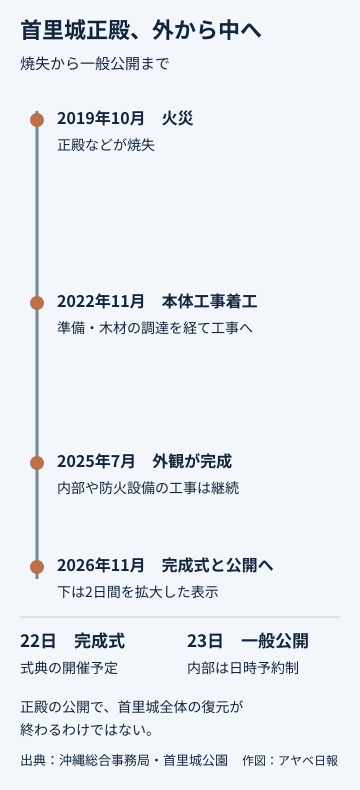
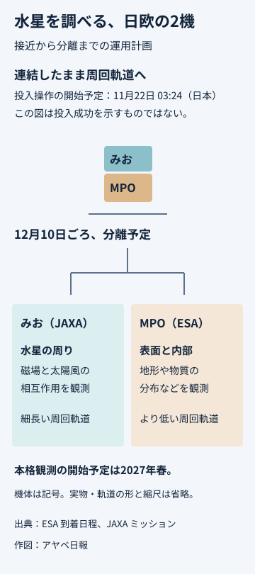
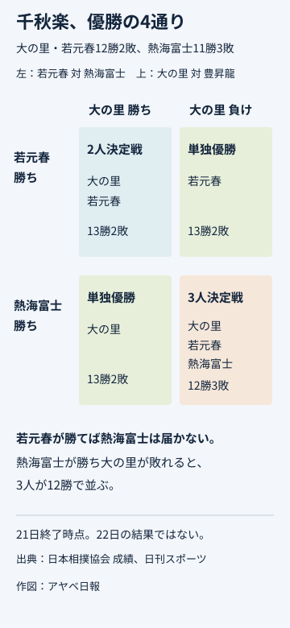

# アヤベ日報　2026年11月22日（日）

本紙 · 21記事 · 図解3点　情報確認 2026-11-22T07:39:12+09:00

## 今朝の読みどころ

- 北塩原で住民・宿泊客約1500人が孤立。倒木と電線が除雪を妨げる
- 首里城はきょう完成式、内部公開はあす。外観の復元と入場再開を分ける
- AIと挑んだリーマン予想、形式検証を通過。何が確かめられたか

## 01　北塩原で住民・宿泊客約1500人が孤立。倒木と電線が除雪を妨げる

福島県北塩原村で、大雪と倒木による通行止めが続いています。22日朝のテレビ朝日報道によると、住民514世帯948人とホテルの宿泊客約500人が孤立状態にあります。日テレは一部で緊急車両が通れるようになったと伝えました。県などは除雪を進めていますが、朝の時点で一般車両の通行再開のめどは立っていません。

なぜ雪を取り除くだけでは復旧しないのでしょうか。村の21日午後10時時点の説明では、倒木が電線にかかり、除雪作業そのものを妨げています。国道459号の道の駅裏磐梯から猪苗代町長坂までの区間、桧原湖周辺の県道などが通行止めです。道路と電力の被害が重なった状態で、雪の量だけでは復旧までの時間を判断できません。

村が公表した停電は桧原・裏磐梯・大塩地区の一部で約300件。東北電力は22日も増員して対応する予定です。猪苗代・裏磐梯線と喜多方・裏磐梯線の路線バスは運休し、地区のコミュニティバスも22日は終日運休となります。朝の報道にある県内約1500戸の停電は村の数字とは集計範囲が異なります。復旧状況は変わるため、移動を予定する場合は村が案内する道路規制情報の更新が必要です。

出典：北塩原村・21日午後10時の被害と交通情報 ／ テレビ朝日・22日午前6時32分、孤立状況 ／ 日テレNEWS NNN：緊急車両と一般交通の違い

**出典**

- [北塩原村・21日午後10時の被害と交通情報](<https://www.vill.kitashiobara.fukushima.jp/soshiki/0/10352.html>)
- [テレビ朝日・22日午前6時32分、孤立状況](<https://news.tv-asahi.co.jp/news_society/articles/000549746.html>)
- [日テレNEWS NNN：緊急車両と一般交通の違い](<https://news.livedoor.com/article/detail/32871901/>)

## 02　首里城はきょう完成式、内部公開はあす。外観の復元と入場再開を分ける

2019年の火災で焼失した首里城正殿は、22日午後1時から復元の完成式を迎える予定です。一般向けに内部を公開するのは23日から。完成式の日と、実際に内部へ入れる日は同じではありません。

すでに正殿の姿を見た人にとって、今回何が変わるのでしょうか。沖縄総合事務局の資料では、外観は2025年7月に完成し、その後も内部の塗装・彩色、両廊下、送水管などの工事を進めてきました。公園の記録によると、今年5月には高台見学デッキ、9月17日には正殿全体の漆塗装が完成しています。外から復元過程を見学する段階から、内部を観覧できる段階へ移ります。

前回の設計を基本としつつ、防火対策と材料も見直しました。構造材は原則として国産ヒノキを使い、赤瓦には一部、破損した瓦を粉砕した材料を再利用しています。火災感知器に連動する監視カメラやスプリンクラー、1人でも操作できる消火栓も採用。姿を戻す工事だけでなく、再び失わないための設備を組み込んだ復元です。

内部観覧には日時指定の事前予約が必要で、年間パスポートでも予約します。空きがある場合には当日受付もありますが、外観や展望デッキを見る有料区域の入場とは扱いが異なります。また正殿の完成は首里城全体の復元終了を意味せず、北殿は正殿の完成後に整備する計画です。

外観の完成、式典、入場再開は異なる節目です。26年11月の2日間は別枠に拡大しました。 自作図：アヤベ日報。データ・研究の出典は下記リンク。

出典：テレビ朝日・22日朝、完成式は午後1時予定 ／ 沖縄総合事務局・供用開始と復元概要 ／ 首里城公園・復興の軌跡 ／ 首里城公園・内部観覧予約の案内

**出典**

- [テレビ朝日・22日朝、完成式は午後1時予定](<https://news.tv-asahi.co.jp/news_society/articles/000549749.html>)
- [沖縄総合事務局・供用開始と復元概要](<https://oki-park.jp/userfiles/files/PDF_20260604_1_kisya.pdf>)
- [首里城公園・復興の軌跡](<https://oki-park.jp/shurijo/fukkou/7024>)
- [首里城公園・内部観覧予約の案内](<https://oki-park.jp/shurijo/ticket_guide/>)

## 03　AIと挑んだリーマン予想、形式検証を通過。何が確かめられたか

米AI企業Anthropicに所属する数学者レヴェント・アルポーゲ氏が20日、生成AI「Claude」との共同作業でリーマン予想の証明を見つけたとして、機械が検査できるようLeanという言語で書いたコードを公開した。本人名義の発表で、同氏は有望な数学的状況へ方向づけ、終盤にClaudeから有力な着想を得たと説明する。Leanと数学ライブラリーMathlibの関係者は21日、予想の記述が正しく、提出された証明が成立していると共同声明を出した。

リーマン予想は、素数が現れる頻度の平均を求めるというより、実際の個数が平均的な見積もりからどれほどずれるかに深く関わる。1859年にリーマンが提示した問いは、ゼータ関数をゼロにするうち特定の例を除いた点が、複素数の平面で実部が2分の1の直線にすべて並ぶか、というものだ。膨大な点を個別に計算してすべて並んだとしても、その先に例外がないことは証明できない。

約1700万行の公開コードについて、検証側はまず、書かれた結論が既存のMathlibで定義されたリーマン予想そのものかを二つの独立した道具で比較した。次いで、証明を書き出したデータをLean標準の検査器と、独立に実装された複数の検査器で確かめた。Claudeに答えを再質問した結果ではなく、「別の命題にすり替わっていないか」と「論理が各段で成立するか」を分けて検査したということだ。MITのアンドリュー・サザーランド氏も独自の検査記録を公開した。

形式検証を通ったことは、独立査読を経た解説論文の掲載や賞の認定を意味しない。アルポーゲ氏自身、長い議論を読み解き、説明を書きたいとしている。クレイ数学研究所が賞の対象として検討するには、規程の要件を満たす媒体での公表、公表から2年以上、数学界での一般的な受容が必要だ。同研究所の問題ページは確認時点で「未解決」の表示だった。今回は少なくとも、関係者が独立した道具で形式証明を確認した段階まで進んだ。

出典：アルポーゲ氏本人の20日発表（PDF） ／ Lean・Mathlib関係者の21日共同声明 ／ MIT・Andrew Sutherlandの検証記録 ／ AP通信・本人の発表と数学者の反応 ／ クレイ数学研究所・問題の説明 ／ クレイ数学研究所・賞の審査要件

**出典**

- [アルポーゲ氏本人の20日発表（PDF）](<https://alpo.ge/remark.pdf>)
- [Lean・Mathlib関係者の21日共同声明](<https://leanprover-community.github.io/blog/posts/riemann-hypothesis/>)
- [MIT・Andrew Sutherlandの検証記録](<https://math.mit.edu/~drew/grh/>)
- [AP通信・本人の発表と数学者の反応](<https://apnews.com/article/anthropic-claude-math-solution-ai-4fe8b69a891f160f9e7f0c85af8c55c8>)
- [クレイ数学研究所・問題の説明](<https://www.claymath.org/millennium/Riemann-Hypothesis/>)
- [クレイ数学研究所・賞の審査要件](<https://www.claymath.org/millennium-problems/rules/>)

## 04　日欧の水星探査、到着と観測開始はなぜ別なのか

日欧共同の水星探査計画「ベピコロンボ」は、日本時間22日午前3時24分に水星周回軌道への投入操作を始める予定だった。宇宙航空研究開発機構（JAXA）は同日未明に見守り配信を案内し、21日のアストロピクスは投入予定時刻を伝えた。確認した欧州宇宙機関（ESA）の公式更新に投入の成否はまだ掲載されていない。予定時刻は成功を確認した時刻ではない。

地球から水星へは、太陽に向かって真っすぐ飛べば着くわけではない。太陽の重力で速度が増すため、水星のそばを通り過ぎずにとどまるには、接近時の速度を合わせる必要がある。2018年に打ち上げられた探査機は、地球で1回、金星で2回、水星で6回、近くを通りながら惑星の重力で進路や速度を変えた。長い移動を担った電気推進モジュールは9月3日に切り離され、その後はESAの探査機MPOが、まだ連結している日本の「みお」とともに航行を担った。

到着の次に待つのは、同じ場所を同じ高さで回るだけでは得られない観測の準備だ。「みお」は12月10日ごろに分離し、遠くまで伸びる細長い軌道から、水星の磁場と太陽から流れ出す粒子の相互作用などを調べる。MPOはより低い軌道へ移り、表面の地形や物質の分布、惑星内部に関わる手がかりを調べる。水星の周囲に広がる現象と、表面の細かな違いを知るには、異なる軌道がそれぞれ役立つ。

ESAによると、科学観測の本格的な開始は2027年4月を予定する。今回の投入、2機の分離、それぞれの観測軌道の調整は別の段階で、すべてが未明の一度の運用で終わるわけではない。

二機を別々の軌道に移すことで、異なる視点で水星を調べます。投入操作の成否を示す図ではありません。 自作図：アヤベ日報。データ・研究の出典は下記リンク。

出典：ESA：到着の公式更新と今後の予定 ／ ESA：到着・分離の時系列 ／ JAXA：みおの軌道と科学観測 ／ アストロピクス：日本時間の投入予定 ／ パリ天文台LIRA：減速と飛行経路 ／ ガーディアン：軌道投入前の独立報道 ／ JAXA：21日のファクトシート更新 ／ 財経新聞：噴射開始予定時刻と軌道調整

**出典**

- [ESA：到着の公式更新と今後の予定](<https://www.esa.int/articles/about-us/directorates/science/bepicolombo/latest-updates-bepicolombo-s-arrival-at-mercury>)
- [ESA：到着・分離の時系列](<https://www.esa.int/media/bepicolombo-arrival-at-mercury-timeline>)
- [JAXA：みおの軌道と科学観測](<https://mio.isas.jaxa.jp/mission/>)
- [アストロピクス：日本時間の投入予定](<https://astropics.bookbright.co.jp/bepicolombo-mercury-orbit-insertion>)
- [パリ天文台LIRA：減速と飛行経路](<https://lira.obspm.fr/BepiColombo-s-rendezvous-with-Mercury-orbit-insertion-on-the-21st-of-November>)
- [ガーディアン：軌道投入前の独立報道](<https://www.theguardian.com/science/2026/nov/20/spacecraft-mercury-second-ever-mission-orbit-bepicolombo>)
- [JAXA：21日のファクトシート更新](<https://mio.isas.jaxa.jp/topics/news/000076.html>)
- [財経新聞：噴射開始予定時刻と軌道調整](<https://www.zaikei.co.jp/amp/article/20261121/878694.html>)

## 05　英EUの若者交流は各方向10万人、留学費用は別の交渉

欧州連合（EU）と英国は20日、ブリュッセルで開いた2回目の首脳会議で、若者の相互滞在、食品・農産品の検疫、排出量取引制度の連結を巡る交渉の終了を発表した。今回の成果は、EUを離脱した英国が加盟時と同じ扱いに戻ることではなく、行き来や取引を難しくしてきた条件を、分野ごとの取り決めで改めることだ。若者はどこまで自由に行き来できるようになるのか。

英国の制度説明によると、新しい共同制度では初回渡航時に18〜31歳の人が、最長3年間にわたり相手側で就労、学習、ボランティアや旅行をできる。枠はEUから英国、英国からEUの各方向で年10万人。英国人がシェンゲン圏に査証なしで短期滞在する従来の条件は180日間のうち90日で、それより長い滞在には目的に応じた許可が必要だった。若者向けに目的をまたげる道が増える一方、年齢や期間の上限があり、誰でも使える自由移動とは違う。

ここで若者交流の制度と、大学の授業料の交渉は別だ。共同声明では、授業料の新たな取り決めは渡航経路にかかわらず双方の学生に適用することを目指し、首脳会議から6か月以内に交渉を終えるとしている。相互滞在の枠に入っただけで留学生の授業料が変わるわけではない。若者交流の協定は遅くとも2028年の適用を目標とし、機会の提供は遅くとも2030年1月を目指す。申し込みが始まったという発表でもない。

食品・農産品については、共通の検疫区域を設け、現在求める証明書や検査を取引の大部分で省けるようにする。こちらは2028年3月からの適用を目指す。21日には英エネルギー相が、より広い関係の選択肢は今後の非公式協議の対象になり得ると述べたが、再加盟の決定ではない。今回の文書にある期限や対象を一つずつ見ると、合意したことと政治的な展望を切り分けられる。

出典：英政府掲載のEU・英国共同声明 ／ 英政府・若者交流の制度説明 ／ 英ガーディアン・21日の閣僚発言

**出典**

- [英政府掲載のEU・英国共同声明](<https://www.gov.uk/government/publications/ukeu-summit-2026-key-documents/uk-eu-summit-2026-joint-statement-html>)
- [英政府・若者交流の制度説明](<https://www.gov.uk/government/publications/ukeu-summit-2026-key-documents/uk-eu-summit-2026-explainer-youth-experience-scheme-html>)
- [英ガーディアン・21日の閣僚発言](<https://www.theguardian.com/politics/2026/nov/21/rejoining-eu-uk-trade-youth-deals-ed-miliband>)

## 06　大の里と若元春が並ぶ千秋楽。二番で変わる優勝の行方

大相撲九州場所は21日に14日目を終え、横綱・大の里と東前頭七枚目・若元春が12勝2敗で並んだ。関脇・熱海富士が11勝3敗で追う。大の里は金峰山を寄り切り、若元春は大関・安青錦を寄り倒し、熱海富士は大関・霧島をすくい投げで破った。前半に先頭集団が何度も入れ替わった場所は、22日の千秋楽を前に候補が三人に絞られた。

先に組まれたのは若元春と熱海富士。その三番後、結びで大の里と横綱・豊昇龍が当たる。若元春が勝てば13勝に届き、そこで熱海富士の優勝の可能性はなくなる。大の里も勝てば13勝2敗で二人の決定戦、大の里が敗れれば若元春が初優勝となる。

逆に熱海富士が勝つと、若元春と熱海富士が12勝3敗で並ぶ。大の里が勝てば一人だけ13勝に届いて優勝し、負ければ三人とも12勝3敗で「巴戦」と呼ばれる三人の決定戦になる。熱海富士にとっては、自分で若元春を下すことと、結びで豊昇龍が勝つことの両方が、決定戦に進む条件だ。

同じ白星一つでも、先に土俵に上がる若元春と熱海富士で意味は違う。若元春は勝てば少なくとも決定戦に進めるが、熱海富士は勝っても結びを待たなければならない。大の里が優勝すれば、日刊スポーツによると2場所連続で7度目になる。一方、熱海富士も若元春も初優勝がかかる。どの形になるかは22日朝の時点では決まっていない。

若元春・大の里の単独優勝、二人の決定戦、三人の巴戦の四通り。千秋楽前の条件です。 自作図：アヤベ日報。データ・研究の出典は下記リンク。

出典：日本相撲協会・14日目終了時の成績 ／ 共同通信・14日目の取組と千秋楽 ／ 日刊スポーツ・千秋楽の優勝条件

**出典**

- [日本相撲協会・14日目終了時の成績](<https://sumo.or.jp/ResultData/leaders/>)
- [共同通信・14日目の取組と千秋楽](<https://www.daily.co.jp/general/2026/11/21/0021059531.shtml>)
- [日刊スポーツ・千秋楽の優勝条件](<https://www.nikkansports.com/battle/sumo/news/202611220000001.html>)

## 07　自律兵器の規制案を起草へ、条約化には合意できず

ジュネーブで開かれた特定通常兵器使用禁止制限条約（CCW）の見直し会議は21日未明、自律型致死兵器システムを規制する国際文書案を2027〜28年に起草する方針で合意した。議長国スイスは、参加国が一歩を進めたと評価する。一方で多くの国が求めた、法的に拘束する新条約を作るという交渉方針までは合意できなかった。二つの見方が並ぶのは、起草する仕事と、最終文書が各国を拘束するかどうかが別だからだ。

国連の説明で主な論点となるのは、作動後に人間が個々の標的を選ばなくても、対象の選択や攻撃を進めるシステムだ。自動化された装備を一括りにするのではなく、人がどこまで判断に関わるべきか、国際人道法に沿うよう、どの使用を禁じ、どの使用を制限するかが問われる。議論のテーマが定まっても、そのまま新しい禁止規則が発効するわけではない。

会議は全会一致で決める。議長国スイスの発表によると、128の締約国が関わる枠組みには主要な軍事大国が参加しているが、多数の賛成だけでは法的拘束力を前提にした交渉の委任を決められない。AP通信によると、中満泉・国連軍縮担当上級代表は今回の合意を前進としながらも、グテレス事務総長が2026年中に法的拘束力のある取り決めへ向けた交渉を始めるよう求めていたことに言及した。今回確保したのは、今後2年かけて文書案をまとめる段階だ。

今後を測る目印は、文書にどんな規制が書かれるかに加え、それが新たな法的義務なのか、各国に実践を促す政治的な取り決めになるのかだ。合意したと聞いて即時禁止と読むのも、拘束力を決められなかったため何も進まなかったと読むのも、今回の決定の中身を取り違える。

出典：スイス外務省・会議結果 ／ 国連・自律兵器と会議の解説 ／ AP通信・採択の範囲と国連の反応

**出典**

- [スイス外務省・会議結果](<https://www.post2015.admin.ch/en/newnsb/cpYJGLEaQYIi>)
- [国連・自律兵器と会議の解説](<https://www.un.org/en/node/250267>)
- [AP通信・採択の範囲と国連の反応](<https://apnews.com/article/un-drones-robots-un-lethal-ai-weapons-ebe057d2a47cde53100970c8f648e7fa>)

## 08　鈴木幹事長、関文科相の進退にも言及。更迭決定ではない

自民党の鈴木幹事長は21日、官庁職員が出席した政治資金パーティーを巡る問題で、関文科相の進退も含め、重要法案の成立を進める観点で判断する考えを示しました。テレビ朝日は、更迭の可能性を示唆したと報じています。

前日の新たなパーティー3回の判明から、与党幹部が閣僚の進退と法案審議を結び付ける段階へ移った点が新しい動きです。ただし、進退を判断するという発言と、更迭の正式決定は別です。鈴木氏は、説明が覆ったことで国民の理解を得られていないとして、引き続き説明責任を果たすよう求めました。

出典：テレビ朝日・21日午後3時28分、鈴木幹事長発言 ／ FNN：鈴木幹事長の21日会見

**出典**

- [テレビ朝日・21日午後3時28分、鈴木幹事長発言](<https://news.tv-asahi.co.jp/news_politics/articles/000549635.html>)
- [FNN：鈴木幹事長の21日会見](<https://www.fnn.jp/articles/-/1157033>)

## 09　専修大の寮食堂で23人が食中毒。川崎市が2日間の営業停止

川崎市は21日、専修大学生田第3体育寮の食堂を原因施設とするノロウイルス食中毒を認定し、21～22日の営業停止を命じました。14～16日に食堂の食品を食べた53人のうち23人に体調不良が確認されました。

市は、検査した患者18人全員と従事者10人中1人の便、設備の拭き取り検体の一部からウイルスを検出したことなどを判断根拠にしています。原因食品は当該期間に調理した食品とされ、具体的な一品までは絞られていません。メニューに載った食品を、そのまま感染源と決めつけることはできません。市は調査を続け、再発防止の指導と従事者への衛生教育を行うとしています。

出典：川崎市・21日報道発表 ／ 川崎市・行政処分公表 ／ テレビ朝日・21日午後8時29分

**出典**

- [川崎市・21日報道発表](<https://www.city.kawasaki.jp/templates/prs/cmsfiles/contents/0000191/191904/HP_20261121_noro.pdf>)
- [川崎市・行政処分公表](<https://www.city.kawasaki.jp/350/page/0000085369.html>)
- [テレビ朝日・21日午後8時29分](<https://news.tv-asahi.co.jp/news_society/articles/000549698.html>)

## 10　ポーランド領空への侵入報告、NATO事務総長がワルシャワで連帯表明

北大西洋条約機構（NATO）のルッテ事務総長は21日、ポーランドのワルシャワを訪れ、同国の防衛を支える考えを示した。前日、ポーランドはロシアによる領空侵犯があり、入ってきた3つの物体はミサイル2つと無人機1つとみられると発表した。種類や侵入を巡る説明はポーランド側の見立てだ。

ロイター通信によると、23日にブリュッセルで北大西洋理事会が侵入を協議すると、ポーランド通信が伝えた。事務総長の発言は加盟国への連帯を示すものだが、新しい共同軍事措置を決めたとの発表ではない。ウクライナ停戦後の保証を話し合ったベルリン会合とは異なり、焦点は現にNATOに加盟している国の領空と、その防護にある。

出典：ロイター・ワルシャワ会談と次の協議 ／ AP通信・ポーランドでの発言

**出典**

- [ロイター・ワルシャワ会談と次の協議](<https://www.reuters.com/world/nato-will-defend-every-inch-polish-territory-rutte-says-2026-11-21/>)
- [AP通信・ポーランドでの発言](<https://apnews.com/article/bfdee2ffadc2693e7338d6822e5356ef>)

## 11　デンマーク、ロシアの国防駐在官を追放方針

デンマークの外相はロシア大使を呼び、同国の国防駐在官を追放する決定を伝えた。20日のデンマーク首相声明によると、国内で米国とウクライナに関係する市民を狙った殺害計画を治安当局が阻止し、ロシアの情報機関が主導したとみている。計画への関与はデンマーク当局の判断で、裁判で確定した事実とは異なる。

英ガーディアンの21日更新記事によると、駐在官は7日以内に退去する。デンマークはロシア国民への不要不急の査証発給を止める方向で欧州各国にも働きかけている。自国の駐在官への措置は決定したが、欧州全体の査証政策が変わったわけではない。

出典：デンマーク首相声明 ／ 英ガーディアン・外相の説明

**出典**

- [デンマーク首相声明](<https://stm.dk/presse/pressemeddelelser/2026/statement-by-the-prime-minister/>)
- [英ガーディアン・外相の説明](<https://www.theguardian.com/world/2026/nov/20/denmark-russian-diplomat-us-ukrainian-rapper-attempted-killing>)

## 12　ウクライナの子ども死傷1,144人、国連が1〜10月を集計

国連児童基金（ユニセフ）は20日、2026年1〜10月にウクライナで死傷が確認された子どもが少なくとも1,144人だったと発表した。国連の人権監視団が確認した内訳は死者114人、負傷者1,030人で、過去3年のどの年よりも多い。前号で報じた単日の攻撃とは異なり、今回の数字は10か月を通じた確認数だ。

ユニセフは学校や住まいでの被害だけでなく、停電が暖房・給水を妨げることも懸念する。ロイターによると、国連は今年、教育施設への攻撃も約270件確認している。死傷者が出なかった施設への攻撃でも、学習の場が損なわれる。1,144人は調査で裏付けられた最低数であり、学校・水・暖房への影響をすべて人数に表したものではない。

出典：ユニセフ・子どもの確認死傷数 ／ ロイター・教育施設被害

**出典**

- [ユニセフ・子どもの確認死傷数](<https://www.unicef.org/press-releases/child-casualties-ukraine-reach-highest-level-almost-four-years-unicef>)
- [ロイター・教育施設被害](<https://www.reuters.com/world/ukraine-child-death-toll-climbs-near-2022-levels-unicef-says-2026-11-20/>)

## 13　台湾の外交次官、カナダの対中関係深化に警戒促す

台湾の陳明祺・外交部次長は21日、カナダのハリファクスでAP通信の取材に応じ、カナダが中国との通商関係を深める際は、経済的な依存が政治的な圧力に使われる可能性を考慮すべきだと語った。陳氏は、中国と香港向けが台湾の輸出全体に占める割合が2020年の約44％から昨年は約27％に下がったとの台湾当局の数字を挙げた。

一方で陳氏は、カーニー首相が台湾との貿易協力の取り決めに署名する意向を歓迎した。中国との経済関係に距離を取るよう求める発言と、台湾自身がカナダとの取引を広げたいという立場が並ぶ。これは台湾側の見解であり、カナダが対中方針を変更したという発表ではない。

出典：AP通信・陳外交部次長への現地取材

**出典**

- [AP通信・陳外交部次長への現地取材](<https://apnews.com/article/canada-taiwan-china-carney-trade-halifax-2e5eb3949e4c1a1d394363663791f883>)

## 14　韓国海軍トップ、きょうから訪日へ 海自と部隊間交流を協議

韓国海軍によると、キム・ギョンリュル海軍参謀総長は22、23日に日本を訪れる予定だ。聯合ニュースと韓国SBSが20日、海軍の発表を報じた。斎藤聡海上幕僚長と会談し、幹部や部隊同士の交流をどう活発にするかを含め、海洋安全保障協力を話し合う。海上自衛隊の横須賀地方隊も訪ねる予定という。

韓国陸軍の参謀総長も11〜13日に訪日し、統合幕僚長、陸上幕僚長と個別に会談した。陸の交流に続き、今回は海の現場を含む交流が議題になる。22日朝時点で確認できたのは韓国側が発表した予定で、新たな取り決めに合意したという情報ではない。

出典：聯合ニュース・韓国海軍発表の内容 ／ 韓国SBS・訪日の予定と過去の交流

**出典**

- [聯合ニュース・韓国海軍発表の内容](<https://www.yna.co.kr/view/AKR20261120076700504>)
- [韓国SBS・訪日の予定と過去の交流](<https://news.sbs.co.kr/amp/news.amp?news_id=N1008855589>)

## 15　ブルテオンが信州松本に3–0。勝率で名古屋を追う

男子SVリーグで大阪ブルテオンは21日、枚方市のパナソニックアリーナで信州松本トライデンツに25–19、25–20、25–17の3–0で勝った。これで8勝1敗。21日終了時は、同じ25ポイントのウルフドッグス名古屋（9勝1敗）に勝率でわずかに及ばず2位だった。

松本との第2戦は22日14時05分、同じ会場で行われる。第1戦と同じく大阪が勝てば、9勝1敗と名古屋の勝敗数に並ぶ。同日の他会場では、21日に北海道を3–0で下した3位のサントリーと、第1戦で東レ静岡をフルセットで下した日鉄堺も第2戦に臨む。

出典：バレーボールマガジン・全セット結果と順位 ／ 伊那谷ねっと・21日の松本戦 ／ 大阪ブルテオン・第2戦開催情報

**出典**

- [バレーボールマガジン・全セット結果と順位](<https://volleyballmagazine.jp/704402/>)
- [伊那谷ねっと・21日の松本戦](<https://ina-dani.net/Topics/detail/?id=69659>)
- [大阪ブルテオン・第2戦開催情報](<https://www.osaka-bluteon.com/homegame/2026-27/261121-1122/>)

## 16　M-1準決勝30組、大阪マンゲキから6組。復活投票は22日正午

M-1グランプリ2026の準決勝進出30組が21日夜、TVerの配信で発表された。Lmaga.jpによると、大阪のよしもと漫才劇場から豪快キャプテン、ジョックロック、華山、ドーナツ・ピーナツ、三遊間、空前メテオの6組が通過。一方、昨年の決勝で2位のドンデコルテ、3位のエバースは30組に入らなかった。

準々決勝の132組から、通過しなかった102組のうち一組が視聴者投票で12月3日の準決勝に戻る。公式告知ではTVerで対象の漫才を見て、M-1のLINEミニアプリから投票する。投票は22日正午から29日23時59分までで、復活する一組の発表は30日19時。12月20日の決勝当日に行う敗者復活戦とは別の枠だ。

出典：M-1公式・準決勝進出発表 ／ M-1公式・ワイルドカード日程と対象 ／ Lmaga.jp・30組と大阪勢の結果

**出典**

- [M-1公式・準決勝進出発表](<https://www.m-1gp.com/>)
- [M-1公式・ワイルドカード日程と対象](<https://www.m-1gp.com/news/detail.html?id=648>)
- [Lmaga.jp・30組と大阪勢の結果](<https://www.lmaga.jp/news/2026/11/1123278/>)

## 17　Android、アプリ開発者確認を27年1月から世界に拡大

Googleは認証済みAndroid端末向けに、アプリ開発者の本人確認とアプリ登録を、2027年1月から世界に段階拡大すると発表した。ブラジルなど4か国では対象ストアで9月末に始めていた。世界展開の初期段階にはGoogle Playだけでなく、Galaxy StoreやOPPO、Xiaomiなど計7つの配布事業者が加わる。

数か月かけて対応する国と配布経路を広げるため、1月に全端末の設定が一斉に変わるわけではない。Google Play以外からの入手をなくす方針でもなく、未登録アプリには追加の確認を伴う例外が設けられる。Googleは詐欺アプリの再配布を抑える狙いを示す。20日付のAndroid Centralは、利用者側ではインストール時の確認が増えると報じた。

出典：Google・世界展開の日程 ／ Android公式・開発者確認概要 ／ Android Central・既存経路への影響

**出典**

- [Google・世界展開の日程](<https://developer.android.com/blog/posts/android-developer-verification-2027>)
- [Android公式・開発者確認概要](<https://developer.android.com/developer-verification>)
- [Android Central・既存経路への影響](<https://www.androidcentral.com/apps-software/google-play-store/androids-sideloading-freedom-is-about-to-get-a-lot-more-complicated-worldwide>)

## 18　GTA VI、初日の小売販売額は37.9億ドル。会社推計

米ゲーム会社Rockstar Gamesは20日、19日に発売した「Grand Theft Auto VI」の初日の世界小売販売額が37億9000万ドルに達したと発表した。19日終了時までの会社推計で、発売前の販売本数は3250万本だったとしている。

二つの発表値は「初日までの販売金額」と「発売前の本数」で、期間も単位も違う。37億9000万ドルをそのまま開発会社の利益と読むことはできない。APによれば外部調査会社も先行して本数と金額を推計したが、ここでは比較の条件が異なるため、上場会社の開示資料に示された数字を採った。

出典：SEC掲載・Take-Two提出の会社発表 ／ AP通信・初日販売と計測の違い

**出典**

- [SEC掲載・Take-Two提出の会社発表](<https://www.sec.gov/Archives/edgar/data/946581/000162828026075217/exhibit9918k.htm>)
- [AP通信・初日販売と計測の違い](<https://apnews.com/article/grand-theft-auto-gta-vice-city-playstation-15c69f76548ab5659bc3fe44a69756d8>)

## 19　ソニーFX5が国内発売、同じ映像から縦横を切り出しやすく

ソニーの映像制作用カメラ「FX5」が、生産上の都合による延期を経て20日に国内で発売された。メーカーは10月に新しい日付を案内しており、販売店も20日に販売開始を告知した。ボディ単体の希望小売価格は税込81万2900円、業務用マイクなどを接続するXLRハンドル付きは90万900円。

特徴はセンサー全面の3対2を記録する「オープンゲート」。同じ素材から縦長と横長を作る場合、横長に絞って撮るより上下に切り出しの余裕がある。ソニーによれば、この記録ができるのは同社独自のRAW形式「X-OCN」を使う場合。新機種を選ぶ際は撮影だけでなく、現在の編集環境でその素材を扱えるかも関わる。

出典：ソニー・国内発売日訂正 ／ ソニー・価格と記録方式 ／ 財経新聞・発売と撮影条件

**出典**

- [ソニー・国内発売日訂正](<https://www.sony.jp/pro-cam/info2/20261028.html>)
- [ソニー・価格と記録方式](<https://www.sony.jp/CorporateCruise/Press/202607/26-0722B/>)
- [財経新聞・発売と撮影条件](<https://www.zaikei.co.jp/article/20261121/878700.html>)

## 20　藤井聡太、4連勝で竜王戦6連覇

第39期竜王戦七番勝負の第4局が20、21日に宮崎県都城市で指され、藤井聡太竜王が94手で服部慎一郎七段に勝った。これで4勝0敗。先に4勝した時点でシリーズは終わるため、七番勝負でも第5局以降は行われず、藤井の竜王6期連続獲得が決まった。

共同通信によると、藤井は六冠を維持し、通算タイトル獲得数は歴代4位の38期に伸びた。服部にとっては6、7月の棋聖戦に続く2度目のタイトル挑戦。藤井は終局後、4連勝という数字とは別に、シリーズには際どい対局が続いたと振り返った。

出典：日本将棋連盟：第4局の結果 ／ 日本将棋連盟：七番勝負の成績 ／ 共同通信：終局後の両者とタイトル獲得数

**出典**

- [日本将棋連盟：第4局の結果](<https://www.shogi.or.jp/news/view.php?id=aeabb146db39b733>)
- [日本将棋連盟：七番勝負の成績](<https://www.shogi.or.jp/match/ryuuou/index.php>)
- [共同通信：終局後の両者とタイトル獲得数](<https://kumanichi.com/articles/2060566>)

## 21　大阪の家賃、募集と成約で別の数字。どちらが何を映すのか

共同通信は21日、アットホームが調べた9月の30平方メートル以下の賃貸マンションの募集家賃が、調査対象の13地域すべてで前年同月を上回ったと報じた。大阪市は8.0％上昇した。新たに借りる人に提示する価格であり、すでに住んでいる人全員の家賃が同じだけ上がったという意味ではない。

一方、エイブル総合研究所が20日に公表した10月の単身者向け成約データでは、大阪府の平均は6万9598円で、前年同月比1.6％上昇、前月比3.2％下落だった。同社の仲介店舗で成立した契約のうち、面積18〜40平方メートル、築5〜25年の物件が対象で、管理費や共益費も含む。大阪市の募集と大阪府の成約では地域も対象月も物件条件も違うので、8.0％との差が値引きの大きさを示すわけではない。

出典：共同通信：21日報道・9月の募集家賃 ／ エイブル総合研究所：10月の成約家賃と条件

**出典**

- [共同通信：21日報道・9月の募集家賃](<https://kumanichi.com/articles/2060525>)
- [エイブル総合研究所：10月の成約家賃と条件](<https://www.kurashi-able.jp/data/5626>)
