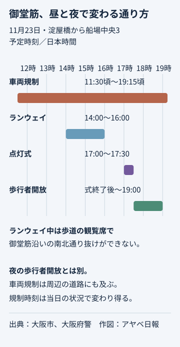
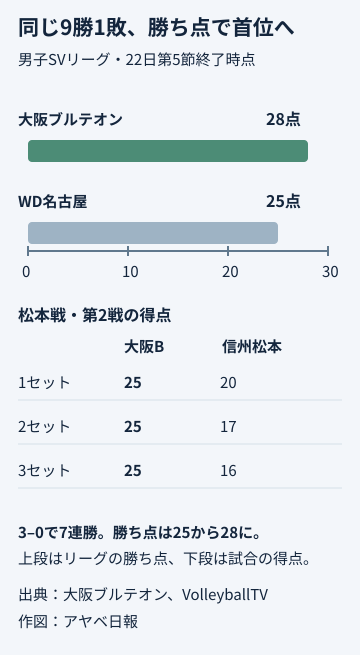
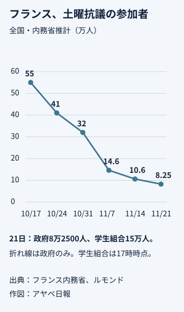

# アヤベ日報　2026年11月23日（月）

本紙 · 24記事 · 図解3点　情報確認 2026-11-23T07:46:45+09:00

## 今朝の読みどころ

- 北塩原の孤立は解消、停電・断水は別の復旧段階に
- きょう御堂筋は「見る時間」と「歩ける時間」が違う
- COP31、化石燃料を巡り包括合意なしで閉幕

## 01　北塩原の孤立は解消、停電・断水は別の復旧段階に

大雪による倒木などで道路が通れなくなっていた福島県北塩原村で、22日午後6時、国道459号と県道の一部区間で通行が再開しました。県の第3報は、10集落の514世帯948人の孤立が解消したとしています。前号が伝えた孤立人数には宿泊客も含まれていたため、948人はその総数を訂正した数字ではなく、県が確認した集落住民の数です。

道路が開いたことと、地区の生活が元に戻ったことは別です。同じ午後6時時点で、県は北塩原村の停電を約900軒、村内のレイクウッド付近の断水を20世帯と記載しています。県の資料は停電を軒数、断水を世帯数で示しており、別の影響を数えています。

村が午後7時に更新した案内では、大型車も通れますが、一部は片側通行です。米沢猪苗代線の早稲沢から狐鷹森の区間は引き続き通行止めとしています。毎日新聞によれば、22日には県の防災ヘリが水や食料を運びました。

村は23日午前8時半から裏磐梯合同庁舎で非常食と飲料水を再配布する予定です。孤立解消は物資や人の往来を戻す節目ですが、ここから確認すべきなのは、停電・断水の解消と残る通行制限です。数字は22日夕方の公表時点で、今朝も同数という意味ではありません。

出典：福島県・被害状況第3報 ／ 北塩原村・22日19時更新 ／ 毎日新聞・孤立解消と物資輸送

**出典**

- [福島県・被害状況第3報](<https://www.bousai.pref.fukushima.lg.jp/data/damage/pdf/216.pdf>)
- [北塩原村・22日19時更新](<https://www.vill.kitashiobara.fukushima.jp/soshiki/0/10352.html>)
- [毎日新聞・孤立解消と物資輸送](<https://home.kingsoft.jp/news/news/mainichi/20261122k0000m040162000c.html>)

## 02　きょう御堂筋は「見る時間」と「歩ける時間」が違う

大阪市中心部の御堂筋では23日、淀屋橋交差点から船場中央3交差点までの区間で、14時から16時まで「御堂筋ランウェイ」、17時から17時半までイルミネーション点灯式が予定されています。ともに同じ区間を使いますが、14時の催しと17時の式は別です。大阪市の20日更新では、点灯式のステージは北浜3交差点付近と案内しています。

車両規制の予定は11時半ごろから19時15分ごろまでで、御堂筋に加え御霊筋や心斎橋筋など周辺道路にも及びます。車が入れない時間が、そのまま歩きやすい時間になるわけではありません。大阪府警によると、ランウェイ開催中は歩道が観覧場所となり、会場区間を歩道で南北に通り抜けることもできません。

車道を歩行者に開放するのは17時半ごろの点灯式終了後から19時までの予定です。催しの観覧ではなく南北に移動するために出かけるなら、開催中は会場沿いを通り抜ける前提で動かず、周辺を含む現地の規制案内を確認する方が確実です。

大阪シティバスは8号系統を両方向とも一部運休すると案内しています。警察は進行状況などで規制時間が前後する場合があるとしており、終了予定時刻を車の通行再開が保証される時刻とは扱えません。

車で通れない時間と、車道を歩ける時間は違います。昼の歩道は観覧席となります。 自作図：アヤベ日報。データ・研究の出典は下記リンク。

出典：大阪市・ランウェイ概要と交通規制 ／ 大阪市・11月20日更新の点灯式 ／ 大阪府警・歩行者と車両の規制 ／ 大阪シティバス・運行変更 ／ 大阪消費者協会・交通規制案内

**出典**

- [大阪市・ランウェイ概要と交通規制](<https://www.city.osaka.lg.jp/hodoshiryo/keizaisenryaku/0000687509.html>)
- [大阪市・11月20日更新の点灯式](<https://www.city.osaka.lg.jp/keizaisenryaku/page/0000692029.html>)
- [大阪府警・歩行者と車両の規制](<https://www.police.pref.osaka.lg.jp/topics/25132.html>)
- [大阪シティバス・運行変更](<https://citybus-osaka.co.jp/notice/261109/>)
- [大阪消費者協会・交通規制案内](<https://shohisha.jp/2026/11/18/midosuji-runway-traffic-20261123/>)

## 03　COP31、化石燃料を巡り包括合意なしで閉幕

トルコ南部アンタルヤで開かれた国連気候変動会議（COP31）は22日、会期を2日延ばしても、今後の対策全体の方向を示す包括文書を採択できずに閉幕しました。21日号で伝えたのは交渉が延長に入った段階です。その後、開催国トルコと交渉を主導したオーストラリアが新たな草案を示しましたが、欧州連合（EU）やパナマなどの反対を受け、全体会合でまとまりませんでした。

最終草案が認めたのは、世界の気温上昇が産業革命前に比べて1.5度を超える軌道にあることでした。一時的に上限を超えた後に気温を下げるため、大気中の二酸化炭素を取り除く技術の開発を急ぐことも求めました。一方、化石燃料からの脱却を直接には明記せず、過去の合意を参照する形にとどまりました。排出を発生源で減らす方針と、排出後に大気から除去する方針は、同じ約束ではありません。

EUを代表したアイルランドの環境相は、化石燃料に触れない文書を支持できないと説明しました。ロイターは、主要産油国などが化石燃料への言及を入れず、炭素除去を盛り込むよう働きかけたと報じています。会議は参加国のコンセンサスを前提とするため、ある側の支持を得るために表現を弱めても、別の側が受け入れるとは限りませんでした。

ただし、包括文書の不採択は、すべての個別協議が不成立だったという意味ではありません。国連気候変動枠組条約事務局のスティール事務局長は閉幕演説で、公正な移行に関する決定などがあったと説明しています。COP31で新たな包括方針がまとまらなかったことと、パリ協定や従来の決定がなくなったことは別です。

出典：UNFCCC：閉幕演説 ／ ロイター：採択断念と草案 ／ AP：閉幕後の検証

**出典**

- [UNFCCC：閉幕演説](<https://unfccc.int/news/un-climate-change-executive-secretary-simon-stiell-remarks-at-the-closing-plenary-of-cop31>)
- [ロイター：採択断念と草案](<https://www.newsweekjapan.jp/articles/-/340952>)
- [AP：閉幕後の検証](<https://apnews.com/article/climate-change-cop31-fossil-fuels-turkey-f571df2b9d6dc6fd6b4b991e988c3bdd>)

## 04　日欧の探査機が水星を周回、予定より短かった噴射を調査

欧州宇宙機関（ESA）は日本時間22日、日欧の探査機2機が連結したまま水星の周回軌道に入ったと明らかにした。AP通信によると、地上の管制チームは通信が戻った後、探査機から届いたデータを調べて周回を確認した。前日号が伝えたのは投入操作の予定で、今回は水星にとどまったことが確認された。

一方、ロイターによると、ESAはソフトウェアの問題で推進器の噴射が予定より短くなったと説明した。機体は安全で、運用チームが何が起きたかを調べているという。水星の重力に捕まったかどうかと、計画どおりの軌道調整を終えたかどうかは別だ。

ESAの従来計画では、日本の磁気圏探査機「みお」と欧州の表面探査機MPOを12月9〜10日に分離し、2027年4月に科学観測に入る。今回の事象で分離日や観測開始が変わるか、この朝までに確認した発表では分からない。

出典：AP通信：地上での周回確認 ／ 時事通信：日本時間22日の周回確認 ／ ロイター：ESAの噴射時間に関する説明 ／ ESA：到着後の従来日程

**出典**

- [AP通信：地上での周回確認](<https://apnews.com/article/mercury-bepicolombo-space-planet-esa-0c80bbf2039ed4f6ee4a34426b3594a0>)
- [時事通信：日本時間22日の周回確認](<https://forincs.com/headlinet.php?src=soc/2026112200286.xml>)
- [ロイター：ESAの噴射時間に関する説明](<https://www.streetinsider.com/Reuters/Spacecraft%2Bbegins%2Borbit%2Bof%2BMercury%2C%2Bwith%2Ba%2Bglitch%2Breported/27383078.html>)
- [ESA：到着後の従来日程](<https://www.esa.int/articles/about-us/directorates/science/bepicolombo/latest-updates-bepicolombo-s-arrival-at-mercury>)

## 05　韓国の教育相が辞任 入試の直前変更と、不正疑い111件を分けて読む

韓国の崔教鎮（チェ・ギョジン）教育相は22日、19日の大学修学能力試験（通称スヌン）を前に、AIを使う不正を防ぐための規則変更が相次いで混乱を招いたとして辞意を表明しました。李在明（イ・ジェミョン）大統領は約1時間後に受理したと、大統領府の説明を聯合ニュースとSBSが報じました。

大臣が責任を取った対象は、試験当日にAI不正が何件確認されたかだけではありません。持ち込み品や服装への対応が直前まで変わり、受験生も監督する側も準備し直す必要が生じました。韓国では大学入試が進学や就職に大きく関わり、英語のリスニング中に航空機の運航を制限するなど、社会全体で受験環境を整えてきた経緯があります。

聯合ニュースが教育部の発表として伝えた111件は、試験中に把握した電子機器をめぐる不正の疑いです。すべてが生成AIを使ったと確認されたわけではなく、後から調べる対象とも区別が必要です。首相室は20日に省庁横断の対策チームを立ち上げ、試験終了後も疑い事案を調べる方針を示しました。

李大統領は22日、問題の撮影・外部送信を技術的に防止する措置の法的根拠を整え、流出した場合に出所を追えるよう試験問題に識別用の印を付ける案の検討も指示すると表明しました。個々の不正を確認してから処分する取り組みと、次の試験で受験生が何を守ればいいか早く確定して知らせる仕組みは、両方を整える必要があります。

出典：聯合ニュース：辞任受理と教育部発表 ／ SBS：大統領府の説明 ／ 韓国大統領府：22日の追加対策 ／ 韓国首相室：事後調査 ／ AP：全国入試の背景

**出典**

- [聯合ニュース：辞任受理と教育部発表](<https://en.yna.co.kr/view/AEN20261122001051315>)
- [SBS：大統領府の説明](<https://news.sbs.co.kr/english/article.do?news_id=N1008857693>)
- [韓国大統領府：22日の追加対策](<https://www.president.go.kr/social-media/96DfUYVL>)
- [韓国首相室：事後調査](<https://www.opm.go.kr/opm/news/press-release.do?articleNo=164260&attachNo=157973&mode=download>)
- [AP：全国入試の背景](<https://apnews.com/article/south-korea-exam-cheating-ai-college-e25b5612dbf4bd09fdf9197254c4547e>)

## 06　大阪ブルテオン、松本に連日の3–0で首位へ

大同生命SVリーグ男子の大阪ブルテオンは22日、ホームで信州松本トライデンツと対戦し、25–20、25–17、25–16のストレート勝ち。21日の第1戦に続いてセットを落とさず、7連勝とした。1セット目の5点差から、第2、第3セットは8点差、9点差と差を広げた。

勝った数はどちらも九つなのに、なぜ大阪が上なのか。今節を終え、大阪とウルフドッグス名古屋はともに9勝1敗で勝率が並んだ。次の比較となる勝ち点で大阪が28、名古屋が25。前号時点では大阪が第1戦に勝っても勝率で名古屋に届いていなかったが、第2戦の勝利で並び、勝ち点差が順位に表れた。

ティリ監督は試合後、アタックの決定率の高さとディフェンスを評価した。連日の3–0でも、内訳を見ると第2戦は第3セットが最も点差の開いたセットだった。次は28・29日にアウェーでヴォレアス北海道と対戦する。首位は今節を終えた時点の順位で、レギュラーシーズンの最終順位ではない。

同じ勝率でも勝ち点に3点差がつきました。下のセットごとの得点とは別の数字です。 自作図：アヤベ日報。データ・研究の出典は下記リンク。

出典：大阪ブルテオン・第2戦結果と試合後コメント ／ スポーツしらべ・22日の結果と順位 ／ 大阪ブルテオン・試合日程 ／ 大阪ブルテオン公式：第5節終了時の順位 ／ Volleyball TV：第5節の試合結果

**出典**

- [大阪ブルテオン・第2戦結果と試合後コメント](<https://www.osaka-bluteon.com/game/result/detail/12>)
- [スポーツしらべ・22日の結果と順位](<https://svleague.sports-shirabe.com/2026/11/22/gunma-aichi-toyama-osaka-result-20261122/>)
- [大阪ブルテオン・試合日程](<https://www.osaka-bluteon.com/schedule/>)
- [大阪ブルテオン公式：第5節終了時の順位](<https://www.osaka-bluteon.com/>)
- [Volleyball TV：第5節の試合結果](<https://volleyballtv.net/ja/league/japan-sv-league-men/2026-2027/week/5>)

## 07　福間香奈が倉敷藤花12連覇、連盟は来春の棋戦運営を調整

将棋の福間香奈倉敷藤花は21日、岡山県倉敷市で大山名人杯倉敷藤花戦三番勝負の第2局に臨み、挑戦者の宮澤紗希女流二段を107手で破った。2勝0敗で防衛し、倉敷藤花は12期連続、通算17期目。女王、女流王座、女流王位と合わせて四冠を維持した。

対局後の会見で福間は第2子の妊娠を公表した。日本将棋連盟は、来年4〜6月に予定するマイナビ女子オープンと女流王位戦で、タイトル保持者の福間がどう対局できるか、両棋戦の委員会で日程や会場などを調整していると発表。あらかじめ本人から報告を受けて主催者と協議しており、健康・安全と本人の意思、対局の公平性の両立を掲げた。

個々の棋戦の調整と、連盟全体の規定の見直しは別に進む。共同通信によると、福間は2024年の出産時に一部タイトル戦で不戦敗となり、妊娠・出産と対局日程が重なった場合の規定の見直しを求めていた。旧規定は削除され、新規定の策定は作業中。今回発表されたのは二つの棋戦で調整に入ったことまでで、日程変更や新ルールが決まったわけではない。

出典：日本将棋連盟・倉敷藤花戦結果 ／ 日本将棋連盟・本人の発表を受けた今後の対応 ／ 共同通信・会見と制度見直しの経緯

**出典**

- [日本将棋連盟・倉敷藤花戦結果](<https://www.shogi.or.jp/news/view.php?id=2633b7a91c727106>)
- [日本将棋連盟・本人の発表を受けた今後の対応](<https://www.shogi.or.jp/news/view.php?id=3bc0f50ad4f6bfeb>)
- [共同通信・会見と制度見直しの経緯](<https://www.kumanichi.com/articles/2060545>)

## 08　首里城正殿、完成式を経てきょう正午から一般公開

沖縄の首里城で22日、2019年の火災で焼失した正殿の復元完成式が行われました。7年ぶりに戻った正殿は、きょう23日正午から一般公開されます。国の式典が実際に行われたことと、一般の人が入れる日時が確定していることが、式典前にお伝えした前号からの更新です。

初日の正殿内部は、首里城公園の21日付案内で予約枠が満員です。予約を持たない場合でも、有料区域の入場券で正殿の外観などは見られますが、内部には入れません。公園は初日の駐車場も利用不可と案内しています。復元された建物を見ることと、予約して内部に入ることは別です。

出典：首里城公園・初日入場と交通の案内 ／ AP・22日の復元完成式

**出典**

- [首里城公園・初日入場と交通の案内](<https://oki-park.jp/shurijo/information/detail/11539>)
- [AP・22日の復元完成式](<https://apnews.com/article/japan-okinawa-ryukyu-history-castle-3ac5a220df1efa2be0a6d32529518314>)

## 09　関文科相のパーティー問題、官房長官が説明求め、国民民主代表は問責に言及

関芳弘文部科学相の政治資金パーティーを巡り、木原稔官房長官は22日、関氏本人が十分に説明することが重要だと述べました。省庁職員を招いた回数について関氏が当初の2回から5回に訂正したことを受け、国民民主党の玉木雄一郎代表は同日、参院の問責決議案の提出に値するとの認識を示しました。

前号で報じた自民党・鈴木幹事長の発言は、閣僚交代の可能性に関するものでした。これに対し、テレビ朝日によると、木原氏は鈴木氏の発言について、個別の人事に関する発言ではないと説明しました。閣僚交代が決まったわけでも、問責決議案が提出・可決されたわけでもありません。

出典：TBS・木原、玉木両氏の22日の発言 ／ テレビ朝日・木原氏の人事発言 ／ KAB（ANN系列）・23日朝の報道

**出典**

- [TBS・木原、玉木両氏の22日の発言](<https://newsdig.tbs.co.jp/articles/-/3104333>)
- [テレビ朝日・木原氏の人事発言](<https://news.tv-asahi.co.jp/news_politics/articles/000549876.html>)
- [KAB（ANN系列）・23日朝の報道](<https://www.kab.co.jp/news/article/17072455>)

## 10　柏崎刈羽原発の敷地内工事で作業員死亡、発電所内の工事を中止

東京電力の柏崎刈羽原発で22日、新事務本館の建設に携わっていた協力会社の作業員が死亡しました。東電によると、事故は午前11時40分ごろ、事務本館建設現場の屋外で発生。作業員が資材の荷をほどく途中、ガラスが荷崩れし、病院に搬送された後、死亡が確認されました。

東電は安全が確認されるまで、発電所内で行っている全ての工事を中止すると発表しました。事故現場は事務本館の建設工事で、発表中の「工事中止」は原子炉の運転を停止したという意味ではありません。荷崩れの詳しい経緯は調査中です。

出典：東京電力・22日の事故と工事中止 ／ UX新潟テレビ21・22日夜の報道

**出典**

- [東京電力・22日の事故と工事中止](<https://www.tepco.co.jp/niigata_hq/data/press/pdf/2026/2026112201p.pdf>)
- [UX新潟テレビ21・22日夜の報道](<https://news.livedoor.com/article/detail/32877205/>)

## 11　連続企業爆破事件の益永利明死刑囚、拘置中に死亡

法務省は22日、益永利明死刑囚が東京拘置所での収容中に死亡したと明らかにしました。78歳でした。1970年代の連続企業爆破事件を巡り、1987年に死刑が確定していました。

報道によると、今回の死亡は刑の執行によるものではありません。FNNは法務省の発表に基づき、死刑が確定して収容されている人は今回の死亡後に99人になったと報じています。

出典：熊本日日新聞（共同）・法務省発表 ／ FNN・死刑確定時期と死亡公表

**出典**

- [熊本日日新聞（共同）・法務省発表](<https://www.kumanichi.com/articles/2060748>)
- [FNN・死刑確定時期と死亡公表](<https://www.fnn.jp/articles/-/1157343>)

## 12　飛鳥・藤原の世界遺産登録を記念、ブルーインパルスが奈良で展示飛行

22日、航空自衛隊のブルーインパルスが奈良県内で展示飛行しました。奈良テレビによると、県内での展示飛行は10年ぶりで、石舞台古墳などの上空を通り、平城宮跡では約20分間の演技が披露されました。奈良基地の開庁70周年と「飛鳥・藤原の宮都」の世界文化遺産登録を記念した行事です。

世界遺産への登録はこの日の出来事ではなく、7月26日に決定しています。県によると、資産は明日香村、桜井市、橿原市の計19件。宮殿や役所、寺院、古墳の跡から古代国家の形が整っていった過程を伝える遺跡群です。

出典：奈良テレビ・22日の展示飛行 ／ 奈良県・世界遺産登録と構成資産

**出典**

- [奈良テレビ・22日の展示飛行](<https://www.naratv.co.jp/tvnnews/detail.html?id=48477537494a68664b2f4a6852392f7778654d6f57413d3d>)
- [奈良県・世界遺産登録と構成資産](<https://www.pref.nara.lg.jp/n002/p151340.html>)

## 13　中国・韓国産のめっき鋼板に5年の上乗せ関税、審議会が答申

財務省の関税・外国為替等審議会は20日、中国・韓国産の溶融亜鉛めっき鋼帯・鋼板に、不当廉売関税を5年間課すことが適当だと答申しました。普通の関税に上乗せする税率は、中国が原則55.3％、韓国は原則38.0％。生産企業に応じて低い税率を設ける案です。

8月に始まった暫定課税と同じ税率で、今回はその先の5年間の課税を支持する意見です。財務省の調査は、廉売された輸入品が国内産業に実質的な損害を与えたと判断しました。本課税としての発効とは別の段階で、対象は指定された鋼帯・鋼板に限られ、中国・韓国の鋼材や製品の全般に税が上乗せされるわけではありません。

出典：財務省・11月20日答申 ／ 財務省・対象、税率、期間 ／ 日本時事新聞・答申報道

**出典**

- [財務省・11月20日答申](<https://www.mof.go.jp/about_mof/councils/customs_foreign_exchange/sub-of_customs/report/20261120a_toushin.html>)
- [財務省・対象、税率、期間](<https://www.mof.go.jp/about_mof/councils/customs_foreign_exchange/sub-of_customs/proceedings_tokusyu/material/20261120/kanb20261120siryo1-1.pdf>)
- [日本時事新聞・答申報道](<https://jpjj.jp/articles/galvanized-steel-antidumping-duty-korea-china/>)

## 14　フランスの生活費デモ、6週目は政府集計8万2500人

フランスで21日、生活費高騰に抗議する土曜日のデモが6週連続で行われました。労働組合、若者の団体、「黄色いベスト」運動などが呼びかけ、内務省は全国112件の行動に8万2500人、うちパリに2万1500人が参加したと発表しました。前週14日の全国10万6000人を下回りました。

一方、ルモンドによると、学生組合は21日17時時点の参加者を全国15万人、パリ4万5000人と推計しました。公表主体や集計時点が違うので、両者の数字は足したり、異なる主体の数字を前週と比べたりできません。内務省が示した18時時点の拘束者144人は、参加者数とは別の速報値です。

政府推計の同じ系列だけを折れ線にしました。学生組合の同日推計は別に記しました。 自作図：アヤベ日報。データ・研究の出典は下記リンク。

出典：フランス内務省：6回の政府集計 ／ ルモンド：学生組合推計と現場

**出典**

- [フランス内務省：6回の政府集計](<https://www.interieur.gouv.fr/actualites/communiques-de-presse/bilan-de-mobilisation-du-21-novembre-2026>)
- [ルモンド：学生組合推計と現場](<https://www.lemonde.fr/videos/video/2026/11/21/manifestations-du-21-novembre-retour-sur-les-manifestations-qui-ont-rassemble-entre-80-000-et-150-000-personnes-en-france_6814065_1669088.html>)

## 15　台湾の地方選まで1週間 台北で国民党と民進党が集会

台湾で28日に投開票される統一地方選を前に、最後の日曜日となった22日、台北市長選の両陣営が支持を訴えました。共同通信によると、野党・国民党の現職、蒋万安氏は集会でインフラ整備の実績を強調し、与党・民進党の沈伯洋立法委員の陣営は街頭イベントを行いました。世論調査の見方は分かれています。

全域22県市の首長を選ぶ地方選は、頼清徳政権への評価や2028年総統選への影響という観点からも注目されます。ただし、今回選ぶのは地方の役職で、総統の当落を決める投票ではありません。中央選挙委員会の説明によると、28日には全国住民投票も別に実施されます。

出典：共同通信：22日の台北の集会 ／ 台湾中央選挙委員会：28日の投票

**出典**

- [共同通信：22日の台北の集会](<https://www.kumanichi.com/articles/2060788>)
- [台湾中央選挙委員会：28日の投票](<https://www.ey.gov.tw/File/ED4151F1E591AAE6?A=C>)

## 16　フィンランド湾で火災のロシア貨物船、えい航で領海外へ

フィンランド湾で21日に攻撃を受けて火災が起きたロシア貨物船スパルタIIについて、22日にロシアの救助船がえい航を始め、フィンランド領海を離れました。現地メディアのデーリー・フィンランドが同国国境警備隊の説明として伝えています。

国境警備隊は21日、同船がロビーサ沖に停泊し、消火と救助対応を続けていると発表していました。ロイターはフィンランドとエストニアが消火を助けたと報道。船が領海を離れることと、同国の海難救助の担当海域を出て対応の指揮が移ることは別段階です。攻撃主体については、ここでは断定しません。

出典：フィンランド国境警備隊：21日の救助発表 ／ デーリー・フィンランド：22日の領海離脱 ／ ロイター：消火とえい航

**出典**

- [フィンランド国境警備隊：21日の救助発表](<https://www.epressi.com/tiedotteet/turvallisuus/the-finnish-border-guard-continues-to-lead-the-rescue-operations-in-the-gulf-of-finland..html?c=Urheilu>)
- [デーリー・フィンランド：22日の領海離脱](<https://www.dailyfinland.fi/national/52410/Russian-cargo-vessel-Sparta-II-leaves-Finland>)
- [ロイター：消火とえい航](<https://new.streetinsider.com/Reuters/Russian%2Bship%2Bhit%2Bby%2Bdrones%2Bin%2BBaltic%2Bstill%2Bsmoulders%2Bas%2BFinland%2C%2BEstonia%2Bhelp%2Bput%2Bout%2Bblaze/27383009.html>)

## 17　ロヒンギャ判決、マレーシアが国連・ASEANとの協議方針

マレーシア外務省は22日、ミャンマーが少数民族ロヒンギャに対するジェノサイド（集団殺害）を行ったと認定した国際司法裁判所（ICJ）の判断を尊重すると表明しました。国連、イスラム協力機構（OIC）、東南アジア諸国連合（ASEAN）などと、判決から生じる課題について協議する考えです。

20日号では19日の判決を、21日号ではミャンマー政権などの反応を伝えました。今回は周辺国がどの枠組みで対応を話し合うかを明らかにした点が新しい動きです。協議方針の公表であり、新たな受け入れや帰還の実施が決まったわけではありません。

出典：The Star：外務省声明 ／ ANTARA：協議枠組み

**出典**

- [The Star：外務省声明](<https://www.thestar.com.my/news/nation/2026/11/22/malaysia-respects-icj-judgment-in-myanmar-genocide-case>)
- [ANTARA：協議枠組み](<https://www.antaranews.com/berita/5870619/malaysia-hormati-putusan-icj-soal-rohingya>)

## 18　フィリピン入管、特殊詐欺の疑いで日本人9人を含む17人拘束と発表

フィリピン入管当局は22日、詐欺に関わった疑いでマニラ首都圏パサイ市の拠点を20日に摘発し、日本人9人を含む17人を拘束したと発表しました。共同通信が伝えました。FNNは、フィリピンの入管当局と日本の警察庁が連携したと報じています。

当局の説明では、宅配業者や警察官へのなりすましを使って金銭をだまし取った疑いがあります。拘束は容疑が確定したことを意味しません。警察などを名乗る突然の連絡で送金を求められたら、その相手が示した番号ではなく、公式に公開された連絡先から確認することが大切です。

出典：共同通信：入管当局の22日発表 ／ FNN：20日の摘発と日比連携

**出典**

- [共同通信：入管当局の22日発表](<https://news.livedoor.com/article/detail/32874509/>)
- [FNN：20日の摘発と日比連携](<https://www.fnn.jp/articles/-/1156785>)

## 19　大の里が決定戦を制し7度目の優勝

大相撲九州場所は22日に千秋楽。横綱大の里は本割で横綱豊昇龍を押し出し、平幕若元春も関脇熱海富士を突き落として、ともに13勝2敗。優勝決定戦では大の里が渡し込みで若元春を破り、2場所連続7度目の優勝を飾った。

前日まで優勝の可能性があった熱海富士は11勝4敗で殊勲賞、若元春は技能賞を受賞。大の里の連覇は横綱昇進後では初めてとなった。

出典：日本相撲協会・優勝力士と三賞 ／ 共同通信・千秋楽の取組と決定戦

**出典**

- [日本相撲協会・優勝力士と三賞](<https://www.sumo.or.jp/ResultData/champions/?C=M%3BO%3DD>)
- [共同通信・千秋楽の取組と決定戦](<https://www.oita-press.co.jp/1004000000/2026/11/22/NP2026112201000841>)

## 20　釜山のゲーム展「G-STAR」閉幕、主催者推計20万1000人

韓国・釜山の国際ゲーム展「G-STAR 2026」が22日、4日間の日程を終えた。聯合ニュースが主催団体の発表として報じた来場者推計は約20万1000人。前年の約20万2000人に近く、閉幕時の集計では42カ国の1294社が参加し、3445ブースを展開した。

第2展示場では現代自動車がレースゲーム「グランツーリスモ7」の大会決勝を開き、インディーゲームの展示には250ブースが使われた。組織委員会は、全入場枠を事前予約制とし、第2展示場の展示を広げるなどして、来場者が会場全体に分散したと説明している。

出典：聯合ニュース・閉幕時の集計と展示内容 ／ 釜山観光公社・開催案内

**出典**

- [聯合ニュース・閉幕時の集計と展示内容](<https://www.yna.co.kr/view/AKR20261122045400017>)
- [釜山観光公社・開催案内](<https://www.visitbusan.net/schedule/view.do?boardId=BBS_0000009&dataSid=6453&menuCd=DOM_000000204012000000>)

## 21　F1ラスベガス、フェルスタッペンが0.639秒差で制す

自動車レースF1のラスベガス・グランプリ決勝は現地21日（日本時間22日）に行われ、レッドブルのマックス・フェルスタッペンが優勝した。マクラーレンのランド・ノリスが0.639秒差の2位、オスカー・ピアストリが1.529秒差の3位だった。

先頭を争ったメルセデス勢は終盤に後退。ジョージ・ラッセルはブレーキングでタイヤをロックさせてバリアに当たり、コースに戻ったが9位。キミ・アントネッリは4位で、マクラーレンの2台が表彰台に上がった。

出典：FIA・決勝結果とレース経過 ／ F1公式・決勝レポート

**出典**

- [FIA・決勝結果とレース経過](<https://api.fia.com/news/f1-verstappen-wins-action-packed-las-vegas-grand-prix-late-mercedes-drama-delivers-mclaren>)
- [F1公式・決勝レポート](<https://www.formula1.com/en/latest/article/verstappen-wins-exhilarating-las-vegas-grand-prix-from-norris-and-piastri.2eeBWqekZdir9mdDVK9YVX>)

## 22　新人お笑い尼崎大賞、漫才・コント等の部はシャガール

第27回新人お笑い尼崎大賞は22日、漫才・コント等の部の本選を開き、漫才のシャガールが大賞に選ばれた。優秀賞は11件目のおつかいメール、奨励賞はレ点。尼崎市総合文化センターの公式結果によると、シャガールは同賞の第26回で優秀賞だった。

同賞は尼崎から活動を広げる新人を後押しするための賞で、予選は映像審査。今回は22日に開かれた漫才・コント等の部の結果で、別部門の落語の結果ではない。

出典：尼崎市総合文化センター・第27回結果と第26回の受賞歴

**出典**

- [尼崎市総合文化センター・第27回結果と第26回の受賞歴](<https://www.archaic.or.jp/event/owarai/>)

## 23　GeForceの過剰な書き込みに暫定修正、NVIDIAは正式版への反映も予告

NVIDIAがWindows 10／11の64ビット版向けに、GeForceの暫定ドライバー「621.35」を公開した。同社の20日付サポート情報は、バックグラウンドでログファイルへの書き込みが過剰になることがあると説明。22日には専門媒体HotHardwareも、最近のドライバーで利用者から報告されていた問題に対する修正だと報じた。

今回の配布は対象を絞った任意のベータ版で、正式版と同じ検証を経たものではない。NVIDIAは次回の正式ドライバーにも修正を取り込むとしている。どの環境でも書き込みが止まるか、実際にストレージの寿命へどれほど影響したかは、今回の告知では示されていない。

出典：NVIDIA・621.35暫定修正の告知 ／ HotHardware・22日の報道

**出典**

- [NVIDIA・621.35暫定修正の告知](<https://nvidia.custhelp.com/app/answers/detail/a_id/5940>)
- [HotHardware・22日の報道](<https://hothardware.com/news/nvidia-hotfix-driver-62135-stops-gpus-from-thrashing-your-ssd>)

## 24　Google、米国で検索・Geminiと食料品店の連携を拡大

Googleは20日、米国向けの検索とGeminiアプリで、アルバートソンズやターゲットなど4つの食料品店の連携を順次追加すると発表した。商品の候補を選ぶだけでなく、注文を組み立てて決済に進む用途を見込む。今回の告知対象は米国で、日本での同時提供は発表されていない。

検索側には、Geminiアプリで先行していたExperianの信用情報関連機能も順次提供する。米H&amp;R Blockの税額・還付の試算についても、公式発表が挙げている提供先は検索だ。Geminiの作業代行が無料利用者に広がった件とは異なり、今回はサービスごとに使える窓口や地域が違う。

出典：Google公式・追加の連携先と対象地域 ／ Android Authority・連携内容の報道

**出典**

- [Google公式・追加の連携先と対象地域](<https://blog.google/products-and-platforms/products/search/connected-apps-holiday-errands/>)
- [Android Authority・連携内容の報道](<https://www.androidauthority.com/new-gemini-connected-apps-2-3737790/>)
