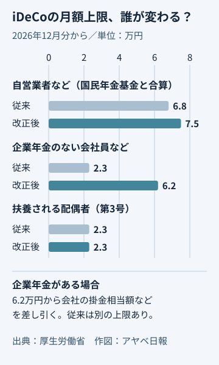
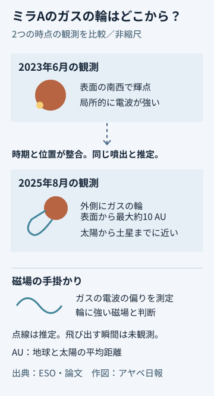

# アヤベ日報　2026年11月24日（火）

本紙 · 27記事 · 図解2点　情報確認 2026-11-24T07:44:01+09:00

## 今朝の読みどころ

- 首都直下地震の対策本部、東京圏外の代替を検討へ 共同報道
- EU、ロシア約60銀行を追加制裁案に 発効には27加盟国の同意
- 常陸大宮で「核のごみ」の初の市民説明会、次の調査には県・市の意見

## 01　首都直下地震の対策本部、東京圏外の代替を検討へ 共同報道

首都直下地震に備え、国の緊急災害対策本部を東京圏外に置く選択肢を政府が検討する方針だと、共同通信が23日夜、関係者への取材で報じました。現行の政府業務継続計画（BCP）では、首相官邸が使えない場合に、中央合同庁舎第8号館、防衛省、立川広域防災基地の順で移るとしています。いずれも東京都内です。

新たな検討は、この3拠点を廃止するものではありません。共同通信によれば、まず現行の候補を残したうえで、副首都を含む東京圏外の拠点を検討する方針をBCPに盛り込み、その後、副首都の指定に向けた動きなどを踏まえて再改定し、代替拠点を定めるという二段階です。今回の報道は、移転先が大阪などに決まったという意味ではありません。

政府が6月に変更した首都直下地震の基本計画は、東京圏で中枢機能を保てなくなる事態も想定して、代替拠点を検討すると明記しました。それは基本方針で、今回はその方針を、政府がどこで緊急対策を続けるかという業務計画に落とし込む動きです。

「副首都」は災害時の首都機能の代替などを担う制度ですが、緊急災害対策本部を置く場所と、政府の各部門や国会の機能をどこが引き継ぐかは同じ問いではありません。今後確認したいのは、拠点名だけでなく、本部を切り替える条件と、移動が難しい場合でも指揮を続ける手順が具体化されるかです。

出典：共同通信・23日夜の関係者取材 ／ 防災庁・6月の基本計画変更概要 ／ 衆院議事録・現行代替拠点と副首都の関係

**出典**

- [共同通信・23日夜の関係者取材](<https://news.livedoor.com/article/detail/32882217/>)
- [防災庁・6月の基本計画変更概要](<https://www.bousai.go.jp/jishin/syuto/pdf/syuto_keikaku_henkou1_20260612.pdf>)
- [衆院議事録・現行代替拠点と副首都の関係](<https://www.shugiin.go.jp/internet/itdb_kaigiroku.nsf/html/kaigiroku/033022120260701010.htm>)

## 02　EU、ロシア約60銀行を追加制裁案に 発効には27加盟国の同意

欧州委員会は23日、ロシアによるウクライナ侵攻を巡る第22弾の制裁案を発表した。欧州委のフォンデアライエン委員長は、ロシアの約60銀行に取引禁止を広げ、対象行を国際銀行間の通信網SWIFTから外すと説明した。暗号資産や決済ネットワークも対象で、制裁回避に手を貸す第三国にも対策を広げる方針だ。

SWIFTは、銀行が送金の指示を伝える通信網だ。対象行がそこから外れると、参加行と同じ経路で指示をやり取りできなくなる。一方、取引禁止は、対象行と取引できるかを規制するもの。欧州委は通信と取引に別々の歯止めをかけ、さらに暗号資産など別経路にも目を向けている。ロシア向けの送金がすべて即時に止まると決まったわけではない。

金融以外では、ロシアのエネルギー施設の建設・運営・修理を支えるサービスの禁止を広げ、電力関連も初めて含める。制裁を逃れる石油輸送などに使われる「影の船団」では70隻超を追加する案だ。ロシア国旗の下での欧州のスポーツ・文化行事への参加などにも制限案がある。

これは欧州委の提案で、APによると、発効にはEU加盟27か国すべての同意が必要だ。交渉で内容や対象が変わる可能性がある。次に確認したいのは、最終的にどの銀行・決済業者・船舶が対象になり、いつから各措置が始まるかだ。

出典：欧州委員長声明：第22弾案 ／ AP：提案と27加盟国の手続き

**出典**

- [欧州委員長声明：第22弾案](<https://cyprus.representation.ec.europa.eu/news/statement-president-von-der-leyen-22nd-package-sanctions-against-russia-2026-11-23_en>)
- [AP：提案と27加盟国の手続き](<https://apnews.com/article/ecad86868390f6602b346c70d1fa5757>)

## 03　常陸大宮で「核のごみ」の初の市民説明会、次の調査には県・市の意見

茨城県常陸大宮市は23日、高レベル放射性廃棄物の処分地選びに向けた文献調査について、原子力発電環境整備機構（NUMO）と初めて市民向けの説明会を開きました。テレビ朝日によると、600人以上が参加しました。市は10月に国の申し入れを受け入れ、NUMOは10月15日に調査を始めています。

文献調査は、現地で掘削する前に、既存の地図や地質の資料を調べる段階です。説明資料では、次の概要調査へ進む際には、都道府県知事と市町村長の意見を聴き、反対があれば先へ進まないとしています。茨城県の大井川和彦知事は10月2日の会見で、文献調査の次の段階は受け入れない考えを示しました。市の文献調査の受け入れは、次の段階や処分場建設の決定ではありません。

NUMOは12月5日以降も地域を変えて説明会を続けます。説明の映像は後から公開する一方、質問した人が特定されないよう質疑応答は公開しない方針です。調査が何を確かめるかに加え、会場以外で市民が疑問を確かめる手段も、今後の説明を見るポイントです。

出典：テレビ朝日：初の市民説明会と参加者 ／ NUMO：23日の会場配布資料 ／ 茨城県：10月2日の知事会見 ／ NUMO：次回説明会と質疑公開範囲

**出典**

- [テレビ朝日：初の市民説明会と参加者](<https://news.tv-asahi.co.jp/news_society/articles/000550028.html>)
- [NUMO：23日の会場配布資料](<https://www.numo.or.jp/chisoushobun/survey_status/hitachiomiya/20261123_hitachiomiya.pdf>)
- [茨城県：10月2日の知事会見](<https://www.pref.ibaraki.jp/bugai/koho/hodo/press/19press/p261002.html>)
- [NUMO：次回説明会と質疑公開範囲](<https://www.numo.or.jp/topics/202626102015.html>)

## 04　iDeCo、12月に掛金の上限変更 月6万2千円を使えるのは誰か

私的年金のiDeCo（個人型確定拠出年金）は、12月1日に掛金の上限と加入可能年齢が変わります。共同通信が23日に近づく施行を報じました。上限が上がる人は多いものの、給与から天引きされる厚生年金とは別の制度で、全員が同じ金額を積み立てられるわけではありません。

会社員や公務員などは、iDeCoと企業年金等を合わせて月6万2千円が上限です。企業年金がない会社員のiDeCo上限は月2万3千円から6万2千円へ。企業年金がある場合は6万2千円から勤務先の企業型確定拠出年金の掛金や、確定給付企業年金などの掛金相当額を差し引きます。勤務先に企業年金があるかだけでなく、その掛金相当額がいくらかでも空き枠が変わります。

自営業者やフリーランスなどは、国民年金基金等と合わせた上限が月6万8千円から7万5千円に上がります。一方、会社員などに扶養される配偶者（国民年金の第3号被保険者）は月2万3千円のままです。同じ「7千円増」でも、どの区分の何との合計かを分けて見る必要があります。

加入年齢では、国民年金の被保険者でなくなった60歳以上70歳未満の人にも対象が広がります。原則としてiDeCoへの加入・資産の運用指図、企業年金の資産をiDeCoへ移すことのいずれかが必要ですが、2029年11月末まではこの部分に経過措置があります。老齢基礎年金やiDeCoの老齢給付金を受けていないことなど、ほかの条件は残ります。

改正後の上限まで掛金が自動で増えるわけではなく、増額には変更手続きが必要です。厚生労働省の説明資料では、12月分の引き落としは翌年1月となっています。

3区分の月額上限を同じ尺度で比較しました。企業年金がある場合はその掛金相当額などを差し引きます。 自作図：アヤベ日報。データ・研究の出典は下記リンク。

出典：厚生労働省・12月改正の上限と加入要件 ／ 厚生労働省・区分別の拠出限度額図 ／ 共同通信・23日の解説 ／ 厚生労働省：変更手続きと経過措置（日本年金機構）

**出典**

- [厚生労働省・12月改正の上限と加入要件](<https://www.mhlw.go.jp/web_magazine/column/20261020.html>)
- [厚生労働省・区分別の拠出限度額図](<https://www.mhlw.go.jp/content/12500000/001597082.pdf>)
- [共同通信・23日の解説](<https://kumanichi.com/articles/2060969>)
- [厚生労働省：変更手続きと経過措置（日本年金機構）](<https://www.nenkin.go.jp/service/riyoushabetsu/nenkiniin/kenshu/7.files/shiryou02_2026.pdf>)

## 05　米ナスダック総合6.5%高 NVIDIAはフアン氏の復帰を公表

AP通信によると、23日の米株式市場は、日本時間24日午前6時の通常取引終了時にナスダック総合が前週末比6.5%高の24,089.56、S&amp;P500が4.7%高の7,237.17、ダウ平均が3.0%高の49,595.31となりました。人工知能（AI）向け半導体のNVIDIAは31.5%上昇しました。

NVIDIAは23日、ジェンスン・フアン氏の社長・最高経営責任者（CEO）・取締役への復帰を発表した。米証券取引委員会への提出書類では取締役会の決定は22日で、暫定CEOを務めてきたコレット・クレス氏は最高財務責任者（CFO）を続ける。APによると、株価指数先物は公表前から上昇していた。AI関連株の買い戻しが目立ったが、市場全体の上昇を復帰発表だけで説明することはできない。

出典：米SEC提出書類：取締役会決定とCFO ／ NVIDIA：復帰発表 ／ AP：主要指数の終値 ／ AP：個別株と市場の反応

**出典**

- [米SEC提出書類：取締役会決定とCFO](<https://www.sec.gov/Archives/edgar/data/1045810/000104581026000090/nvda-20261122.htm>)
- [NVIDIA：復帰発表](<https://nvidianews.nvidia.com/news/nvidia-board-reinstates-jensen-huang-as-president-ceo-and-board-director>)
- [AP：主要指数の終値](<https://apnews.com/article/wall-street-stocks-dow-nasdaq-fcdf1bad36b4f81c90cbb0f33a2c5704>)
- [AP：個別株と市場の反応](<https://apnews.com/article/stocks-markets-rates-technology-ai-anthropic-49ba1beba78fa4ed2bd5898029f79c91>)

## 06　赤色巨星ミラに巨大なガスの輪、磁場で進む放出の証拠

地球から約330光年離れた赤色巨星ミラA。その表面から太陽と土星の距離ほども離れたところまで、放出されたガスの輪が伸びていることを、チリのアルマ望遠鏡が捉えました。欧州南天天文台などが23日に観測像を公開し、研究チームは天文学誌 Astronomy &amp; Astrophysics の2本の論文で、表面の急激な増光と外へ飛び出したガスの関係を報告しています。

年老いた恒星では、星の光が周囲のちりを押し、そのちりに伴ってガスがゆっくり外へ流れると説明されてきました。今回は2023年に表面の一部が急に明るくなり、2025年の観測では同じ方向に大きな輪が見えました。表面から約10天文単位という距離は、地球から太陽までの距離の約10倍です。動画で飛び出す瞬間を捉えたのではなく、時期の異なる観測をつないで放出の経緯を推定しています。

決め手の一つは、輪のガスが出す電波の偏り方です。光と同じ電磁波である電波には、振動する向きの偏りがあります。研究者は一酸化ケイ素の電波の偏りを調べ、輪に強い磁場があると判断しました。放出の規模とその磁場を合わせると、光がちりを押すだけでは説明しにくく、太陽で見られるような磁気活動に伴う噴出が、この星でも起きたと考えられます。

星が表面の物質を宇宙へ返す経路を知ることは、炭素などが次の世代の星や惑星の材料に混ざる過程を知る手掛かりにもなります。ただし、今回の像はミラAの観測です。別の赤色巨星でも磁気による噴出が主な経路なのか、通常の風とどの程度の割合で分担するのかは、これだけでは決まりません。

観測したのは時間を隔てた二つの姿です。点線は同じ現象と考える研究者の推定、模式図は非縮尺です。 自作図：アヤベ日報。データ・研究の出典は下記リンク。

出典：欧州南天天文台：23日公開の観測像と手法 ／ Vlemmingsら：噴出の論文著者版 ／ Andriantsaralazaら：表面活動の論文著者版 ／ チャルマース工科大学：研究発表

**出典**

- [欧州南天天文台：23日公開の観測像と手法](<https://www.eso.org/public/images/potw2647a/>)
- [Vlemmingsら：噴出の論文著者版](<https://arxiv.org/abs/2608.23695>)
- [Andriantsaralazaら：表面活動の論文著者版](<https://arxiv.org/abs/2608.23724>)
- [チャルマース工科大学：研究発表](<https://www.chalmers.se/en/current/news/fa-star-s-record-eruption-shows-how-key-elements-can-spread-through-space/>)

## 07　経済安保に特別会計案 日銀のETF売却益を財源に検討と共同報道

政府が経済安全保障分野に複数年度で資金を配分するため、一般会計から資金を分けて管理する特別会計を設ける方向だと、共同通信が23日に報じました。年明けの通常国会で特別会計法の改正を目指し、2027年度からの予算確保につなげる構想です。特別会計が既に設置されたわけではありません。

同報道によると、政府は日銀の上場投資信託（ETF）売却の加速で増える利益を年1兆円程度と見込み、それを返済の裏付けとする「つなぎ国債」を発行する案です。資金の流れは、日銀がETFを売る、日銀の決算を経て利益の一部が国庫に納められる、という順で、売却代金がそのまま特別会計に入るわけではありません。

日銀の資料は10月の会合で、2027年1月から年間売却ペースを簿価ベースで約3300億円から約8600億円に増やし、売却完了までを約43年と見込むと説明しています。この数字は売却のペースで、共同が報じた政府見通しの「追加売却益の年1兆円」とは別の指標です。

複数年度の投資を計画しやすくする狙いがある一方、税外収入として実際に使える額、特別会計の対象分野や支出を誰がどう点検するかは残ります。法案や会計の設計が示されて初めて、政府の見込みと制度として確定した部分を切り分けられます。

出典：共同通信・経済安保特別会計構想 ／ 日本銀行・ETF売却ペース見直し

**出典**

- [共同通信・経済安保特別会計構想](<https://www.kumanichi.com/articles/2060976>)
- [日本銀行・ETF売却ペース見直し](<https://www.boj.or.jp/about/press/koen_2026/data/ko261112a1.pdf>)

## 08　インドネシア、副大統領の候補2人を正式提出 選ぶのは国民協議会

インドネシアのプラボウォ大統領は23日、空席となっている副大統領の候補として、農相アンディ・アムラン・スライマン氏と元外相スギオノ氏の2人を国民協議会（MPR）に提出した。MPRのムザニ議長は提出された書簡を報道陣の前で開き、選出を担当する委員会が適格性の確認に入ると説明。選出と就任のための本会議は12月9日から11日に変更された。

通常の大統領・副大統領選挙では国民が正副の組み合わせに投票するが、任期途中で副大統領だけが欠けた場合は別の手続きがある。APによると、憲法は大統領が候補2人を挙げ、MPRが60日以内にその中から1人を選ぶと定める。当選者は現任期の残りを務める。今回の提出で候補は絞られたが、後任はまだ決まっていない。

空席が生じたのは12日。ジョコ・ウィドド前大統領の長男ギブラン・ラカブミン・ラカ氏が、学歴を巡る裁判所の判断を受けて資格に疑義が出るなか、辞任を申し出た。辞任と正式な後任選びは別の段階にある。今回の候補者には現職の閣僚が並び、現政権の顔ぶれから選ぶ形となった。

次の節目は候補2人の適格性の確認と12月11日のMPR本会議だ。候補間の支持の広がりは、23日の書簡提出だけでは判断できない。

出典：AP：候補と憲法上の選出手続き ／ ANTARA：議長会見と12月11日の日程 ／ Kompas：書簡の候補名

**出典**

- [AP：候補と憲法上の選出手続き](<https://apnews.com/article/2077ccdc5912be1593cb50ae1a1fb675>)
- [ANTARA：議長会見と12月11日の日程](<https://en.antaranews.com/amp/news/444755/mpr-starts-verification-of-vp-candidates-nominated-by-prabowo>)
- [Kompas：書簡の候補名](<https://go.kompas.com/read/2026/11/23/182942174/prabowo-proposes-amran-sugiono-as-vice-presidential-candidates-dasco-i-will-not>)

## 09　ChatGPTの通常チャットにGPT-6.2、Work・Codexとは別の更新

OpenAIは23日、通常のチャット用に調整したGPT-6.2を世界で順次提供し始めたと発表した。対象はPlus、Pro、Business、Enterpriseで、Enterpriseは管理者設定による。会社は、長い指示に沿った回答や、ウェブで情報を探して複数の条件を比較するような依頼を例に挙げる。対象プランで一斉に利用可能になったという意味ではない。

17日にも同じGPT-6.2名でAstraとSolが発表されたが、そちらの対象はChatGPT WorkとCodexだった。今回は日常の会話に合わせたSol系のモデルを通常チャットに展開する発表で、WorkとCodexを動かすモデルは今回変わらない。同じ名前でも、どの画面についての発表かで変更内容を見分ける必要がある。

同社が公表した通常チャットでの画像理解のテストでは、GPT-6の47.4%からGPT-6.2の71.7%へ、24.3ポイント上がった。画像付きの質問を処理する能力を測った社内評価の一つで、あらゆる画像への正答率でも、他社モデルに対する比較でもない。

出典：OpenAI・23日および17日の公式更新履歴 ／ OpenAI・通常チャット版のシステムカード

**出典**

- [OpenAI・23日および17日の公式更新履歴](<https://help.openai.com/en/articles/6825453-chatgpt-release-notes>)
- [OpenAI・通常チャット版のシステムカード](<https://deploymentsafety.openai.com/gpt-6-2-chatgpt/gpt-6-2-chatgpt.pdf>)

## 10　女子W杯2031年に初の48チーム、2035年は英4協会共催

FIFAは23日、オンラインの臨時総会で女子ワールドカップ2大会の開催地を正式に決めた。2031年は米国、メキシコ、コスタリカ、ジャマイカの4カ国。2035年はイングランド、北アイルランド、スコットランド、ウェールズの4協会が共催する。候補の発表ではなく、加盟協会による開催地選定が完了した。

2031年大会は、女子W杯で初めて48チームが出場する。FIFAによると、1991年に開かれた第1回は12チームだった。拡大初回は単一国ではなく、北米・中米・カリブ海の4協会に開催がまたがる。一方、2035年大会は英国の中にある4つのサッカー協会での共同開催で、両大会とも「4」だが、地理と大会運営の単位が異なる。

招致は2025年3月にFIFA理事会が始め、今回は拍手による承認で決まった。FIFAは大会規模と開催地を今回明示したが、この発表は試合割り当てや代表の出場確定を知らせるものではない。

出典：FIFA・臨時総会の公式発表 ／ FIFA・米国での大会開催歴と2031年の共催

**出典**

- [FIFA・臨時総会の公式発表](<https://inside.fifa.com/organisation/congress/media-releases/extraordinary-congress-appoints-hosts-2031-2035-womens-world-cup>)
- [FIFA・米国での大会開催歴と2031年の共催](<https://www.fifa.com/en/news/articles/competitions-tournaments-world-cups-hosted-united-states-usa>)

## 11　ユーロ圏の景況感は横ばい、ドイツの製造業とフランスに明暗

S&amp;Pグローバルが23日に公表した11月のユーロ圏の総合購買担当者景気指数（PMI）速報値は51.7で、10月確報と同じでした。製造業とサービス業の企業に、前月と比べて生産や営業活動がどう変わったかを聞く調査です。50は前月と変わらない節目で、51.7はGDPが1.7％伸びたという意味ではありません。活動の拡大を示す50超えは5カ月連続です。

同じ51.7でも、国ごとの動きは同じではありません。S&amp;Pによると、ドイツ企業の活動の伸びは4年半余りで最も速くなり、製造部門では5年余りで最も大きな増加になりました。対してフランスの企業活動の縮小は半年で最も大きく、ドイツとフランスの総合指数の開きは6年で最大です。ロイターは、ドイツの伸びがフランスの弱さを埋め合わせる構図だと伝えました。

企業全体の新規受注は5カ月続けて増えましたが、輸出の新規受注の伸びは3カ月で最も小さくなりました。製造業の新規受注の伸びはサービス業より強く、総合指数からは見えない差もあります。調査会社が示したユーロ圏の10〜12月期のGDP前期比約0.3％は、PMIと過去のGDPとの関係から見た目安です。四半期の公式GDPは、集計後に別に公表されます。

出典：S&amp;Pグローバル：11月速報と国・業種の比較 ／ ロイター：新規受注と国別結果

**出典**

- [S&amp;Pグローバル：11月速報と国・業種の比較](<https://www.spglobal.com/market-intelligence/en/news-insights/research/2026/11/steady-eurozone-flash-pmi-masks-widening-growth-disparities>)
- [ロイター：新規受注と国別結果](<https://www.investing.com/news/economic-indicators/euro-zone-growth-holds-steady-but-frances-deepening-downturn-clouds-outlook-pmi-shows-5044744>)

## 12　地方選の電子投票、6県が条例を整備・検討 県だけでは始められない

2027年4月の統一地方選を前に、電子投票を行うための条例を既に作ったか、実施に向けて検討している県が6つあることが、23日の共同通信の選挙管理委員会などへの取材で分かりました。香川と岐阜は制定済みで、千葉は20日に案を提出。神奈川、富山は月内の提出予定、福岡は実施に向けた検討段階です。

ここでいう電子投票は、投票所で専用の端末を使い、紙の代わりに候補者を選ぶ方式です。自宅のスマートフォンから投票する仕組みではありません。知事・県議の選挙で使うには県と、その投票所を置く市町村の両方に条例が必要です。県が条例を制定しても、県内の全投票所が一律に切り替わるわけではありません。

逆に市町村が単独で定める条例は、自らの選挙が対象です。例えば京都府亀岡市の条例は、2027年1月1日施行で、市議選と市長選を対象とします。次の統一地方選で実際にどう投票するかは、県の件数ではなく、住んでいる市町村でどの選挙に実施するかまで見て分かります。

出典：共同通信：6県の整備状況と二段階の条例 ／ 香川県議会：電子投票条例案の可決 ／ 亀岡市：市議・市長選の条例

**出典**

- [共同通信：6県の整備状況と二段階の条例](<https://www.kobe-np.co.jp/news/zenkoku/compact/202611/0021065019.shtml>)
- [香川県議会：電子投票条例案の可決](<https://www.pref.kagawa.lg.jp/gikai/jyoho/giketsu/0806_t01.html>)
- [亀岡市：市議・市長選の条例](<https://www.city.kameoka.kyoto.jp/reiki_int/reiki_honbun/k108RG00001538.html>)

## 13　観光地の渋滞を避けるナビ、滋賀・高島で生活道路に車が集中

滋賀県高島市のメタセコイア並木は約2.4キロに約500本の木が並び、紅葉の時期は車が集中します。24日朝に公開された関西テレビの取材では、観光地から離れた細い集落の道にも車列ができ、住民が日常の出入りをしづらくなったといいます。

取材班がスマートフォンのナビを試すと、空いていた平日の案内では集落を通らず、本来の道路が混んだ休日は細い道を経由しました。一台が早く着くために選ぶルートを多くの車が使うと、車をさばききれない生活道路に待ち時間が移ることがあります。現地の実験はこの経路を示す一例で、渋滞の原因がナビだけだったことまで確認したものではありません。

市は連休初日から入口に誘導員を置き、観光車両が入らないようにしました。地図の事業者などにも、この道を迂回路として案内しないよう申し入れています。市は関西テレビに、連休中は集落で渋滞が発生しなかったと説明しました。市が告知した通行規制は12月6日までの土曜・日曜・祝日の9時から17時半です。連休の報告だけでは、規制を終えた後も効果が続くかは分かりません。

出典：関西テレビ：現地で検証した迂回案内と連休の結果 ／ 高島市：生活道路の規制の期間・理由

**出典**

- [関西テレビ：現地で検証した迂回案内と連休の結果](<https://www.fnn.jp/articles/-/1158039>)
- [高島市：生活道路の規制の期間・理由](<https://www.city.takashima.lg.jp/topics/16119.html>)

## 14　医療事故調査、病院長らの研修は2029年4月から義務に

医療事故を調査する制度を適切に運用するため、全ての病院と、全身麻酔手術や分娩を年間計120件以上行う入院・入所施設付きの診療所・助産所で、管理者らの研修が2029年4月から義務付けられます。共同通信が24日朝、研修を複数の団体が実施すると報じました。研修内容の指針は厚生労働省の研究班がまとめています。

調査制度が対象とするのは、診療に起因する、またはその疑いがある予期しなかった死亡・死産です。該当するかは施設の管理者が判断するため、研修では死亡事例が起きた際の対応や、医療安全の仕組みを学びます。研修が始まることと、個別の死亡事例について過失が認定されることは別です。

出典：共同通信・24日朝の研修報道 ／ 厚労省・研修の内容に関する指針 ／ 厚労省・対象・施行日資料

**出典**

- [共同通信・24日朝の研修報道](<https://www.kobe-np.co.jp/news/zenkoku/compact/202611/0021067131.shtml>)
- [厚労省・研修の内容に関する指針](<https://www.mhlw.go.jp/hourei/doc/tsuchi/T260402G0170.pdf>)
- [厚労省・対象・施行日資料](<https://www.mhlw.go.jp/content/12201000/001680002.pdf>)

## 15　AIの普及、事務・管理系の新卒採用「減らす」19.6％ マイナビ調査

AIによって新卒採用を減らす意向が最も多かった職種は事務・管理系で、回答割合は19.6％だったと、共同通信が24日朝、マイナビの調査を報じました。調査は9月7日から10月4日まで行われ、新卒の採用実績がある企業など1,667社から回答を得ました。

これは事務職の採用人数が約2割減ったという集計ではありません。新卒採用している職種ごとに、AIが採用に与える影響について企業の意向を尋ねた調査です。事務・管理系の回答の残りは維持79.2％、増やす1.2％でした。「増やす」の割合が最も高かったのはIT系の10.3％で、AI導入が全ての職種に同じ方向に働くという結果でもありません。

出典：マイナビ・原調査と調査方法 ／ 共同通信・24日朝の報道

**出典**

- [マイナビ・原調査と調査方法](<https://career-research.mynavi.jp/reserch/20261110_116865/>)
- [共同通信・24日朝の報道](<https://www.oita-press.co.jp/1002000000/2026/11/24/NP2026112401000068>)

## 16　御堂筋で阪神が連覇パレード スポーツ選手らが沿道の声援に応える

「御堂筋ランウェイ」が23日、大阪市中心部で開かれました。セ・リーグを球団史上初めて連覇した阪神タイガースの藤川球児監督や選手は、球団によると2台のフロートに分乗し、沿道の観客に手を振って応えました。

ABCによると、アジア競技大会のメダリストらも登場し、イベントに集まった観客は約30万人でした。30万人はABCが伝えたイベントの数字で、阪神パレードだけの実人数とは区別します。前号が伝えた交通規制や催しの予定は、実施の確認に置き換わりました。

出典：阪神タイガース・23日の実施報告 ／ ABC・沿道と観客数 ／ 共同通信・連覇記念パレード

**出典**

- [阪神タイガース・23日の実施報告](<https://score.hanshintigers.jp/news/topics/info_11437.html>)
- [ABC・沿道と観客数](<https://www.asahi.co.jp/webnews/pages/abc_63743.html>)
- [共同通信・連覇記念パレード](<https://kumanichi.com/articles/2061029>)

## 17　関文科相の問責案、野党が24日にも提出時期を協議へ

関芳弘文部科学相が政治資金パーティーに省庁職員を招いた問題で、野党各党は24日にも参院の国会対策委員長会談を開き、問責決議案を出す時期などを協議する方針です。共同通信が23日夕、TBSが24日未明に報じました。関氏は自身の辞任を否定しています。

前号では国民民主党の玉木雄一郎代表が問責に値すると述べたことを伝えました。今回は政党間で提出に向けた時期の調整に入る方針が明らかになった段階です。協議が行われても提出や可決がその場で決まるとは限らず、朝時点で提出は確認されていません。

出典：共同通信・23日夕の野党動向 ／ TBS・24日未明の協議報道

**出典**

- [共同通信・23日夕の野党動向](<https://www.kumanichi.com/articles/2061018>)
- [TBS・24日未明の協議報道](<https://newsdig.tbs.co.jp/articles/withbloomberg/3105605?display=1>)

## 18　ウクライナ、リビアでロシア軍艦を攻撃と発表 現地政府は巻き込まれることを拒否

ウクライナのゼレンスキー大統領は23日、リビア東部ベンガジでロシアの軍艦を前日に攻撃したと発表した。APによると、同大統領は軍艦が沈没したと主張している。被害の確定情報と、攻撃当事者が発表した内容は区別する必要がある。

リビア西部に拠点を置く政府の外務省は23日、自国の主権と領土の一体性を強調し、戦争に巻き込まれることは受け入れないと表明した。リビアには東西に対立する政権があり、攻撃の発表は、リビアが他国間の戦争に巻き込まれる危険を改めて示した。

出典：AP：ウクライナ大統領の発表 ／ AP：リビアの東西対立と背景 ／ AP：リビア外務省声明

**出典**

- [AP：ウクライナ大統領の発表](<https://apnews.com/article/ukraine-russia-zelenskyy-warship-attack-libya-c382f8eb06dca7d87e89bc6c18ba7d61>)
- [AP：リビアの東西対立と背景](<https://apnews.com/article/libya-russia-ukriane-war-benghazi-ship-drone-cbd82b965a111dcf4605b8b2d0493780>)
- [AP：リビア外務省声明](<https://apnews.com/article/mideast-iran-gaza-israel-houthis-libya-november-23-2026-c2cb6de3515f887a5786c1147e918489>)

## 19　ハンガリー首相がウクライナ西部訪問を表明 ハンガリー系住民の権利を協議へ

ハンガリーのマジャル首相は23日、議会で、ウクライナ西部のザカルパッチャ州を近く訪れる考えを明らかにした。同州にはハンガリー系の住民が暮らす。首相はハンガリー語を使う権利や、同語による教育を巡ってウクライナ側に対応を求めるとした。訪問の具体的日程は公表していない。

APによると、ウクライナは10月、ハンガリー系住民の言語権を広げる法律を可決した。オルバン前政権期には、ハンガリーは対ウクライナ支援を何度も阻んだ。訪問表明は対話を進める動きだが、支援や少数民族政策を巡る対立がすべて解消したわけではない。

出典：ハンガリー政府：議会演説 ／ AP：訪問表明と関係改善の背景

**出典**

- [ハンガリー政府：議会演説](<https://kormany.hu/en/news/magyar-peter-ukrajna-fele-es-brusszelben-is-szot-emelunk-a-magyarokert>)
- [AP：訪問表明と関係改善の背景](<https://apnews.com/article/hungary-magyar-ukraine-visit-564457bace8a9053b948d3182235cc1f>)

## 20　イラン、米の海上封鎖に対抗すると表明 交渉再開は見えず

イラン外務省のバガイ報道官は23日の定例会見で、米国による海上封鎖に対し、あらゆる手段を使って対抗する考えを示した。ロイターとアナドル通信が報じた。対抗を表明したもので、新たな措置を実行したと発表したわけではない。

ロイターによれば、米国によるイラン関連の石油輸出の封鎖は4月に始まり、米・イランの暫定了解を受け6月に解除されたが、了解が崩れて7月14日に再開した。イラン側は、ホルムズ海峡を再開する条件として敵対行為や封鎖の停止、制裁の免除などを求めている。APは、ルビオ米国務長官がカタール首相に仲介への謝意を示したと報じたが、仲介が続いていることと交渉再開の合意は別だ。

出典：ロイター：イラン定例会見と海上封鎖の経緯 ／ アナドル通信：イラン外務省会見 ／ AP：米国とカタールの連絡

**出典**

- [ロイター：イラン定例会見と海上封鎖の経緯](<https://theprint.in/world/iran-says-it-will-use-all-its-tools-to-confront-us-naval-blockade/3106416/>)
- [アナドル通信：イラン外務省会見](<https://www.aa.com.tr/en/middle-east/iran-vows-to-use-all-capabilities-to-defy-us-naval-blockade-sanctions/4134270>)
- [AP：米国とカタールの連絡](<https://apnews.com/article/mideast-iran-gaza-israel-houthis-libya-november-23-2026-c2cb6de3515f887a5786c1147e918489>)

## 21　コンゴ民主共和国とケニア、大使級の関係回復へ コンゴ共和国が仲介

コンゴ民主共和国のチセケディ大統領とケニアのルト大統領は22日、コンゴ共和国のオヨで会談し、大使級の外交関係を回復する方向で合意した。23日に報じられた共同声明によると、経済・安全保障の協力も進める。会談場所のコンゴ共和国と、当事国のコンゴ民主共和国は別の国だ。

両国関係は2023年、ケニアの首都ナイロビで、コンゴ民主共和国東部で活動する反政府武装組織M23を含む連合が発足してから悪化した。今回の合意は外交の窓口を立て直す動きであり、M23を巡る紛争の停戦や、大使の着任までが確認されたわけではない。

出典：Africanews：オヨ会談と共同声明 ／ アナドル通信：関係回復の方向と経緯

**出典**

- [Africanews：オヨ会談と共同声明](<https://www.africanews.com/amp/2026/11/23/tshisekedi-and-ruto-meet-in-congo-brazzaville-to-resolve-dr-congo-kenya-rift/>)
- [アナドル通信：関係回復の方向と経緯](<https://www.aa.com.tr/en/africa/dr-congo-kenya-move-to-restore-diplomatic-ties-after-years-of-tensions/4133898>)

## 22　藤浪晋太郎がオリックス入団、背番号27

オリックスは23日、前横浜DeNAの藤浪晋太郎投手の獲得を正式発表した。背番号は27。大阪桐蔭高から阪神に入り、大リーグの球団を経てDeNAでプレーした右腕が、出身地の大阪を本拠地とする球団に移る。

大阪・舞洲で同日開いた会見では、大阪桐蔭時代にバッテリーを組んだ森友哉捕手と、また一度は組めたらとの期待を口にした。実戦での起用やバッテリー結成が決まったという発表ではない。

出典：オリックス・獲得発表と経歴 ／ オリックス・入団会見の一問一答

**出典**

- [オリックス・獲得発表と経歴](<https://www.buffaloes.co.jp/news/detail/20260a112302.html>)
- [オリックス・入団会見の一問一答](<https://www.buffaloes.co.jp/news/detail/20260a112306.html>)

## 23　全日本ジュニア、男子は西野・女子は金沢がともに初優勝

フィギュアスケート全日本ジュニア選手権は23日、茨城県ひたちなか市で最終日を迎えた。男子は西野太翔が合計232.83点、女子は金沢純禾が200.50点で、ともに初優勝した。

女子ではショートプログラムで首位だった岡田芽依がフリー3位となり、合計199.18点で2位。金沢はフリー首位で逆転し、2人の総合差は1.32点だった。日本スケート連盟は上位選手ら男女各9人を全日本選手権に推薦したと日刊スポーツが伝えた。

出典：共同通信・男女最終結果 ／ 日本スケート連盟・女子フリーの採点表 ／ 日刊スポーツ・全日本推薦選手一覧

**出典**

- [共同通信・男女最終結果](<https://kumanichi.com/articles/2061038>)
- [日本スケート連盟・女子フリーの採点表](<https://www.jsfresults.com/National/2026-2027/fs_j/national_jr/FSKWSINGLES-JUNIOR--01FNL-000100--_JudgesDetailsperSkater.pdf>)
- [日刊スポーツ・全日本推薦選手一覧](<https://www.nikkansports.com/sports/figure/news/202611230002012.html>)

## 24　花園の高校ラグビー、桐蔭学園や大阪仰星など7校がAシード

日本ラグビー協会は23日、12月27日に東大阪・花園で開幕する全国高校ラグビー大会のシードを発表した。Aシード7校には4連覇を狙う神奈川の桐蔭学園、春の選抜を制した東福岡、大阪第3地区代表の東海大大阪仰星が入った。大阪第1地区代表の常翔学園はBシード。

全国から51チームが出場し、組み合わせ抽選は12月5日13時から。シード校が決まった段階で、初戦の相手はまだ決まっていない。

出典：日本ラグビー協会・シード一覧と抽選会 ／ 共同通信・上位シードと大会背景

**出典**

- [日本ラグビー協会・シード一覧と抽選会](<https://www.rugby-japan.jp/news/54349>)
- [共同通信・上位シードと大会背景](<https://news.livedoor.com/article/detail/32881462/>)

## 25　実写「国民クイズ」、大倉孝二ら追加キャストを公表

Netflixシリーズ「国民クイズ」を制作するTHE SEVENは23日、山田孝之が司会者K井K一を演じる作品の追加キャストを発表した。大倉孝二は、反体制側の人物らと接点を持つスナックのママ・アンコ役。その店の常連客としてロックバンドTHE STREET BEATSのOKIと栗原類が出演する。

政府が願いをかなえるクイズ番組を中心に据えた漫画の実写化で、Netflixで12月17日から世界配信予定。配信日は既報で、今回新たに明らかになったのは物語を動かす脇役の配役だ。

出典：THE SEVEN・23日の追加キャスト発表 ／ Netflix・予告と配信日

**出典**

- [THE SEVEN・23日の追加キャスト発表](<https://www.the7.co.jp/news/news20261123/>)
- [Netflix・予告と配信日](<https://about.netflix.com/ja/news/netflix-unveils-trailer-and-key-art-for-quiztopia>)

## 26　Acaciaの新作2本が延期、Steam版の発表日を別々に予告

ゲームブランドAcaciaの新作「配信少女ノ裏垢迷宮」「魔法少女ノ因習村」の発売が延期された。23日の公式告知を伝えた専門媒体によると、Steam版の新たな発売日は前者が11月27日、後者が12月1日に発表される。

この2日はゲームが出る日ではなく、発売日を知らせる日。両作ともNintendo Switch版も予定されているが、今回予告された日程はSteam版についてで、Switch版の発売日はまだ確定したとはいえない。

出典：Game\*Spark・2作の延期と発表予定日 ／ 電撃オンライン・因習村公式告知の引用と12月1日 ／ 「魔法少女ノ因習村」作品公式サイト・プラットフォーム

**出典**

- [Game\*Spark・2作の延期と発表予定日](<https://www.gamespark.jp/article/2026/11/23/175210.html>)
- [電撃オンライン・因習村公式告知の引用と12月1日](<https://dengekionline.com/article/202611/94830>)
- [「魔法少女ノ因習村」作品公式サイト・プラットフォーム](<https://mahoumura.com/>)

## 27　通信衛星36機のアリアン6、地上設備の不具合で24日夜へ

仏領ギアナの宇宙基地で23日に予定されていた欧州のロケット「アリアン6」の打ち上げは、地上の支援設備に技術上の問題が起きて中断されました。運用会社アリアンスペースによると、機体を囲う移動式の整備塔を外す前に作業を止め、ロケットと米アマゾンの通信衛星「Leo」36機は安全な状態です。

確認作業を経て、会社は日本時間24日19時45分から20時14分に打ち上げを再設定しました。予定どおりなら最終の衛星分離は離陸から約2時間4分後です。打ち上げ時刻を決め直した段階で、衛星が軌道に入ったという発表ではありません。

出典：アリアンスペース：23日の中断と安全確認 ／ アリアンスペース：24日の新予定（UTC）

**出典**

- [アリアンスペース：23日の中断と安全確認](<https://newsroom.arianespace.com/mission-va271le-04-launch-update/>)
- [アリアンスペース：24日の新予定（UTC）](<https://newsroom.arianespace.com/mission-va271le-04-dernieres-informations/>)
