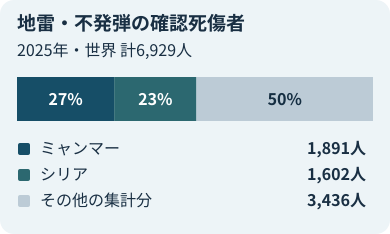
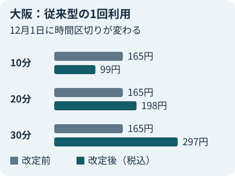

# アヤベ日報　2026年11月25日（水）

本紙 · 20記事 · 図解2点　情報確認 2026-11-25T07:44:12+09:00

## 今朝の読みどころ

- 日本、ICCの来年分を年内に全額拠出へ 制裁下で支払時期を変える意味
- 関文科相への問責案、参院野党が提出方針 減税審議に波及するのはなぜか
- 地雷・不発弾の死傷、5年で最多の6,929人 帰還先にも危険が残る

## 01　日本、ICCの来年分を年内に全額拠出へ 制裁下で支払時期を変える意味

高市早苗首相は24日、国際刑事裁判所（ICC）の赤根智子所長と官邸で会い、日本の2027年分の分担金を年内に全額支払う政府決定を伝えました。ICCは戦争犯罪などについて個人の刑事責任を問う裁判所です。国家間の争いを扱う国際司法裁判所とは別の組織です。

焦点は増額ではなく、来年分の資金をいつ使えるようにするかです。ロイターによると、日本は例年4月に拠出しています。米政権は8月に赤根所長ら、10月には裁判所自体を制裁の対象とする措置を発表し、金融取引への影響をICCが懸念しています。例年の拠出時期と制裁が本格的に影響し得る時期が重なるため、前倒しに意味があります。

日本の2026年分は約46億円で、AP通信によると裁判所の年間予算の約15％。赤根所長は職員の給与にも言及しました。現金が手元にあることは組織の運営を支えますが、前倒しが銀行の決済や他国の資金拠出を保証するわけではありません。2027年分の額はまだ別途決まる予定で、約46億円は今回の支払額ではありません。

米政府が問題視するのは、ICCの管轄を認めない国の当局者に捜査・訴追などが及び得ることです。一方、日本政府は裁判所が役割を果たせるよう支援する立場を表明。今回の措置は、米国への制裁解除要求ではなく、日本が自ら決められる送金時期を動かす対応です。次の確認点は年内の実際の支払いと、他の拠出国が同様の対応を取るかです。

出典：外務省：表敬の概要 ／ ロイター：分担金と制裁 ／ AP：赤根所長の説明

**出典**

- [外務省：表敬の概要](<https://www.mofa.go.jp/mofaj/ila/ila/pageit_000001_00003.html>)
- [ロイター：分担金と制裁](<https://www.gaitameonline.com/reuters/outdir/20261124nRTROPT20261124070647KCN3WZ0MB.html>)
- [AP：赤根所長の説明](<https://apnews.com/article/bbb7371ca6eb08710b5c2d50ee1cbb2c>)

## 02　関文科相への問責案、参院野党が提出方針 減税審議に波及するのはなぜか

24日の参院野党6党の会談で、関芳弘文部科学相への問責決議案を提出する方針がまとまりました。前号で伝えた協議予定から一歩進みましたが、提出方針、実際の提出、可決はそれぞれ別です。この時点で採決や辞任が決まったわけではありません。

争点は、自身の政治資金パーティーに官僚を招き、参加した企業関係者に説明させたことと、関氏の国会説明です。時事通信によると、関氏は政府職員を呼んだ会を2回と説明した後、さらに3回あったと明らかにしました。野党は説明の信用性も問うています。

問責は参院が大臣への政治的な意思を示す決議で、可決すれば自動的に失職する仕組みではありません。今回の波及経路は別にあります。野党側は辞任・更迭がなければ消費税減税などの法案審議に応じない構えで、少数与党の参院では協力を得られるかが採決日程に響きます。減税法案の内容を問責案で直接修正するわけではありません。

提出時期は立憲民主党の斎藤嘉隆参院国対委員長に一任されました。TBSは自民党幹部が官邸に更迭の意向はないと語ったと報じています。今後は、決議案の提出日だけでなく、審議を巡る与野党協議が進むか、関氏が国会で何を追加説明するかを分けて見る必要があります。

出典：時事通信：提出方針と野党の対応 ／ TBS：参院の協議と与党反応 ／ 参議院：本会議決議の効力

**出典**

- [時事通信：提出方針と野党の対応](<https://www.nippon.com/ja/articles/-/57882>)
- [TBS：参院の協議と与党反応](<https://newsdig.tbs.co.jp/articles/withbloomberg/3106123?display=1>)
- [参議院：本会議決議の効力](<https://www.sangiin.go.jp/japanese/aramashi/keyword/honkaigi.html>)

## 03　地雷・不発弾の死傷、5年で最多の6,929人 帰還先にも危険が残る

地雷禁止国際キャンペーンなどの24日公表の年次報告では、2025年に地雷や戦闘後に残った爆発物で、少なくとも6,929人が死傷しました。前年より10％多く、2020年以降で最多。ミャンマーが1,891人、シリアが1,602人で、2か国を合わせて確認分のほぼ半分を占めます。

ミャンマーでは戦闘が続くなかで被害が増えました。一方、シリアでは2024年末の政権崩壊後、それまで離れていた土地に人が戻り、2025年の死傷者は前年比で5割以上増えました。戦闘が弱まった地域でも、人が農地や家に戻れば、過去に残された危険に触れる機会が増えます。帰還者を数えるだけでは、安全な再定住が進んだかは分かりません。

身分が判明した死傷者の84％は民間人で、年齢が分かった民間人死傷者の半数は子どもでした。現地から集められた確認分であり、報告されない事例もあります。国ごとに情報の集まり方は異なるため、図は危険度の順位ではなく、報告で確認された人数の内訳です。

地雷汚染は被害の直接の原因になるだけでなく、農地や生活道路の利用、学校・診療所への移動、支援物資の配送を妨げます。停戦後の復旧には、住民への周知と被害者支援に加え、安全が確認された土地を順次使えるようにする作業が欠かせません。

割合は人数から四捨五入。集計で確認できた世界の死傷者数に占める比率。出典：Landmine Monitor 2026。 図：アヤベ日報。

出典：Landmine Monitor 2026：対象年と報告 ／ ICBL-CMC：集計の要点 ／ AP：ミャンマーとシリアの状況

**出典**

- [Landmine Monitor 2026：対象年と報告](<https://the-monitor.org/reports/landmine-monitor-2026>)
- [ICBL-CMC：集計の要点](<https://icblcmc.org/our-impact/landmine-monitor-2026-landmine-casualties-reach-five-year-high-as-new-use-spreads>)
- [AP：ミャンマーとシリアの状況](<https://apnews.com/article/372ca2debb4628f8672584c6c267cb7d>)

## 04　シェア自転車のNOLL始動 大阪で12月に変わる、10分と30分の値段

ドコモ・バイクシェアは24日、全国共通ブランド「NOLL」を始めました。各地で使われてきたサービス名は残しながら、アプリとサイトを全国で刷新。利用者はアプリを更新すれば、原則として既存アカウントと契約を引き継げます。新型車両と新料金の導入は同日からの広島が先で、大阪は12月1日の予定です。

大阪で従来型を都度利用する場合、いまは30分ごと165円、新料金は10分ごと99円（税込）。10分なら165円から99円に下がりますが、20分なら165円から198円、30分なら165円から297円に上がります。細かい区切りに変わると、最短利用の料金だけでは普段の負担は判断できません。

大阪の新型車両は通常10分120円、キャンペーンは同99円。新型はアプリで貸出・返却する仕様で、ICカードは従来型に限られます。電池容量の拡大、前輪サスペンション、フレームに固定した大型かごは新型の特徴です。大阪の月額基本料も2,200円から3,300円に変わるため、都度払いの比較図と混ぜて判断しないでください。

従来型の都度利用のみ。税込、10分単位の例。出典：ドコモ・バイクシェアの大阪向け料金表。 図：アヤベ日報。

出典：ドコモ・バイクシェア：導入日と車両 ／ ドコモ・バイクシェア：大阪エリアの税込料金

**出典**

- [ドコモ・バイクシェア：導入日と車両](<https://docomo-cycle.jp/news/information/2026-11-10/>)
- [ドコモ・バイクシェア：大阪エリアの税込料金](<https://www.d-bikeshare.com/assets/json/news_img/2026/20261110/noll_new_price_hiroshima_osaka.pdf>)

## 05　米消費者信頼感は103.3に 株価と家計の見方が同じ方向を向くとは限らない

米調査機関コンファレンス・ボードが24日公表した11月の消費者信頼感指数は103.3で、10月の改定値91.9から11.4ポイント上がりました。ロイターによると2025年1月以来の高水準です。この指数は家計の景気認識を測るもので、店の売上や実際の支出の集計ではありません。

APによると、就職機会への見方が改善しました。11月の中間選挙後、民主党支持層と無党派層の信頼感が上がる一方、共和党支持層は小幅に低下。全国平均一つでは見えない差です。さらに全米自動車協会によれば、ガソリンは24日平均1ガロン3.61ドルで、1か月前の4.30ドルより安いものの、前年同時期の3.07ドルは上回っていました。

選挙後の反応や燃料価格の低下は、家計が現状をどう感じているかを理解する助けになります。ただし、これらだけで改善幅の何割を説明できるかは分かりません。指数の改善が年末商戦の支出増につながったかは、小売売上などの実績で別に確かめる必要があります。

出典：AP：支持層別の違いと燃料価格 ／ コンファレンス・ボード：調査結果 ／ ロイター：11月指数と10月改定値

**出典**

- [AP：支持層別の違いと燃料価格](<https://apnews.com/article/9d13d96cc3e4bac8f334f9145c718e42>)
- [コンファレンス・ボード：調査結果](<https://www.conference-board.org/topics/consumer-confidence/>)
- [ロイター：11月指数と10月改定値](<https://www.marketscreener.com/news/us-consumer-confidence-surges-to-highest-level-in-nearly-two-years-ce7851dbda8af323>)

## 06　米AI株、一斉高の翌日に反落 同じ日にダウは上昇

米国24日の通常取引で、ナスダック総合は1.5％安の23,733.54、S&amp;P500は0.5％安の7,201.09、ダウ平均は0.9％高の50,018.70で終了しました。前日の急反発からAI関連株が売られ、APによればアンソロピック株は公開価格を下回りました。

同じ日に三つの数字が逆方向を向いたのは、指数の中身が違うためです。値動きは米株全体の一斉下落を意味しません。APの集計では、技術株以外も含めると上昇した銘柄が過半数でした。一方、先に取引を終えた東京市場は米国前日の上昇も受けて日経平均が大きく反発しました。東京の終値は、その後の米反落を織り込んだ数字ではありません。

出典：AP：主要指数の終値 ／ AP：AI銘柄と日米市場

**出典**

- [AP：主要指数の終値](<https://apnews.com/article/6cc4e580290aadf304ee316d6d46dd81>)
- [AP：AI銘柄と日米市場](<https://apnews.com/article/feec0e25b9994b1c86b16329cf770192>)

## 07　イエメン南部アデンを巡り緊張 英政府はフーシ派に追加制裁

イエメンの国際的に承認された政府が拠点とする南部の港湾都市アデンに、フーシ派が接近したとイエメン軍報道官が24日に説明しました。AP通信が伝えたもので、都市が陥落したとの確認ではありません。英国は同日、フーシ派の組織を新たに金融制裁の対象としました。

英国の措置は、すでにある国連の武器禁輸とは別に、英国の管轄での資産凍結などを加えるものです。イエメン国内の政治・人道の問題と、紅海の海上交通への影響が重なりますが、英国の指定によって戦闘が止まったことや航行の安全が回復したことは確認されていません。

出典：AP：アデンを巡る軍報道官の説明 ／ 英政府：制裁措置

**出典**

- [AP：アデンを巡る軍報道官の説明](<https://apnews.com/article/ba01cb036a849ba69873da5000ee08d5>)
- [英政府：制裁措置](<https://www.gov.uk/government/news/uk-steps-up-response-to-renewed-houthi-aggression>)

## 08　WHO、キューバでワクチンと医療機材支援 接種率の低下を食い止める

世界保健機関（WHO）のテドロス事務局長は24日、キューバ訪問にあわせてワクチンや医療機材への支援を発表しました。WHOは用途を柔軟に決められる200万ドルも拠出し、現地保健当局と子どもの予防接種を優先することで合意しました。

WHOによると、キューバの接種率は長く98％超でしたが2025年に95％に低下。WHOは今回の支援で新生児約6万2千人、子ども78万人超などへの接種を支えるとしています。これは対象者の見込みで、すでに接種を終えた人数ではありません。

同事務局長は訪問先の小児病院にも触れ、燃料や電力不足、医薬品・機材の確保の難しさを指摘しました。ワクチンが届くことと、医療施設で保管・接種を続けられることは別で、医療サービスの維持が支援のもう一つの焦点です。

出典：WHO：支援対象と接種率 ／ WHO：現地記者会見

**出典**

- [WHO：支援対象と接種率](<https://www.who.int/malaysia/news/detail-global/24-11-2026-who-director-general--announces-support-for-vaccines--medical-equipment-during-official-visit-to-cuba>)
- [WHO：現地記者会見](<https://www.who.int/news-room/speeches/item/who-director-general-s-remarks-at-press-conference---24-november-2026>)

## 09　警察官を名乗る電話、大阪の男性が1億円超の被害 本人が警察に相談

大阪府内の60代男性が2026年9月、警察官などを名乗る人物からの虚偽の連絡を受け、複数回の振り込みで計約1億200万円をだまし取られたと、カンテレとMBSが24日に報じました。24日は報道・公表の日で、被害が起きた月とは別です。

MBSによると、男性は繰り返し送金を求められたことを不審に思い、警察へ相談しました。自分の資金が捜査の対象だと電話で告げられても、その通話を切り、相手の示す番号ではなく、自分で調べた警察の番号にかけ直せます。

出典：カンテレ：被害の公表 ／ MBS：相談に至る経緯

**出典**

- [カンテレ：被害の公表](<https://www.ktv.jp/news/articles/?id=31172>)
- [MBS：相談に至る経緯](<https://newsdig.tbs.co.jp/articles/mbs/3107236?display=1>)

## 10　重要施設周辺の土地取得を許可制に 改正案が衆院通過

衆院本会議は24日、重要土地等調査法の改正案を可決しました。重要施設の周辺や国境にある無人島などのうち、指定する区域で土地や建物の所有権を移す際に国の許可を求める案です。審議が参院へ移る段階で、成立・施行されたわけではありません。

いまの制度が調査や利用への規制を軸とするのに対し、改正案は対象区域の取引の段階で国が確認する仕組みを加えます。外国政府や外国軍関係者などへの許可は原則出さない一方、区域内の許可制を「すべての外国人を対象にした全国一律の取得禁止」とは読めません。どこまで区域が指定されるか、どの取引に例外があるかは、条文とその後の運用を分けて見る必要があります。

出典：衆議院：法案の議案経過 ／ TBS：衆院本会議の可決と制度案

**出典**

- [衆議院：法案の議案経過](<https://www.shugiin.go.jp/internet/itdb_gian.nsf/html/gian/keika/1DE36CA.htm>)
- [TBS：衆院本会議の可決と制度案](<https://newsdig.tbs.co.jp/articles/withbloomberg/3107640?display=1>)

## 11　国内景気、個人消費に足踏み 企業調査ではサービスと製造業に差

内閣府の11月の月例経済報告は、個人消費を持ち直しが足踏みしていると評価しました。10月より弱い表現になった一方、生産の評価は引き上げました。

S&amp;Pグローバルの別の企業調査では、民間の活動を表す総合PMIが10月の52.1から11月は51.5に下がりました。50を超えているので前月からの活動拡大を示しますが、その勢いは弱まりました。製造業の生産の伸びが強まる一方、サービス業の活動の伸びは鈍化。同社は企業回答に半導体需要の強さが見られたとしています。

月例報告の個人消費と、PMIで企業が答えたサービス業の活動は同じ統計ではありません。この二つから読み取れるのは「景気が一律に悪化」という話ではなく、設備や製造業と、家計や一部サービスとでは、改善の速さが違うということです。

出典：内閣府：11月の月例経済報告 ／ S&amp;Pグローバル：11月の企業調査

**出典**

- [内閣府：11月の月例経済報告](<https://www5.cao.go.jp/keizai3/getsurei/2026/1124getsurei/main.pdf>)
- [S&amp;Pグローバル：11月の企業調査](<https://www.spglobal.com/market-intelligence/en/news-insights/research/2026/11/japans-growth-becomes-increasingly-uneven-as-business-confidence-weakens-and-price-pressures-remain-elevated>)

## 12　くら寿司、すし22品を値上げ、サイドなど34品は値下げ

堺市に本社を置くくら寿司は24日、27日から価格を改めると発表しました。熟成まぐろやサーモンなどすし22品は10〜30円の値上げ。一方でドリンクやデザート、サイドメニューなど34品は10〜70円下げます。

最低価格が110円の店舗では、グルメ Watchによると、熟成まぐろは120円から135円になります。値下げ品目の数が多いから店全体の会計が安くなるとは限らず、何を何皿頼むかで変わります。会社は原材料、人件費、エネルギー費の上昇を改定理由に挙げています。

出典：くら寿司：価格改定商品 ／ グルメ Watch：改定の内容

**出典**

- [くら寿司：価格改定商品](<https://www.kurasushi.co.jp/upload/261124release.pdf>)
- [グルメ Watch：改定の内容](<https://gourmet.watch.impress.co.jp/docs/news/2158682.html>)

## 13　和歌山・串本のカイロス4号機、1月22日を打ち上げ日に設定

スペースワンは24日、小型ロケット「カイロス」4号機を2027年1月22日に和歌山県串本町のスペースポート紀伊から打ち上げると発表しました。関西テレビによると時間帯は午後3時から3時20分で、翌23日から3月31日までを予備期間とします。

これは4回目の挑戦の発表で、打ち上げ実績ではありません。和歌山放送によると、串本町と那智勝浦町は当日の応援会を企画し、入場券や公式ツアーは12月11日午前10時から販売予定です。打ち上げの予備期間と、観覧案内の条件は別に確認しておく必要があります。

出典：和歌山放送：日程と地元の応援会 ／ 関西テレビ：打ち上げ時間帯と予備期間

**出典**

- [和歌山放送：日程と地元の応援会](<https://news.wbs.co.jp/222026>)
- [関西テレビ：打ち上げ時間帯と予備期間](<https://www.fnn.jp/articles/-/1158572>)

## 14　アリアン6、延期から一日で36機を軌道へ 最後の衛星分離まで2時間4分

欧州の大型ロケット「アリアン6」は24日、南米の仏領ギアナからアマゾンの衛星通信網「Amazon Leo」向けの通信衛星36機を打ち上げ、高度約460キロの低い地球周回軌道に投入しました。現地08時14分、日本時間20時14分の打ち上げです。前号では地上設備の不具合で延期された段階でした。

今回はアリアン6の10回目の飛行。アリアングループによると、発射から最後の衛星を分離するまで2時間4分かかりました。離昇の成功とすべての衛星の分離は同じ瞬間ではありません。また、今回の軌道投入と、地上の利用者が通信サービスを使えるようになる時期も別です。

出典：アリアングループ：飛行と衛星分離 ／ European Spaceflight：延期から打ち上げまで

**出典**

- [アリアングループ：飛行と衛星分離](<https://www.ariane.group/en/news/ariane-6-successfully-transports-another-36-amazon-leo-satellites-into-orbit-on-its-10th-flight/>)
- [European Spaceflight：延期から打ち上げまで](<https://europeanspaceflight.com/arianespace-completes-10th-ariane-6-flight-with-next-expected-on-17-december/>)

## 15　キヤノンが24年ぶりにArFドライ露光装置 狙いは微細化だけではない

キヤノンは24日、半導体の回路パターンを基板へ転写するArFドライ露光装置「FPA-6300AS6」を発表しました。同社がこの種類の新製品を市場に出すのは24年ぶりで、受注開始は12月上旬です。

ArFはフッ化アルゴンの略で、露光の光の波長は193ナノメートル。既存のKrF装置の共通基盤を引き継ぎながら、新しい投影レンズを採用しました。同社が挙げる用途はメモリーだけでなく、電力を制御するパワー半導体やセンサー、小径や薄い基板、裏側の模様に合わせる工程などです。

半導体の露光装置は、一番細かい回路だけで選ばれるわけではありません。製品によって基板の大きさ、厚さ、表裏の位置合わせが違います。今回の発表は最先端の微細化競争の決着ではなく、異なる工程に対応する選択肢を増やす動きです。

出典：キヤノン：製品と用途 ／ 関東経済産業局掲載のキヤノン資料：露光方式の位置づけ

**出典**

- [キヤノン：製品と用途](<https://global.canon/ja/news/2026/20261124-2.html>)
- [関東経済産業局掲載のキヤノン資料：露光方式の位置づけ](<https://www.kanto.meti.go.jp/seisaku/iot_robot/digital_industry/data/4_260206canon.pdf>)

## 16　ふぉ〜ゆ〜と吉本新喜劇、対立する銭湯を舞台に 大阪は4月8日から

ふぉ〜ゆ〜と吉本新喜劇の舞台「ふぉ〜ゆ〜シン喜劇2027」の公演詳細が24日に発表されました。大阪は2027年4月8〜11日、COOL JAPAN PARK OSAKA TTホールで全6公演の予定です。東京のIMM THEATERでは3月26日から4月4日まで上演します。

物語は老舗スーパー銭湯と近くに開業した新興の銭湯とのサービス合戦。老舗の創業50周年が迫るなか、二つの店の対立に恋模様が重なります。店の対立を、常連客との関係や新設備による集客の違いに重ねた設定です。主催者発表では各種チケット先行は12月24日から順次始まります。

出典：吉本興業：公演詳細と先行受付 ／ テレビ朝日：舞台設定と会場

**出典**

- [吉本興業：公演詳細と先行受付](<https://prtimes.jp/main/html/rd/p/000005512.000029501.html>)
- [テレビ朝日：舞台設定と会場](<https://news.tv-asahi.co.jp/news_geinou/articles/900205141.html>)

## 17　ファーウェイに米陪審が一部有罪評決 企業ぐるみの組織犯罪の訴因は無罪

米ニューヨークの連邦地裁の陪審は24日、中国の通信機器大手ファーウェイについて、営業秘密の窃取を共謀した罪や銀行詐欺などで有罪評決を出しました。APとInvesting.comによると、組織犯罪の共謀と司法妨害については無罪でした。

今回の評決は、政府の主張のすべてを陪審が認めたという意味ではありません。個別の訴因ごとに結論が分かれています。また、陪審が有罪と判断する段階と、裁判所が刑を言い渡す段階も別です。

出典：AP：陪審評決の内容 ／ Investing.com：有罪・無罪が分かれた訴因

**出典**

- [AP：陪審評決の内容](<https://apnews.com/article/b39ac780e2e31140015a1be02f0329ab>)
- [Investing.com：有罪・無罪が分かれた訴因](<https://uk.investing.com/news/stock-market-news/huawei-found-guilty-of-bank-fraud-and-money-laundering-in-us-5002468>)

## 18　OpenAI、開発者向けに医療文献の検索構成 診断の代行とは別

OpenAIは24日、開発者が外部アプリにAI機能を組み込むためのAPIに、医療向けのモデル構成を追加したと発表しました。ウェブ検索を有効にした場合に専用の医療情報の索引を使い、根拠となる資料を探して比較・要約し、出典を添えられる設計です。

一般のChatGPTが医師の代わりに診断するという告知ではありません。医療向け構成へのアクセスだけで患者情報を取り扱う資格が得られるわけでもなく、OpenAIは専門家の判断を置き換えないとしています。違いは、回答の断定を強めることではなく、どの資料から答えが出たかを、開発したアプリで追いやすくする点にあります。

出典：OpenAI：11月24日のモデル更新 ／ OpenAI：対象とデータ取り扱いの要件

**出典**

- [OpenAI：11月24日のモデル更新](<https://help.openai.com/en/articles/9624314-model-release-notes>)
- [OpenAI：対象とデータ取り扱いの要件](<https://help.openai.com/en/articles/20001656-healthcare-model-configurations-in-the-openai-api>)

## 19　「GetBackers」告知の生成AI利用で運営が謝罪 新作テレビアニメとは別

漫画「GetBackers-奪還屋-」のボイスコミックを巡り、運営が再開の告知映像の一部に生成AIを使ったことについて謝罪したと、複数の媒体が報じました。運営側の説明を報じた記事によると、告知が新作テレビアニメの発表のように受け取られたことを受け、YouTubeでのボイスコミック再開だと区別しています。

ITmediaの取材に対し、映像を制作したIMAKAIは、運営を通じて公開前に映像を作者へ送ったものの、生成AIを含む制作方法の説明と確認が不十分だったと答えました。告知映像の制作方法、配信する本編の種類、原作者側がどこまで知っていたかは同じ問いではありません。本紙では元のX投稿を直接読めなかったため、告知と本編の区別以外に、投稿全体や反応の規模は評価しません。

出典：ACGCH：声明の内容と原典への案内 ／ ITmedia：作者への説明を巡る報道 ／ 公式YouTube：再開の案内

**出典**

- [ACGCH：声明の内容と原典への案内](<https://acgch.com/en/news/getbackers-youtube-series-ai-teaser-apology>)
- [ITmedia：作者への説明を巡る報道](<https://www.itmedia.co.jp/aiplus/article/2611/24/2000003424/>)
- [公式YouTube：再開の案内](<https://www.youtube.com/channel/UCuOQx8E9IHioWbqrMeAZq-A>)

## 20　米国がカナダの戦闘機調達見直しを批判 カナダ国防相は自国で決めると反論

カナダのマギンティ国防相は24日、カナダの国防上の判断は自国で行うと述べました。米国防総省が米国製F35戦闘機88機の調達計画をカナダが見直していることなどを批判したのを受けた発言です。

米側は複数機種を混ぜる案が人員や北米の共同防衛に影響すると主張しています。論点は機体の性能にとどまらず、同盟内で装備を共通化する利点と、カナダが調達先を決める権限をどう両立させるかにあります。この応酬だけで、既存の契約が取り消されたとか、共同防衛が終わったとはいえません。

出典：AP：カナダ国防相の発言 ／ TIME：米国防総省の指摘

**出典**

- [AP：カナダ国防相の発言](<https://apnews.com/article/188a8ce7b731241befc9376fe7d13595>)
- [TIME：米国防総省の指摘](<https://time.com/article/2026/11/24/hegseth-pentagon-accuses-canada-failing-credible-defense-partner/>)
