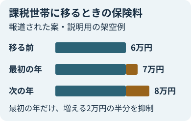
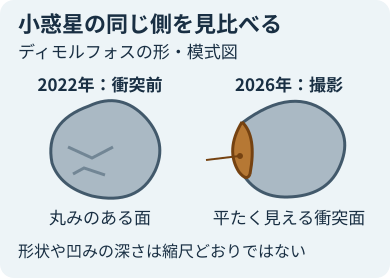
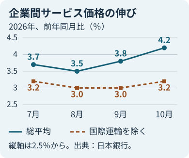

# アヤベ日報　2026年11月26日（木）

本紙 · 20記事 · 図解3点　情報確認 2026-11-26T07:38:41+09:00

## 今朝の読みどころ

- 米国が14の国・地域に新関税案 日本向け「最大15％」は何にかかるのか
- 介護保険料、「非課税から課税」で跳ねる分だけ1年間半減へ
- 小惑星ディモルフォスに、大きな衝突跡 4年越しにヘラが撮影

## 01　米国が14の国・地域に新関税案 日本向け「最大15％」は何にかかるのか

米通商代表部（USTR）が25日、製造業の過剰供給を理由に、日本・中国・EUなど14の国と地域について新たな関税措置を提案しました。日本向けは、一部を除いて最大15％との案です。事前報道の対象数は媒体間で異なりましたが、発表された決定は14経済圏。メキシコ・ノルウェーは、この日に同じ判断を出した対象には入りません。

ここでの15％は、現在の全税率に一律15ポイントを足すという意味ではありません。日本についてUSTRは、通常の最恵国税率と既存の通商法301条関税を控除して適用する案と説明しています。最恵国税率は通商上の通常税率のことです。品目による除外や別枠の232条関税、日米の取り決めも関係します。輸出企業にとって最初に確認すべきなのは、国別の数字より、米国税関で使う自社製品の分類と適用中の別の関税です。

調査の結論は出ましたが、今回の資料は措置案です。USTRは生産能力を増やす各国の政策が米国の商取引を圧迫すると判断しました。例えば日本について支援策や自動車、鉄鋼、半導体などの産業に言及しています。これは米当局の判断で、関係国が認めた事実として扱うものではありません。日本に関する告示案では2027年1月25日に公聴会を予定しています。発効日はここで決まったわけではありません。

直近の関税合意があれば何も変わらない、という見方も早計です。同じ上限の数字でも、どの品目を除き、どの既存税と調整するかで、会社ごとの請求額は変わります。今後は最終告示の品目表と発効日を見て、提案段階と実際の負担を切り分ける必要があります。

出典：USTR・14経済圏の発表 ／ USTR・対日案と公聴会日程 ／ 共同通信・日本を含む新関税案

**出典**

- [USTR・14経済圏の発表](<https://www.ustr.gov/about/policy-offices/press-office/press-releases/2026/november/ustr-makes-determinations-and-proposes-actions-14-section-301-investigations-relating-structural>)
- [USTR・対日案と公聴会日程](<https://ustr.gov/sites/default/files/files/Press/Releases/2026/Japan%20FRN%20Final.pdf>)
- [共同通信・日本を含む新関税案](<https://news.livedoor.com/article/detail/32901422/>)

## 02　介護保険料、「非課税から課税」で跳ねる分だけ1年間半減へ

厚生労働省が、住民税非課税世帯から課税世帯に移る65歳以上の人について、介護保険料の増額を1年間だけ緩める方針を固めたと、共同通信が26日未明に報じました。対象は保険料全体の半額ではなく、前年度と比べた増加分。実施は2028年度からの予定とされ、現時点で各家庭の保険料が変わるわけではありません。

65歳以上の介護保険料は、所得などに応じた段階で決まります。厚労省資料にある現行の標準段階では、世帯全員が住民税非課税か、本人は非課税だが世帯に課税者がいるか、本人が課税されるかで段階が分かれます。したがって、自分の年金だけを見ていても、同じ世帯の課税状況が変わると段階をまたぐ場合があります。

仕組みを架空の額で考えると、年6万円から8万円になる場合、初年度の増分2万円の半分を抑え、7万円。条件が同じなら翌年以降は8万円となる考え方です。年2万円の上昇を恒久的になくすのではなく、一度に負担する増分を抑える案です。図は説明用で、自治体の実額ではありません。

共同通信によると、所得が一定以上の人の段階を細かくし、一部の保険料を引き上げる方針もあります。ただし、対象世帯の範囲、自治体ごとの計算、軽減後の負担がどうなるかは別の論点です。公表資料にある段階見直しと、今回報じられた1年間の緩和措置を区別しました。

保険料全体ではなく、初年度の増える分だけを半減。共同通信の報道をもとにした架空例です。 図：アヤベ日報。

出典：共同通信・11月26日報道 ／ 厚労省資料・課税化と標準段階

**出典**

- [共同通信・11月26日報道](<https://kumanichi.com/articles/2061890>)
- [厚労省資料・課税化と標準段階](<https://www.mhlw.go.jp/content/12512000/001761908.pdf>)

## 03　小惑星ディモルフォスに、大きな衝突跡 4年越しにヘラが撮影

欧州宇宙機関（ESA）は25日、探査機ヘラが撮影した小惑星ディモルフォスの画像を公表しました。米航空宇宙局（NASA）の探査機DARTが2022年に意図的に衝突した側に、競技場ほどと形容される大きなくぼみがあり、丸かった面が平たく見えます。ディモルフォス自体は約150メートルの小天体です。

衝突前から、ディモルフォスはより大きな小惑星ディディモスの周りを回っていました。地上からの観測でこの一周の時間が約33分短くなったことは測れましたが、表面にどんな変化が起きたかまでは分かりませんでした。今回の画像は、一部が広く掘れた一方、それ以外には以前の岩場に似た地形が残っていると示しています。33分は太陽の周りを回る時間の変化ではありません。

ESAのチームはまた、小天体の回転が複雑になり、二つの天体の周りに多数の岩塊が見えると報告しました。最初に写った岩のすべてが衝突で生まれたと断定はできません。現場を立体的に測り、地形と運動を一緒に調べることで、地上から測った周期の変化をよりよく説明できるようになります。

地球に向かう小惑星に対し、探査機を当てる手段を検討するには、衝突すれば動くかだけでなく、相手の大きさや岩の詰まり方に応じてどの程度動くかを知る必要があります。DARTが実際に押し、ヘラが現場を測る、という二段構えに意味があります。

ESAとドイツ航空宇宙センターの説明に基づく模式図。実際の画像は下記の出典へ。 図：アヤベ日報。

出典：ESA・画像と研究チームの説明 ／ ドイツ航空宇宙センター・比較画像と測定 ／ 豪ABC・結果の報道

**出典**

- [ESA・画像と研究チームの説明](<https://www.esa.int/nl/articles/about-us/directorates/operations/space-safety/hera/hera-reveals-stadium-sized-asteroid-crater-left-after-spacecraft-impact>)
- [ドイツ航空宇宙センター・比較画像と測定](<https://www.dlr.de/en/latest/news/2026/asteroid-defence-hera-spacecraft-reaches-its-destination>)
- [豪ABC・結果の報道](<https://www.abc.net.au/news/2026-11-26/new-photos-of-struck-asteroid-dimorphos/107428078>)

## 04　大阪の特別区協定書案、きょう第16回協議会 どこまで決まる場か

大阪府・市の大都市制度協議会が26日に開かれ、特別区設置協定書の案を議題とします。大阪市が公表した予定では、会場は府庁本館の府議会第1委員会室で、YouTubeで生中継します。この記事の時点で会議の結論は出ていません。19日付のMBS報道では、この回で案を取りまとめる予定とされ、協議に不参加の会派から日程の進め方に批判が出ています。

協定書の役割は、単に区の境界と名前を示すことではありません。前の会議の議題を遡ると、事務を府と区でどう持つか、財源や債務の扱い、庁舎、区議会の定数など、生活に近いサービスをどこが決め、どこが払うかが論点になっています。同じサービスを残すという説明でも、所管・予算・窓口が変わるかで、住民への影響は違います。

協議会の取りまとめを設置決定と読み替えることはできません。協定書案の整理、議会による判断、住民が判断する段階は別です。そして、今回出る案と、将来実際に行われる事務の引継ぎも別です。行政サービスを見たい場合は、広域の事業だけでなく、区に移す事務と、それに割り当てる財源の対応を見ると判断材料が増えます。

19日号では協定書案そのものを扱いました。今日の新しい問いは、会議が案のどこを確定させるか、異論と修正がどの資料に残るかです。大阪市は第16回の資料を開催日に掲載する予定としており、その版で確認できます。

出典：大阪市・開催日程と各回の議題 ／ MBSニュース・前回協議会の取材

**出典**

- [大阪市・開催日程と各回の議題](<https://www.city.osaka.lg.jp/fukushutosuishin/page/0000679330.html>)
- [MBSニュース・前回協議会の取材](<https://news.livedoor.com/article/detail/32851392/>)

## 05　企業間サービス価格は4.2％高 国際運輸を除くと3.2％

日銀が25日に発表した10月の企業向けサービス価格指数は、前年同月比4.2％上がりました。9月は改定後3.8％です。一方、国際運輸を外すと10月は3.2％で、同じく9月の3.0％から上がりました。上昇は国際運輸だけに限りませんが、集計に含めるかどうかで見え方が変わります。

これは企業が取引するサービスの価格を測る指数で、スーパーや家計の支出を直接測る消費者物価指数とは計測対象が異なります。日銀がここで国際運輸と分類するのは外航貨物・タンカー、国際航空の旅客・貨物、国際郵便の5品目。海外向けの輸送条件が大きく動くと、国内で使うサービスの変化と切り分けた方が実態を読みやすくなります。

図では同じ期間、同じ前年同月比で総平均と国際運輸を除く参考系列を載せました。四つの月のうち10月で差が最も開きます。ただし10月の1.0ポイント差は、国際運輸を除いた別の集計との比較です。外航運賃だけの寄与が正確に1.0ポイントと決まるわけではありません。

企業のサービス仕入れが上がっても、その分をすぐ消費者向けの価格に転嫁できるとは限りません。価格改定時期や契約、競争環境が違うためです。今回読み取れるのは、取引価格の上昇が国際運輸を外しても続いたことと、全体の数字を使うと変化を大きく見積もる場面があることです。

総平均と日銀の参考系列を同じ軸で比較。7〜9月は10月速報資料の値、10月は速報です。 図：アヤベ日報。

出典：日本銀行・10月速報表 ／ 読売新聞・速報

**出典**

- [日本銀行・10月速報表](<https://www.boj.or.jp/statistics/pi/cspi_release/sppi2610.pdf>)
- [読売新聞・速報](<https://news.livedoor.com/article/detail/32893487/>)

## 06　EU首脳会議、7年予算とウクライナ支援を協議 同じ財布ではない

EUは26〜27日に特別首脳会議を開きます。欧州理事会の議題には2028〜34年の中期予算枠と、ウクライナの2027年以降の資金需要が並びます。競争力や防衛の予算を増やしたい国がある一方、農業や地域振興への支援をどう守るかも争点です。どの論点も、開催前の現時点では合意していません。

ウクライナ向けでは、欧州委員会が18日、2027年に最大450億ユーロを追加で支援する案を出しました。欧州理事会は、既存の2026・27年向け900億ユーロの融資を土台とする追加案として説明しています。450億は追加案の上限で、900億は二年を対象にする既存枠。どちらも2027年に実際に着金する額ではありません。

なぜ長期予算も同席するのでしょうか。通常のEU予算は、域内の産業や農業、地域政策など何年も続く支出の優先順位を決めます。一方、戦時の資金需要は支払いの時期が切迫し、域外の支援国との分担も必要です。長期予算にどれだけ余力を持たせるかと、来年の調達に誰が責任を持つかは結び付いていても、同じ議決や同じ数字ではありません。

会議の声明で見たいのは、①次の7年の配分案をどこまで詰めたか、②追加支援に実際に合意したか、③資金調達と支給時期を決めたか、の三点です。議題に載っただけで現金が用意されたことにはならず、支援枠が決まっても支払いには別の条件があり得ます。

出典：欧州理事会・特別会合の議題 ／ コスタ議長の招待状

**出典**

- [欧州理事会・特別会合の議題](<https://www.consilium.europa.eu/en/meetings/european-council/2026/11/26-27/>)
- [コスタ議長の招待状](<https://www.consilium.europa.eu/media/ysfdpeob/president-costa-s-invitation-letter-to-the-extraordinary-european-council-26-27-november.pdf>)

## 07　米消費物価は前年比3.8％ 食品・エネルギーを除いても3.3％

米商務省の経済分析局が25日に発表した10月の個人消費支出（PCE）物価指数は、前年比3.8％上昇しました。食品とエネルギーを除いた指数も3.3％上がりました。9月の総合は、今回の発表で確認できる系列では3.7％です。別の報道にある旧値ではなく、最新の同じ系列で比較しました。

PCEは、米国の家計などが購入する財やサービスを幅広く集計し、その価格を追う指標です。10月に名目の消費額は前月比0.3％増えましたが、価格の変化を差し引いた実質の消費とは違います。値札が上がれば、同じ量を買っても名目支出が増えるためです。

貯蓄率は可処分所得の4.1％でした。所得の発表には一時的な要因も含まれます。今月の物価と支出だけから、家計が今後も同じペースで買い続けるとは読めません。

出典：米経済分析局・10月の所得と消費 ／ 同局・PCE物価の時系列

**出典**

- [米経済分析局・10月の所得と消費](<https://bea.gov/sites/default/files/2026-11/pi1026.pdf>)
- [同局・PCE物価の時系列](<https://bea.gov/data/personal-consumption-expenditures-price-index>)

## 08　北朝鮮、再開したスイス拠点に閉鎖要求 外交官に48時間で退去命令

北朝鮮は25日、平壌のスイス外交拠点の閉鎖を求め、責任者に48時間以内に出国するよう通告しました。APによると、北朝鮮側は、ロシアの占領下にあるウクライナの地域から連れ出された子どもの移送に関わった疑いを巡り、スイスが北朝鮮の青少年施設に制裁を科したことへの反発だと説明しています。

スイス外務省の整理では、平壌の協力事務所は新型コロナの流行を受け2020年3月に閉まり、外交拠点として10月19日に再開しました。カシス外相は10月末に現地を訪れ、限られた外交環境で北朝鮮と直接話す意義を強調していました。今回の要求は、わずか約1カ月でその拠点の存続が揺らいだことを意味します。

出典：AP・閉鎖要求と制裁を巡る経緯 ／ スイス外務省・関係の年表

**出典**

- [AP・閉鎖要求と制裁を巡る経緯](<https://apnews.com/article/a39dbc92d195e69443ce66913a3dff7e>)
- [スイス外務省・関係の年表](<https://www.eda.admin.ch/en/relations-between-switzerland-and-the-democratic-peoples-republic-of-korea-key-dates>)

## 09　欧州製EVの優遇案、争点はメーカーの国籍より「どこで作ったか」

欧州連合（EU）が検討する欧州製電気自動車（EV）の優遇で、日本で製造した車両は修正案でも対象外と、共同通信が24日夜に報じました。25日にはEUの次期駐日大使が、日本に打撃を与える意図はないとの認識を示したと報じられています。優遇を巡る協議中の話であって、日本製EVの販売禁止や確定した追加関税とは違います。

日本メーカーでも欧州で組み立てる車と日本から輸出する車では、制度の影響が同じとは限りません。車両のどの工程や部品まで地域要件に含めるのか、欧州外のどの国に例外を設けるのかが実務上の焦点です。米国での輸入関税案とは別の政策で、税の上乗せと優遇を受ける条件は分けて読む必要があります。

出典：共同通信・優遇案 ／ テレビ朝日系・次期大使の発言

**出典**

- [共同通信・優遇案](<https://www.saitama-np.co.jp/index.php/articles/224745>)
- [テレビ朝日系・次期大使の発言](<https://www.nagoyatv.com/news/kokusai.html?id=000550611>)

## 10　米アナログ半導体大手が最高売上 伸びをAI向けだけでは説明できない

アナログ・デバイセズが24日に発表した2026会計年度の売上高は、前年度比38％増の152億ドルでした。10月31日までの第4四半期は43億7000万ドルで、前年同期からの増加をデータセンター向けと産業向けがけん引しました。

同社の経営陣は、AI基盤への投資がデータセンターや半導体の自動試験装置向けの需要を押し上げた一方、通期の増収の3分の2超はAIを主目的としない市場からだったと説明しています。通期の増収要因と、四半期の売上の内訳は同じものではありません。

アナログ半導体は、温度や電圧のような連続的な信号を測ったり、機器の電源を制御したりする部品です。データセンターは用途の一つであり、工場や計測機器の投資も需要を動かします。

出典：アナログ・デバイセズ決算

**出典**

- [アナログ・デバイセズ決算](<https://www.analog.com/en/newsroom/press-releases/2026/11-24-26-adi-reports-record-4th-qtr-and-fiscal-2026-financial-results.html>)

## 11　HPの通期売上高が9.5％増 関税還付込みの利益とは別に読む

米HPが24日発表した2026会計年度の売上高は605億ドルで、前年より9.5％増えました。為替の影響をそろえた比較では7.8％増です。会計基準に従った希薄化後1株利益は2.62ドルと前年の2.65ドルを下回りました。売上が伸びたという事実と、利益指標の方向は一致していません。

同社によれば、1株利益には関税の還付による0.26ドルの押し上げが含まれます。調整後の1株利益は3.33ドルと前年を上回りましたが、こちらにも同じ還付影響を含みます。営業の地力を見比べるとき、売上、還付を含む利益、会社独自の調整を同じ数字として扱わないのがポイントです。

出典：HP・通期決算の発表

**出典**

- [HP・通期決算の発表](<https://investor.hp.com/news-events/news/news-details/2026/HP-Inc--Reports-Fiscal-2026-Full-Year-and-Fourth-Quarter-Results-Announces-Dividend-Increase/default.aspx>)

## 12　OpenAI、数学の原稿9本を公開 計算に必要な手数の限界を探る

OpenAIは24日付の更新履歴で、二つの研究群から数学の原稿9本を公開したと報告しました。うち七つは、多次元の数の並びを扱うテンソルの理論と計算・組み合わせ問題への応用、残り二つは線形計画法を解く手順に関する研究です。一部の結果には、証明の論理をソフトウェアで検査できるLeanの形式化が添えられました。

例えば行列を掛け合わせる計算では、行列のサイズが大きくなるにつれ必要な手数がどの程度増えるかを問います。原稿の一つはその増え方を表す指数を扱いますが、理論上の上限に関する主張と、手元のGPUで実際にどれだけ速く計算できるかは別です。

形式化は記述された命題と証明を機械で照合する助けになります。公開元も全原稿の全結果ではなく選んだ結果を形式化したとしています。公表は、研究共同体による評価がすべて済んだという意味ではありません。

出典：OpenAI公開リポジトリ・11月24日の更新 ／ OpenAI・原稿の公開方針

**出典**

- [OpenAI公開リポジトリ・11月24日の更新](<https://github.com/openai/math/blob/main/history.md>)
- [OpenAI・原稿の公開方針](<https://openai.com/index/sharing-ai-progress-in-mathematics/>)

## 13　極小の素子で量子状態を揺らす 観測から「制御」へ進めた実験

Zatelli氏らは、超伝導体と量子ドットを使った二つの短い鎖を結び、量子情報を記録する状態を時間とともに規則的に変化させる実験を報告しました。11月25日付のNatureの掲載一覧にあり、先に公開された著者の原稿でも、二つずつのサイトからなる鎖を使ったと確認できます。

鎖の端には、条件がそろうとマヨラナ粒子に似たふるまいをする状態が現れます。実験は、それらしい特徴を電気的な測定で見分ける段階から、一組の状態をどのように操作できるかへ踏み込みました。短い鎖では雑音に対する保護が限られると著者らは説明しています。大規模で誤りに強い量子計算機を実現したという発表ではありません。

出典：研究チーム・公開原稿の概要 ／ Nature・掲載一覧

**出典**

- [研究チーム・公開原稿の概要](<https://arxiv.org/abs/2607.09511>)
- [Nature・掲載一覧](<https://www.nature.com/nature/research-articles/nature-index?year=2026>)

## 14　短い動画を止められない自分に名前 Simejiの調査で「ドパガキ」

日本語入力アプリSimejiの運営元は24日、利用者アンケートに基づく年間トレンド大賞に「ドパガキ」を選びました。ショート動画を次々見る、長い動画を倍速で流すといった自分の習慣を、少し自虐的に言い表す言葉です。別の部門では、歌謡グループのモナキと、押すと形が戻る玩具のメロジョイが選ばれました。

今回の有効回答は11,443件。調査期間は10月15日から11月8日でした。これは入力アプリを通じた回答で、若者全体の代表調査でも、XやTikTokの投稿件数ランキングでもありません。世代全員の視聴時間を示すものではなく、動画の見方を友人同士で語る短い言葉が目立った、という読み方ができます。

出典：バイドゥ・結果と調査方法 ／ Simeji・各部門の結果

**出典**

- [バイドゥ・結果と調査方法](<https://prtimes.jp/main/html/rd/p/000000996.000006410.html>)
- [Simeji・各部門の結果](<https://simeji.me/blog/news/trend-awards-2026>)

## 15　豪議会、ネット事業者に被害の予防義務 投稿を消すだけでは足りない

オーストラリア議会が25日、オンラインサービスの安全対策を強める法案を可決したと米誌TIMEなどが報じました。利用者からの苦情に個別対応するだけでなく、事業者がリスクを見つけ、被害を起こしにくいサービスにする注意義務を設けるものです。

豪議会の審査資料によれば、既存の基本的安全基準や業界ごとの仕組みを、一つの強制力ある義務へまとめる考え方です。TIMEによると、違反に対する制裁の上限は世界売上高の5％に達し得ます。上限が実際に一律で適用されるわけではありません。どんな設計変更が必要で、過剰な削除をどう防ぐかは規制当局の具体的な運用が重要になります。

出典：TIME・可決と最終修正 ／ 豪議会・審査報告 ／ 豪eSafety・規制当局の見解

**出典**

- [TIME・可決と最終修正](<https://time.com/article/2026/11/25/australia-digital-duty-of-care-big-tech-fines-social-media-platforms-risks-harms-safety/>)
- [豪議会・審査報告](<https://otd.aph.gov.au/public-api/api/documents/19045/files/34519>)
- [豪eSafety・規制当局の見解](<https://www.esafety.gov.au/sites/default/files/2026-11/eSafety_submission_Digital_Duty_of_Care_Bill_Senate_Committee_Inquiry.pdf>)

## 16　米GDP、7〜9月期は年率4.3％増 投資・消費・政府支出が押し上げ

米経済分析局が25日公表した改定推計では、7〜9月期の実質国内総生産（GDP）が前期比年率4.3％増えました。前の4〜6月期は2.2％増。7〜9月期は投資、個人消費、政府支出が押し上げ、輸出減が一部を相殺しました。

年率は、その四半期の伸びが一年続くと仮定した表示で、前年同じ月から4.3％増えたという発表ではありません。また、同じ日に出たPCE物価は10月の価格を測った別統計です。景気の伸びと家計が感じる物価は同じ日付の発表でも切り分けて読む必要があります。

出典：米経済分析局・第2次推計 ／ 共同通信・GDP改定値

**出典**

- [米経済分析局・第2次推計](<https://www.bea.gov/data/gdp/gross-domestic-product>)
- [共同通信・GDP改定値](<https://kumanichi.com/articles/2061876>)

## 17　ドクターヘリの委託先選び 人員を持続的に確保できるかを確認へ

ドクターヘリの運航が一部地域で休止した問題を受け、厚生労働省が運航事業者を選ぶ際に人員確保を確認する方向だと、共同通信が25日に報じました。ドクターヘリは患者を運ぶだけでなく、医師らが早く現場に着いて治療を始めるために利用します。

厚労省の検討資料は、運航事業者が確保しにくい地域や、近隣のドクターヘリ・消防防災ヘリと連携する対応を記載しています。機体を一つ用意するだけでは、継続運航には足りません。整備や操縦に必要な人材を継続して置けるか、休止時にどこが代わるかが運航の実効性を左右します。個別の地域で運航再開が決まったというニュースではありません。

出典：共同通信・25日の報道 ／ 厚労省・救急搬送の検討資料

**出典**

- [共同通信・25日の報道](<https://kumanichi.com/articles/2061712>)
- [厚労省・救急搬送の検討資料](<https://www.mhlw.go.jp/content/10808000/001754410.pdf>)

## 18　NYダウは取引序盤の急落から反転 終値は164ドル高

25日のニューヨーク株式市場で、ダウ工業株30種平均は前日比164.25ドル高の5万182.95ドルで引け、3営業日続伸しました。共同通信は日本時間の前夜、取引中に下げ幅が一時1000ドルを超えたとも伝えていました。二つの報道は、取引中と終値という時点が違います。

同日には米国の物価統計や新たな関税案も出ていますが、ダウの値動き全体を一つのニュースだけで説明することはできません。終値の上昇は、日中の変動が小さかったという意味でもありません。

出典：共同通信・終値 ／ 共同通信・取引中の速報一覧

**出典**

- [共同通信・終値](<https://kumanichi.com/articles/2061941>)
- [共同通信・取引中の速報一覧](<https://kumanichi.com/news/zenkoku?page=170>)

## 19　ブルテオンの北海道戦、日曜は大阪からも同じ一球を見る

大阪ブルテオンは29日のヴォレアス北海道とのアウェー戦に合わせ、うめきたのTime Out Market Osakaで試合のライブビューイングを開きます。クラブ発表では11時30分開場、12時30分からプレマッチトーク、試合開始は13時05分です。ゲストに福澤達哉さんを迎えます。

普段は現地に行く人と自宅で見る人に分かれるアウェー戦を、解説や試合前のトークと一緒に大阪で見る試みです。会場は試合そのものの開催地ではありません。開催告知は5日のもので、今週末の観戦情報として掲載しました。

出典：大阪ブルテオン・29日のイベント詳細

**出典**

- [大阪ブルテオン・29日のイベント詳細](<https://www.osaka-bluteon.com/news/2026/20261105_02.html>)

## 20　ルクア大阪のM-1展、勝敗だけでなく舞台袖の感情を見せる

漫才の大会M-1グランプリを題材とする「M-1感情爆発展」が、梅田のルクア9階で開かれています。期間は11月21日から12月6日。おなじみの決勝の言葉をボタンで聴かせる展示に加え、予選から漫才師を追った舞台裏の写真と言葉を並べる展示があります。

テレビ本編では、数分間のネタと審査の結果が中心です。展覧会はその前後にある緊張や悔しさに焦点を移します。会場発表によると本番や撮影の都合で実物が会場にない日もあるため、トロフィーなどの展示は常時見られるとは限りません。

出典：M-1感情爆発展・公式サイト ／ 会場運営会社・大阪会場の案内

**出典**

- [M-1感情爆発展・公式サイト](<https://exhibition.m-1gp.com/>)
- [会場運営会社・大阪会場の案内](<https://prtimes.jp/main/html/rd/p/000000256.000014414.html>)
