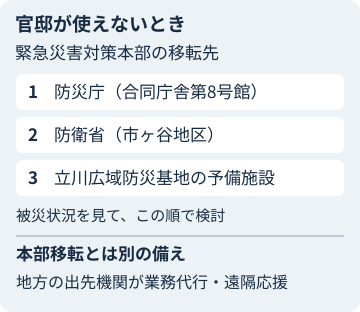
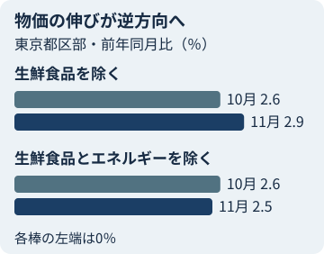
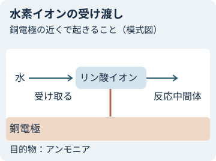

# アヤベ日報　2026年11月28日（土）

本紙 · 20記事 · 図解3点　情報確認 2026-11-28T07:43:42.018+09:00

## 今朝の読みどころ

- 首都が止まったら、誰が仕事を引き取るのか。国が地震への備えを改定
- 東京の物価は2.9％高、エネルギーを除くと鈍化。電気・ガスが分けた11月
- 文科相問責、120対124で否決。決着したのは決議案の採否

## 01　首都が止まったら、誰が仕事を引き取るのか。国が地震への備えを改定

政府は27日、首都直下地震に備えた政府業務継続計画を約12年ぶりに改定した。建物が壊れないようにするだけでなく、中央省庁の仕事を地方の出先機関が代行したり、遠隔から応援したりする考えを盛り込んだ。非常時に誰が何の仕事を引き取るかが、今回の読みどころだ。

官邸が使えないときには、防災庁、防衛省の市ヶ谷地区、立川広域防災基地の予備施設の順に、被災状況を見ながら緊急災害対策本部の移転先を決める。これは本部の話で、各省庁が一緒の建物へ移る計画ではない。本部が立川へ移る事態に備えて、各府省は基地とその周辺でそれぞれの拠点をあらかじめ選び、職員の移動や執務開始の手順を詰める。

庁舎が無事でも、電気や通信が止まれば仕事は続かない。計画は二系統での電力引き込みや、燃料油を使わない電源の確保を挙げる。一方、地方からの代行は仕事を別の人に渡す備えだ。拠点を移す備えと、仕事を引き渡す備えの両方があって初めて、職員の参集が遅れる日にも動ける。

東京都は立川で新たな防災拠点を整備中だと説明しつつ、東京圏外への代替を計画に盛り込む表現には懸念を示した。前号で取り上げた大阪の制度案とは決定主体が異なり、今回の閣議決定で大阪が政府の代替拠点に指定されたわけではない。次に見たいのは、各省庁が代行する業務を具体化し、職員と通信が限られる訓練で引き継げるかだ。

防災庁の改定概要から作図。各省庁の執務先は、本部の移転先とは別に選ぶ。

出典：防災庁 ／ 東京都 ／ 防災庁・計画一覧

**出典**

- [防災庁](<https://www.bousai.go.jp/jishin/syuto/pdf/syuto_taisaku_gaiyou_20261127.pdf>)
- [東京都](<https://www.metro.tokyo.lg.jp/ja/information/press/2026/11/2026112708>)
- [防災庁・計画一覧](<https://www.bousai.go.jp/taisaku/chuogyoumukeizoku/index.html>)

## 02　東京の物価は2.9％高、エネルギーを除くと鈍化。電気・ガスが分けた11月

総務省が27日に公表した東京都区部の11月中旬速報では、生鮮食品を除く指数が前年同月より2.9％上がった。10月の2.6％から加速したが、そこからエネルギーも除くと2.6％から2.5％に鈍った。どちらも前年との比較で、物価全体が下落したという意味ではない。

第一生命経済研究所は、生鮮食品を除く指数への電気・ガス代の押し上げが0.10ポイントから0.44ポイントへ広がったと試算した。拡大幅の約0.34ポイントは、丸められた指数の上昇率の差0.3ポイントに近い。夏の料金支援が指数に反映されなくなったことに、以前の燃料高の反映が重なったという見方だ。

食卓でも平均と個別の値動きは違う。同研究所の整理では、米類の値下がり幅が広がった一方、調理食品の上昇率は3.8％から4.8％へ拡大した。生鮮食品を除く食料全体も3.0％から3.1％に上がった。ある買い物が安くなった体感と、かご全体が高いという体感は同時に起こり得る。

数字は東京都区部の速報で、全国の11月分とは別だ。先行する東京の数字は変化を探す手掛かりになるが、住む地域や電気の契約、買う品目が異なる家庭の支出をそのまま表すものではない。

総務省統計局・第一生命経済研究所資料から作図。10月と11月の前年比で、棒はすべて0％を起点とする。

出典：総務省統計局 ／ 第一生命経済研究所

**出典**

- [総務省統計局](<https://www.stat.go.jp/data/cpi/sokuhou/tsuki/pdf/kubu.pdf>)
- [第一生命経済研究所](<https://www.dlri.co.jp/files/macro/678634.pdf>)

## 03　文科相問責、120対124で否決。決着したのは決議案の採否

関芳弘文部科学相への問責決議案は27日、参議院本会議で賛成120、反対124で否決された。前号では野党7党と1会派の共同提出を伝えた。今回は実際の採決で、反対が4票上回った。

問責は議院として大臣の責任を問う決議だ。今回はその意思表示が成立しなかったことになる。共同通信によれば、与党側は法案審議を進める考えを示す一方、野党側は政治資金パーティーを巡る説明を引き続き求める姿勢だ。投票結果から、会合を巡る事実関係がすべて確定したとは言えない。

次は審議が通常の日程に戻るかと、関氏が会合に関する説明をどこまで具体化するかを分けて追う。採決に勝った側が、その後の議題でも同じ多数を維持するとは限らない。

出典：FNN ／ 共同通信

**出典**

- [FNN](<https://www.fnn.jp/articles/-/1160419>)
- [共同通信](<https://www.kumanichi.com/articles/2062497>)

## 04　EU、7年予算に合意できず。ウクライナ融資も持ち越し

EUの特別首脳会議は、2028〜34年の長期予算の規模で合意できなかった。27日未明にコスタ欧州理事会議長が協議結果を説明し、AP通信はウクライナ向けの融資も持ち越しになったと報じた。26日号で伝えた二つの議題に、交渉の結果が出た。

長期予算は、各国がどの程度お金を出し、どこに回すかを何年分もまとめて決める。APによると、議長が示した案に対し、負担をさらに減らすことを求める国も、支出の削減を戻すよう求める国もあった。総額の折り合いがつかなければ、個別の使途を決める計算も動かない。

一方、ウクライナ側が資金を必要とするのは翌2027年だ。APによれば、この融資が次期予算交渉に絡んで止まった。議題は同じ会議でも、資金が必要になる時計は違う。持ち越しを、既に決まった他の支援の取り消しや、支援方針そのものの白紙化と同一視はできない。

次に確かめるのは、新しい予算案が国ごとの対立を縮めたかと、2027年の融資に予算全体の決着を待たずに動かせる案が示されるかだ。首脳による支援の表明とは別に、融資の条件と日程がそろったかを見る。

出典：欧州理事会・会見 ／ AP通信

**出典**

- [欧州理事会・会見](<https://www.consilium.europa.eu/en/press/press-releases/2026/11/27/remarks-by-president-antonio-costa-at-the-press-conference-following-the-special-european-council-meeting-of-26-november-2026/>)
- [AP通信](<https://apnews.com/article/europe-budget-ukraine-2028-summit-costa-fd025046850b824b2e62def18408c6b6>)

## 05　食料を運ぶ側にも物価高。国連が示した支援の「届く人数」

国連食糧農業機関と世界食糧計画は27日、2026年12月から翌年5月までの食料危機の見通しを説明した。紛争地では世帯が買う食料が高くなるだけでなく、支援団体が同じ量の食料を運ぶのにも余計な費用がかかる。

報告書が挙げる商船の運航の混乱は、運賃や保険料を上げ、燃料や肥料の調達にも波及する。南スーダンの首都ジュバでは2月から8月に軽油価格が2倍を超えた。スーダンでは国内の戦闘も重なり、主食に使われるソルガムの価格が1年で倍を超えたという。隣り合う国でも、比べている品目と期間が違う。

WFPは、この経済的な圧力が来年半ばまで続いた場合、2027年の追加費用が少なくとも7億5,000万ドルになると試算した。支援を目標とする9,100万人のうち、700万人を超える人に届かなくなるおそれがある。これは既に配給が止まった人数の集計ではなく、費用高が続いた場合の見通しだ。

一律に同じ対策を取ればよいわけでもない。FAOは東アフリカの一部では降雨が水や牧草を回復させうる一方、洪水が作物や物流を損なう危険も指摘する。食料を買う力、農家が次に収穫する力、支援が地域に届く力のどこが弱っているかで、必要な備えは変わる。

出典：国連会見記録 ／ FAO・WFP報告書 ／ AP通信

**出典**

- [国連会見記録](<https://transcripts.un.org/en/briefing/geneva/2026-11-27>)
- [FAO・WFP報告書](<https://executiveboard.wfp.org/document_download/WFP-0000177390>)
- [AP通信](<https://apnews.com/article/un-hunger-famine-food-war-sudan-yemen-819ca5f619621b6f3b7ca8ba66b65762>)

## 06　次の宇宙飛行士を募集へ。月に行く人が今すぐ決まるわけではない

文部科学省は27日、日本人宇宙飛行士候補者の新たな募集を予告した。JAXAの現時点の想定では、2027年4月ごろに募集要項の発表と説明会、6月ごろに募集開始。採用は若干名で、日程や細かな要件は確定前だ。

なぜ2030年代の活動に向けて今から採るのか。候補者になったあとに訓練があり、任務への起用はさらにその先だからだ。JAXAは、地球に近い軌道での国際宇宙ステーションでの経験を引き継ぎながら、月面探査にまで活躍の場を広げる世代を育てようとしている。

資料集に載る訓練の例には、地上と軌道上のシステムを理解する科目、船外活動、無重量体感、国際協力のもとで活動するための学習がある。資格の数を競うだけの募集でも、選ばれた人から順に搭乗する名簿でもない。先に人を育てておくこと自体が宇宙計画の準備になる。

この段階で特定の月面任務が約束されたわけではない。応募を考える側にとって次に意味があるのは年齢や経験などの正式要件、読者にとっては地球低軌道と月面でどんな訓練が共通し、何が新たに必要になるかだ。

出典：JAXA ／ 文部科学省 ／ JAXA資料集

**出典**

- [JAXA](<https://www.jaxa.jp/press/2026/11/20261127-1_j.html>)
- [文部科学省](<https://www.mext.go.jp/content/20261127-mxt_uchukai01-000053562_1.pdf>)
- [JAXA資料集](<https://www.jaxa.jp/press/2026/11/files/20261127-1_requirement01.pdf>)

## 07　同じ銅でも反応は約10倍速く。電極の表面でリン酸が担った役割

大阪大学などは27日、水質汚染の原因になりうる硝酸イオンを、肥料などの原料になるアンモニアへ変える反応を調べた結果を発表した。論文は米国の化学誌に23日付で掲載された。注目したのは触媒である銅そのものより、銅の表面を取り巻く液体だ。

反応が進むと、液体全体が中性でも銅の表面付近は強いアルカリ性になりうる。そこで研究班は表面近くのpHと反応を進める電気的な条件をそろえて比較した。中性のリン酸緩衝液では、強アルカリ性水溶液に比べて硝酸イオンの反応速度が約10倍、目的のアンモニアに向かう選択率が2倍以上になった。

理由を探るため、反応中の表面を赤外線で調べる測定や理論計算を組み合わせた。銅に付いたリン酸イオンが、水から水素イオンを受け取り、途中でできる物質へ手渡すと研究班は説明する。水素イオンが反応に必要な場所へ届けば、同じ銅でも反応の進み方が変わる。

この倍率は実験条件をそろえた比較だ。工場での製造量や電力コストが同じ倍率で改善するという結論ではない。実際の排水に混じる他の成分の影響や、表面の働きを長時間維持できるかは別に確かめる必要がある。

大阪大学・JSTの発表から作図。化学構造や実際の距離・縮尺を示すものではない。

出典：大阪大学・JSTの共同発表

**出典**

- [大阪大学・JSTの共同発表](<https://www.jst.go.jp/pr/announce/20261127-2/index.html>)

## 08　台湾の実質GDP、7〜9月14.39％増。輸出の伸びと設備投資が重なる

台湾の行政院主計総処が27日に公表した7〜9月の実質GDPは、前年同期比14.39％増だった。先行推計から0.03ポイント上がった。2026年通年の13.28％、2027年の6.51％はそれぞれ現時点の予測で、四半期の実績推計とは性格が違う。

需要側をみると、財とサービスの実質輸出は21.65％増、輸入も21.10％増。機械設備や知的財産などの投資と在庫変動を合わせた実質の総資本形成は26.74％増えた。輸出が伸びれば国内でつくった付加価値も必ず同じだけ伸びるわけではない。輸入の増加や、設備への国内投資も同時に見る必要がある。

生産側では、半導体やコンピューター、電子・光学製品の生産拡大を背景に、製造業が21.39％増えた。民間消費も5.50％増えたが、伸びは製造業より小さい。AI関連の需要が目立つ一方、消費や輸出の各率を足してGDPの成長率にすることはできない。

2027年の成長率予測は前年より低いものの、経済の規模が縮む予測ではない。高くなった比較基準の上で残る伸びを、次の統計で設備投資と消費に分けて追いたい。

出典：台湾行政院主計総処 ／ 台湾中央社

**出典**

- [台湾行政院主計総処](<https://eng.dgbas.gov.tw/News_Content.aspx?n=4438&s=236907>)
- [台湾中央社](<https://focustaiwan.tw/business/202611270017>)

## 09　政治資金報告、ネット広告の支払先が表に出る。届いた相手は分からない

総務省が27日に公表した2025年分の政治資金収支報告書のうち、総務相が所管する分について、時事通信は政治団体全体の収入を約1,048億円、前年比11.8％増と報じた。集計には政党のほか政治家の資金管理団体なども含まれる。

読売新聞が28日に報じた内訳では、参政党は25年4月から7月20日の参院選投開票までに、グーグルへの広告費として1億円超を支出した。一方、広告会社に払っていれば、その帳簿の支払先は広告会社になる。直接の支払先だけを横に並べると、広告会社を通じたネット広告を見落とす。

収支報告書は誰にいくら払ったかを調べる入口だ。表示先、動画を最後まで見た人数、広告が投票に与えた影響までは、その金額からは分からない。

出典：読売新聞 ／ 時事通信

**出典**

- [読売新聞](<https://news.livedoor.com/article/detail/32922161/>)
- [時事通信](<https://forincs.com/headlines.php?src=2026112700702.xml>)

## 10　福岡市長選、異議申し出受理。再選挙の日程決定は後ろへ

15日の福岡市長選で当選人がいなかったことは市の公報で確認できる。27日には有権者2人の異議申し出が受理され、再選挙の日程の決定に影響する見通しとなった。KBCによれば、市選管は申し出の内容を精査する。

申し出では、告示前の一部候補者の活動や、ビラの配布を巡る疑義が挙げられた。受理されたことは、その主張が認められたことを意味しない。一方、テレビ西日本は前回立候補した吉富景子氏と井上潔氏が再選挙に出ない意向を表明したと伝えた。日程と顔触れが、ともに前回のままではない。

出典：福岡市公報 ／ KBC ／ テレビ西日本

**出典**

- [福岡市公報](<https://www.city.fukuoka.lg.jp/soki/hosei/shisei/documents/7285-1.pdf>)
- [KBC](<https://kbc.co.jp/news/article.php?id=18606942&ymd=2026-11-27>)
- [テレビ西日本](<https://www.fnn.jp/articles/-/1160612>)

## 11　神崎武法氏が死去。非自民政権と、自自公政権の両方に関わった政治家

公明党元代表の神崎武法氏が25日に83歳で死去した。報道によると党が発表したのは27日。検事を経て1983年の衆院選で初当選し、当選は9回。93年の細川内閣では郵政相を務めた。

99年に神崎氏が代表として選んだのは、自民党・自由党との連立だった。始まりは自公の2党だけではなく、自由党も加わった自自公。その後、参加政党が変わりながら自公の枠が続く。非自民連立にいた政治家が、数年後に長期の自公協力の土台を築いた経緯に、90年代の連立再編の速さが表れている。

出典：テレビ朝日 ／ 時事通信

**出典**

- [テレビ朝日](<https://news.tv-asahi.co.jp/news_politics/articles/000551006.html>)
- [時事通信](<https://www.nippon.com/ja/articles/-/58105>)

## 12　日仏経済人に日本が協力要請。話題はEUの産業加速化法案

高市首相は27日、日仏クラブの関係者と約20分会談した。両国の経済人を中心につくる日仏クラブは、25〜26日に名古屋で第35回総会を開催。両議長がその発表資料を手渡した。

外務省によると、首相はEUの産業加速化法案に対する日本政府の立場を説明し、産業界に協力を求めた。EUの制度をめぐる日本の働きかけの相手が、政府だけでなく現地と取引する企業側にも及んでいる。企業間の対話を通じて論点を伝える場であり、フランス政府との合意や、EU法案の扱いの決定ではない。

出典：外務省

**出典**

- [外務省](<https://www.mofa.go.jp/mofaj/erp/erp_1/fr/pageit_000001_03360.html>)

## 13　中国の工業利益、10月20.1％増。電子と公益部門に開き

中国国家統計局の27日の発表によると、一定規模以上の工業企業の利益は10月に前年同月比20.1％増えた。1〜10月累計では16.0％増。月単位の伸び率と年初からの合計の伸び率は別だ。

中国政府網が掲載した新華社の報道では、1〜10月に電子部門の利益が前年同期の2倍となる一方、電気・熱・ガス・水の生産・供給は14.8％減った。工業利益の合計が伸びていても、同じ方向へ動いた業種ばかりではない。調査対象は一定規模以上の企業で、今回の利益統計だけで小規模企業や家計の景況感までは判断できない。

出典：中国政府網掲載の新華社記事 ／ 中国国家統計局

**出典**

- [中国政府網掲載の新華社記事](<https://english.www.gov.cn/archive/statistics/202611/27/content_WS6b0970e3c6d00ca5f9a0ea3a.html>)
- [中国国家統計局](<https://www.stats.gov.cn/sj/zxfb/202611/t20261127_1965949.html>)

## 14　米株は短縮取引で上昇。ナスダック、週初からの値動きは平坦でない

感謝祭で26日が休場だった米株式市場は27日、短縮取引で主要指数が上昇した。APによるとS&amp;P500は1.6％、ナスダック総合は2.3％高で引けた。ロイターが取引中に報じた日経平均の2.1％高とは、指数も取引時間も異なる。

週間ではS&amp;P500が5.6％上昇したが、週の半ばには値が大きく振れた。さらにロイターは取引中の時点で、世界株の月間成績はなおマイナスだと伝えた。金曜日の終値、週間の動き、月末に至る途中経過を分ければ、反発だけから相場全体の方向を決めつけずに済む。

出典：AP通信・終値 ／ ロイター・取引中の動き

**出典**

- [AP通信・終値](<https://apnews.com/article/wall-street-stocks-dow-nasdaq-04dab6079cf7f3dfe7285a3cc1f240a2>)
- [ロイター・取引中の動き](<https://www.lse.co.uk/news/global-markets-global-markets-rally-as-end-of-bruising-month-approaches-djxsa5671cs9w9y.html>)

## 15　中之島の冬、中央公会堂の初回上映にUSJとコブクロ

大阪市などは27日、12月11日の中央公会堂のプロジェクションマッピング初回上映に、コブクロとユニバーサル・スタジオ・ジャパンの出演者を迎えると発表した。公会堂東側正面で17時30分から18時15分まで。上映のほか、トークとコブクロのライブが予定されている。

前方の無料椅子席の事前募集は12月6日23時59分までで、椅子席以外は中之島公園で自由に観覧できる。11日だけの催しと、25日まで夜に繰り返す映像は別だ。建物へのUSJ連携映像は開催期間中17時30分〜21時30分に12分ごと、約2分の上映を予定する。

出典：大阪市

**出典**

- [大阪市](<https://www.city.osaka.lg.jp/hodoshiryo/keizaisenryaku/0000691298.html>)

## 16　大阪ブルテオンU15は準優勝。トップの試合とは別に育成の全国舞台

大阪ブルテオンは27日、21〜22日に群馬県太田市で開かれたSVリーグU15選手権の決勝大会への出場を報告した。バレーボールキングによると、男子はウルフドッグス名古屋U15が決勝で大阪ブルテオンU15を下し、大阪は準優勝だった。

今年は男子25、女子29チームからそれぞれ4チームが決勝大会に進んだ。SVリーグではユース保有がクラブライセンスの条件になり、大会は理事会の承認を得た所属外のU15チームにも門戸を開いている。トップの勝敗とは別に、地域の育成チームが全国の相手と試合をできる仕組みとして見ると、大会の位置づけが分かる。

出典：大阪ブルテオン ／ SVリーグ ／ バレーボールキング

**出典**

- [大阪ブルテオン](<https://www.osaka-bluteon.com/news/2026/20261127_02.html>)
- [SVリーグ](<https://www.svleague.jp/news/detail/24100/>)
- [バレーボールキング](<https://volleyballking.jp/article/97793/>)

## 17　紀平・西山組、NHK杯で62.71点。シングルとは違う採点で競う

東京で始まったフィギュアスケートのNHK杯で27日、紀平梨花・西山真瑚組がアイスダンスのリズムダンスに出場し、日テレNEWSによると自己ベストの62.71点を記録した。紀平にとってアイスダンスでのグランプリシリーズ初出場だ。

同じフィギュアでも、アイスダンスは男女がリズムダンスとフリーダンスを滑る。シングル時代の紀平の得点と比べて競技力の上下を測る数字ではない。国際スケート連盟は競技別に演技の順位と審判の採点資料を公開しており、短い演技の結果と最終順位は分けて追える。

出典：国際スケート連盟 ／ 日テレNEWS

**出典**

- [国際スケート連盟](<https://www.isuresults.com/results/season2627/gpjpn2026/>)
- [日テレNEWS](<https://news.livedoor.com/article/detail/32915685/>)

## 18　海外プラグに45WのUSB充電器。ただし電圧を変える機器ではない

城下工業は27日、USB充電器一体の海外専用マルチアダプター「Globalite 45W」を発売した。メーカー発表では厚さ26mm。旅先のコンセント形状に合わせる部品とUSB充電器を一体にした製品で、薄さだけでなく荷物の点数を減らす狙いがある。

コンセント側の変換は差し込み口の形を変えるためのものだ。外部機器をアダプターのAC口に挿す場合、機器側が現地の電圧に対応しているかは別に確かめる必要がある。45WはUSB-Cを1口だけ使ったときの最大出力で、USBを複数使うと合計最大15Wになる。参考価格は税込3,980円で、日本国内では使用できない。短時間の充電性能や、機器ごとの相性は実測していない。

出典：城下工業の発表 ／ テクノエッジ

**出典**

- [城下工業の発表](<https://prtimes.jp/main/html/rd/p/000000001.000195049.html>)
- [テクノエッジ](<https://www.techno-edge.net/article/2026/11/27/5839.html>)

## 19　フジテレビが来夏に『27時間テレビ』を復活へ。企画はこれから

フジテレビの清水賢治社長は27日の定例会見で、2027年夏に『FNS27時間テレビ』を放送する意向を明らかにした。日刊スポーツとオリコンニュースが報じ、復活の発言はYahoo\! JAPANのトレンド欄にも掲載された。番組は25年と26年には放送されず、27年に実現すれば3年ぶりとなる。

系列局と盛り上げると説明した一方、具体的な企画は明らかにしていない。夏の長時間番組が戻るというニュースと、誰が出て何をするかは、別の発表を待つことになる。

出典：オリコンニュース ／ 日刊スポーツ ／ Yahoo\!トレンド

**出典**

- [オリコンニュース](<https://news.livedoor.com/article/detail/32917524/>)
- [日刊スポーツ](<https://smart.asahi.com/v/article/CMBfettp02611278496.php>)
- [Yahoo\!トレンド](<https://trend.yahoo.co.jp/archives/1589>)

## 20　大阪で始まった『2Cheat7』が東京へ。楽屋の面白さを舞台に移す

俳優の山内圭哉と福田転球の舞台『2Cheat7』は、20〜22日の大阪公演に続いて、27日から東京公演の日程に入った。FANY Magazineが取材した大阪の通し稽古では、ほぼ台本なしで2人が90分ふざける構成だった。

企画は、舞台の外で見せる福田の面白さを、山内が客席の前にも持ち込もうとしたことから始まったという。決まったオチに向かう漫才とは違い、片方が始めたことをもう片方がどこまで引き受けるかという間合いに見どころがある。ここで紹介した舞台の内容は大阪の取材に基づき、東京初日の演目を確認したものではない。

出典：FANY Magazine・大阪公演取材

**出典**

- [FANY Magazine・大阪公演取材](<https://magazine.fany.lol/297404/>)
